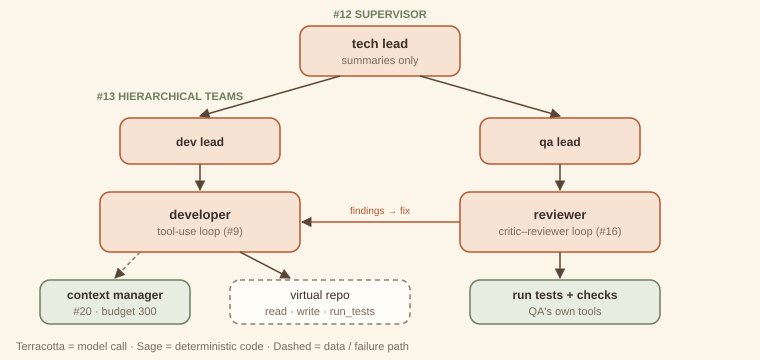

# Capstone 3 — Multi-agent coding team

> **Composes:** [Supervisor (#12)](../part-3-multi-agent/12-supervisor.md) · [Hierarchical teams (#13)](../part-3-multi-agent/13-hierarchical-teams.md) · [Critic–reviewer loop (#16)](../part-3-multi-agent/16-critic-reviewer.md) · [Tool-use loop (#9)](../part-2-single-agent/09-tool-use-loop.md) · [Context management (#20)](../part-4-cross-cutting/20-context-management.md)
> **Code:** `code/capstones/coding_team/` · **Run:** `python3 code/capstones/coding_team/main.py`

Coding is where multi-agent systems are most tempting and most often over-built. This capstone uses the minimum structure that still earns its keep: a lead that never reads code, a developer that only touches files through tools, a reviewer that only trusts tests it ran itself, and a context budget that every developer prompt must fit. Every claim in the acceptance block is a measurement.

## 1. The brief (written first)

The full brief is in `code/capstones/coding_team/brief.md`. The request is *"Add a `--json` flag that prints the report as JSON. Text output must not change."*

| ID | Requirement | Pattern |
|---|---|---|
| R1 | A tech lead coordinates turn by turn and decides when the work is done. | Supervisor |
| R2 | Dev and QA teams with their own leads; the tech lead sees summaries, never file contents. | Hierarchical teams |
| R3 | The developer changes code only through validated tools. | Tool-use loop |
| R4 | QA reviews with its own tools, files itemised findings, and blocks on blocking findings. | Critic–reviewer loop |
| R5 | Every developer prompt fits a token budget via compaction and progressive disclosure. | Context management |

**Acceptance criteria:** all tests pass, including new ones · the original tests pass unmodified · QA approval with zero open blocking findings · every developer prompt ≤ 300 tokens with at least one compaction · no file contents in any tech-lead prompt.

## 2. Architecture



`team.py` builds three supervisors from the same class: the tech lead, the dev lead and the QA lead. The dev team's only worker is the developer, a `ToolLoop` whose `render` is a `ContextManager`. The QA team's only worker runs `review_loop`, whose *author* callback asks the developer to address the findings. That is the one deliberate cross-team link, and it is narrow: findings in, a summary out.

The repository is a dictionary of files, but `run_tests` really executes them: it loads `cli.py` as a module and runs every `test_*` function. "Tests pass" is therefore something the code checked, not something a mock said.

## 3. Example first: the run

<!-- expected-output: code/capstones/coding_team/main.py -->
```text
Coding-team capstone
====================
[tech_lead → dev_team] Implement: Add a --json flag that prints the report as JSON. Text output must not change.
[dev_lead → developer] Implement: Add a --json flag that prints the report as JSON. Text output must not change.
[call 1] read_file({"path": "cli.py"})
[result 1] "USAGE = \"usage: report [--verbose]\"\n\ndef build_report(rows):\n    return {\"total\": sum(r[\"amount\"] f…
[call 2] write_file({"path": "cli.py", "content": "USAGE = \"usage: report [--verbose]\"\n\nimport json\n\ndef build_r…
[result 2] {"written": "cli.py", "lines": 15}
[call 3] run_tests({})
[result 3] {"passed": 2, "failed": []}
[final] Implemented --json in cli.py; existing tests pass.
[developer] Implemented --json in cli.py; existing tests pass.
[dev_lead] FINISH: Implemented --json in cli.py; existing tests pass.
[dev_team] Implemented --json in cli.py; existing tests pass.
[tech_lead → qa_team] Review the --json change and get blocking findings fixed
[qa_lead → reviewer] Review the --json change against: Add a --json flag that prints the report as JSON. Text output must not chan…
[review 1] F1[blocking] no test covers --json output; F2[nit] USAGE text does not list --json
[call 1] write_file({"path": "test_cli_json.py", "content": "import json\nfrom cli import main\n\ndef test_json():\n…
[result 1] {"written": "test_cli_json.py", "lines": 6}
[call 2] read_file({"path": "cli.py"})
[result 2] "USAGE = \"usage: report [--verbose]\"\n\nimport json\n\ndef build_report(rows):\n    return {\"total\": sum(…
[call 3] write_file({"path": "cli.py", "content": "USAGE = \"usage: report [--verbose] [--json]\"\n\nimport json\n\nde…
[result 3] {"written": "cli.py", "lines": 15}
[call 4] run_tests({})
[result 4] {"passed": 3, "failed": []}
[final] Added test_cli_json.py; USAGE now lists --json; all tests pass.
[author F1] fixed: Added test_cli_json.py; USAGE now lists --json; all tests pass. → noted
[author F2] fixed: Added test_cli_json.py; USAGE now lists --json; all tests pass. → noted
[review 2] no findings
[reviewer] approved=True after 2 review round(s); open blocking findings=none
[qa_lead] FINISH: approved=True after 2 review round(s); open blocking findings=none
[qa_team] approved=True after 2 review round(s); open blocking findings=none
[tech_lead] FINISH: Implemented --json in cli.py; existing tests pass. | approved=True after 2 review round(s); open bloc…
-- acceptance
tech lead: finished; files now: ['cli.py', 'test_cli.py', 'test_cli_json.py']
[PASS] all tests pass: passed=3 failed=0
[PASS] text output unchanged: original test_cli.py passes unmodified
[PASS] QA approval: approved=True, rounds=2
[PASS] developer context: 9 prompts, largest 270 tokens (budget 300), compactions=5
[PASS] tech-lead scoping: 3 tech-lead prompts, file contents leaked into 0
model calls: developer=9, summarizer=5, qa=2, tech-lead=3, dev-lead=2, qa-lead=2
```

Read it top to bottom:

1. **Tech lead → dev team.** The developer reads `cli.py`, writes a version with a `--json` branch, runs the existing tests (2 pass), and reports. The dev lead passes the summary up. The tech lead never sees the code.
2. **Tech lead → QA team.** The reviewer runs the tests and two repository checks. Tests pass, but *no test covers `--json`* (blocking) and the usage text does not mention the flag (nit).
3. **Review loop.** The author callback sends both findings to the developer. It writes `test_cli_json.py`, re-reads `cli.py`, updates `USAGE`, and runs the tests: 3 pass. Round 2 of review finds nothing, and QA approves.
4. **Acceptance.** Everything is measured: tests 3/3, the original test file passes unmodified, 9 developer prompts with the largest at 270 tokens (budget 300) and 5 compactions, and the tech lead's 3 prompts contain no file contents.

## 4. Why first: the design decisions

**The reviewer's blocking finding is about a missing test, not a failing one.** All tests passed after step 1, and a tests-as-a-gate design would have shipped an untested feature. The reviewer's judgement on top of the evidence (*nothing exercises the new flag*) is the reason this is a critic–reviewer loop rather than a guardrail.

**One cross-team call, by design.** In a strict hierarchy, QA would report to the tech lead, who would re-delegate to dev: two extra lead calls per review round. Letting QA's review loop call the developer directly (through `_author`) is a pragmatic shortcut. It is narrow (findings in, summary out) and it keeps the tech lead's context small. The trade-off is documented here, rather than hidden in the code.

**Context management sits in the developer, where context grows.** The developer's transcript accumulates file contents and tool results. Leads only ever see short summaries, so they do not need a budget. Five compactions over two developer runs kept every prompt under 300 tokens, and the summarizer's job is narrow: record which files were read and written and what the test results were. That is exactly what the developer needs in order not to repeat itself.

**Every acceptance check reads a different source.** Test results come from executing the repository. Context size comes from the `ContextReport` log. Scoping comes from the tech-lead model's recorded prompts. No check trusts an agent's own summary.

## 5. Cost and latency

From the run: 9 developer calls, 5 summarizer calls (small model), 2 QA calls, and 3 + 2 + 2 lead calls. Coordination (7 lead calls out of 23) is about 30% of model calls here, which is typical for small tasks and is exactly why the [hierarchical-teams](../part-3-multi-agent/13-hierarchical-teams.md) chapter warns against structure you do not need. For a one-line change, a single developer loop with a test gate would be cheaper. The team structure pays off as tasks grow: bigger diffs, more files, independent review.

## 6. Extending it

1. Add a security reviewer to the QA team (a second worker for the QA lead) that files a blocking finding when `eval(` appears in any file.
2. Lower the budget to 200 tokens. Which section of the developer's prompt breaks first? Fix it with progressive disclosure of file contents (read files in chunks).
3. Replace the hand-written acceptance block with the [eval harness (#21)](../part-4-cross-cutting/21-eval-harness.md) over three different feature requests.
