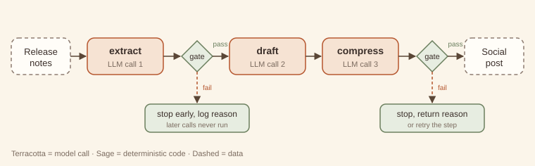

# 1. Prompt chaining

> **Intent.** Split a task into a fixed sequence of model calls, each consuming the previous call's output, with cheap code gates between steps that stop the chain as soon as something goes wrong.

**Also known as:** pipeline, sequential prompting, multi-step prompting · **Part:** 1 — Workflow · **Code:** `code/patterns/prompt_chaining/`

## Structure



Release notes pass through three model calls (*extract → draft → compress*). Code gates (sage diamonds) sit after the steps whose output can be checked mechanically. A failing gate ends the run with a reason, and the later calls never happen.

## Design concept & theory

**Core idea.** One hard prompt becomes several easy ones. Each step has a single job, its own instructions, and an output you can inspect. The sequence is fixed when you write the code. The model never chooses what runs next.

**Why it works: difficulty and detection.** Two effects combine.

1. *Each step is easier.* A model asked to "read these notes, pick the user-facing changes, write a warm announcement and keep it under 200 characters" juggles four constraints at once. Split up, each call juggles one. Per-step accuracy rises because each prompt is narrower and its examples can be more specific.
2. *Failures become visible.* Errors compound along a chain. If each of *n* steps succeeds with probability *p*, the whole chain succeeds with probability *pⁿ*. That looks like an argument *against* chaining (0.95³ ≈ 0.86), but the comparison is with the single call doing all the work, not with one step. Suppose the monolithic prompt succeeds 80% of the time and each focused step 97%: the chain wins, 0.97³ ≈ 0.91. More importantly, gates convert some of the remaining failures from *silent and shipped* into *detected and stopped*. A chain without gates has all the cost of decomposition and only half the benefit.

**Invariants.** (1) The step order is fixed at design time. (2) Each step sees only what the previous step produced, plus its own instructions. (3) Gates are deterministic code, not model calls. If a model decides the next step, you have an agent (Part 2). If the steps are agents that pass ownership of a conversation to each other, you have [sequential handoffs (#14)](../part-3-multi-agent/14-sequential-handoffs.md).

**Lineage.** *Pipes and Filters* (POSA, 1996) and the *Pipeline* in Enterprise Integration Patterns: independent filters connected by pipes, each filter replaceable on its own. The gates play the part of a *Message Filter*.

## When to use / when not to use

| Use it when | Don't use it when |
|---|---|
| The task splits cleanly into ordered stages (extract → transform → format). | One well-written prompt already meets the quality bar. |
| Intermediate outputs can be checked mechanically (has a version number, is valid JSON, under N chars). | The next step depends on *what you find* (go to [ReAct (#6)](../part-2-single-agent/06-react.md) or [plan-and-execute (#7)](../part-2-single-agent/07-plan-and-execute.md)). |
| Different stages benefit from different prompts, models or temperatures. | Stages are independent of each other (go to [parallelization (#3)](03-parallelization.md)). |
| You need an audit trail of how the output was produced. | Latency budgets cannot absorb several sequential round trips. |

**Cheaper alternative:** a single well-structured prompt with explicit numbered sub-steps, sometimes called "chain inside one prompt." Upgrade to a real chain when you need to *inspect, gate, or swap* an intermediate result, or when the single prompt's error rate plateaus however you reword it.

## Forces & trade-offs

| Force | vs. a single prompt | Why |
|---|---|---|
| Latency | ↑ worse | Calls are sequential: total ≈ sum of step latencies. |
| Cost | ≈ to ↑ | More calls, but each prompt is shorter, and early exits skip later steps entirely. |
| Reliability | ↑ better | Narrower steps are more accurate, and gates catch bad intermediates before they spread. |
| Complexity | ↑ slightly | More prompts to version, but each is simple and unit-testable. |

## Trade-off analysis & usage guidance

**Cost and latency model.** For *n* steps with per-step latency *tᵢ* and cost *cᵢ*, and gate pass rate *gᵢ* after step *i*:

- Latency, happy path: *T = Σ tᵢ* (gates add microseconds).
- Expected cost: *E[C] = c₁ + g₁·c₂ + g₁g₂·c₃ + …*. Early gates are worth the most, because every later step is multiplied by their pass rate. In the companion run, the internal-only release stops at gate 1 and costs one call instead of three.

**Decision checklist.**

1. Can you name each stage's output in a noun phrase ("the facts list", "the draft")? If not, the split is wrong.
2. Can at least one intermediate be checked by code? If none can, a chain buys little over one prompt.
3. Is the order fixed for *every* input? If it varies, you need routing or an agent.
4. Does the latency budget allow *n* sequential calls?
5. Would you want to swap one stage's model or prompt independently? Chains make that a one-line change.

**Usage in production.**

- Log every intermediate with the run ID. It is the main debugging benefit of the pattern.
- Put the strictest, cheapest gate as early as possible.
- Use a cheaper or faster model for mechanical stages (extraction, formatting) and spend on the creative stage.
- Version prompts per step. A regression is then traceable to one step's change.
- Alert on gate failure *rate* per step. A sudden rise means an upstream prompt, model or data change.

## Worked example

### Example first: what happens

The companion code turns raw release notes into a social post. It runs the same three-step chain twice: once on notes with real user-facing changes, and once on an internal-only release.

```
python3 code/patterns/prompt_chaining/main.py
```

<!-- expected-output: code/patterns/prompt_chaining/main.py -->
```text
Prompt chaining
===============
-- run 1: release with user-facing changes
[extract] v2.4 | - Dark mode across all screens | - CSV export for reports | - 40% faster search
[gate:extract] pass
[draft] Big news: version 2.4 is here! You asked, we listened: dark mode now covers every screen, you can export any report to CSV, and search is 40% faster. Update today and enjoy.
[compress] v2.4 is live: dark mode everywhere, CSV export for reports, and 40% faster search. Update now!
[gate:compress] pass
result: ok=True (94 chars)
-- run 2: internal-only release
[extract] NO_USER_FACING_CHANGES
[gate:extract] STOP — nothing user-facing to announce
result: ok=False stopped_at=extract
calls: run1=3, run2=1
```

Run 1 goes straight through. The `extract` gate checks that the first line is a version and that there are at least two bullets. The `compress` gate checks the 200-character limit. Run 2's extraction honestly reports `NO_USER_FACING_CHANGES`, and the gate stops the chain there, so `draft` and `compress` never run. The last line shows the saving: one call instead of three.

The whole architecture is a list:

```python
STEPS = [
    Step("extract", "Extract the USER-FACING changes ... {input}", gate=facts_gate),
    Step("draft",   "Write a friendly customer announcement from these facts:\n\n{input}"),
    Step("compress","Rewrite as one social post of at most 200 characters:\n\n{input}",
         gate=length_gate),
]
```

and the runner (`chain.py`) is about twenty lines: call, record, gate, continue or stop.

### Why first: why it is built this way

- **Steps are data, not code paths.** A `Step` is a name, a template and an optional gate. Adding, removing or reordering stages does not touch the runner. The exercise adds a whole new check with one line.
- **The extractor is allowed to say "nothing here".** Giving the first step an explicit escape value (`NO_USER_FACING_CHANGES`) is what makes the cheap early exit possible. Without it, the model invents changes to satisfy the prompt, which is a classic chaining failure.
- **Gates return reasons, not booleans.** `ChainResult.reason` says *why* the chain stopped. That reason is what you log, alert on, or show to the user.
- **The draft has no gate.** Not every step needs one. "Is this announcement friendly?" is a judgement, not a check. If it mattered enough to verify, that would be a job for an [evaluator–optimizer (#5)](05-evaluator-optimizer.md) step, not a regex.

## Failure modes & guardrails

| Failure mode | Symptom | Guardrail |
|---|---|---|
| Error propagation | A wrong fact in step 1 is fluently restated by every later step. | Gate the earliest step hardest; give it an explicit "none/unknown" escape. |
| Instruction drift | Late steps lose constraints stated only in step 1 (tone, audience). | Repeat key constraints in every step's prompt, or pass them as a shared header. |
| Format mismatch | Step *k* outputs prose when step *k+1* expects a list. | Schema-check the handoff (a gate), or use [guardrailed generation (#11)](../part-2-single-agent/11-guardrailed-generation.md) for that step. |
| Over-chaining | Ten steps where three would do; latency balloons. | Merge adjacent steps that share inputs and have no gate between them. |
| Hidden loss | A summarising step drops a detail a later step needed. | Pass the original input alongside the intermediate when later steps need it. |

## Variations

- **Gated chain with retry.** On gate failure, re-run *that step* once with the gate's reason appended before giving up. This is a tiny, local form of [guardrailed generation (#11)](../part-2-single-agent/11-guardrailed-generation.md).
- **Branch-free conditional steps.** A step can be skipped by code (`if lang != "en": translate`). The order is still fixed. A step that might be skipped is not routing.
- **Mixed-model chain.** Small model for extraction, large model for drafting, small model for formatting. This is often the largest single cost lever.
- **Chain inside a single prompt.** The cheaper alternative: numbered sub-steps in one call. No gates, but one round trip.

## Try it

The draft step sometimes leaks internal ticket IDs (such as `JIRA-412`) into customer-facing copy. Add a gate after `draft` that stops the chain when that happens, *without adding any model calls*, and show it firing on a leaky draft. How many calls does the stopped run cost?

→ Solution: [Solutions — Prompt chaining](../solutions/01-prompt-chaining.md)

## 60-second interview lens

- **Say:** "A prompt chain is a fixed pipeline of model calls with code checks between them. I use it when a task has distinct stages and at least one intermediate result I can verify mechanically."
- **Trade-off to name:** latency is the sum of the steps, so it buys accuracy and debuggability with wall-clock time; early gates make expected cost *lower* than it looks.
- **Expect the follow-up:** "Doesn't error compound across steps?" Answer: yes, *pⁿ*, but each step's *p* is higher than the monolithic prompt's, and gates turn silent failures into detected ones.
- **Red flag to avoid:** calling a chain "an agent". The model never chooses the next step.

## Related patterns

- [Sequential handoffs (#14)](../part-3-multi-agent/14-sequential-handoffs.md): the steps are autonomous agents passing ownership, chosen at runtime, not fixed calls.
- [Routing (#2)](02-routing.md): often the *first* step of a chain, choosing which chain runs.
- [Guardrailed generation (#11)](../part-2-single-agent/11-guardrailed-generation.md): a chain step whose gate is allowed to request a repair.
- [Evaluator–optimizer (#5)](05-evaluator-optimizer.md): when a step's quality needs judgement, not a check.
