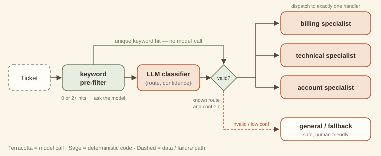

# 2. Routing

> **Intent.** Classify an input once and dispatch it to exactly one specialised handler, so that each handler can be simple, cheap and good at one kind of input.

**Also known as:** classifier dispatch, intent routing, model routing · **Part:** 1 — Workflow · **Code:** `code/patterns/routing/`

## Structure



A ticket first meets a free keyword pre-filter (code). A unique hit goes straight to validation and costs no model call. Otherwise a small LLM classifier returns `{route, confidence}`. Code validates that answer: the route must be known and the confidence at least the threshold τ. Anything invalid goes down the dashed path to a safe fallback. Exactly one handler runs.

## Design concept & theory

**Core idea.** Inputs differ in kind. One prompt written for all of them is mediocre at each. Specialised prompts (or models) are good at one kind and cheap to improve in isolation. A router sits in front and sends each input to its specialist.

**Why it works: specialisation and the cost of mistakes.**

- *Specialisation.* A billing handler's prompt can include refund policy, plan names and billing examples, and none of that pollutes the technical handler. Each prompt shrinks and its examples become relevant, which is usually worth more than any amount of "you are an expert in everything" prompting.
- *A router is a classifier, so think in confusion matrices.* Overall quality ≈ Σ P(route = r) · P(correct handler output | correctly routed) minus the damage from misroutes. Misroutes are not equally costly. Sending a billing question to the general fallback is mildly annoying; sending a security incident to the "marketing" handler is not. That asymmetry is why the fallback should be the *safest* handler, not the most common one.
- *Cascades cut cost.* The keyword pre-filter is a cheap first classifier that answers only when it is sure (exactly one hit). The LLM classifier sees only the ambiguous remainder. This is the same idea as a cascade of models: expected classification cost = (1 − *k*) · *c_cls*, where *k* is the share of inputs the free stage resolves.

**Invariants.** (1) Exactly one handler runs per input. (2) The classification decision is made once, then the router exits. (3) Every possible classifier answer (garbage, unknown label, low confidence) maps to a defined route.

**Lineage.** *Content-Based Router* (Enterprise Integration Patterns): inspect the message, forward it to one channel. The handler table resembles *Strategy*, with the strategy selected per request.

## When to use / when not to use

| Use it when | Don't use it when |
|---|---|
| Inputs fall into distinct categories that need different instructions, tools or models. | All inputs need roughly the same treatment. |
| Some categories are cheap (FAQ) and others expensive (complex reasoning): route to match model size to difficulty. | Categories overlap so heavily that a classifier cannot separate them reliably. |
| You want to improve one category without regression-testing the others. | The handling must change *during* the conversation based on results. That calls for a [supervisor (#12)](../part-3-multi-agent/12-supervisor.md), which re-decides each turn. |
| A misroute has a safe default you can fall back on. | There is no safe fallback and a misroute is costly (add [human-in-the-loop (#17)](../part-3-multi-agent/17-human-in-the-loop.md) first). |

**Cheaper alternative:** one general prompt with conditional instructions ("if the question is about billing, …"), or keyword or regex routing alone. Upgrade when the general prompt's instructions start contradicting each other, or keyword rules start colliding (as "crashes on *login*" does in the example).

## Forces & trade-offs

| Force | vs. one general prompt | Why |
|---|---|---|
| Latency | ↑ slightly | One extra classification call for ambiguous inputs only; zero for keyword hits. |
| Cost | ↓ often better | Cheap inputs go to cheap handlers; the classifier is a small model with short output. |
| Reliability | ↑ better per route, with a new failure: misroutes | Specialised prompts are more accurate; a confusion matrix now matters. |
| Complexity | ↑ | *N* handlers to maintain, a classifier to evaluate, and a fallback to design. |

## Trade-off analysis & usage guidance

**Cost model.** With keyword resolution rate *k*, classifier cost *c_cls* and handler cost *c_r* for route *r*:

*E[C] = (1 − k)·c_cls + Σ_r P(r)·c_r*

In the companion run *k* = 2/5, so the classifier ran on 3 of the 5 tickets. Routing pays off when the gap between the cheapest and the most expensive handler is large. Sending 60% of traffic to a model one-tenth the price easily covers a small classifier.

**Choosing τ.** The confidence threshold trades misroutes against fallback volume. Plot both on your eval set as τ varies and pick the knee. Re-check whenever the classifier model changes, because self-reported confidence is not calibrated across models.

**Decision checklist.**

1. Can you name the routes, and does each have a meaningfully different handler?
2. Do you have labelled examples per route to evaluate the classifier? (See the [eval harness (#21)](../part-4-cross-cutting/21-eval-harness.md).)
3. Is there a safe fallback?
4. Can a cheap rule resolve a meaningful share of inputs?
5. Will the route set be stable for months? If routes change weekly, a single prompt may be easier.

**Usage in production.**

- Log `(route, method, confidence)` for every input. The method mix (keyword / llm / fallback) is your first health dashboard.
- Alert on a rising fallback rate. It signals new kinds of input your routes do not cover.
- Evaluate the router separately from the handlers. A handler regression and a routing regression look the same from outside.
- Keep the classifier's output tiny (a JSON label), so it stays fast and cheap.

## Worked example

### Example first: what happens

Five support tickets meet four handlers and one fallback:

```
python3 code/patterns/routing/main.py
```

<!-- expected-output: code/patterns/routing/main.py -->
```text
Routing
=======
[billing  ] via keyword conf=1.00 :: I was charged twice for March.
            -> I've refunded the duplicate charge; it will appear in 3-5 days.
[technical] via llm conf=0.86 :: The app crashes on login since yesterday.
            -> Please update to 3.2.1, which fixes the login crash.
[account  ] via keyword conf=1.00 :: How do I update my email address?
            -> You can change your email under Settings > Profile.
[general  ] via fallback conf=0.55 (low confidence for 'billing') :: Do you offer a student discount?
            -> Thanks for reaching out! A teammate will follow up shortly.
[general  ] via fallback conf=0.90 (unknown route 'sales') :: We'd like to discuss a partnership.
            -> Thanks for reaching out! A teammate will follow up shortly.
classifier calls: 3 of 5 tickets
```

- *"charged twice"* and *"update my email"* each hit exactly one keyword list, so they are routed free.
- *"crashes on login"* hits two lists (technical: `crash`; account: `login`). The pre-filter declines, and the LLM decides `technical` with 0.86.
- *"student discount"*: the model guesses `billing` at 0.55, below τ = 0.7, so it falls back to `general`.
- *"partnership"*: the model invents a route, `sales`, that does not exist. It is rejected as unknown and goes to `general`.

### Why first: why it is built this way

- **Unique match or nothing.** The pre-filter answers only when exactly one route's keywords appear. Ambiguity is detected, not resolved by list order, which is the bug the [eval harness](../part-4-cross-cutting/21-eval-harness.md) example catches in a naive keyword router.
- **Validate the classifier like user input.** The LLM's answer is parsed, checked against the known route set, and thresholded. The model can say anything, and the router turns *anything* into one of four outcomes.
- **The fallback is the safest handler.** `general` promises a human follow-up rather than guessing, so the cost of a misroute into it is a delay, not a wrong answer.
- **`parse()` is a hook.** Normalising sloppy labels ("Billing ") is a subclass override, not a fork of the router. The exercise uses it.
- **Different models per stage.** The mock declares the classifier as `small-classifier` with a lower price than the `large-specialist`. Routing is where model-size choices pay off.

## Failure modes & guardrails

| Failure mode | Symptom | Guardrail |
|---|---|---|
| Invented route | Classifier returns a label not in the set. | Validate against the known set; unknown → fallback. |
| Overconfident misroute | High confidence, wrong route. | Eval per route; add a few-shot example for the confused pair; consider a second-opinion vote for costly routes. |
| Fallback flood | Too many inputs land in `general`. | Monitor the fallback rate; mine fallback inputs for a new route. |
| Keyword collisions | Order-dependent keyword lists misroute silently. | Unique-match-only pre-filter; send ambiguity to the classifier. |
| Route-set drift | Product adds a category; the classifier's menu is stale. | Generate the classifier prompt from the route table (as `Router` does), so it cannot drift. |
| Mixed-intent inputs | "Refund me *and* fix the crash." | Allow multi-label output and handle with [parallelization (#3)](03-parallelization.md), or route to a handler that can do both. |

## Variations

- **Model routing (cascade).** Route by *difficulty* rather than topic: easy queries to a small model, hard ones to a large one. The classifier predicts difficulty, or the small model's own low confidence triggers escalation.
- **Embedding router.** Route by nearest centroid of example embeddings. No LLM call; well suited to many routes with plentiful examples.
- **Hierarchical routing.** Route to a domain, then to a sub-intent. Keep depth at two; deeper trees compound misroutes.
- **Multi-label routing.** The classifier returns several routes and the outputs are merged. That is no longer pure routing but [parallelization (#3)](03-parallelization.md) with a router in front.

## Try it

The classifier sometimes answers `"Billing "` or `"TECHNICAL"` instead of the exact route name, and every such answer is wrongly treated as unknown and falls back. Make the router tolerant of case and whitespace *without* accepting genuinely unknown routes such as `"Sales"`. Change as little code as possible.

→ Solution: [Solutions — Routing](../solutions/02-routing.md)

## 60-second interview lens

- **Say:** "Routing classifies an input once and dispatches it to one specialised handler. It lets each prompt be narrow, and it lets cheap inputs go to cheap models."
- **Trade-off to name:** you gain specialisation and cost control, and you take on a new failure mode, the misroute, which you manage with validation, a confidence threshold and a safe fallback.
- **Expect the follow-up:** "How do you pick the threshold?" Sweep τ on a labelled eval set and plot misroute rate against fallback rate; pick the knee; re-tune when the model changes.
- **Red flag to avoid:** trusting the classifier's label without checking it is in the route set.

## Related patterns

- [Supervisor (#12)](../part-3-multi-agent/12-supervisor.md): re-decides after every worker turn; a router decides once and exits.
- [Prompt chaining (#1)](01-prompt-chaining.md): the chosen handler is often a chain.
- [Eval harness (#21)](../part-4-cross-cutting/21-eval-harness.md): how you know the router is good enough to ship.
- [Support-triage capstone](../capstones/support-triage.md): this exact `Router` in production-shaped glue.
