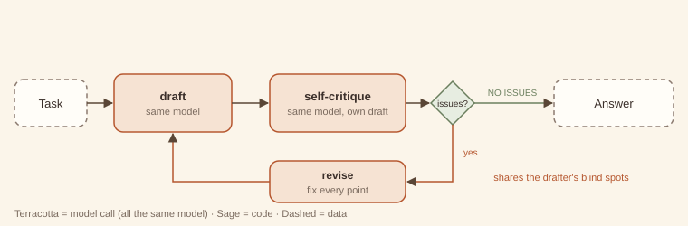

# 8. Reflection / self-critique

> **Intent.** Have the same model critique its own output and then revise it, catching the errors it can recognise on a second look, at the cost of one or two extra calls and no extra infrastructure.

**Also known as:** self-critique, self-refine, self-correction; Reflexion (trajectory variant) · **Part:** 2 — Single-agent reasoning · **Code:** `code/patterns/reflection/`

## Structure



One model drafts. The same model is then asked to critique its own draft: concrete errors, missed edge cases, unsupported claims, or `NO ISSUES`. If there are issues, it revises, and the loop runs at most a small number of rounds. Every box is the same model, which is what makes this reflection and not [evaluator–optimizer (#5)](../part-1-workflow/05-evaluator-optimizer.md).

## Design concept & theory

**Core idea.** Generation is one pass; critique is a second pass with a different instruction. Asking a model to *look for problems* points its attention at different features of the same text than asking it to *write* did.

**Why it works, partially.**

- *Mode switch.* While writing, the model optimises for fluency and completeness; while critiquing, it is told to hunt for errors, edge cases and unsupported claims. Many slips (a missed edge case, a contradiction with the task) are visible in the second mode.
- *Cheap.* No rubric to maintain, no second model, no tools: 2–3 calls per round.
- *Bounded by the model's own knowledge.* Self-critique can only find errors the model can recognise. If the model *believes* February always has 28 days, its critique will approve that belief. This is the **shared blind spot**, and the example shows it happening. Reflection improves outputs on average; it does not verify them.

That last point sets the pattern's place. Use reflection to remove cheap, recognisable errors before a stronger check, not *as* the check.

**Invariants.** (1) Critique and revision use the same model as generation; no external judge or ground truth enters the loop. (2) The critique is explicit text that the revision must address. (3) Rounds are bounded.

**Lineage.** Proofreading your own writing; the "rubber-duck" review. In research: Self-Refine (2023), and Reflexion (2023) for learning from failed trajectories across attempts.

## When to use / when not to use

| Use it when | Don't use it when |
|---|---|
| First drafts contain errors the model *can* recognise when asked (missed edge cases, contradictions). | Correctness can be checked in code. Run the check ([#11](11-guardrailed-generation.md)), which is cheaper and exact. |
| You want a quality bump without a separate evaluator or rubric. | The stakes need independent verification ([#5](../part-1-workflow/05-evaluator-optimizer.md), [#16](../part-3-multi-agent/16-critic-reviewer.md), or a human). |
| Latency allows one extra round trip or two. | The model lacks the knowledge to see the error. Reflection will just approve it. |
| As a first, cheap pass before a stronger reviewer. | You need to *prove* quality improved; reflection's verdict is not evidence. |

**Cheaper alternative:** put the critique checklist *in the original prompt* ("before answering, check for X, Y, Z"), which costs one call and no loop. Upgrade to reflection when measured error rates show the second pass catches enough to pay for it.

## Forces & trade-offs

| Force | vs. single generation | Why |
|---|---|---|
| Latency | ↑ | +2 sequential calls per round (critique, revise). |
| Cost | ↑ ×2–3 | Critique and revision re-read the draft. |
| Reliability | ↑ modestly | Catches recognisable errors; cannot catch blind spots; can occasionally make a correct answer worse. |
| Complexity | ≈ | Two prompt templates and a loop bound. |

## Trade-off analysis & usage guidance

**Model.** Per task: 1 draft + *r* × (critique + revision) + 1 final critique when it returns `NO ISSUES`. For *r* = 1, that is 4 calls. In the example: 4 calls for `is_leap` (one revision) and 2 for `days_in_month` (approved at once).

**Measure the delta, not the verdict.** The only honest way to know reflection helps is an [eval harness (#21)](../part-4-cross-cutting/21-eval-harness.md) comparing outputs with and without it. The example measures with tests: 3/4 → 4/4 on one task and 3/4 → 3/4 on the other.

**Decision checklist.**

1. Do first drafts fail in ways the model would recognise if asked?
2. Is there a code check you could run instead? Prefer it.
3. Have you measured the improvement on an eval set?
4. Is one round enough? Usually yes; the second round has small returns.
5. Where does the output go after reflection: straight to users, or to a stronger check?

**Usage in production.**

- Default to one round. Make the critique prompt *specific* to your task's known failure modes.
- Require the critique to name concrete problems; "looks good, maybe improve clarity" should be treated as `NO ISSUES`.
- Track how often reflection changes the output, and how often the change is an improvement, on an eval set.
- For trajectory reflection, store lessons with the failure that taught them, and expire lessons that stop helping.

## Worked example

### Example first: what happens

```
python3 code/patterns/reflection/main.py
```

<!-- expected-output: code/patterns/reflection/main.py -->
```text
Reflection
==========
-- Write Python is_leap(y) for the Gregorian calendar.
[draft] def is_leap(y): …
[critique 1] Missed the Gregorian century rule: 1900 is not a leap year, 2000 is.
[revision 1] def is_leap(y): …
[critique 2] NO ISSUES
measured: first draft 3/4 tests, final 4/4 tests; revisions=1
-- Write Python days_in_month(m, y).
[draft] def days_in_month(m, y): …
[critique 1] NO ISSUES
measured: first draft 3/4 tests, final 3/4 tests; revisions=0
model calls: 6 (same model throughout)
```

**`is_leap`:** the first draft only checks `y % 4`. The self-critique spots the Gregorian century rule (1900 is not a leap year, 2000 is), the revision fixes it, and the second critique returns `NO ISSUES`. Tests, run only to *measure*, go from 3/4 to 4/4.

**`days_in_month`:** the first draft ignores leap years in February. The critique says `NO ISSUES`. The model does not see the bug in its own code, and the measured result stays at 3/4. That is the shared blind spot, reproduced on purpose.

### Why first: why it is built this way

- **Tests are outside the loop.** If test results fed the critique, it would be an evaluator with ground truth: a better pattern, but a different one. Keeping them outside shows what reflection achieves alone.
- **`NO ISSUES` is an exact token.** It makes "stop" unambiguous to parse and easy for a model to emit.
- **The critique sees the task and the draft; the revision also sees the critique.** The revision must address named points, not rewrite freely.
- **`first_draft` is recorded.** You cannot measure what reflection did unless you keep what it started from.

## Failure modes & guardrails

| Failure mode | Symptom | Guardrail |
|---|---|---|
| Shared blind spot | Critique approves a wrong answer. | Use external checks for anything verifiable; measure with an eval set. |
| Sycophantic critique | Always `NO ISSUES`, or only cosmetic notes. | Task-specific critique checklist; treat vague critiques as no-ops. |
| Over-correction | Revision "fixes" a correct answer into a wrong one. | Keep the first draft; compare on evals; limit rounds. |
| Cost creep | Reflection added everywhere "just in case". | Enable per task type only where evals show gains. |
| Endless polishing | Each round finds a new nit. | Round cap of 1–2. |

## Variations

- **Trajectory reflection (Reflexion).** After a failed *episode*, write a lesson and carry it into the next attempt or task as context. The exercise implements it.
- **Checklist reflection.** The critique prompt is a fixed list of task-specific checks, which reduces vagueness.
- **Reflection then evaluate.** A cheap self-critique pass first, then an independent [evaluator (#5)](../part-1-workflow/05-evaluator-optimizer.md). The deep-research capstone does exactly this.
- **Chain-of-verification.** The model writes verification questions about its own claims, answers them independently, then revises.

## Try it

Self-critique missed the February bug. Add **trajectory reflection**: when an outside signal (tests, a user report) reveals a failure, have the model write a one-line lesson, store it, and pass stored lessons as system text on later tasks. Show that a related task (`days_left`) fails without the lesson and passes with it.

→ Solution: [Solutions — Reflection](../solutions/08-reflection.md)

## 60-second interview lens

- **Say:** "Reflection asks the same model to critique and revise its own output. It is cheap and catches errors the model can recognise on a second look."
- **Trade-off to name:** it costs two or three times the calls and cannot catch the model's own blind spots, so it is a quality bump, not verification.
- **Expect the follow-up:** "How is that different from LLM-as-judge?" A judge is a separate role (ideally a separate model) with an explicit rubric. Reflection is the same model, introspecting.
- **Red flag to avoid:** citing the model's "I checked and it's correct" as evidence of correctness.

## Related patterns

- [Evaluator–optimizer (#5)](../part-1-workflow/05-evaluator-optimizer.md): a separate evaluator with a rubric, more independent and more expensive.
- [Critic–reviewer loop (#16)](../part-3-multi-agent/16-critic-reviewer.md): a separate reviewer *agent* with tools such as running tests.
- [Guardrailed generation (#11)](11-guardrailed-generation.md): when the check can be code, use code.
- [Memory tiers (#19)](../part-4-cross-cutting/19-memory-tiers.md): where trajectory lessons should live.
