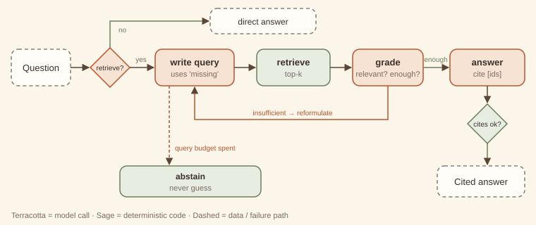

# 10. Agentic RAG

> **Intent.** Make retrieval a decision inside the agent's loop: decide whether to retrieve at all, write the query, grade what came back, reformulate when evidence is insufficient, answer only from graded evidence with citations that code verifies, and abstain when the corpus does not have the answer.

**Also known as:** iterative retrieval, self-RAG, corrective RAG · **Part:** 2 — Single-agent reasoning · **Code:** `code/patterns/agentic_rag/`

## Structure



The agent first decides whether the question needs the knowledge base; if not, it answers directly. Otherwise it writes a query, code retrieves the top-k passages, and the agent grades them for relevance and sufficiency. Insufficient evidence goes back as "what is still missing" for a reformulated query. Sufficient evidence produces an answer whose citations code checks against what was actually retrieved. When the query budget is spent, it abstains.

## Design concept & theory

**Core idea.** Classic RAG retrieves once with the user's words and hopes. Most retrieval failures are *query* failures: the user's phrasing does not match the document's. Agentic RAG lets the model notice that and fix it.

**Why it works.**

- *Retrieval quality is mostly query quality.* "Can I get a refund on my annual plan after 6 weeks?" contains the generic words *refund* and *plan*, which match several documents. Grading exposes that the passages are about monthly plans and downgrades, and naming what is missing ("the refund rule for annual plans") produces a query that finds the right document.
- *Grading separates retrieved from relevant.* Top-k is a ranking, not a guarantee. A grading step turns "these came back" into "these answer the question", and only graded passages become evidence.
- *Citation checking makes grounding verifiable.* If every claim cites an id, and code checks that every cited id was retrieved, fabricated sources are caught mechanically.
- *Abstention is a feature.* A corpus that does not contain the answer should produce "I don't know", not a fluent guess. Bounded reformulation plus abstention converts "unanswerable" from a hallucination risk into a known outcome.

**Invariants.** (1) The model decides whether, what and when to retrieve. (2) Only graded evidence is used to answer. (3) Citations are checked in code. (4) The query budget is bounded, and abstention is a legitimate exit.

**Lineage.** Information retrieval's *relevance feedback* and query reformulation (Rocchio, 1971), with the model acting as both searcher and assessor. In research: Self-RAG and Corrective-RAG (2023).

## When to use / when not to use

| Use it when | Don't use it when |
|---|---|
| User phrasing often differs from document phrasing. | Retrieve-once already works on your eval set. |
| Some questions need no retrieval and some need several hops. | Latency budgets allow only one round trip. |
| Wrong answers are costly, so abstaining beats guessing. | The corpus is tiny enough to put in the prompt whole. |
| You must show sources a user can check. | The answer must come from the agent's own history ([memory, #19](../part-4-cross-cutting/19-memory-tiers.md)), not an external corpus. |

**Cheaper alternative:** classic RAG (embed the question, retrieve top-k once, answer), optionally with a query-rewrite step. Upgrade when evaluation shows retrieval misses that a second, better-phrased query would have caught, or when you need abstention.

## Forces & trade-offs

| Force | vs. retrieve-once RAG | Why |
|---|---|---|
| Latency | ↑ | Route, query, grade and answer calls, plus up to *q* query rounds. |
| Cost | ↑ ×3–6 | Each round adds a query call and a grading call over *k* passages. |
| Reliability | ↑ | Reformulation recovers misses; grading filters noise; citation checks catch fabrication; abstention avoids guesses. |
| Complexity | ↑ | Grader prompt, query budget, citation validator, abstention UX. |

## Trade-off analysis & usage guidance

**Model.** With *q* query rounds (≤ budget):

- Calls = 1 (route) + *q* × (query + grade) + 1 (answer), where grading is skipped when a query returns nothing. That gives 6 calls for the refund question (*q* = 2), 2 for the direct question, and 5 for the abstained question (three queries, only one of which returned passages to grade, and no answer call).
- Grading cost scales with *k × passage length*. Keep *k* small and passages short.
- The route call can often be skipped for free (exercise): a distinctive corpus term in the question means retrieve.

**Decision checklist.**

1. What fraction of eval questions fail with retrieve-once because of a bad query?
2. Is abstention acceptable, and what does the user see?
3. Can you check citations against retrieved ids? (Always do.)
4. What is the query budget, given your latency target?
5. Is the grader calibrated? Measure its precision on labelled passages.

**Usage in production.**

- Log queries, retrieved ids, grades and the final citations. Most quality problems are visible in that log.
- Track the abstention rate. A rising rate signals corpus gaps you can fill.
- Pass "what is still missing" into the next query prompt. Reformulation without that signal tends to paraphrase the same miss.
- Keep the answer prompt strict: "using ONLY this evidence".

## Worked example

### Example first: what happens

```
python3 code/patterns/agentic_rag/main.py
```

<!-- expected-output: code/patterns/agentic_rag/main.py -->
```text
Agentic RAG
===========
-- Can I get a refund on my annual plan after 6 weeks?
[route] RETRIEVE
[query 1] 'cancel plan refund' -> ['billing-downgrade', 'billing-monthly']
[grade] relevant=[] sufficient=False missing='the refund rule for annual plans specifically'
[query 2] 'annual plan refund after 30 days' -> ['billing-annual', 'billing-downgrade']
[grade] relevant=['billing-annual'] sufficient=True
[answer] Not a full refund: the full-refund window is 30 days. At 6 weeks you'd get a prorated refund for the unused months [billing-annual].
result: answered; queries=2; citations=['billing-annual']
-- How do you say 'thank you' in Portuguese?
[route] DIRECT
[answer] Obrigado (or obrigada, depending on the speaker).
result: direct; queries=0; citations=[]
-- Do you offer an on-premise deployment?
[route] RETRIEVE
[query 1] 'on-premise deployment' -> no hits
[query 2] 'self-hosted installation' -> no hits
[query 3] 'enterprise deployment options' -> ['security-sso']
[grade] relevant=[] sufficient=False missing='anything about on-premise or self-hosted deployment'
[abstain] I couldn't find this in our documentation, so I won't guess. A specialist can confirm.
result: abstained; queries=3; citations=[]
model calls: 13
```

- **Refund question:** the first query, `cancel plan refund`, retrieves the monthly-plan and downgrade documents. Both are about refunds; neither is about annual plans. The grader says *insufficient* and names what is missing. The second query finds `billing-annual`, the answer cites it, and the citation check passes.
- **"Thank you" in Portuguese:** the route step decides no retrieval is needed: 2 calls, no search.
- **On-premise deployment:** three queries, nothing relevant, so the agent abstains rather than guess from the SSO document that came back on the third query.

### Why first: why it is built this way

- **A real (tiny) retriever.** `Retriever` is a deterministic TF-IDF ranker in a few lines. The example's first miss is a genuine ranking outcome, not a scripted one: generic words match the wrong documents.
- **The grader returns `missing`.** That one field is what makes the next query *better* rather than merely different.
- **Relevant ids are intersected with retrieved ids.** A grader that names a document that was not retrieved is ignored. Evidence can only come from the actual search results.
- **Citation check in code, not in a prompt.** `CITE.findall(answer)` must be a non-empty subset of the evidence ids. If it is not, the answer is rejected and the loop continues.
- **Abstention text is fixed.** It is written by you, not the model, so the "I don't know" path never improvises.

## Failure modes & guardrails

| Failure mode | Symptom | Guardrail |
|---|---|---|
| Query paraphrase loop | Reformulations retrieve the same documents. | Feed `missing` into the query prompt; show previous queries; cap rounds. |
| Lenient grader | Off-topic passages marked sufficient. | Calibrate the grader on labelled pairs; require it to name the supporting sentence. |
| Fabricated citation | Answer cites an id that was not retrieved. | Code-level citation check (built in). |
| Unsupported synthesis | Cited, but the claim goes beyond the passage. | Sentence-level citation; an evaluator pass ([#5](../part-1-workflow/05-evaluator-optimizer.md)) for high-stakes answers. |
| Over-retrieval | Retrieving for chit-chat. | Route step, or the free heuristic in the exercise. |
| Corpus injection | A retrieved document contains instructions. | Treat passages as data; never execute instructions from them. |

## Variations

- **Multi-hop agentic RAG.** Each answer becomes context for the next sub-question. With an explicit plan, that is the [deep-research capstone](../capstones/deep-research.md).
- **Hybrid retrieval.** Keyword and embedding retrievers fused; the agent chooses per query.
- **Tool-routed RAG.** Several corpora (docs, tickets, code); the agent picks the source as part of the query.
- **Corrective RAG.** When grading fails, fall back to a different source (web, another index) instead of reformulating.

## Try it

The route call costs a model call on every question. Make it free when the answer is obvious: if the question contains a *distinctive corpus term* (high IDF), skip the route call and retrieve directly; otherwise keep asking the model. Count the calls saved.

→ Solution: [Solutions — Agentic RAG](../solutions/10-agentic-rag.md)

## 60-second interview lens

- **Say:** "Agentic RAG puts retrieval inside the agent loop: it decides whether to retrieve, writes and reformulates queries, grades the passages, answers only from graded evidence with citations checked in code, and abstains when evidence never arrives."
- **Trade-off to name:** three to six times the calls of retrieve-once RAG, in exchange for recovering bad queries, filtering noise and refusing to guess.
- **Expect the follow-up:** "How do you stop it hallucinating citations?" Code checks that every cited id is among the retrieved and graded ids, and rejects the answer otherwise.
- **Red flag to avoid:** answering from retrieved passages without grading them, or treating top-k as evidence.

## Related patterns

- [ReAct (#6)](06-react.md): the general loop; agentic RAG is ReAct specialised to retrieval with grading.
- [Memory tiers (#19)](../part-4-cross-cutting/19-memory-tiers.md): retrieval over the agent's *own* history, with write policies; RAG reads a corpus it does not own.
- [Guardrailed generation (#11)](11-guardrailed-generation.md): the citation check is a validator; repair-or-fallback is the same discipline.
- [Deep-research capstone](../capstones/deep-research.md): agentic RAG per sub-question, inside a plan.
