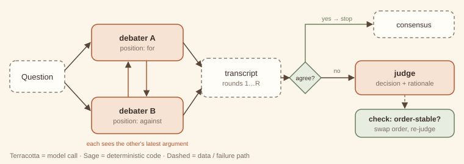

# 15. Debate / peer critique

> **Intent.** Have two or more peer agents argue assigned positions over a few rounds, each responding to the others' latest arguments, then let a judge decide with a rationale. Stop early, with no judge, if the peers converge.

**Also known as:** multi-agent debate, adversarial collaboration, red team / blue team · **Part:** 3 — Multi-agent coordination · **Code:** `code/patterns/debate/`

## Structure



Debaters A and B take assigned positions. In each round, each one sees the question, its own position and the other's latest argument, and may concede. The transcript accumulates. If all debaters agree, the debate ends with a consensus and no judge call. Otherwise a judge reads the transcript and returns a decision with a rationale that cites the arguments it relied on. An optional check re-judges with the order swapped, to catch position bias.

## Design concept & theory

**Core idea.** One model asked for a decision gives you its first framing of the problem. Two models *assigned* opposing positions are forced to find the strongest case on each side, and the weaknesses of the other. A judge then weighs arguments rather than generating them.

**Why it works, and when it doesn't.**

- *Assigned positions counter single-framing bias.* A single model tends to commit to its first framing and then justify it. Forcing a "con" role surfaces considerations (14 shared tables, no owning team) that a single "should we split billing?" answer may omit.
- *Rebuttal rounds expose weak claims.* An argument that cannot survive a direct reply ("ownership is solvable by assigning two engineers") gets refined or dropped. This is the mechanism humans use in design reviews.
- *Judging is easier than arguing.* Like the evaluator in [#5](../part-1-workflow/05-evaluator-optimizer.md), the judge compares rather than generates, and compares against a transcript rather than its own priors.
- *Limits.* Debaters that share a model share its blind spots, so debate surfaces *disagreement the model can generate*, not facts it lacks. Judges can favour eloquence, length or the last speaker (the exercise). Debate is a structured way to see two sides; it does not produce truth.

**Invariants.** (1) Debaters are symmetric peers: same powers, opposing assignments. (2) Each round, every debater sees the others' latest arguments. (3) Resolution is by consensus or by a separate judge with a rationale.

**Lineage.** Adversarial legal process; red team / blue team exercises; architecture decision reviews with a devil's advocate. In ML research: "debate" as a scalable-oversight proposal (Irving et al., 2018), and multi-agent debate for reasoning (Du et al., 2023).

## When to use / when not to use

| Use it when | Don't use it when |
|---|---|
| The decision has real trade-offs and you need both sides surfaced. | The question has a checkable answer. Check it. |
| Single-model answers seem one-sided or overconfident. | Cost or latency allows only one call. |
| You want an auditable rationale (decision records, ADRs). | The participants would need facts that no one in the debate has; add retrieval first. |
| Stakes justify ~5× the calls of a single answer. | One side is plainly unacceptable (policy, safety). Don't debate it. |

**Cheaper alternative:** a single call that is asked to "list the strongest arguments for and against, then decide", which is a one-prompt debate. Upgrade when evaluation shows single-call answers miss the opposing considerations that matter.

## Forces & trade-offs

| Force | vs. a single "pros and cons" call | Why |
|---|---|---|
| Latency | ↑ | Rounds are sequential; the judge waits for the transcript. |
| Cost | ↑ ×(debaters × rounds + 1) | Two debaters × two rounds + judge = 5 calls. |
| Reliability | ↑ on contested decisions | Stronger arguments on both sides; a judge can still be biased. |
| Complexity | ↑ moderately | Positions, round protocol, judge prompt, bias checks. |

## Trade-off analysis & usage guidance

**Model.** Calls = *d × r_used + (judge ? 1 : 0)*. In the example: the contested question used 2 × 2 + 1 = 5 calls; the uncontested index question used 2 × 1 + 0 = 2, because early consensus skips both the second round and the judge.

**Decision checklist.**

1. Is the question genuinely contested, with no ground truth to look up?
2. Do the debaters have the facts they need (retrieval, data)?
3. Is the judge separate from the debaters, ideally a different model?
4. Have you checked the judge for order and length bias (exercise)?
5. What happens with the decision: is it advice to a human, or an automated action?

**Usage in production.**

- Use 2 debaters and 1–2 rounds. More rounds mostly add repetition.
- Require the judge to cite the specific arguments relied on, and store the transcript as the decision record.
- Swap order and re-judge on high-stakes calls. Escalate if the verdict flips.
- Track the early-consensus rate: high consensus on a question type means debate is not needed there.

## Worked example

### Example first: what happens

```
python3 code/patterns/debate/main.py
```

<!-- expected-output: code/patterns/debate/main.py -->
```text
Debate
======
-- Should we split billing out of the monolith this quarter?
[r1 pro] Yes: billing deploys are blocked by unrelated monolith releases twice a month.
[r1 con] No: no team owns billing today, so a new service would be orphaned.
[r2 pro] Ownership is solvable by assigning two engineers; deploy coupling costs us a blocked release every sprint.
[r2 con] Billing shares 14 tables with orders; splitting now means distributed transactions before we have an API boundary.
[judge] Not this quarter: first put billing behind an internal API inside the monolith, then split. — Con's shared-tables point (r2) makes a split now risky; Pro's deploy-blocking cost (r1) is real, so the API boundary should start now to enable the split next quarter.
result: consensus=False, rounds=2
-- Should we add an index on orders.customer_id (queries scan 4M rows)?
[r1 pro] Yes: every lookup scans 4M rows; the index is cheap to add online.
[r1 con] Yes from me too: the write overhead is negligible next to the read savings.
[consensus] all debaters agree after round 1 — no judge needed
result: consensus=True, rounds=1; judge calls in total: 1
```

**Split billing now?** Round 1 states positions: deploys are blocked versus no owning team. Round 2 rebuts. Pro answers the ownership objection, and con raises a stronger one: 14 shared tables mean distributed transactions. The judge decides "not this quarter, but build the API boundary now", citing con's round-2 point *and* pro's round-1 cost. That is a decision neither side proposed, made from both.

**Add an index?** Both sides agree in round 1, so the debate stops at consensus. The judge is never called, and the total cost is 2 calls.

### Why first: why it is built this way

- **Positions are assigned, not chosen.** Letting each debater pick a side tends to produce two debaters on the same side.
- **Rounds are simultaneous.** Within a round, each debater sees only the *previous* round's arguments, so neither gets a structural last-word advantage inside a round.
- **`agree_with_opponents` enables early exit.** Consensus is checked in code after each round. Debating a settled question wastes calls.
- **The judge's rationale must cite arguments.** The prompt asks for it, and the transcript is kept so the citation can be checked. A decision you cannot trace to an argument is just another opinion.

## Failure modes & guardrails

| Failure mode | Symptom | Guardrail |
|---|---|---|
| Position bias | The verdict follows the last speaker. | Swap order and re-judge; escalate on a flip (exercise). |
| Eloquence bias | The longer or more confident argument wins. | Length limits; the judge prompt says "arguments, not style". |
| Collapse | Both debaters converge on the same view in round 1 by default. | Assigned positions; instruct "concede only if persuaded". |
| Shared blind spot | Both miss the same key fact. | Give debaters retrieval tools ([#10](../part-2-single-agent/10-agentic-rag.md)); different models. |
| Debate theatre | Many rounds, repeated points. | 1–2 rounds; stop when arguments repeat. |

## Variations

- **Multi-perspective panel.** Three or more roles (security, cost, UX), each arguing from its lens.
- **Debate with evidence.** Debaters must cite retrieved sources; the judge discounts uncited claims.
- **Peer critique without a judge.** Agents critique each other's drafts and each revises, a symmetric cousin of [critic–reviewer (#16)](16-critic-reviewer.md).
- **Human judge.** The transcript goes to a person as a decision brief.

## Try it

Judges can be swayed by **order** rather than arguments. Detect it: run the judge twice with the debaters' order swapped. If the decision changes, the verdict is order-sensitive and must be escalated. Show the argument-based judge passing and a recency-biased judge being caught.

→ Solution: [Solutions — Debate](../solutions/15-debate.md)

## 60-second interview lens

- **Say:** "Debate assigns peer agents opposing positions, lets them rebut each other for a round or two, and has a separate judge decide with a cited rationale, or stops early if they agree."
- **Trade-off to name:** several times the calls of one answer, in exchange for both sides being argued well. It does not create facts, and judges have biases you must test.
- **Expect the follow-up:** "Debate or critic–reviewer?" Debate is symmetric (either side can be right). Critic–reviewer is asymmetric: an author owns the artefact and a reviewer checks it.
- **Red flag to avoid:** treating the judge's verdict as ground truth without bias checks.

## Related patterns

- [Parallelization: voting (#3)](../part-1-workflow/03-parallelization.md): independent answers, no interaction. Debate adds rebuttal.
- [Critic–reviewer loop (#16)](16-critic-reviewer.md): an asymmetric author/reviewer relationship.
- [Evaluator–optimizer (#5)](../part-1-workflow/05-evaluator-optimizer.md): judge-like evaluation of one artefact against a rubric.
- [Human-in-the-loop (#17)](17-human-in-the-loop.md): where order-unstable verdicts go.
