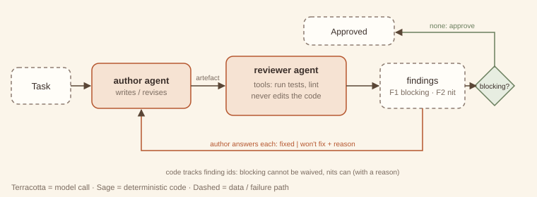

# 16. Critic–reviewer loop

> **Intent.** Pair an author agent that produces an artefact with a reviewer agent that has *different tools* (tests, linters, checks) and returns itemised findings with ids and severities. The author answers every finding (fixed, or won't fix with a reason), and code tracks the findings until no blocking ones remain.

**Also known as:** code review loop, author–reviewer, maker–checker · **Part:** 3 — Multi-agent coordination · **Code:** `code/patterns/critic_reviewer/` *(imported by the coding-team capstone)*

## Structure



The author agent writes or revises the artefact. The reviewer agent runs its own tools on it (here: real tests and a lint check) and turns the evidence into findings like `F1 [blocking]` and `F2 [nit]`. The author answers each finding. Code keeps the ledger: a blocking finding can only be closed by fixing it; a nit can be declined with a reason. Approval means no open blocking findings.

## Design concept & theory

**Core idea.** Code review works because the reviewer is *not* the author, *can run things*, and writes *specific comments that must each be answered*. This pattern encodes all three for agents.

**Why it works.**

- *Independent evidence.* The reviewer's findings come from running tests and checks, not from re-reading the code with the author's assumptions. A failing test is evidence that neither [reflection (#8)](../part-2-single-agent/08-reflection.md) nor a rubric judge ([#5](../part-1-workflow/05-evaluator-optimizer.md)) can produce.
- *Itemised findings make progress measurable.* "F1 blocking, F2 blocking, F3 nit" can be tracked across rounds; a score of 6/10 cannot. Each finding has an owner (the author) and a required response.
- *Severity separates must from should.* Blocking findings gate approval; nits do not. Without severities, review loops either never converge (every nit blocks) or approve real bugs (nothing blocks).
- *Asymmetric authority prevents both bad outcomes.* The reviewer cannot edit the artefact, so it cannot "fix" things the author then fails to understand. The author cannot waive blocking findings, so it cannot argue its way past a failing test.

**Invariants.** (1) Two distinct agents: the author owns the artefact, the reviewer owns the findings. (2) The reviewer has evidence-producing tools. (3) Every finding gets a response, and blocking findings close only by being fixed.

**Lineage.** The four-eyes principle; the *maker–checker* control in banking; pull-request review.

## When to use / when not to use

| Use it when | Don't use it when |
|---|---|
| The artefact can be checked by running something (code, configs, SQL, data). | Only subjective quality matters ([evaluator–optimizer, #5](../part-1-workflow/05-evaluator-optimizer.md) is cheaper). |
| Mistakes are expensive enough to justify a second agent. | All checks are deterministic. Run them in a [guardrail (#11)](../part-2-single-agent/11-guardrailed-generation.md), with no reviewer model. |
| Findings need judgement to prioritise (blocking vs nit). | The reviewer would have the same tools and context as the author: that is reflection with extra steps. |
| You want an audit trail of what was raised and how it was resolved. | Latency allows only one pass. |

**Cheaper alternative:** run the tests as a deterministic gate and feed failures back to the author, which is guardrailed generation with tests as validators. Upgrade when you need judgement on top of the tools: severity, missing tests, design concerns.

## Forces & trade-offs

| Force | vs. tests-as-a-gate | Why |
|---|---|---|
| Latency | ↑ | Reviewer call per round, plus author revision. |
| Cost | ↑ | Two agents; the reviewer reads tool evidence each round. |
| Reliability | ↑ | Catches what tests do not (missing tests, unclear API) and prioritises. |
| Complexity | ↑ | Finding schema, ledger, waiver rules, round budget. |

## Trade-off analysis & usage guidance

**Model.** Per round: tool runs (cheap) + 1 reviewer call + 1 author call (except the final approving round). In the example, 2 rounds took 2 reviewer calls and 2 author calls (the initial draft and one revision). Budget 3–4 rounds; a blocking finding still open after that needs a human.

**Decision checklist.**

1. What tools does the reviewer have that the author does not use?
2. What is the severity scale, and who may waive what?
3. Must every finding get a response? (Yes.) What counts as "fixed"? (The reviewer no longer finds it.)
4. What is the round budget, and where do unresolved blockers go?
5. Do you guard against regressions: fixes that break what already worked (exercise)?

**Usage in production.**

- Keep finding ids stable across rounds, so you can tell "F2 still open" from "new F4".
- Log declined nits with their reasons. They are useful signal for tuning the reviewer.
- Sandbox anything the reviewer executes. Model-written code is untrusted.
- Track first-round blocking-finding counts by author model or prompt version. That is your author-quality metric.

## Worked example

### Example first: what happens

```
python3 code/patterns/critic_reviewer/main.py
```

<!-- expected-output: code/patterns/critic_reviewer/main.py -->
```text
Critic–reviewer loop
====================
[review 1] F1[blocking] accents are not transliterated; F2[blocking] separators wrong: want single dashes between words, none at ends; F3[nit] add a docstring
[author F1] fixed: NFKD + ASCII fold → noted
[author F2] fixed: collapse non-alnum runs, strip dashes → noted
[author F3] wont_fix: one-line helper; the name is the doc → accepted
[review 2] no findings
result: approved=True in 2 rounds; remaining findings: none; tests failing now: 0
calls: author=2, reviewer=2
```

The author's first `slugify` lower-cases and swaps spaces for dashes. The reviewer *runs four real tests*: accents survive (F1, blocking), and leading, trailing or repeated separators leak through (F2, blocking). Its lint check notes the missing docstring (F3, nit). The author fixes F1 and F2 and declines F3 with a reason, and the ledger accepts the waiver because F3 is a nit. Round 2: the tests pass, nothing is open, and the reviewer approves. Zero tests fail at the end, and that is measured, not claimed.

### Why first: why it is built this way

- **The reviewer's evidence is real.** `run_tests` executes the author's code against fixed cases, and the reviewer model only *interprets* tool output into findings. Findings are grounded in execution.
- **The ledger lives in `review_loop`, not in either agent.** Code decides whether a waiver is accepted (nits only) and whether approval is reached (no open blockers), so neither agent can talk its way past the rules.
- **Author responses are per finding.** An unanswered finding stays open, and the trace says so.
- **Waived nits are filtered from later rounds.** Without this, a declined nit would be re-raised forever and the loop would never converge.

## Failure modes & guardrails

| Failure mode | Symptom | Guardrail |
|---|---|---|
| Rubber-stamp reviewer | Approves without running anything. | Findings must cite tool evidence; tool runs are logged. |
| Nit storm | Dozens of style findings; real issues buried. | Severity scale; cap nits per round; blocking first. |
| Regression | A fix breaks a previously passing test. | Reviewer memory of past passes → automatic blocking finding (exercise). |
| Waiving blockers | Author declines a failing test. | Code refuses waivers on blocking findings. |
| Endless loop | Same blocker every round. | Round budget; escalate unresolved blockers to a human. |
| Unsafe execution | Reviewer runs hostile code. | Sandbox: separate process, no network, resource limits. |

## Variations

- **Multi-reviewer.** Separate reviewers for correctness, security and performance, with findings merged.
- **Reviewer writes tests.** The reviewer adds failing tests as findings, so the evidence becomes executable.
- **Human reviewer for blockers only.** The model reviewer files findings; a human confirms blocking ones before they gate ([#17](17-human-in-the-loop.md)).
- **Pair mode.** Author and reviewer alternate on small diffs, giving a shorter loop with smaller findings.

## Try it

An author can "fix" one finding and silently break something that already worked. Give the reviewer memory: any test that **passed in an earlier round and fails now** becomes an automatic blocking `REGRESSION` finding. Show a regressing revision being caught and the loop still converging.

→ Solution: [Solutions — Critic–reviewer loop](../solutions/16-critic-reviewer.md)

## 60-second interview lens

- **Say:** "A critic–reviewer loop pairs an author agent with a reviewer agent that has its own tools, such as tests. The reviewer files itemised findings with severities, the author answers each, and code tracks them until no blocking findings remain."
- **Trade-off to name:** two agents and several rounds, in exchange for independent, executable evidence and a clear ledger. Pointless if the reviewer has no tools or context the author lacks.
- **Expect the follow-up:** "Why not just run the tests?" Do, as a gate. The reviewer adds judgement on top: missing tests, severity, design issues.
- **Red flag to avoid:** letting the author waive a failing test.

## Related patterns

- [Evaluator–optimizer (#5)](../part-1-workflow/05-evaluator-optimizer.md): one artefact, a rubric judge, no tools, a score rather than a ledger.
- [Reflection (#8)](../part-2-single-agent/08-reflection.md): the same model reviewing itself, with no independent evidence.
- [Debate (#15)](15-debate.md): symmetric peers rather than author and reviewer.
- [Coding-team capstone](../capstones/coding-team.md): QA's review loop with callbacks to the developer.
