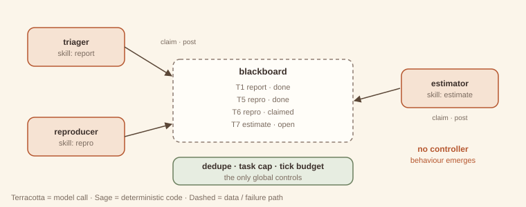

# 18. Swarm

> **Intent.** Let many peer agents coordinate without any controller, through local rules over shared state (a blackboard): each agent claims work matching its skills, posts results and follow-up work, and the overall behaviour emerges from these interactions.

**Also known as:** blackboard system, decentralised multi-agent, stigmergy · **Part:** 3 — Multi-agent coordination · **Code:** `code/patterns/swarm/`

## Structure



Peer agents (triager, reproducer, estimator) watch a shared blackboard of tasks. Each tick, each agent claims at most one open task matching its skill (claims are atomic), works it, writes the result, and may post follow-up tasks. No agent assigns work to another. Code supplies the only global controls: de-duplication of identical tasks, a cap on total tasks, and a tick budget.

## Design concept & theory

**Core idea.** Instead of a coordinator deciding who does what, work is *published* and *claimed*. Agents react to the state of the board, not to instructions. Coordination emerges, the way an ant colony's trails emerge from individual ants reacting to pheromones (stigmergy).

**Why it can work.**

- *No coordinator bottleneck.* Adding agents adds capacity without adding a supervisor's context or decision calls.
- *Work appears where it is needed.* A triager posts a repro task only for real bugs. A reproducer posts an estimate only when it reproduced the bug. In the example, 4 reports led to 7 model calls, not 12, because the feature request and the duplicate never generated downstream work.
- *Robust to individual failure*, if claims expire (the exercise). Another agent picks the work up.

**Why it usually shouldn't be your choice.**

- *Emergence is a polite word for "unpredictable".* You cannot write the call count in advance, and runs depend on timing and claim order. In production, with concurrency, two runs of the same input can take different paths.
- *Termination is not guaranteed.* An agent that posts follow-ups faster than the swarm completes them grows the board without bound. The runaway example hits the task cap with work unfinished.
- *Debugging is archaeology.* There is no decision log of "who decided X", only a board history to reconstruct.
- *Every benefit above has a cheaper, controlled equivalent.* The skip-unneeded-work property comes just as well from [routing (#2)](../part-1-workflow/02-routing.md) plus a [chain (#1)](../part-1-workflow/01-prompt-chaining.md); the scalability from [parallelization (#3)](../part-1-workflow/03-parallelization.md) with a queue.

**Invariants.** (1) No agent assigns work to another; agents claim from shared state. (2) Agents act on local rules and the board. (3) Global properties (termination, size) are enforced only by the board's code.

**Lineage.** Blackboard architectures (Hearsay-II, 1970s); tuple spaces (Linda); swarm intelligence and stigmergy; job queues with competing consumers.

## When to use / when not to use (the honest section)

| Use it when (rarely) | Don't use it when (usually) |
|---|---|
| Work is open-ended and discovered during processing, from many sources. | You can draw the workflow. Draw it and build it in Part 1. |
| Many heterogeneous agents must cooperate, and a central coordinator would be a real bottleneck. | You need predictable cost, latency or termination. |
| Partial results are useful, and completion of everything is not required. | You must explain *why* the system did something. |
| You are simulating or researching emergent behaviour. | You have fewer than ~10 agent types: a supervisor will do. |
| Teams already run a queue with competing consumers; agents slot in. | Compliance or safety requires a decision record. |

**Cheaper alternative, almost always:** a job queue with typed tasks and a [supervisor (#12)](12-supervisor.md), or [routing (#2)](../part-1-workflow/02-routing.md) plus [parallelization (#3)](../part-1-workflow/03-parallelization.md). Keep the useful idea, *work published as typed tasks on shared state*, and add a controller that owns termination.

## Forces & trade-offs

| Force | vs. a supervisor over the same agents | Why |
|---|---|---|
| Latency | ≈ to ↓ | Parallel claiming; no coordinator round trips. |
| Cost | unpredictable | Calls depend on emergent task generation; can explode. |
| Reliability | ↓ predictability, ↑ fault tolerance | No single point of failure, but no guarantee of completion. |
| Complexity | ↑↑ to operate | Simple agents, hard system behaviour to reason about. |

## Trade-off analysis & usage guidance

**Model.** Calls = tasks processed, and tasks processed depends on the posting behaviour. If each task spawns on average *b* follow-ups, the task count grows like *b^depth*. With *b* < 1 the swarm terminates; with *b* ≥ 1 only the cap stops it. The runaway agent in the example has *b* = 2.

**If you must use one, the checklist:**

1. Is there a hard cap on tasks, ticks and cost, and a defined result when the cap is hit?
2. Are identical tasks de-duplicated by key?
3. Do claims have leases, so a crashed agent's work returns to the pool?
4. Is every post logged with its author and parent task, so causality can be reconstructed?
5. Is the branching factor measured and alerted on?

**Usage in production.**

- Treat the board as the system of record: typed tasks, statuses, provenance (`posted_by`).
- Put admission control on posting: rate limits per agent, per-kind quotas.
- Run a "janitor" that expires stale claims and closes abandoned branches. At that point you have reintroduced a little central control, which is usually the right move.

## Worked example

### Example first: what happens

```
python3 code/patterns/swarm/main.py
```

<!-- expected-output: code/patterns/swarm/main.py -->
```text
Swarm
=====
-- bug-report swarm (no controller; agents claim by skill)
[t1 triager] T1 report: bug → posted ['T5']
[t1 reproducer] T5 repro: could not reproduce on Safari 18; asked reporter for version
[t2 triager] T2 report: feature request → product backlog
[t3 triager] T3 report: bug
[t4 triager] T4 report: bug → posted ['T6']
[t4 reproducer] T6 repro: reproduced: rounding applied before VAT → posted ['T7']
[t4 estimator] T7 estimate: small: 1 day
result: board empty after 4 ticks; 7 model calls for 4 reports; duplicate repro tasks suppressed by the board
-- runaway swarm: an agent that posts 2 follow-ups per task
result: tick budget 4 spent; 8 calls; tasks=12 (cap 12), unfinished=4, posts rejected by cap=5
```

**Bug-report swarm.** The triager processes reports one per tick. The first Safari report spawns a repro task, which the reproducer picks up *in the same tick* (it could not reproduce, so it asked for the version). The dark-mode report goes to the backlog with no follow-up. The *second* Safari report would post an identical repro task, so the board's de-duplication absorbs it. The VAT report leads to a reproduced bug, then an estimate. The board empties after 4 ticks and 7 calls.

**Runaway swarm.** Two explorers that each post two follow-ups per task fill the 12-task cap within 4 ticks. Five posts are refused, and 4 tasks are left unfinished. Nothing in the swarm *decided* to stop; the cap and the tick budget stopped it.

### Why first: why it is built this way

- **Ticks run agents in a fixed order.** Real swarms are concurrent; this one is sequential so that the book's output is reproducible. Do not mistake that for the production behaviour, which is less predictable.
- **`claim()` is the only coordination primitive.** It is atomic, so two agents can never work the same task. Everything else is local.
- **De-duplication is by (kind, payload).** It is crude but effective. Normalising payloads before posting (the triager writes "export crash on Safari" for both phrasings) is what lets it work.
- **The cap rejects posts rather than crashing.** `rejected` counts them, so you can see the pressure the swarm was under.

## Failure modes & guardrails

| Failure mode | Symptom | Guardrail |
|---|---|---|
| Task explosion | Board grows faster than work completes. | Task cap; per-agent posting quotas; branching-factor alerts. |
| Duplicate work | Same task posted in different words. | Normalised payload keys; de-duplication. |
| Orphaned claims | A crashed agent's task stays claimed forever. | Claim leases that expire (exercise). |
| Starvation | Tasks no agent has the skill to take. | "Stalled" detection; skill coverage check at startup. |
| Non-termination | No natural end state. | Tick and cost budgets; define "done" as an empty board or the budget. |
| Untraceable outcomes | Nobody can say why X happened. | `posted_by` and parent ids on every task; board history. |

## Variations

- **Contract net.** Tasks are announced, agents *bid*, and the board awards. More control, same spirit.
- **Market-based allocation.** Tasks carry budgets; agents spend to claim.
- **Blackboard + controller.** A lightweight controller schedules which agent looks next (Hearsay-II's design). Usually the best compromise.
- **Simulation swarms.** Many agents with personas interact to model a population, for research rather than production.

## Try it

An agent crashes right after claiming a task. With no controller, nobody notices: the task stays claimed forever and the swarm stalls. Add claim **leases**: a claim not completed within *N* board operations expires and the task reopens. Show the plain board stalling and the lease board finishing.

→ Solution: [Solutions — Swarm](../solutions/18-swarm.md)

## 60-second interview lens

- **Say:** "A swarm has peer agents coordinate through a shared blackboard: they claim matching work and post results and follow-ups, with no controller, so the behaviour emerges."
- **Trade-off to name:** no coordinator bottleneck and some fault tolerance, in exchange for unpredictable cost, no termination guarantee and hard debugging.
- **Expect the follow-up:** "Would you use one in production?" Rarely. I'd keep the typed-task blackboard idea and add a controller that owns termination, which is a supervisor over a queue.
- **Red flag to avoid:** presenting emergence as a feature without caps, leases and provenance.

## Related patterns

- [Parallelization (#3)](../part-1-workflow/03-parallelization.md): fixed, known work, with no interaction between branches.
- [Supervisor (#12)](12-supervisor.md): the controlled alternative over the same specialists.
- [Sequential handoffs (#14)](14-sequential-handoffs.md): decentralised too, but one owner at a time.
- [Eval harness (#21)](../part-4-cross-cutting/21-eval-harness.md): essential if you ship one. Measure the cost distribution, not just the mean.
