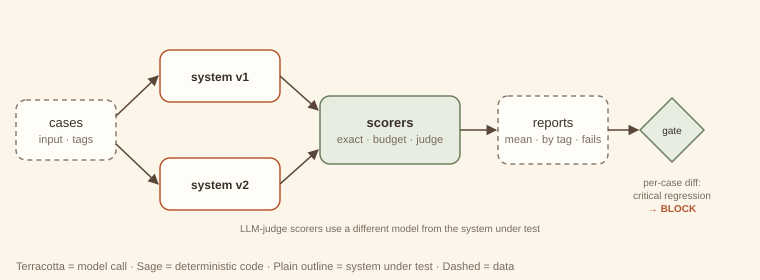

# 21. Eval harness

> **Intent.** Measure any LLM system offline against a fixed, versioned set of cases with deterministic scorers (plus calibrated model-judge scorers where needed), and compare versions *case by case*, so that "better on average" can never hide "broken where it matters".

**Also known as:** offline evals, regression suite for prompts, LLM test harness · **Part:** 4 — Cross-cutting · **Code:** `code/patterns/eval_harness/` *(canonical module, imported by the support-triage capstone)*

## Structure



Cases (input, expected values, tags such as `critical`) run through each version of the system. Scorers turn each output into numbers between 0 and 1: exact field checks, budget checks, and optionally an LLM judge from a *different* model. Reports aggregate by scorer and by tag, and list the failing cases. A comparison diffs two reports case by case, and a gate decides: any critical regression blocks, whatever the averages say.

## Design concept & theory

**Core idea.** LLM systems change constantly: prompts, models, retrieval settings, tools. Without measurement, every change is a guess, and regressions are found by users. An eval harness makes changes *testable* the way unit tests make code changes testable, adapted for outputs that are probabilistic and judged rather than exact.

**Why it works.**

- *Fixed cases make versions comparable.* The same inputs, scored the same way, isolate the effect of the change. Cases are data, versioned with the code.
- *Deterministic scorers first.* Route equals expected, field present, under budget, no card number: these are exact, free and stable. Use model judges only for what code cannot check, and fail them closed on unparseable output.
- *Per-case comparison catches what averages hide.* In the example, v2 improves route accuracy from 0.70 to 0.90, a clear win on average, and still breaks `c08`, a *critical* billing case. Simpson's-paradox-style surprises are the norm in LLM evals, because improvements and regressions land on different slices.
- *Tags define what matters.* `critical` marks the cases where a regression is unacceptable regardless of the average. Slice gates (the exercise) turn that policy into data.
- *Judges need calibration.* A judge from the same model as the system grades itself generously (the support-triage capstone hit this). A judge with position bias picks whichever answer came second ([debate](../part-3-multi-agent/15-debate.md) exercise). A judge is a model with error rates, so measure it.

**Invariants.** (1) Fixed, versioned cases. (2) Scorers return 0..1, and crashes score 0 rather than aborting the run. (3) Comparison is per case, with critical slices gated separately. (4) Evaluation is offline and development-time.

**Lineage.** Unit and regression testing; golden-file tests; A/B testing's guardrail metrics; ML's held-out test sets, with tags as slices.

## When to use / when not to use

| Use it when | Don't use it when |
|---|---|
| You will change prompts, models or parameters more than once. | Never. Even a 10-case harness beats none. |
| A regression on some inputs would be costly. | (Scale it down rather than skip it.) |
| You need to justify "the new version is better". | Using it as a *runtime* loop. That is [evaluator–optimizer (#5)](../part-1-workflow/05-evaluator-optimizer.md). |
| Several people change the system. | Treating eval scores as product truth: they are evidence about your cases. |

**Cheaper alternative:** a handful of manual spot-checks before each release. It works for a prototype, but it misses regressions on cases nobody re-checked. The harness is the cheapest *reliable* option, and every capstone here ends with one.

## Forces & trade-offs

| Force | vs. manual spot-checks | Why |
|---|---|---|
| Latency (of the dev loop) | ↓ | Run the whole suite in minutes instead of hours of review. |
| Cost | ↑ small | Model calls per case per version, plus judge calls; deterministic scorers are free. |
| Reliability (of releases) | ↑↑ | Regressions caught before users see them. |
| Complexity | ↑ | Curating cases, writing scorers, calibrating judges, maintaining gates. |

## Trade-off analysis & usage guidance

**Model.** Cost per run ≈ cases × (system calls + judge calls). For 200 cases, 3 system calls each and 1 judge call, that is 800 calls per version. Run on every prompt or model change, not every commit. Keep a fast deterministic subset for every commit.

**Building the case set.**

- Start from real traffic, plus the failures users reported (each bug becomes a case).
- Tag by slice: `critical`, intent type, language, length. Write expected values from the *spec*, before the system exists (as every capstone brief did).
- Include *should-fail* cases: inputs where the right answer is to abstain, escalate or refuse.
- Keep it small enough to run often (tens to hundreds), and grow it with every incident.

**Decision checklist.**

1. Are expected values written from the spec, not from the current output?
2. Which scorers are deterministic, and which judges need calibration?
3. What are the gates: overall thresholds, slice thresholds, and zero critical regressions?
4. Is the judge a different model, and has it been checked for position and length bias?
5. Is the harness wired into the release process, so that it can block?

**Usage in production.**

- Store reports per version, and diff them in code review like test results.
- Add every production incident as a tagged case before fixing it.
- Track judge–human agreement on a sample; re-calibrate when the judge model changes.
- Never tune on the full eval set. Hold out a slice so the system does not overfit to its own tests.

## Worked example

### Example first: what happens

```
python3 code/patterns/eval_harness/main.py
```

<!-- expected-output: code/patterns/eval_harness/main.py -->
```text
Eval harness
============
v1 keywords:
  route_correct    0.70  [critical] 1.00  fails: c05, c09, c10
  llm_calls<=1     1.00  [critical] 1.00  fails: -
v2 llm:
  route_correct    0.90  [critical] 0.67  fails: c08
  llm_calls<=1     1.00  [critical] 1.00  fails: -
comparison:
  route_correct    0.70 -> 0.90 (+0.20)
  llm_calls<=1     1.00 -> 1.00 (+0.00)
  fixed:      c05/route_correct, c09/route_correct, c10/route_correct
  regressed:  c08/route_correct (critical)
  verdict:    BLOCK — 1 critical regression(s)
```

**v1** (ordered keyword rules) gets 0.70: it misroutes a payment error as billing, and misses "declined" and "slow". **v2** (LLM classifier) gets 0.90 and fixes all three, but routes "Invoice shows the wrong company name" to *account*. That case is tagged `critical`, so the comparison lists it as a critical regression and the verdict is **BLOCK**, even though every average improved. The exercise turns this into a gate policy and shows a v3 that fixes `c08` passing.

### Why first: why it is built this way

- **Scorers are plain functions with a name and, for graded scorers, a pass mark.** Reports list failures per scorer, and a 0.86 quality mean with `fails: TK-106` is actionable in a way a bare 0.86 is not.
- **Crashes score zero.** `run_eval` catches system exceptions per case, records them, and keeps going. A partial report is far more useful than a stack trace.
- **`compare` works per case.** Regressions are tuples (case, scorer, critical?), and the verdict reads them. Averages are reported but never decide alone.
- **The verdict is conservative.** Any critical regression blocks; any drop in a mean blocks; only then SHIP. Shipping is the claim that needs evidence.

## Failure modes & guardrails

| Failure mode | Symptom | Guardrail |
|---|---|---|
| Averages hide regressions | Mean up, key case broken. | Per-case diff; critical tags; slice gates. |
| Self-grading judge | Inflated quality scores. | A different judge model; calibrate on human labels. |
| Biased judge | Order or length decides. | Swap-order checks; length-controlled prompts. |
| Overfitting to the eval set | Scores rise, users unhappy. | Held-out slice; refresh cases from real traffic. |
| Expected values copied from outputs | The harness "passes" whatever the system does. | Write expectations from the spec, before the run. |
| Flaky scores | Same version, different results. | Fixed seeds and temperatures for evals; repeat runs on noisy cases. |

## Variations

- **Pairwise comparison.** A judge picks the better of two outputs, which is more sensitive than absolute scores but needs order-swapping.
- **Online evals.** Sample production traffic and score it continuously, alongside the offline gate.
- **Trajectory evals.** Score the steps an agent took (tool calls, cost, turns), not just the final answer.
- **Eval-driven development.** Write the failing case first, then change the prompt until it passes, which is TDD for prompts.

## Try it

Turn the acceptance policy into data: write `gate(report, thresholds)` where a threshold may name a tag slice (`"route_correct@critical": 1.0`). Show that v1 fails the overall bar, v2 fails the critical-slice bar, and a v3 that fixes `c08` passes both.

→ Solution: [Solutions — Eval harness](../solutions/21-eval-harness.md)

## 60-second interview lens

- **Say:** "An eval harness runs a fixed, tagged case set through each version with deterministic scorers first and calibrated judges second, and compares versions case by case, with critical slices gated separately."
- **Trade-off to name:** curation and run cost, in exchange for catching regressions before users do. Averages alone will mislead you.
- **Expect the follow-up:** "How do you trust an LLM judge?" Use a different model, calibrate it against human labels, check for position and length bias, and fail closed on unparseable verdicts.
- **Red flag to avoid:** declaring a change better because the mean went up.

## Related patterns

- [Evaluator–optimizer (#5)](../part-1-workflow/05-evaluator-optimizer.md): runtime improvement of one output, not development-time measurement.
- [Guardrailed generation (#11)](../part-2-single-agent/11-guardrailed-generation.md): the same deterministic checks, as validators at runtime.
- [Debate (#15)](../part-3-multi-agent/15-debate.md): its exercise is the judge-bias check you need here too.
- [Support-triage capstone](../capstones/support-triage.md): acceptance thresholds from the brief, enforced by this harness.
