# eda-commerce architecture

This document is the shared design for both implementations. If the Python build and the Java build disagree about something, this document and the files in `contracts/` decide who is right.

It covers the bounded contexts and how they relate, who owns which data, the two sagas with every failure branch, the topic catalogue, the consistency model, the SLOs, and the chaos drills that prove the design holds. The reasoning behind each choice lives in the ADRs under `docs/adr/`. This document says *what*; the ADRs say *why* and *what it costs*.

## 1. The system in one paragraph

A customer browses products, fills a cart and places an order. Placing the order is asynchronous: the checkout service answers `202 Accepted` with an order id within a few hundred milliseconds, and an order saga takes over. The saga reserves stock, authorises the card, asks the warehouse to pick and pack, waits for the parcel to leave, captures the payment, issues an invoice, and follows the carrier until delivery. Within 30 days of delivery the customer can return items, which starts a second saga that runs mostly in reverse: label, parcel, inspection, restock, refund. Every service owns its database and talks to the others only through Kafka, with Avro contracts registered in Schema Registry.

The external world is deliberately unreliable. The payment provider declines, times out and sends the same webhook three times. The warehouse is slow and loses requests. The carrier sends tracking updates twice and out of order. The design must absorb all of that without losing an order, charging twice or shipping something unpaid.

## 2. Context map

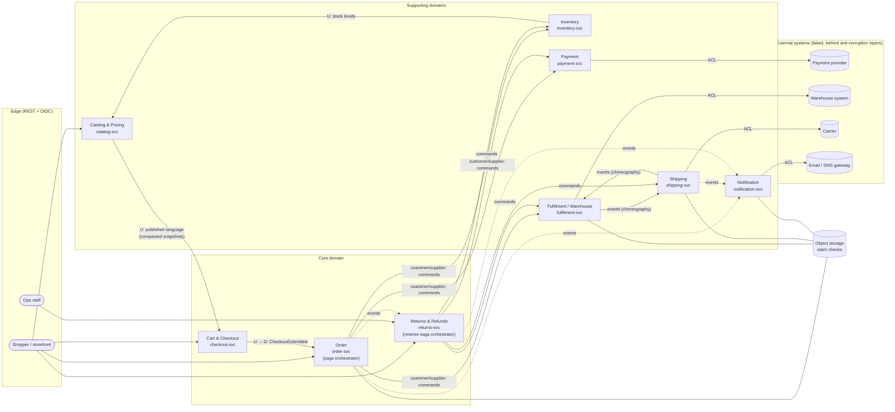

How to read the relationships:

- **Published language.** Catalog and Inventory publish state snapshots on compacted topics. Consumers conform to that language and keep their own copy. Nobody calls catalog-svc at checkout time.
- **Customer/supplier.** The orchestrators (order-svc, returns-svc) are customers of Inventory, Payment, Fulfilment and Shipping. The suppliers define the commands they accept and the replies they emit. The orchestrator adapts to them, not the other way around.
- **Anti-corruption layer (ACL).** Each external system sits behind a port. The domain never sees PSP status codes, carrier status strings or WMS message formats. The fakes implement the same ports, so a real adapter replaces a fake without touching the domain.
- **Choreography.** Fulfilment and Shipping cooperate by reacting to each other's events (packed → label booked → dispatched). Notification and the read models only listen.

## 3. Services, responsibilities and data ownership

Every service has its own Postgres database (`<name>_db`, owner role `<name>_svc`). No service reads another service's tables. The shared tables (`outbox`, `inbox`, `idempotency_key`, `saga_*`) are defined once in `contracts/sql/common-tables.sql`.

| Service (port) | Responsibility | Owns (tables) | Publishes | Consumes |
|---|---|---|---|---|
| catalog-svc (8101) | Product master data and prices. Browse API. | `product`, `price`, `stock_level_view` | `catalog.product.v1`, `catalog.price.v1` | `inventory.stock-level.v1` |
| checkout-svc (8102) | Carts, price validation, order submission. Mints the `orderId`. | `cart`, `cart_line`, `checkout`, `catalog_view`, `idempotency_key` | `checkout.events.v1` | `catalog.product.v1`, `catalog.price.v1`, `inventory.stock-level.v1`, `order.events.v1` |
| order-svc (8103) | Order aggregate and the **order saga** orchestrator. Invoice rendering. Order status API. | `orders`, `order_line`, `saga_instance`, `saga_transition`, `invoice`, `invoice_counter` | `order.events.v1`, `inventory.commands.v1`, `payment.commands.v1`, `fulfilment.commands.v1` | `checkout.events.v1`, `inventory.events.v1`, `payment.events.v1`, `fulfilment.events.v1`, `shipping.events.v1` |
| order-history-projector (no HTTP; same codebase as order-svc) | CQRS read model of orders for the status and history API. | schema `order_history` in `order_db` | nothing | `order.events.v1`, `payment.events.v1`, `fulfilment.events.v1`, `shipping.events.v1`, `returns.events.v1`, `notification.events.v1` |
| payment-svc (8104) | Authorise, capture, void, refund. PSP adapter (fake PSP included). Reconciliation of unknown outcomes. | `payment`, `payment_attempt`, `refund`, `psp_webhook` | `payment.events.v1` | `payment.commands.v1`, PSP webhooks (HTTP) |
| inventory-svc (8105) | Stock per SKU, reservations with TTL, restocks. | `stock`, `reservation`, `reservation_line` | `inventory.events.v1`, `inventory.stock-level.v1` | `inventory.commands.v1` |
| fulfilment-svc (8106) | Warehouse orders: pick, pack, dispatch. Returns intake and inspection. WMS adapter (fake WMS included). Packing manifests. | `fulfilment`, `parcel`, `return_intake` | `fulfilment.events.v1` | `fulfilment.commands.v1`, `shipping.events.v1` |
| shipping-svc (8107) | Carrier bookings, labels, tracking normalisation. Carrier adapter (fake carrier included). | `shipment`, `tracking_event` | `shipping.events.v1` | `fulfilment.events.v1`, `shipping.commands.v1`, carrier webhooks (HTTP) |
| notification-svc (8108) | Customer emails and SMS with attachments. Owns contact details for messaging. | `contact`, `notification` | `notification.events.v1` | `order.events.v1`, `payment.events.v1`, `shipping.events.v1`, `returns.events.v1` |
| returns-svc (8109) | Return eligibility, RMA, the **returns saga** orchestrator. | `return_request`, `return_line`, `eligibility_view`, `saga_instance`, `saga_transition` | `returns.events.v1`, `payment.commands.v1`, `inventory.commands.v1`, `fulfilment.commands.v1`, `shipping.commands.v1` | `order.events.v1`, `payment.events.v1`, `inventory.events.v1`, `fulfilment.events.v1`, `shipping.events.v1` |

A few ownership decisions are worth spelling out, because they are where teams usually argue:

- **checkout-svc mints the orderId.** The HTTP response needs an id the client can poll, and it cannot wait for the saga. Minting it at the edge also makes the id the partition key from the very first event.
- **order-svc owns the invoice, not payment-svc.** An invoice is a legal document about an order (lines, tax, addresses). Payment knows amounts, not lines.
- **notification-svc stores contact details.** It learns them from `OrderPlaced` and keeps them under its own retention rules. Other events then carry only ids, which keeps personal data out of most topics (ADR-013).
- **The order-history projector is a separate process from the same codebase.** It has its own consumer group and its own lag. A slow projection never slows the saga (ADR-010).

## 4. Integration style: where we orchestrate and where we choreograph

The rule is simple. **Orchestrate where money or stock must be compensated. Choreograph where the flow only moves forward.** ADR-001 has the full argument.

| Flow segment | Style | Why |
|---|---|---|
| Checkout → order created | Event (`CheckoutSubmitted`) | One producer, one consumer, no compensation. |
| Reserve stock → authorise payment → commit stock → request fulfilment | **Orchestration** (order-svc) | Every step can fail and each failure needs a different set of compensations. One place must know the state. |
| Packed → label booked → dispatched | **Choreography** (fulfilment ↔ shipping) | Two services, a linear hand-off, no money involved. Adding an orchestrator step would only add latency and coupling. |
| Dispatched → capture → shipped → delivered | **Orchestration** resumes (order-svc) | Capture is money, and a failed capture after the parcel left needs a decision. |
| Notifications, read models | **Choreography** (listeners) | Pure reactions. Adding one must not require changing a producer. |
| Return → label → parcel → inspection → restock + refund | **Orchestration** (returns-svc) | Parallel steps, partial outcomes and a human decision point. |

## 5. The order saga

### 5.1 State machine

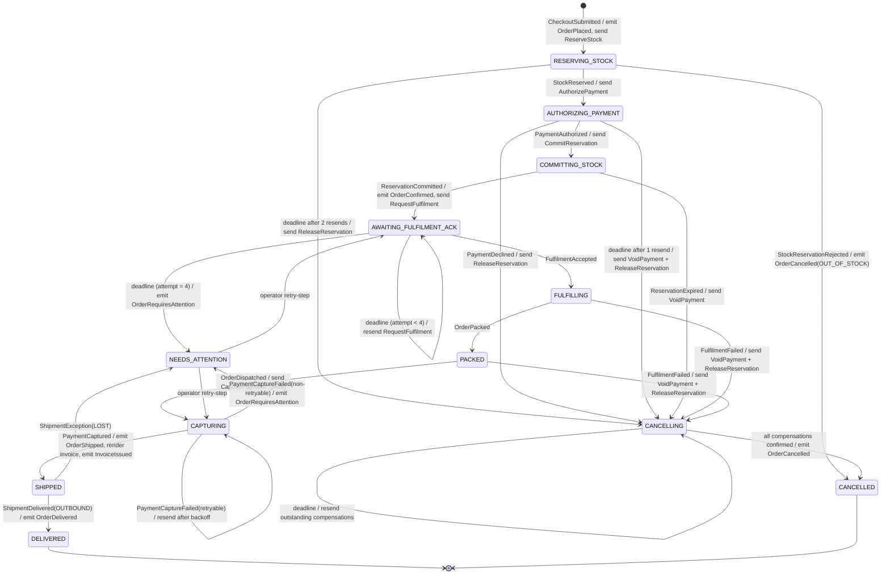

### 5.2 Step table

Timeouts are defaults; each one is an environment variable (see `infra/compose.apps.example.yml`).

| State | Command sent | Success reply | Failure reply | Deadline | On deadline | Compensation if a later step fails |
|---|---|---|---|---|---|---|
| RESERVING_STOCK | `ReserveStock` (reservationId, TTL 900 s) | `StockReserved` | `StockReservationRejected` | 30 s | Resend same command (same reservationId) twice, then cancel and send `ReleaseReservation` in case the reply was lost | `ReleaseReservation` |
| AUTHORIZING_PAYMENT | `AuthorizePayment` (paymentId) | `PaymentAuthorized` | `PaymentDeclined` | 180 s | Resend once (payment-svc dedupes on paymentId), then cancel with `VoidPayment` | `VoidPayment` |
| COMMITTING_STOCK | `CommitReservation` | `ReservationCommitted` | `ReservationExpired` | 30 s | Resend | `ReleaseReservation` (returns allocated stock) |
| AWAITING_FULFILMENT_ACK | `RequestFulfilment` (fulfilmentId, attempt n) | `FulfilmentAccepted` | `FulfilmentFailed` | 600 s | Resend with attempt n+1, up to 3 resends, then NEEDS_ATTENTION | `CancelFulfilment` |
| FULFILLING / PACKED | none (waiting) | `OrderPacked`, `OrderDispatched` | `FulfilmentFailed` | 24 h | NEEDS_ATTENTION | as above |
| CAPTURING | `CapturePayment` | `PaymentCaptured` | `PaymentCaptureFailed` | 300 s | Resend (payment-svc dedupes) | **none: past the pivot** |
| SHIPPED | none | `ShipmentDelivered` | `ShipmentException` | 30 days | NEEDS_ATTENTION | none |
| CANCELLING | outstanding compensations | `ReservationReleased`, `PaymentVoided`, `FulfilmentCancelled` | none (compensations must succeed) | 60 s | Resend outstanding compensations, forever, with backoff; alert after 10 | n/a |

### 5.3 Rules every orchestrator follows

1. **One transaction per transition.** Read saga row, apply event, update row (version check), insert transition row, insert outbox rows for the commands and events. Commit. Then commit the Kafka offset. A crash anywhere replays the event, and the inbox turns the replay into a no-op.
2. **Business ids are minted once and stored in saga data.** `reservationId`, `paymentId`, `fulfilmentId` are created when the saga enters the step and reused for every resend. That is what makes a resend safe.
3. **Replies are matched by business id and state, not by arrival order.** A `PaymentAuthorized` that arrives while the saga is already CANCELLING is not an error. The saga records it and sends `VoidPayment`.
4. **Early events are recorded, not rejected.** Kafka orders messages per key *within one topic*. Across topics there is no order at all, even with the same key. A `ShipmentDelivered` can arrive before `PaymentCaptured`. The saga stores the fact in `data.pending` and applies it when it reaches the state that expects it.
5. **The pivot is explicit.** Before `OrderDispatched`, every step is compensatable. After it, every step is retriable and the only escape hatch is a human (NEEDS_ATTENTION). Nobody writes code that "un-ships" a parcel.
6. **Compensations are commands like any other.** They have business ids, they are idempotent, and the saga waits for their replies. "Fire and forget" compensation is how money gets stuck.

### 5.4 Sequence: happy path, checkout to delivery

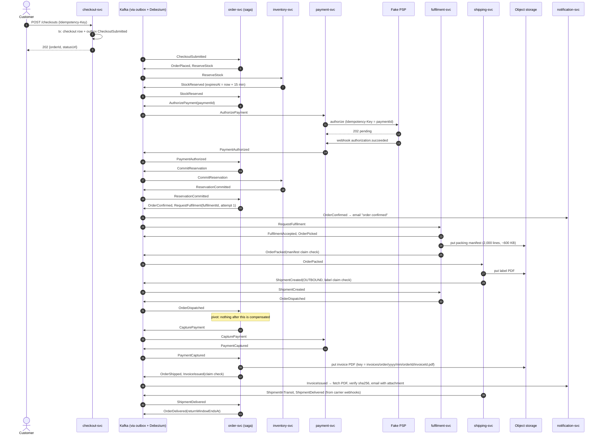

### 5.5 Sequence: payment declined

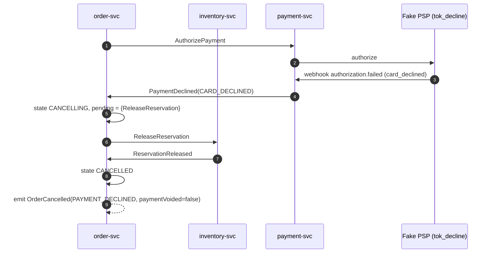

### 5.6 Sequence: PSP timeout and duplicate webhooks

The PSP timeout is the most realistic failure in the system. A timeout means *we do not know*. The money may or may not be held.

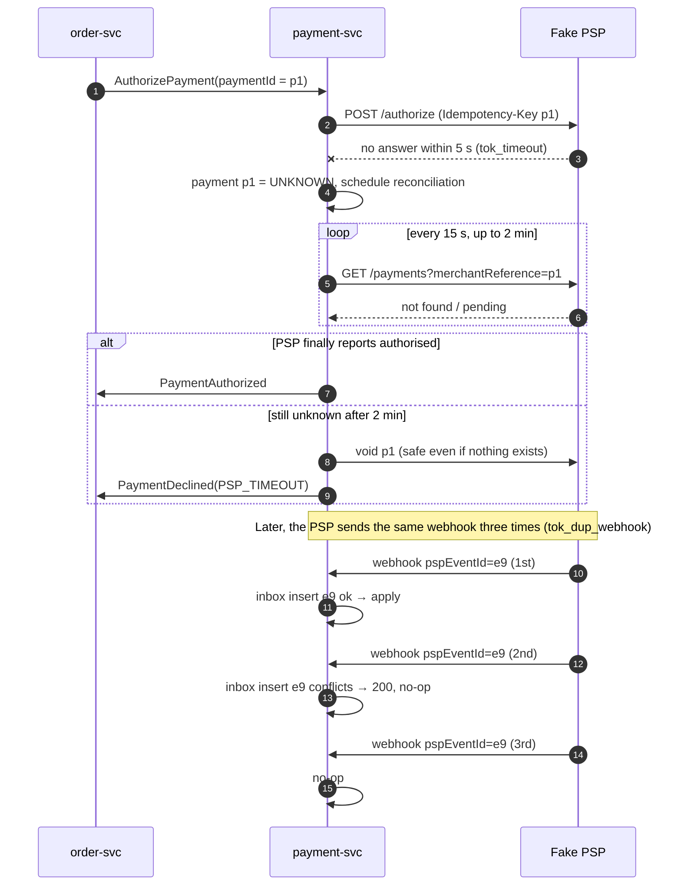

If a late `authorization.succeeded` webhook arrives after payment-svc already declared `PSP_TIMEOUT`, payment-svc voids it immediately and records the void. The order saga never hears about it. That is the anti-corruption layer doing its job.

### 5.7 Sequence: reservation expires before payment finishes

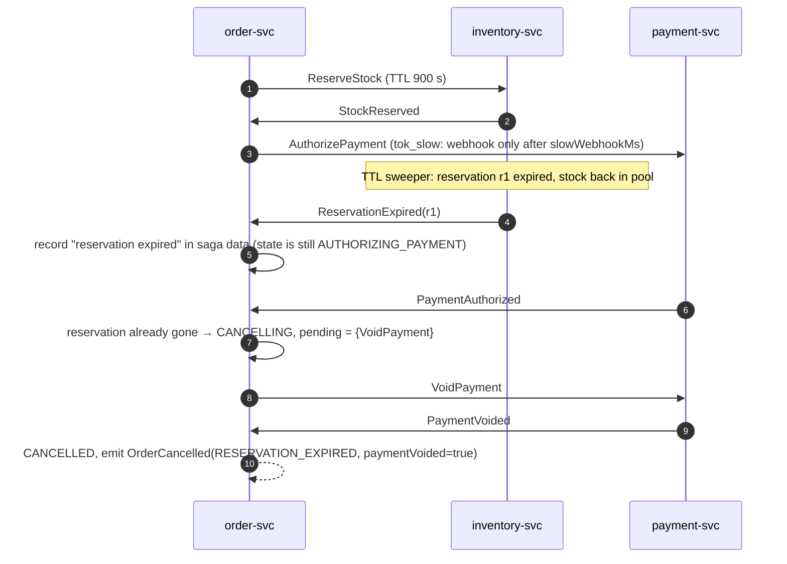

The drill makes the race deterministic: `tok_slow` delays the webhook by `slowWebhookMs` (90 s by default), and the test runs inventory-svc with `RESERVATION_TTL=60s`. In production the TTL (15 min) only loses this race on the PSP-timeout path.

An alternative is to re-reserve and carry on. We chose to cancel because a second reservation can fail too, and a customer who waited that long deserves a clear answer, not a third outcome. Revisit this if the business says expiries are common.

### 5.8 Sequence: the warehouse loses the request

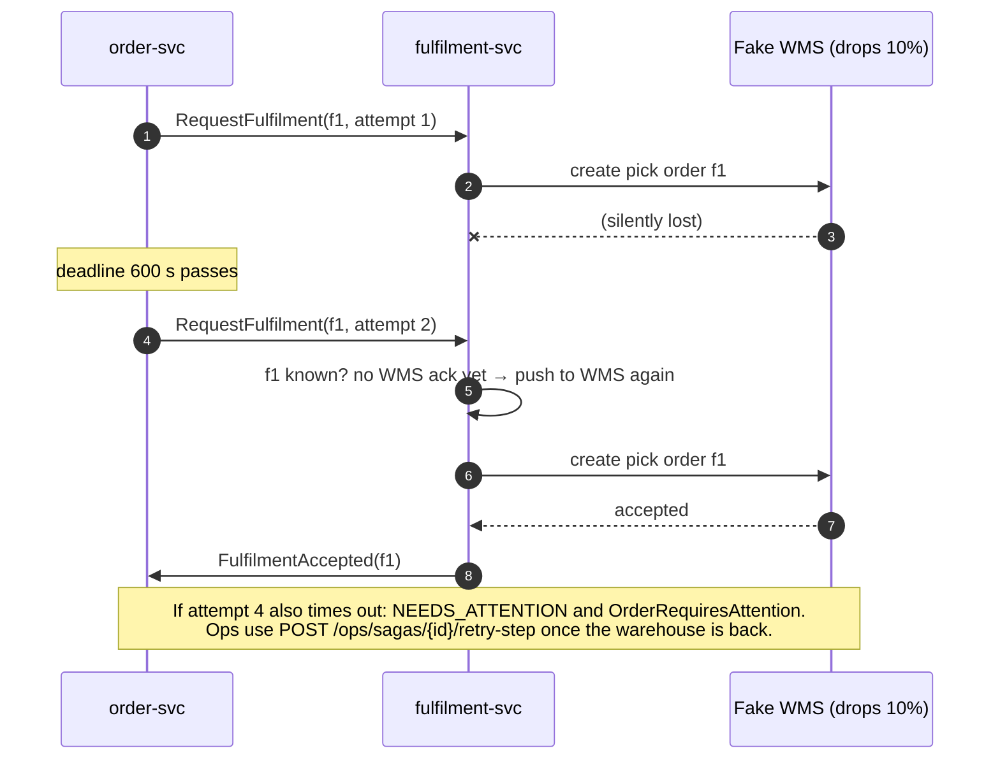

### 5.9 Sequence: capture fails after dispatch (past the pivot)

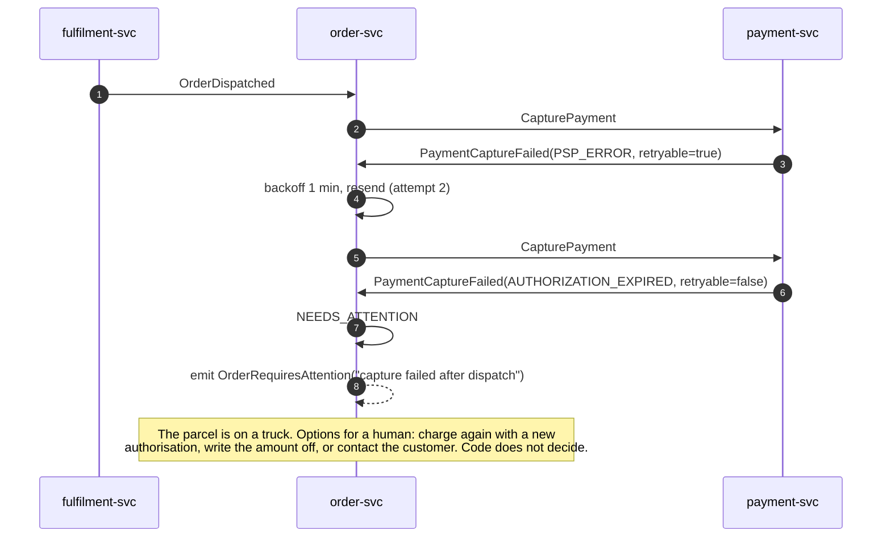

### 5.10 Sequence: carrier webhooks duplicated and out of order

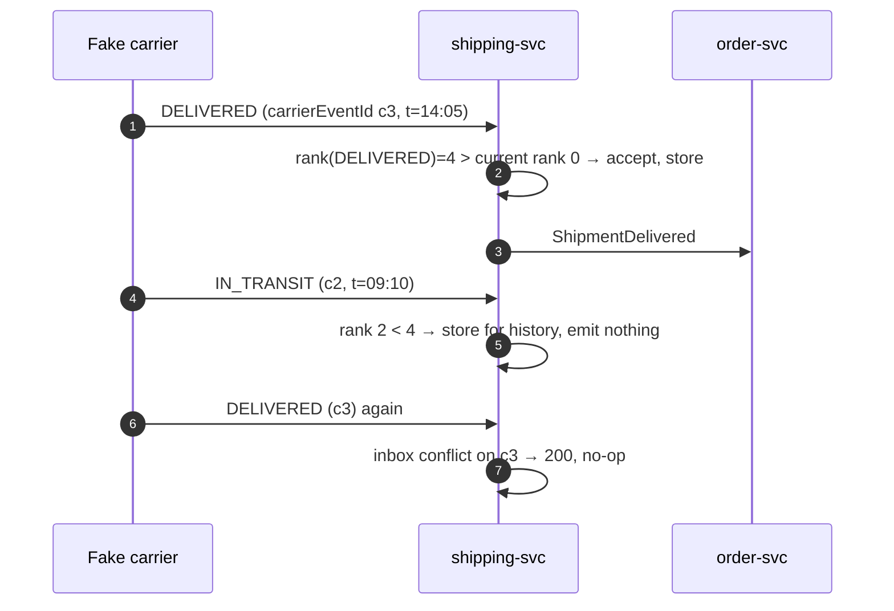

shipping-svc normalises the carrier's world so downstream services see each status at most once and never move backwards. Every raw webhook is still stored in `tracking_event` for audit.

## 6. The returns saga (reverse flow)

### 6.1 State machine

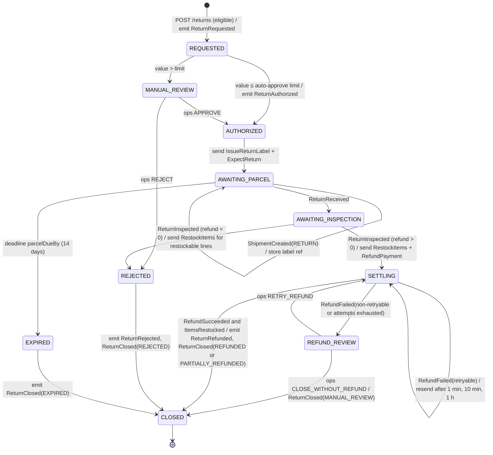

### 6.2 Why it is a "forward-recovery" saga

The order saga compensates. The returns saga almost never does. Once a parcel is back on a shelf, nothing is gained by "un-restocking" it because a refund failed. So every step after inspection is **retried until it succeeds or a human decides**. That changes the code shape: no compensation table, but a retry schedule and a manual decision endpoint.

Refund amount rule (in the returns domain, not in payment):

- RESTOCKABLE lines: full line total.
- DAMAGED lines: full line total if the customer's reason was DAMAGED, WRONG_ITEM or NOT_AS_DESCRIBED (merchant fault); zero otherwise.
- MISSING lines: zero.
- Shipping fee: refunded only for merchant-fault reasons, and only on the first return of the order.

Several returns per order are allowed. The eligibility view tracks the quantity left per line.

### 6.3 Sequence: return, inspection with one damaged item, partial refund

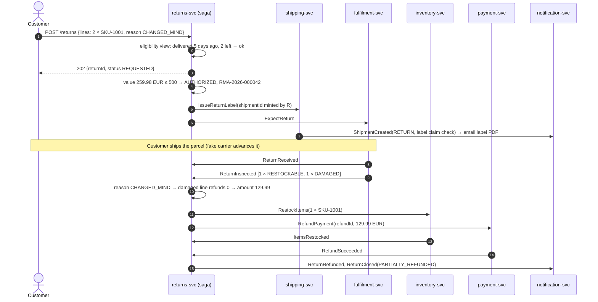

### 6.4 Sequence: refund keeps failing

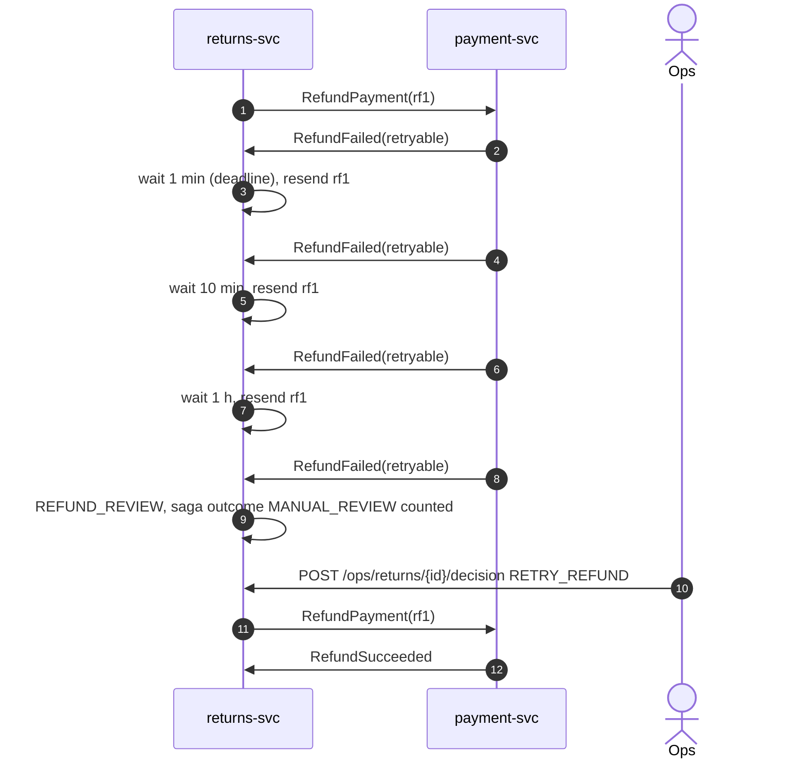

The same `refundId` is reused for every attempt. payment-svc passes it to the PSP as the idempotency key, so a "failed" attempt that actually succeeded at the PSP can never refund twice.

## 7. Large payloads: claim check

Three payloads are too big or too sensitive for Kafka messages:

| Payload | Producer | Bucket | Typical size | Lifecycle |
|---|---|---|---|---|
| Invoice PDF | order-svc | `invoices` | 50–200 KB | Kept (legal retention; object lock in production) |
| Packing manifest (per-item scans, lots, serials) | fulfilment-svc | `packing-manifests` | 100 KB – 5 MB | 90 days |
| Shipping label PDF | shipping-svc | `shipping-labels` | 30–100 KB | 30 days |

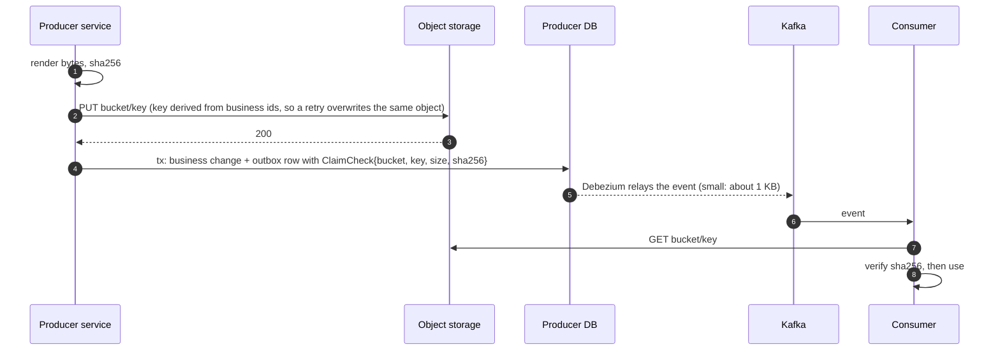

Ordering matters: **object first, event second**. If the transaction rolls back, the result is an orphan object, which the lifecycle rule eventually deletes. The reverse order would produce an event that points at nothing. ADR-009 covers thresholds, keys and security.

## 8. Topic catalogue

The machine-readable catalogue is `contracts/topics.yaml`. `infra/topics.conf` and `contracts/asyncapi/asyncapi.yaml` are generated from it. The table below is a readable copy.

| Topic | Kind | Key | Partitions | Cleanup / retention | Producers | Consumers | Messages | Ordering |
|---|---|---|---|---|---|---|---|---|
| `catalog.product.v1` | state | `sku` | 6 | compact | catalog-svc | checkout-svc | ProductUpserted | Per sku. Latest value wins after compaction. |
| `catalog.price.v1` | state | `sku` | 6 | compact | catalog-svc | checkout-svc | PriceChanged | Per sku. Latest value wins after compaction. |
| `inventory.stock-level.v1` | state | `sku` | 6 | compact | inventory-svc | catalog-svc, checkout-svc | StockLevelChanged | Per sku. Latest value wins after compaction. |
| `checkout.events.v1` | events | `orderId` | 12 | delete, 7d | checkout-svc | order-svc | CheckoutSubmitted | Per orderId. |
| `order.events.v1` | events | `orderId` | 12 | delete, 90d | order-svc | order-history-projector, notification-svc, returns-svc, checkout-svc | OrderPlaced, OrderConfirmed, OrderCancelled, OrderShipped, OrderDelivered, InvoiceIssued, OrderRequiresAttention | Per orderId. aggregateVersion is strictly increasing per order. |
| `payment.events.v1` | events | `orderId` | 12 | delete, 30d | payment-svc | order-svc, returns-svc, order-history-projector, notification-svc | PaymentAuthorized, PaymentDeclined, PaymentCaptured, PaymentCaptureFailed, PaymentVoided, RefundSucceeded, RefundFailed | Per orderId. |
| `inventory.events.v1` | events | `orderId` | 12 | delete, 7d | inventory-svc | order-svc, returns-svc | StockReserved, StockReservationRejected, ReservationCommitted, ReservationReleased, ReservationExpired, ItemsRestocked | Per orderId. |
| `fulfilment.events.v1` | events | `orderId` | 12 | delete, 30d | fulfilment-svc | order-svc, shipping-svc, returns-svc, order-history-projector | FulfilmentAccepted, OrderPicked, OrderPacked, OrderDispatched, FulfilmentCancelled, FulfilmentFailed, ReturnReceived, ReturnInspected | Per orderId. |
| `shipping.events.v1` | events | `orderId` | 12 | delete, 30d | shipping-svc | order-svc, fulfilment-svc, returns-svc, notification-svc, order-history-projector | ShipmentCreated, ShipmentInTransit, ShipmentDelivered, ShipmentException | Per orderId after shipping-svc has de-duplicated and re-ordered carrier webhooks. |
| `returns.events.v1` | events | `orderId` | 12 | delete, 90d | returns-svc | order-history-projector, notification-svc | ReturnRequested, ReturnAuthorized, ReturnRejected, ReturnRefunded, ReturnClosed | Per orderId, which also orders several returns of the same order. |
| `notification.events.v1` | events | `orderId` | 6 | delete, 30d | notification-svc | order-history-projector | NotificationSent | Per orderId. Notifications without an order use customerId as key. |
| `payment.commands.v1` | commands | `orderId` | 12 | delete, 7d | order-svc, returns-svc | payment-svc | AuthorizePayment, CapturePayment, VoidPayment, RefundPayment | Per orderId, so Authorize is always seen before Capture or Void for the same order. |
| `inventory.commands.v1` | commands | `orderId` | 12 | delete, 7d | order-svc, returns-svc | inventory-svc | ReserveStock, CommitReservation, ReleaseReservation, RestockItems | Per orderId. |
| `fulfilment.commands.v1` | commands | `orderId` | 12 | delete, 7d | order-svc, returns-svc | fulfilment-svc | RequestFulfilment, CancelFulfilment, ExpectReturn | Per orderId. |
| `shipping.commands.v1` | commands | `orderId` | 6 | delete, 7d | returns-svc | shipping-svc | IssueReturnLabel | Per orderId. |

All topics: replication factor 3 and `min.insync.replicas=2` in production (1 locally), producer `acks=all`, idempotent producers, Avro values in the Confluent wire format, string keys. Subjects follow `TopicRecordNameStrategy` with `FULL_TRANSITIVE` compatibility (ADR-004).

### 8.1 Retry and dead-letter topics

Every consumer group `G` gets four extra topics (ADR-007):

| Topic | Partitions | Retention | Purpose |
|---|---|---|---|
| `G.retry.10s` | 6 | 7 days | First non-blocking retry, not before 10 s after failure |
| `G.retry.1m` | 6 | 7 days | Second retry |
| `G.retry.10m` | 6 | 7 days | Third retry |
| `G.dlq` | 3 | 30 days | Parked. Needs a human or `POST /ops/dlq/replay` |

Retry and DLQ topics belong to one consumer group, so a replay disturbs nobody else. They carry the original key and value bytes unchanged, plus the headers `x-retry-attempt`, `x-original-topic`, `x-original-partition`, `x-original-offset`, `x-not-before`, `x-error-class`, `x-error-message` and `x-failed-consumer-group`.

### 8.2 Ordering guarantees

- **Per key, per topic: ordered.** All order-flow topics are keyed by `orderId` and have 12 partitions (shipping commands and notifications: 6). Producers are idempotent (`enable.idempotence=true`, `acks=all`), so retries never reorder.
- **Across topics: no order.** Even with the same key, `payment.events.v1` and `shipping.events.v1` are independent logs. Section 5.3 rule 4 handles this.
- **Retry topics break per-key order for the retried message.** We accept that because every handler guards on state and version (ADR-007).
- **Compacted state topics: last value wins.** Consumers must treat every record as a full snapshot and never as a delta.

### 8.3 Message headers

Debezium copies these from outbox columns. Producers that bypass the outbox (none in this system) would have to set them too.

| Header | Source | Example |
|---|---|---|
| `ce_id` | `envelope.eventId` | `0193a1c4-…` |
| `ce_type` | `envelope.type` | `com.edacommerce.order.OrderPlaced` |
| `ce_source` | `envelope.producer` | `order-svc` |
| `ce_specversion` | constant | `1.0` |
| `ce_time` | `envelope.occurredAt` | `2026-11-18T09:46:40.123Z` |
| `correlation_id`, `causation_id` | envelope | |
| `traceparent`, `tracestate` | W3C trace context | `00-4bf9…-00f0…-01` |
| `id` | added by the Debezium router | same as `ce_id` |

The `ce_*` names follow the CloudEvents Kafka binding, so tools that understand CloudEvents can route on them. The Avro envelope is still the source of truth; headers are a convenience for routing, filtering and tracing without deserialising.

## 9. Consistency model

**Inside one service: strong.** Every state change and the events it produces commit in one Postgres transaction (the outbox). Inventory enforces "stock never negative" with a conditional update (`UPDATE stock SET reserved = reserved + :q WHERE sku = :s AND on_hand - reserved >= :q`). Reservations are all-or-nothing per order.

**Across services: eventual, with semantic atomicity.** There is no distributed transaction. The saga guarantees that an order either reaches DELIVERED or reaches CANCELLED with every compensation confirmed, or lands in NEEDS_ATTENTION where a human owns it. Nothing ends half-done and silent.

**Delivery: at-least-once everywhere, effectively-once in effect.** Outbox + Debezium may publish an event twice (connector restart). Consumers may see a message twice (rebalance before commit). The inbox table plus idempotent business ids (paymentId, refundId, reservationId, fulfilmentId, shipmentId) turn duplicates into no-ops. Kafka exactly-once transactions are not used, because they cannot span Kafka and Postgres (ADR-003).

**Read models: eventually consistent, monotonic.** The order-history projection lags the saga by its event age (SLO: p99 < 2 s). Every projected row stores the `aggregateVersion` it reflects, and an update with a lower or equal version is dropped. Clients therefore never see time go backwards. Right after checkout, `GET /orders/{id}` falls back to the saga table so the customer sees PENDING instead of 404 (read-your-writes for the one case where it matters).

**Saga isolation: none, so we use countermeasures.** Sagas lack the I in ACID. Other transactions can see intermediate states. The countermeasures used here are the classic ones:

| Anomaly | Where it shows up | Countermeasure |
|---|---|---|
| Dirty read | A reserved-then-released unit briefly looks unavailable on the product page | Accept: stock levels are advisory (*commutative* counters, eventual) |
| Lost update | Two buyers race for the last unit (SKU-1005) | *Pessimistic view*: reserve stock **before** taking money, with a conditional update |
| Fuzzy read | Price changes between cart view and checkout | *Reread value*: the client sends `expectedTotal`; mismatch → 422 |
| Semantic inconsistency | Customer sees "confirmed" while capture later fails | *Semantic lock*: status names describe what is true (CONFIRMED ≠ PAID); NEEDS_ATTENTION is visible |

## 10. Service level objectives

SLOs are measured over 30 days. Each has a Prometheus expression in `infra/prometheus/rules/eda-slo.yml` or the Grafana dashboard.

| # | SLI | Objective | Measured from |
|---|---|---|---|
| 1 | `POST /checkouts` availability (non-5xx) | 99.9 % | spanmetrics on checkout-svc server spans |
| 2 | `POST /checkouts` latency | p99 < 300 ms | spanmetrics |
| 3 | `GET /orders/{id}` latency | p99 < 150 ms | spanmetrics |
| 4 | Time to decision (`CheckoutSubmitted` → `OrderConfirmed` or `OrderCancelled`) | p95 < 5 s, p99 < 30 s; 100 % < 4 min | `eda_saga_step_duration_seconds{saga_type="ORDER", step="DECISION"}` |
| 5 | Event age at consumer, saga topics | p99 < 2 s | `eda_event_age_seconds` |
| 6 | Order-history staleness | p99 < 2 s | `eda_event_age_seconds{consumer_group="order-history-projector"}` |
| 7 | Stuck sagas (past deadline + 60 s, unhandled) | 0 for more than 5 min | `eda_saga_overdue` |
| 8 | Dead-letter rate | < 0.01 % of consumed messages; each DLQ message triaged within 1 business day | `eda_dlq_messages_total` / `eda_consumer_processed_total` |
| 9 | Notification latency (trigger event → sent) | p95 < 60 s | `eda_event_age_seconds{consumer_group="notification-svc"}` plus send span |
| 10 | Accepted orders lost | 0 (every 202 eventually has an `OrderPlaced`) | daily reconciliation query: checkout rows without order rows |

**Error budget policy.** When an SLO burns more than half its monthly budget in a week, feature work on the owning service stops until a fix or an explicit risk acceptance lands. SLO 10 has no budget; any loss is a sev-1.

The fakes inject failure on purpose (5 % declines, 10 % warehouse drops). Those orders still count for SLO 4. The point is to prove the design meets its objectives *while* the world misbehaves.

## 11. Chaos drills

Run each drill under steady load (1–5 orders per second from a simple load script) and watch the Grafana dashboard. A drill passes when every pass criterion holds. `make chaos` lists them.

| Drill (`make …`) | What breaks | Expected behaviour | Pass criteria |
|---|---|---|---|
| `chaos-kafka DURATION=60` | Broker paused | Debezium and consumers block and retry. HTTP checkout still answers 202 (the outbox absorbs writes). | After resume: lag drains within 2 min, no DLQ entries, every 202 order reaches a terminal or waiting state |
| `chaos-connect DURATION=120` | Outbox relay down | Writes succeed, `outbox` grows, event age spikes, then events arrive in order | Zero lost events (count outbox rows vs topic records); duplicates absorbed (`outcome="duplicate"` rises, nothing else) |
| `chaos-postgres DURATION=30` | All databases stalled | HTTP 503 fast (pool timeout ≤ 2 s); consumers retry in place, offsets not committed | No message skipped; no DLQ entries for transient DB errors |
| `chaos-minio DURATION=60` | Claim-check store down | Invoice and manifest producers fail **before** writing outbox rows and retry; notification retries downloads via retry topics | No event references a missing object; DLQ empty after recovery |
| `chaos-registry DURATION=60` | Schema Registry down | Running services keep working on cached schema ids | No errors for known schemas; a fresh service start fails readiness instead of producing |
| `chaos-service SVC=order-svc` | Orchestrator killed mid-flight | Rebalance; another instance (or the restart) resumes from committed offsets and saga rows | No saga stuck; deadline sweeper picks up timers; `eda_saga_overdue` returns to 0 |
| `chaos-psp-declines` | 50 % declines | Many CANCELLED(PAYMENT_DECLINED), all reservations released | Stock levels return to the pre-test value once all sagas settle |
| `chaos-psp-timeouts` | 33 % PSP timeouts | Reconciliation resolves most; the rest become PSP_TIMEOUT declines with a void | No order both cancelled and captured; time to decision 100 % < 4 min |
| `chaos-psp-duplicates` | Every webhook ×3 | Inbox dedupes | Exactly one PaymentAuthorized per paymentId on the topic |
| `chaos-wms` | 50 % lost requests, slow accept | Saga deadlines resend RequestFulfilment | Every confirmed order reaches FULFILLING or NEEDS_ATTENTION; no duplicate pick orders in the WMS fake |
| `chaos-carrier` | Duplicated and reordered webhooks | shipping-svc normalises | Each order gets exactly one ShipmentDelivered; status never moves backwards in the read model |
| Interop drill (manual) | order-svc in Java, payment-svc and inventory-svc in Python (or the reverse) | Same as the happy path | Golden example messages decode on both sides; the full flow completes |

## 12. Runbooks

### Runbook: consumer lag

1. Open the dashboard row "Kafka consumers". Is the lag on one group or all groups?
2. One group: check its pods or processes. Is it crash-looping (poison message) or slow (downstream latency)? Poison messages show up as `outcome="retry"` climbing on the same offset.
3. All groups: check the broker and Connect first (`make health`).
4. Scaling helps only up to the partition count (12 for order-flow topics). Beyond that, profile the handler.

### Runbook: DLQ

1. `GET /ops/dlq` on the affected service. Read `errorClass` and `errorMessage`.
2. Deserialisation error: a producer broke the contract. Schema Registry should have prevented it; find out how it didn't. Do not replay until the consumer can read the message.
3. Business rule error (for example "unknown reservation"): find the saga with `GET /ops/sagas/{orderId}`. Most of these mean an earlier message was lost or reordered, which is itself a bug to fix.
4. Transient error that outlived the retries: fix the dependency, then `POST /ops/dlq/replay`.
5. Record the incident. A DLQ entry is never "normal".
