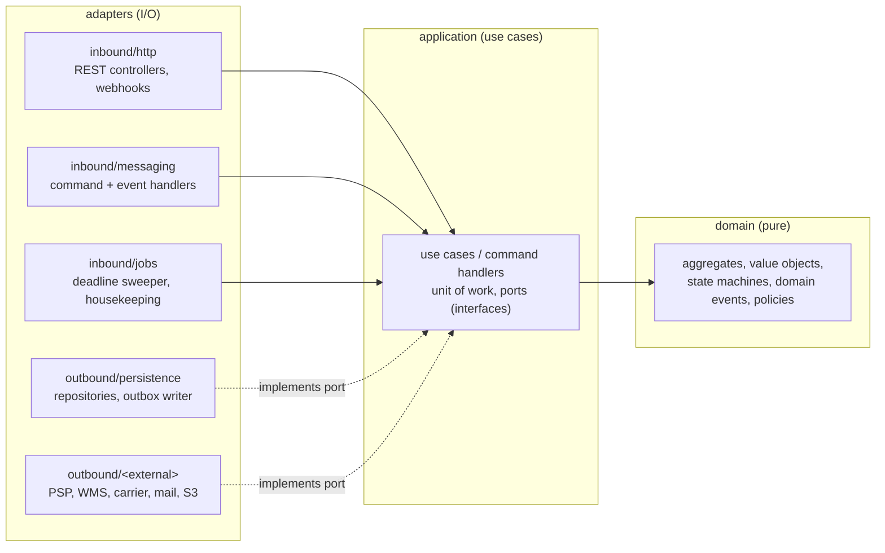

# Implementation guide

This guide is the build contract for both implementations. The architecture document says what the system does. This guide says how each service is laid out, which shared pieces every language needs, and which conventions make a Python service and a Java service interchangeable on the same topics.

Read it in this order: what is fixed (§1), the layout (§2–3), the shared library (§4), the interop rules (§5), conventions (§6–8), stacks (§9–10), and the test checklist (§11). The checklist is the definition of done.

## 1. What is fixed and what is free

**Fixed. Both builds must match exactly:**

- Topics, keys, partition counts, message schemas, subjects and headers (`contracts/`).
- HTTP paths, request and response bodies, status codes, headers (`contracts/openapi/`).
- Shared table definitions (`contracts/sql/common-tables.sql`), because Debezium reads them by column name.
- Consumer group ids, service names, ports, environment variable names (§7).
- Metric names, units, attributes and histogram buckets (§8).
- Business ids and their semantics (who mints `paymentId`, when it is reused).
- Saga state names and transitions (architecture §5–6), and the fake behaviour knobs (`contracts/openapi/admin.yaml`).

**Free. Choose what is idiomatic:**

- Internal class and module names below the layer level, frameworks inside the stack lists in §9–10, private tables beyond the shared ones, internal error types.

If a choice changes anything on the "fixed" list, it is a contract change and goes through `contracts/` first.

## 2. Repository layout

```
capstones/eda-commerce/
├── contracts/                 # source of truth: Avro, AsyncAPI, OpenAPI, SQL, topics.yaml, examples
├── infra/                     # compose, configs, scripts, k8s
├── docs/                      # architecture, ADRs, this guide
├── impl-python/
│   ├── pyproject.toml         # uv workspace
│   ├── libs/edacommon/        # shared library (§4)
│   ├── libs/contracts_py/     # generated: bundled schemas as package data + typed dataclasses
│   └── services/
│       ├── catalog_svc/  checkout_svc/  order_svc/  payment_svc/  inventory_svc/
│       └── fulfilment_svc/  shipping_svc/  notification_svc/  returns_svc/
└── impl-java/
    ├── settings.gradle.kts    # Gradle multi-project
    ├── libs/edacommon/        # shared library (§4)
    ├── libs/contracts-java/   # generated: SpecificRecord classes from contracts/avro-bundled
    └── services/
        ├── catalog-svc/  checkout-svc/  order-svc/  payment-svc/  inventory-svc/
        └── fulfilment-svc/  shipping-svc/  notification-svc/  returns-svc/
```

Generated code is never committed. It is rebuilt from `contracts/avro-bundled/` by the build (`contracts_py` by a small codegen step, `contracts-java` by the Avro Gradle plugin).

## 3. Service layout: hexagonal (ports and adapters)

Every service has three layers. **Dependencies point inwards only.**



| Layer | Contains | May import | Must not |
|---|---|---|---|
| `domain` | Aggregates (`Order`, `Reservation`, `Payment`), value objects (`Money`, `Sku`), saga transition functions, domain events as plain types, policies (refund rule, return eligibility) | Standard library only | Import frameworks, Avro classes, SQL, Kafka, HTTP, clocks (time is passed in) |
| `application` | Use cases (`PlaceOrder`, `HandlePaymentAuthorized`, `RequestReturn`), port interfaces (`OrderRepository`, `PaymentGateway`, `EventPublisher`, `ClaimCheckStore`), unit-of-work boundary, mapping domain events to outgoing messages | `domain`, shared-library interfaces | Know about FastAPI, Spring MVC, confluent-kafka, JPA entities |
| `adapters` | Inbound: HTTP routers/controllers, Kafka handlers, scheduled jobs. Outbound: repositories, outbox writer, PSP/WMS/carrier clients and **fakes**, S3 client, mail sender | Everything | Contain business decisions |

The fakes (PSP, WMS, carrier, mail) are **outbound adapters behind the same ports as real integrations**. They live in `adapters/outbound/<external>/fake/`, take their knobs from configuration and the admin API, and must never be imported by domain or application code.

### 3.1 Python package layout (one service)

```
services/order_svc/
├── pyproject.toml
├── alembic.ini
├── migrations/versions/0001_common_tables.py   # reproduces contracts/sql/common-tables.sql
├── src/order_svc/
│   ├── domain/
│   │   ├── order.py                # Order aggregate
│   │   ├── saga.py                 # OrderSagaState enum + transition(state, data, trigger, now) -> Decision
│   │   ├── invoice.py
│   │   └── events.py               # domain events (dataclasses)
│   ├── application/
│   │   ├── ports.py                # Protocols: OrderRepository, SagaRepository, InvoiceRenderer, ClaimCheckStore
│   │   ├── handle_saga_trigger.py  # one use case per trigger family
│   │   ├── queries.py              # read side for the API
│   │   └── messages.py             # domain event -> outgoing Avro dict mapping
│   ├── adapters/
│   │   ├── inbound/http/routes.py          # FastAPI routers (orders, ops)
│   │   ├── inbound/messaging/handlers.py   # registers handlers by ce_type with edacommon runtime
│   │   ├── inbound/jobs/deadlines.py       # uses edacommon.saga.DeadlineSweeper
│   │   ├── outbound/persistence/models.py  # SQLAlchemy 2 mapped classes
│   │   ├── outbound/persistence/repositories.py
│   │   ├── outbound/documents/pdf.py       # invoice rendering
│   │   └── projector/                      # order-history projection (separate entry point)
│   ├── config.py                   # pydantic-settings, env vars from §7
│   └── main.py                     # composition root: `api`, `projector` sub-commands
└── tests/{unit,contract,integration}/
```

Enforce the dependency rule with **import-linter** (`layers` contract: `adapters > application > domain`).

### 3.2 Java package layout (one service)

```
services/order-svc/
├── build.gradle.kts
└── src/
    ├── main/java/com/edacommerce/order/
    │   ├── domain/            Order.java, OrderSaga.java (sealed states + transition), Invoice.java, events/
    │   ├── application/       port/ (interfaces), usecase/ (HandleSagaTrigger, PlaceOrder…), query/
    │   ├── adapters/
    │   │   ├── in/http/       OrderController, OpsController
    │   │   ├── in/messaging/  handler beans registered by ce_type
    │   │   ├── in/jobs/       DeadlineSweeperJob
    │   │   ├── out/persistence/  JPA entities, Spring Data repositories, OutboxWriter adapter
    │   │   ├── out/documents/    InvoicePdfRenderer (OpenPDF)
    │   │   └── projector/        order-history projection (Spring profile "projector")
    │   ├── config/            @ConfigurationProperties bound to env vars from §7
    │   └── OrderServiceApplication.java
    ├── main/resources/db/migration/V1__common_tables.sql   # copy of contracts/sql/common-tables.sql
    └── test/java/com/edacommerce/order/{unit,contract,integration}/
```

Enforce the dependency rule with an **ArchUnit** test (`layeredArchitecture()`), part of every service's test suite.

## 4. The shared library (`edacommon`) in each language

Each language has one shared library. Services depend on it; it depends on no service. Behaviour must be identical across languages, because the two builds share topics and, in mixed mode, interact directly.

| Module | Responsibility | Key behaviour that must match across languages |
|---|---|---|
| `ids` | UUIDv7 generation; clock abstraction | UUIDv7 text form, lower case. Python 3.13 has no `uuid.uuid7`: implement it (RFC 9562) in about 20 lines, or use the `uuid6` package. Java: `com.github.f4b6a3:uuid-creator` |
| `envelope` | Build and read `Envelope`; derive headers | `type` = Avro full name; `partitionKey` = record key; `causationId` = triggering `eventId`; `correlationId` inherited; `occurredAt` from the clock |
| `serde` | Avro serialise/deserialise with Schema Registry | Confluent wire format; `TopicRecordNameStrategy`; `auto.register.schemas=false`; `normalize.schemas=true`; schema id cache; deserialise with the **reader** schema of the handler (schema resolution) |
| `outbox` | `OutboxWriter.append(topic, record, key)` inside the current DB transaction; polling relay | Columns per `common-tables.sql`; `payload` = wire-format bytes; polling relay publishes in `created_at` order with headers identical to Debezium's, using the murmur2 partitioner (§5) |
| `consumer` | Poll loop, header-based dispatch, inbox, unit of work, error classification, in-place retry, retry/DLQ forwarding, retry consumers, DLQ peek/replay endpoints, graceful shutdown | Dispatch on `ce_type` **before** deserialising; unknown types → `ignored`; commit offsets only after the DB commit; forwarding copies raw bytes and adds the `x-*` headers (ADR-0007) |
| `saga` | Saga repository with optimistic locking; transition log; deadline sweeper; ops endpoints | `SELECT … FOR UPDATE SKIP LOCKED` sweeper; one transaction per transition (saga row + transition row + inbox + outbox) |
| `idempotency` | HTTP `Idempotency-Key` middleware/filter | SHA-256 over `METHOD + "\n" + path + "\n" + canonical JSON body` (keys sorted, no whitespace); semantics in ADR-0012 |
| `claimcheck` | `put(bucket, key, bytes, content_type) -> ClaimCheck`, `get(ClaimCheck) -> bytes`, `presign(ClaimCheck, ttl)` | Deterministic keys; SHA-256 verification on `get`; size metric; missing object → `RetryLater` |
| `tracing` | Inject/extract W3C context into outbox rows and Kafka headers; consumer span creation | Consumer span: parent = extracted context, plus a span link; attributes per OTel messaging conventions (`messaging.system=kafka`, `messaging.destination.name`, `messaging.kafka.consumer.group`, `messaging.message.id`) |
| `webhooks` | HMAC verification; timestamp tolerance; inbox dedupe; store-then-ack | Constant-time comparison; 300 s tolerance; respond 200 on duplicates |
| `http` | Problem-details errors, health endpoints, JWT validation, request logging | `/health/live`, `/health/ready`; problem `type` URIs under `https://errors.edacommerce.example/` |
| `logging` | JSON logs with trace and correlation fields; PII redaction | Field names in §6.4 |
| `metrics` | Pre-registered instruments from §8 | Names, units, attributes and bucket boundaries exactly as in §8 |

### 4.1 Consumer runtime: the processing algorithm

Both languages implement the same loop. Getting this exactly right is most of the work of Days 1–2.

```
for each polled record r (partition p, offset o):
    type = header(r, "ce_type")
    handler = registry.get(type)
    if handler is None:
        metrics.processed(outcome="ignored"); mark o done; continue
    for attempt in 1..5:                                    # in-place retry
        try:
            begin DB transaction
                if not inbox.insert(eventId(r), group):     # duplicate
                    rollback; metrics.processed(outcome="duplicate"); break
                msg = serde.deserialize(r.value, handler.reader_schema)
                with consumer_span(r): handler.handle(msg, ctx)   # may append outbox rows
            commit
            metrics.event_age(now - msg.envelope.occurredAt); metrics.processed(outcome="success")
            break
        except Transient:  rollback; sleep(backoff(attempt)); continue    # partition paused meanwhile
        except RetryLater: rollback; forward(r, next_retry_topic(r)); metrics.processed(outcome="retry"); break
        except NonRetryable: rollback; forward(r, dlq); metrics.dlq(); break
    else:
        forward(r, next_retry_topic(r))                   # in-place retries exhausted
    mark o done
commit offsets of done records (synchronously on rebalance revoke and shutdown, otherwise every 1 s or 500 records)
```

Notes:

- `eventId(r)` comes from the `ce_id` header, so duplicates are detected without deserialising.
- Process one record at a time per partition. Parallelism comes from partitions. Never process two records of the same partition concurrently.
- On partition revoke: finish the in-flight record, commit, then release.
- A forwarded record is "done" for this partition only after the forward is acknowledged by the broker.

### 4.2 Saga kit

```
handle(trigger) in one transaction:
    saga = repo.load_for_update(saga_id)          # SELECT … FOR UPDATE (or version check on save)
    decision = domain.transition(saga.state, saga.data, trigger, now)
    if decision.ignored: return                    # late or irrelevant event; recorded in data if needed
    for cmd in decision.commands: outbox.append(cmd.topic, cmd.record, key=saga.order_id)
    for evt in decision.events:   outbox.append(evt.topic, evt.record, key=saga.order_id)
    repo.save(saga with new state, data, version+1, deadline_at=decision.deadline, step_attempts)
    transitions.append(from, to, trigger_type, trigger_id)
    metrics on terminal / attention / timeout
```

`decision.deadline` is computed by the domain from the configured timeouts. The sweeper calls `handle(DEADLINE)` for due rows. Operators call `handle(OPERATOR_RETRY)`.

## 5. Interoperability rules (Python ↔ Java)

These are the places where two correct-looking builds silently disagree. Each one has bitten real teams.

1. **Partitioner.** Java clients and Kafka Connect use murmur2 on the key bytes. librdkafka (confluent-kafka-python) defaults to `consistent_random` (CRC32). Every Python **producer** (polling relay, retry/DLQ forwarders, DLQ replay) must set `partitioner=murmur2_random`. Otherwise the same orderId lands in different partitions depending on who produced it.
2. **Key encoding.** Keys are UTF-8 strings, no Avro, no schema id. Java: `StringSerializer`. Python: `key.encode("utf-8")`.
3. **Wire format.** Values carry the 5-byte Confluent header. Never strip it, never write raw Avro to a topic.
4. **Subject strategy.** Both sides use `TopicRecordNameStrategy`. Python: `topic_record_subject_name_strategy` from `confluent_kafka.schema_registry`. Java: `value.subject.name.strategy=io.confluent.kafka.serializers.subject.TopicRecordNameStrategy`.
5. **Schema identity.** Register and look up with `normalize.schemas=true` on both sides, and generate code only from `contracts/avro-bundled/`. A schema that differs only in whitespace or property order must resolve to the same id.
6. **Reader schemas.** Deserialise with the handler's own reader schema (Python: pass `schema_str` to `AvroDeserializer`; Java: `specific.avro.reader=true` with generated classes). Never deserialise types you have no handler for: dispatch on `ce_type` first. A Java consumer with `specific.avro.reader=true` fails on a record type it has no class for.
7. **Timestamps.** `timestamp-millis` is UTC epoch milliseconds. Python must use timezone-aware `datetime` (fastavro returns UTC-aware values); Java uses `Instant`. Never local time.
8. **Money.** `amountMinor` is a `long`. Python `int`, Java `long`. No floats anywhere, including JSON APIs.
9. **Enums.** Unknown symbols decode to `UNKNOWN`. Handle it explicitly; never `valueOf` a string from a header.
10. **Optional fields.** `null` means absent. Do not send empty strings for missing values.
11. **Headers.** Header values are UTF-8 strings. Names are lower case exactly as in architecture §8.3. Kafka header names are case-sensitive.
12. **Trace context.** `traceparent` is 55 characters, lower-case hex. Both OTel SDKs use the W3C propagator; do not enable B3 or Jaeger propagators.
13. **JSON over HTTP.** camelCase, RFC 3339 timestamps with `Z`, money as integer minor units. Pydantic: `alias_generator=to_camel`, `populate_by_name=True`. Jackson: `WRITE_DATES_AS_TIMESTAMPS=false`, `JavaTimeModule`.
14. **Canonical JSON for idempotency hashing.** Sorted keys, no insignificant whitespace, UTF-8, numbers as written by the client after parsing (integers only in our APIs). Python: `json.dumps(obj, sort_keys=True, separators=(",", ":"), ensure_ascii=False)`. Java: Jackson with `ORDER_MAP_ENTRIES_BY_KEYS` and `SORT_PROPERTIES_ALPHABETICALLY`.
15. **Migrations.** Alembic and Flyway must produce the same shared tables. The service-private tables may differ, but a database migrated by one build is never used by the other build. Mixed mode means *different services* in different languages, never the same service in both.

**The interop drill (Day 10)** runs order-svc in one language and inventory-svc plus payment-svc in the other, on the same topics, and passes the happy path and the decline path.

## 6. Conventions

### 6.1 Naming

| Thing | Convention | Example |
|---|---|---|
| Service | `<context>-svc` | `payment-svc` |
| Consumer group | service name; projector has its own | `order-svc`, `order-history-projector` |
| Retry consumer group | `<group>-retry` | `payment-svc-retry` |
| Topic | `<context>.<stream>.v<N>` | `payment.events.v1` |
| Event | past-tense fact | `PaymentAuthorized` |
| Command | imperative | `AuthorizePayment` |
| Avro namespace | `com.edacommerce.<context>` | `com.edacommerce.payment` |
| Database / role | `<context>_db` / `<context>_svc` | `payment_db` / `payment_svc` |
| Tables, columns | `snake_case`, singular tables | `reservation_line` |
| Business ids | `<thing>Id`, UUIDv7, minted by the step owner | `paymentId` minted by order-svc |
| Human-readable numbers | prefix-year-sequence | `INV-2026-000123`, `RMA-2026-000042` |

### 6.2 Time, ids and money

- All times UTC. Domain code receives `now` as a parameter; nothing calls the system clock directly.
- UUIDv7 for every id we mint (time-ordered, index-friendly).
- Money: integer minor units with currency. Arithmetic in the domain `Money` type, which refuses to add different currencies. Rounding (tax) uses banker's rounding at line level, defined once in the domain.
- Invoice numbers are gapless per year: a counter row per year locked with `SELECT … FOR UPDATE` in the same transaction as the invoice row. Postgres sequences are not gapless.

### 6.3 Errors

- Domain errors are values or exceptions in the domain layer, mapped to HTTP problem types in the HTTP adapter and to `NonRetryable` in messaging adapters.
- Infrastructure exceptions are classified once, in the adapter that raises them: `Transient` (connection refused, deadlock, serialisation failure, 503), `RetryLater` (dependency degraded, object not found yet), `NonRetryable` (deserialisation, validation, invariant violation).
- HTTP: 4xx for client problems, 503 with `Retry-After` when a dependency is down, never 500 for a known condition.

### 6.4 Logging

JSON to stdout, one object per line. Required fields:

| Field | Content |
|---|---|
| `ts` | RFC 3339 UTC |
| `level` | `DEBUG`, `INFO`, `WARN`, `ERROR` |
| `service`, `impl` | `order-svc`, `python` or `java` |
| `msg` | human sentence |
| `trace_id`, `span_id` | from the current span |
| `correlation_id`, `event_id`, `event_type` | when handling a message |
| `order_id`, `return_id` | when known (ids are not personal data) |
| `error.class`, `error.message`, `error.stack` | on errors |

Never log: email, name, address, phone, payment tokens, JWTs, webhook secrets, message payloads. The logging module redacts any field marked `pii` in the schema when a record is logged.

### 6.5 HTTP

- `/health/live`: process up. `/health/ready`: DB reachable, schema cache warm, consumer subscribed. Readiness never depends on another service.
- Request timeouts: 2 s DB pool acquisition, 5 s outbound HTTP (PSP), 10 s for fakes' admin APIs.
- Pagination: opaque cursors.
- Validation errors list fields in `errors[]`.

## 7. Configuration

All configuration comes from environment variables with these exact names (both builds). `infra/compose.apps.example.yml` shows them in use.

| Variable | Default (local, host run) | Notes |
|---|---|---|
| `SERVICE_NAME` | e.g. `order-svc` | Also `envelope.producer` |
| `ENVIRONMENT` | `local` | `AUTH_MODE=none` is refused unless `local` |
| `HTTP_PORT` | 8101–8109 per service (§ architecture 3); 8080 in containers | |
| `CONSUMER_GROUP` | service name | |
| `KAFKA_BOOTSTRAP_SERVERS` | `localhost:9092` | |
| `KAFKA_SECURITY_PROTOCOL` | `PLAINTEXT` | `SSL` in Kubernetes; plus `KAFKA_SSL_CA_LOCATION`, `KAFKA_SSL_CERT_LOCATION`, `KAFKA_SSL_KEY_LOCATION` |
| `SCHEMA_REGISTRY_URL` | `http://localhost:8081` | |
| `DB_HOST`, `DB_PORT`, `DB_NAME`, `DB_USER`, `DB_PASSWORD` | `localhost`, `5432`, `<context>_db`, `<context>_svc`, `<context>_svc` | |
| `DB_POOL_SIZE` | `10` | |
| `OUTBOX_RELAY` | `debezium` | `polling` for tests or environments without Connect |
| `OUTBOX_POLL_INTERVAL` | `200ms` | polling relay only |
| `S3_ENDPOINT`, `S3_REGION`, `S3_ACCESS_KEY`, `S3_SECRET_KEY` | `http://localhost:9000`, `us-east-1`, `claimcheck`, `claimcheck-secret` | |
| `OTEL_SERVICE_NAME`, `OTEL_EXPORTER_OTLP_ENDPOINT`, `OTEL_EXPORTER_OTLP_PROTOCOL`, `OTEL_RESOURCE_ATTRIBUTES` | service name, `http://localhost:4317`, `grpc`, `service.namespace=edacommerce,eda.impl=<python|java>` | standard OTel variables |
| `AUTH_MODE`, `OIDC_ISSUER_URL`, `OIDC_AUDIENCE` | `none`, `http://localhost:8180/realms/edacommerce`, `edacommerce-api` | |
| `LOG_FORMAT`, `LOG_LEVEL` | `json`, `INFO` | |
| order-svc: `SAGA_STOCK_TIMEOUT`, `SAGA_PAYMENT_TIMEOUT`, `SAGA_COMMIT_TIMEOUT`, `SAGA_FULFILMENT_ACK_TIMEOUT`, `SAGA_FULFILMENT_MAX_RESENDS`, `SAGA_DISPATCH_TIMEOUT`, `SAGA_CAPTURE_TIMEOUT`, `SAGA_COMPENSATION_TIMEOUT` | `30s`, `180s`, `30s`, `600s`, `3`, `24h`, `300s`, `60s` | durations as `<n><s|m|h|d>` |
| inventory-svc: `RESERVATION_TTL`, `RESERVATION_SWEEP_INTERVAL` | `900s`, `5s` | |
| returns-svc: `RETURN_WINDOW_DAYS`, `RETURN_AUTO_APPROVE_LIMIT_MINOR`, `RETURN_PARCEL_DUE_DAYS` | `30`, `50000`, `14` | |
| payment-svc: `PSP_WEBHOOK_SECRET`, `PSP_WEBHOOK_URL`, `FAKE_PSP_*` | `dev-psp-secret`, `http://localhost:8104/webhooks/psp` | fake knobs as in `admin.yaml` `FakePspConfig`, upper snake case |
| fulfilment-svc: `FAKE_WMS_*` | see `FakeWmsConfig` | |
| shipping-svc: `CARRIER_WEBHOOK_SECRET`, `CARRIER_WEBHOOK_URL`, `FAKE_CARRIER_*` | `dev-carrier-secret`, `http://localhost:8107/webhooks/carrier` | |

### 7.1 Kafka client settings (both languages)

| Setting | Value | Why |
|---|---|---|
| `enable.auto.commit` | `false` | Commit after the DB transaction (§4.1) |
| `auto.offset.reset` | `earliest` | A new group (or a rebuilt projection) must see everything retained |
| `isolation.level` | `read_committed` | Harmless; future-proof if a producer starts using transactions |
| `partition.assignment.strategy` | `cooperative-sticky` (Java: `CooperativeStickyAssignor`) | Incremental rebalances; fewer stop-the-world pauses |
| `group.instance.id` | pod name in Kubernetes, unset locally | Static membership: restarts do not trigger rebalances |
| `session.timeout.ms` / `max.poll.interval.ms` | `45000` / `300000` | Handlers must finish well within 5 minutes |
| `max.poll.records` (Java) / batch size (Python) | `100` | Small batches keep commit latency low |
| Producer (relay, forwarders): `acks`, `enable.idempotence`, `compression.type`, `partitioner` | `all`, `true`, `zstd`, `murmur2_random` (Python only; Java default) | §5 rule 1 |
| Avro serde | `auto.register.schemas=false`, `use.latest.version=false`, `normalize.schemas=true`, `TopicRecordNameStrategy` | ADR-0004 |

## 8. Metrics contract

Create these with the **OpenTelemetry metrics API** in both languages (ADR-0011). Configure histogram boundaries with SDK views (Python: `View` + `ExplicitBucketHistogramAggregation`; Java: `View` or `setExplicitBucketBoundariesAdvice`). The Prometheus name is what the collector exposes and what the dashboard and alerts query.

| OTel name | Type | Unit | Attributes | Buckets | Prometheus name |
|---|---|---|---|---|---|
| `eda.event.age` | histogram | `s` | `topic`, `consumer_group`, `event_type` | 0.01, 0.05, 0.1, 0.25, 0.5, 1, 2, 5, 10, 30, 60, 300, 1800 | `eda_event_age_seconds` |
| `eda.consumer.processed` | counter | `{message}` | `topic`, `consumer_group`, `event_type`, `outcome` = `success`\|`duplicate`\|`ignored`\|`retry`\|`dlq` | | `eda_consumer_processed_total` |
| `eda.consumer.handler.duration` | histogram | `s` | `consumer_group`, `event_type` | 0.005, 0.01, 0.025, 0.05, 0.1, 0.25, 0.5, 1, 2.5, 5 | `eda_consumer_handler_duration_seconds` |
| `eda.dlq.messages` | counter | `{message}` | `consumer_group`, `event_type`, `error_class` | | `eda_dlq_messages_total` |
| `eda.outbox.pending` | gauge | `{row}` | none (service from resource) | | `eda_outbox_pending` (polling relay only) |
| `eda.saga.outcomes` | counter | `{saga}` | `saga_type` = `ORDER`\|`RETURN`, `outcome` | | `eda_saga_outcomes_total` |
| `eda.saga.duration` | histogram | `s` | `saga_type`, `outcome` | 1, 5, 10, 30, 60, 300, 900, 3600, 21600, 86400, 604800, 2592000 | `eda_saga_duration_seconds` |
| `eda.saga.step.duration` | histogram | `s` | `saga_type`, `step` (`DECISION` = saga start → confirmed or cancelled; plus one per state) | 0.1, 0.25, 0.5, 1, 2, 5, 10, 30, 60, 120, 240, 600 | `eda_saga_step_duration_seconds` |
| `eda.saga.step.timeouts` | counter | `{timeout}` | `saga_type`, `state` | | `eda_saga_step_timeouts_total` |
| `eda.saga.overdue` | gauge | `{saga}` | `saga_type` | | `eda_saga_overdue` |
| `eda.claimcheck.object.size` | histogram | `By` | `bucket`, `direction` = `put`\|`get` | 1e3, 1e4, 5e4, 1e5, 2.5e5, 5e5, 1e6, 5e6, 2e7 | `eda_claimcheck_object_size_bytes` |
| `eda.webhook.received` | counter | `{webhook}` | `source` = `psp`\|`carrier`, `outcome` = `accepted`\|`duplicate`\|`rejected` | | `eda_webhook_received_total` |

Saga outcome values. ORDER: `DELIVERED`, `CANCELLED` (terminal), `MANUAL_REVIEW` (counted on entering NEEDS_ATTENTION). RETURN: `REFUNDED`, `PARTIALLY_REFUNDED`, `REJECTED`, `EXPIRED` (terminal), `MANUAL_REVIEW` (counted on entering MANUAL_REVIEW or REFUND_REVIEW).

`eda.saga.overdue` is set by the sweeper on each run: the number of sagas with `deadline_at < now() - 60 s`. It should always be 0, because the sweeper handles due sagas before they get there. A non-zero value means the sweeper is not running or is failing.

Never use ids (`orderId`, `eventId`, `customerId`) as metric attributes.

## 9. Python stack

| Concern | Choice |
|---|---|
| Runtime and tooling | Python 3.13, **uv** workspace, ruff (lint + format), mypy `--strict`, import-linter |
| HTTP | FastAPI + uvicorn; pydantic v2 + pydantic-settings |
| Persistence | SQLAlchemy 2 (sync ORM, typed `Mapped[]`), psycopg 3, Alembic |
| Kafka | confluent-kafka 2.x (`[avro,schemaregistry]`); `AvroSerializer` / `AvroDeserializer`; fastavro for golden tests |
| Object storage | boto3 with `endpoint_url` (MinIO) |
| HTTP client | httpx (PSP, carrier and webhook calls) |
| PDF | fpdf2 (invoices, labels) |
| Observability | opentelemetry-sdk, opentelemetry-exporter-otlp, instrumentations: fastapi, sqlalchemy, psycopg, httpx, confluent-kafka (or manual spans in `edacommon.tracing`); structlog for JSON logs |
| Tests | pytest, testcontainers (`postgres`, `kafka`, `minio`), hypothesis, respx (httpx mocks) |

**Concurrency model.** Synchronous code throughout. confluent-kafka is a thread-safe C client with a blocking API, and SQLAlchemy sync sessions are simpler to get right with explicit transactions. Each service process runs uvicorn (HTTP) and one consumer thread per subscribed topic group, plus the retry consumer and the sweeper thread. Use `def` (not `async def`) route handlers so FastAPI runs them in its thread pool. Revisit only if a service becomes I/O-bound on many concurrent outbound calls.

## 10. Java stack

| Concern | Choice |
|---|---|
| Runtime and build | Java 21, Gradle (Kotlin DSL) multi-project, Spotless, Error Prone |
| Framework | Spring Boot 3.x (`spring.threads.virtual.enabled=true`) |
| HTTP | Spring Web MVC, Bean Validation, `ProblemDetail` for RFC 9457, `spring-boot-starter-oauth2-resource-server` |
| Persistence | Spring Data JPA (Hibernate 6), Flyway, PostgreSQL driver; `byte[]` ↔ `bytea`, `@JdbcTypeCode(SqlTypes.JSON)` for `jsonb` |
| Kafka | Spring Kafka; `ConcurrentKafkaListenerContainerFactory` with `AckMode.MANUAL_IMMEDIATE`, `ByteArrayDeserializer` for values (dispatch on `ce_type`, then deserialise with `KafkaAvroDeserializer`), `DefaultErrorHandler` + `DeadLetterPublishingRecoverer` with a destination resolver producing ADR-0007 names |
| Avro | Apache Avro 1.12 + `com.github.davidmc24.gradle.plugin.avro` over `contracts/avro-bundled`; Confluent `kafka-avro-serializer` 7.9.x (repository `https://packages.confluent.io/maven/`) |
| Object storage | AWS SDK v2 S3 client with endpoint override and path-style access |
| PDF | OpenPDF |
| Observability | OpenTelemetry Spring Boot starter (or the OTel Java agent), OTLP exporter; custom metrics via `io.opentelemetry.api.metrics.Meter`; Micrometer bridged for framework metrics; logback with a JSON encoder (logstash-logback-encoder) |
| Tests | JUnit 5, AssertJ, Testcontainers (`postgresql`, `kafka` with `apache/kafka` or `confluentinc/cp-kafka`, MinIO), jqwik (property tests), ArchUnit, WireMock (PSP stubs) |

**Concurrency model.** Spring Kafka listener containers with concurrency ≤ partition count, one record at a time per partition, manual acknowledgement after the transaction commits. Transactions are `@Transactional` on the use case, invoked by the listener; the listener acknowledges only after the use case returns. Do not use Kafka transactions (`KafkaTransactionManager`) or `ChainedTransactionManager`; the outbox replaces them.

## 11. Test checklist (every service)

A service is done when every applicable item passes in CI. Reviewers tick this list for each build. Numbers refer to ADR-0014's layers.

**Structure**

- [ ] Dependency rule enforced by import-linter or ArchUnit; domain has no framework imports.
- [ ] Shared tables created by migration 1, matching `contracts/sql/common-tables.sql` (a test diffs `information_schema.columns` against the contract).

**Domain (layer 1)**

- [ ] Every transition in the relevant state table has a test (order-svc, returns-svc).
- [ ] Late, duplicate and out-of-order replies are tested for every waiting state.
- [ ] Property test: random interleavings of replies always end in a terminal or attention state with compensations consistent with what was done.
- [ ] Money arithmetic and rounding tests; mixed-currency addition is rejected.

**Contracts (layer 2)**

- [ ] Every golden `.bin` for messages this service **consumes** decodes to the matching `.json`.
- [ ] Every message this service **produces** is serialised and validated against the bundled schema, and its envelope fields are correct (`type`, `producer`, `partitionKey` = key, `causationId` = trigger).
- [ ] Unknown `ce_type` on a subscribed topic is ignored, not failed.
- [ ] An enum value `UNKNOWN` is handled without an exception.
- [ ] HTTP responses validate against the OpenAPI document (schemathesis for Python, an OpenAPI validator in MockMvc tests for Java).

**Integration with Testcontainers (layer 3)**

- [ ] Command in → reply event out, with DB state asserted, using the polling relay.
- [ ] The same message delivered twice produces one effect and one reply (`outcome="duplicate"` counted).
- [ ] A resent command (new eventId, same business id) re-emits the original reply and does not repeat the side effect.
- [ ] Crash simulation: kill the consumer after DB commit and before offset commit; on restart the message is a duplicate, not a double effect.
- [ ] A `Transient` failure retries in place and succeeds; a `RetryLater` failure lands on `<group>.retry.10s` with all `x-*` headers and raw bytes unchanged; a `NonRetryable` failure lands on `<group>.dlq`.
- [ ] DLQ replay moves a message to the first retry topic and it is processed once.
- [ ] Trace context: a message produced with a `traceparent` yields a consumer span with that parent and the outbox rows it writes carry the new context.
- [ ] Polling relay publishes in order with headers identical to the Debezium configuration, and with murmur2 partitioning (Python).
- [ ] One test per build runs the Debezium connector in a container and observes an outbox row arrive on its topic with the expected headers.
- [ ] Graceful shutdown: SIGTERM during processing finishes the record, commits and exits within the grace period.

**Service-specific**

- [ ] checkout-svc: same Idempotency-Key replays the same orderId; different body → 422; concurrent same key → 409; price mismatch → 422.
- [ ] inventory-svc: two concurrent reservations for the last unit, exactly one wins; TTL expiry emits `ReservationExpired` and restores stock; commit after expiry answers `ReservationExpired`.
- [ ] payment-svc: decline, timeout with reconciliation to authorised, timeout to `PSP_TIMEOUT` with void, duplicate webhooks (×3), late success after timeout is voided, bad signature → 401.
- [ ] fulfilment-svc: dropped request recovered by resend with no duplicate pick order; manifest uploaded before `OrderPacked`, hash verified by a consumer test.
- [ ] shipping-svc: out-of-order and duplicate carrier webhooks yield monotonic, unique events.
- [ ] order-svc: invoice PDF stored with a deterministic key and gapless number; `GET /orders/{id}` falls back to the write model for a new order.
- [ ] order-history-projector: replay from offset 0 into an empty schema yields the same rows as incremental processing; stale versions are dropped.
- [ ] returns-svc: eligibility (not delivered, window closed, over-quantity), partial refund calculation, refund retry schedule and manual decision.
- [ ] notification-svc: one email per triggering event under duplicates; no PII in logs (a test greps captured logs for the seeded email address).

**Observability**

- [ ] Every metric in §8 that the service emits appears with the exact Prometheus name and buckets (scrape the collector in a test or assert on the in-memory reader).
- [ ] Logs are JSON with the required fields and no PII.

**Component (layer 4, shared suite)**

- [ ] Happy path to `DELIVERED`, decline path, out-of-stock path, return with partial refund: all green against this build, and against a mixed-language deployment.
