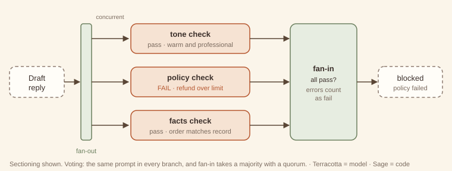
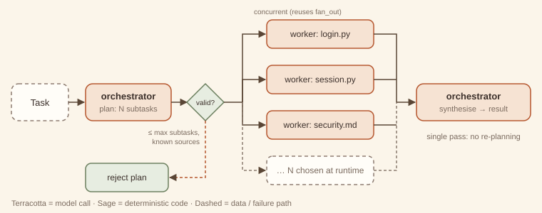
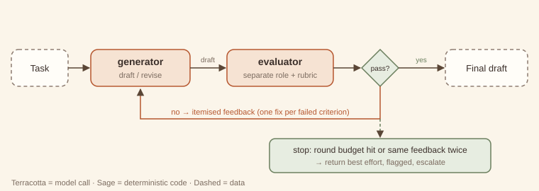
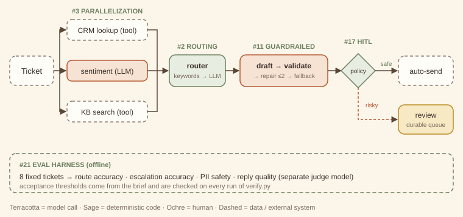

# Agentic Design Patterns

*A pattern catalog for systems built on language models — with runnable code*


<!-- ===== Front matter ===== -->


---

# Preface — How to read this book

This book is a pattern catalog for systems built around language models. It follows the Gang of Four tradition: each pattern has a name, a one-sentence intent, a structure diagram, forces, consequences, and code. The book adds two things that LLM systems need more than object-oriented ones did: an explicit **theory** of why each pattern works, and an explicit **cost and latency model**. Every extra model call costs money and time, so a pattern that buys nothing is worse than no pattern at all.

## The three questions behind every pattern

Every chapter answers the same three questions.

1. **Who decides the control flow?** In Part 1 your *code* decides; the model only fills in steps. In Part 2 a *single model* decides what happens next. In Part 3 *several models* with distinct roles coordinate. Each step to the right buys flexibility and costs predictability.
2. **Who judges the output?** Deterministic code, the same model, a separate model, a peer, or a human. Many patterns differ only in this answer. The scope sheet's overlap table keeps them apart.
3. **What is the cheaper alternative?** Every "when to use" section names the simpler thing you should try first and the signal that tells you it is no longer enough.

## The catalog at a glance

| Part | Patterns | Control flow decided by |
|---|---|---|
| 1 · Workflow | Prompt chaining · Routing · Parallelization · Orchestrator–workers · Evaluator–optimizer | your code |
| 2 · Single-agent reasoning | ReAct · Plan-and-execute · Reflection · Tool-use loop · Agentic RAG · Guardrailed generation | one model |
| 3 · Multi-agent coordination | Supervisor · Hierarchical teams · Sequential handoffs · Debate · Critic–reviewer · Human-in-the-loop · Swarm | several models (and people) |
| 4 · Cross-cutting | Memory tiers · Context management · Eval harness | applies to any structure |

Three capstones show the patterns working together: a **support-triage system** (Part 1 pilot), a **deep-research agent**, and a **multi-agent coding team**.

## Anatomy of a chapter

Every chapter uses the same sections in the same order, so you can compare patterns side by side.

- **Intent**: one sentence.
- **Structure**: a hand-drawn diagram with a fixed colour key: *terracotta* = model call, *sage* = deterministic code, *ochre* = human, *dashed* = data or external system.
- **Design concept & theory**: the mechanism, why it works, the invariants that make it *this* pattern, and its closest classic ancestor.
- **When to use / when not to use**, naming the cheaper alternative.
- **Forces & trade-offs**: latency, cost, reliability, complexity.
- **Trade-off analysis & usage guidance**: a back-of-envelope model, a decision checklist, and production defaults.
- **Worked example**: first *example-first* (what the code does when you run it), then *why-first* (why it is built that way).
- **Failure modes & guardrails**, **Variations**, **Try it** (solutions are kept separately, at the back), and a **60-second interview lens**.

## The companion code

Every pattern has a runnable example under `code/patterns/<name>/`. The examples follow four rules.

- **Standard library only.** The examples need Python 3.10 or later and nothing else, with no `pip install`.
- **Offline and deterministic.** A *mock LLM* (`code/agentkit/llm.py`) stands in for a real model. Each example writes its model's behaviour as a short list of rules next to the code that uses it, so you can see exactly what the "model" will say. The same input always gives the same output.
- **One interface.** Patterns depend only on `complete(prompt, system="") -> str`. To use a real model, implement that one method; the docstring in `agentkit/llm.py` shows a ten-line adapter.
- **Nothing ships unless it runs green.** `python3 code/verify.py` runs every example, exercise solution and capstone. It fails if any script errors, if any output drifts from its recorded expected output, or if a README or a chapter in this book quotes output that is no longer what the code prints. Every console listing in this book is checked by that command.

A mock model cannot show you how *often* a real model fails. It can show you *how a pattern behaves when it does*, and that behaviour is the subject of this book. Where a number in a cost model is illustrative rather than measured, the text says so.

## A note on names

Pattern names in this field are not yet stable. Where a pattern is widely known by another name, the chapter lists it under **Also known as**. The boundaries in the scope sheet decide which chapter a technique belongs to, whatever it is called elsewhere.


---


<!-- ===== Part 1 — Workflow patterns ===== -->


---

# Part 1 — Workflow patterns

> In a workflow, **your code owns the control flow**. The model fills in the steps; it never decides which step comes next.

That single property makes workflows the default starting point. A workflow can be read like a flowchart, tested like a function, and given a cost ceiling before it runs. In every Part 1 pattern you can predict the number of model calls, or at least bound it.

The five patterns differ in the shape of that control flow:

| Pattern | Shape | Who splits or judges the work |
|---|---|---|
| [1. Prompt chaining](01-prompt-chaining.md) | a line | code, at design time |
| [2. Routing](02-routing.md) | a fork with exactly one branch taken | a classifier, once |
| [3. Parallelization](03-parallelization.md) | fan-out, fan-in | code, statically |
| [4. Orchestrator–workers](04-orchestrator-workers.md) | fan-out decided at runtime | a model, once |
| [5. Evaluator–optimizer](05-evaluator-optimizer.md) | a loop | a separate evaluator model |

Two ideas run through all five.

**Gates are code.** Between model calls, deterministic checks (a regex, a schema, a length limit, a known-route test) turn silent failures into explicit ones. They are almost free and they are the cheapest reliability you can buy. In this book they are always drawn in sage.

**Cost is countable.** Each chapter's usage guidance gives a formula in calls, tokens and wall-clock time. If you cannot write the formula for a design, it is probably not a workflow any more; check Parts 2 and 3.

**The ladder of escalation.** Use one well-prompted call if it is good enough. Use a chain when the task splits into distinct steps, a router when inputs differ in kind, parallelization when sub-checks are independent, orchestrator–workers when the split can only be known at runtime, and an evaluator loop when quality is measurable but rarely right the first time. Reach for agents (Part 2) only when the *sequence of steps* itself cannot be known in advance.

The Part 1 pilot ends with the [support-triage capstone](../capstones/support-triage.md). It composes routing and parallelization with three modules from later parts: guardrailed generation (#11), human-in-the-loop (#17) and the eval harness (#21).


---

# 1. Prompt chaining

> **Intent.** Split a task into a fixed sequence of model calls, each consuming the previous call's output, with cheap code gates between steps that stop the chain as soon as something goes wrong.

**Also known as:** pipeline, sequential prompting, multi-step prompting · **Part:** 1 — Workflow · **Code:** `code/patterns/prompt_chaining/`

## Structure


Release notes pass through three model calls (*extract → draft → compress*). Code gates (sage diamonds) sit after the steps whose output can be checked mechanically. A failing gate ends the run with a reason, and the later calls never happen.

## Design concept & theory

**Core idea.** One hard prompt becomes several easy ones. Each step has a single job, its own instructions, and an output you can inspect. The sequence is fixed when you write the code. The model never chooses what runs next.

**Why it works: difficulty and detection.** Two effects combine.

1. *Each step is easier.* A model asked to "read these notes, pick the user-facing changes, write a warm announcement and keep it under 200 characters" juggles four constraints at once. Split up, each call juggles one. Per-step accuracy rises because each prompt is narrower and its examples can be more specific.
2. *Failures become visible.* Errors compound along a chain. If each of *n* steps succeeds with probability *p*, the whole chain succeeds with probability *pⁿ*. That looks like an argument *against* chaining (0.95³ ≈ 0.86), but the comparison is with the single call doing all the work, not with one step. Suppose the monolithic prompt succeeds 80% of the time and each focused step 97%: the chain wins, 0.97³ ≈ 0.91. More importantly, gates convert some of the remaining failures from *silent and shipped* into *detected and stopped*. A chain without gates has all the cost of decomposition and only half the benefit.

**Invariants.** (1) The step order is fixed at design time. (2) Each step sees only what the previous step produced, plus its own instructions. (3) Gates are deterministic code, not model calls. If a model decides the next step, you have an agent (Part 2). If the steps are agents that pass ownership of a conversation to each other, you have [sequential handoffs (#14)](../part-3-multi-agent/14-sequential-handoffs.md).

**Lineage.** *Pipes and Filters* (POSA, 1996) and the *Pipeline* in Enterprise Integration Patterns: independent filters connected by pipes, each filter replaceable on its own. The gates play the part of a *Message Filter*.

## When to use / when not to use

| Use it when | Don't use it when |
|---|---|
| The task splits cleanly into ordered stages (extract → transform → format). | One well-written prompt already meets the quality bar. |
| Intermediate outputs can be checked mechanically (has a version number, is valid JSON, under N chars). | The next step depends on *what you find* (go to [ReAct (#6)](../part-2-single-agent/06-react.md) or [plan-and-execute (#7)](../part-2-single-agent/07-plan-and-execute.md)). |
| Different stages benefit from different prompts, models or temperatures. | Stages are independent of each other (go to [parallelization (#3)](03-parallelization.md)). |
| You need an audit trail of how the output was produced. | Latency budgets cannot absorb several sequential round trips. |

**Cheaper alternative:** a single well-structured prompt with explicit numbered sub-steps, sometimes called "chain inside one prompt." Upgrade to a real chain when you need to *inspect, gate, or swap* an intermediate result, or when the single prompt's error rate plateaus however you reword it.

## Forces & trade-offs

| Force | vs. a single prompt | Why |
|---|---|---|
| Latency | ↑ worse | Calls are sequential: total ≈ sum of step latencies. |
| Cost | ≈ to ↑ | More calls, but each prompt is shorter, and early exits skip later steps entirely. |
| Reliability | ↑ better | Narrower steps are more accurate, and gates catch bad intermediates before they spread. |
| Complexity | ↑ slightly | More prompts to version, but each is simple and unit-testable. |

## Trade-off analysis & usage guidance

**Cost and latency model.** For *n* steps with per-step latency *tᵢ* and cost *cᵢ*, and gate pass rate *gᵢ* after step *i*:

- Latency, happy path: *T = Σ tᵢ* (gates add microseconds).
- Expected cost: *E[C] = c₁ + g₁·c₂ + g₁g₂·c₃ + …*. Early gates are worth the most, because every later step is multiplied by their pass rate. In the companion run, the internal-only release stops at gate 1 and costs one call instead of three.

**Decision checklist.**

1. Can you name each stage's output in a noun phrase ("the facts list", "the draft")? If not, the split is wrong.
2. Can at least one intermediate be checked by code? If none can, a chain buys little over one prompt.
3. Is the order fixed for *every* input? If it varies, you need routing or an agent.
4. Does the latency budget allow *n* sequential calls?
5. Would you want to swap one stage's model or prompt independently? Chains make that a one-line change.

**Usage in production.**

- Log every intermediate with the run ID. It is the main debugging benefit of the pattern.
- Put the strictest, cheapest gate as early as possible.
- Use a cheaper or faster model for mechanical stages (extraction, formatting) and spend on the creative stage.
- Version prompts per step. A regression is then traceable to one step's change.
- Alert on gate failure *rate* per step. A sudden rise means an upstream prompt, model or data change.

## Worked example

### Example first: what happens

The companion code turns raw release notes into a social post. It runs the same three-step chain twice: once on notes with real user-facing changes, and once on an internal-only release.

```
python3 code/patterns/prompt_chaining/main.py
```

<!-- expected-output: code/patterns/prompt_chaining/main.py -->
```text
Prompt chaining
===============
-- run 1: release with user-facing changes
[extract] v2.4 | - Dark mode across all screens | - CSV export for reports | - 40% faster search
[gate:extract] pass
[draft] Big news: version 2.4 is here! You asked, we listened: dark mode now covers every screen, you can export any report to CSV, and search is 40% faster. Update today and enjoy.
[compress] v2.4 is live: dark mode everywhere, CSV export for reports, and 40% faster search. Update now!
[gate:compress] pass
result: ok=True (94 chars)
-- run 2: internal-only release
[extract] NO_USER_FACING_CHANGES
[gate:extract] STOP — nothing user-facing to announce
result: ok=False stopped_at=extract
calls: run1=3, run2=1
```

Run 1 goes straight through. The `extract` gate checks that the first line is a version and that there are at least two bullets. The `compress` gate checks the 200-character limit. Run 2's extraction honestly reports `NO_USER_FACING_CHANGES`, and the gate stops the chain there, so `draft` and `compress` never run. The last line shows the saving: one call instead of three.

The whole architecture is a list:

```python
STEPS = [
    Step("extract", "Extract the USER-FACING changes ... {input}", gate=facts_gate),
    Step("draft",   "Write a friendly customer announcement from these facts:\n\n{input}"),
    Step("compress","Rewrite as one social post of at most 200 characters:\n\n{input}",
         gate=length_gate),
]
```

and the runner (`chain.py`) is about twenty lines: call, record, gate, continue or stop.

### Why first: why it is built this way

- **Steps are data, not code paths.** A `Step` is a name, a template and an optional gate. Adding, removing or reordering stages does not touch the runner. The exercise adds a whole new check with one line.
- **The extractor is allowed to say "nothing here".** Giving the first step an explicit escape value (`NO_USER_FACING_CHANGES`) is what makes the cheap early exit possible. Without it, the model invents changes to satisfy the prompt, which is a classic chaining failure.
- **Gates return reasons, not booleans.** `ChainResult.reason` says *why* the chain stopped. That reason is what you log, alert on, or show to the user.
- **The draft has no gate.** Not every step needs one. "Is this announcement friendly?" is a judgement, not a check. If it mattered enough to verify, that would be a job for an [evaluator–optimizer (#5)](05-evaluator-optimizer.md) step, not a regex.

## Failure modes & guardrails

| Failure mode | Symptom | Guardrail |
|---|---|---|
| Error propagation | A wrong fact in step 1 is fluently restated by every later step. | Gate the earliest step hardest; give it an explicit "none/unknown" escape. |
| Instruction drift | Late steps lose constraints stated only in step 1 (tone, audience). | Repeat key constraints in every step's prompt, or pass them as a shared header. |
| Format mismatch | Step *k* outputs prose when step *k+1* expects a list. | Schema-check the handoff (a gate), or use [guardrailed generation (#11)](../part-2-single-agent/11-guardrailed-generation.md) for that step. |
| Over-chaining | Ten steps where three would do; latency balloons. | Merge adjacent steps that share inputs and have no gate between them. |
| Hidden loss | A summarising step drops a detail a later step needed. | Pass the original input alongside the intermediate when later steps need it. |

## Variations

- **Gated chain with retry.** On gate failure, re-run *that step* once with the gate's reason appended before giving up. This is a tiny, local form of [guardrailed generation (#11)](../part-2-single-agent/11-guardrailed-generation.md).
- **Branch-free conditional steps.** A step can be skipped by code (`if lang != "en": translate`). The order is still fixed. A step that might be skipped is not routing.
- **Mixed-model chain.** Small model for extraction, large model for drafting, small model for formatting. This is often the largest single cost lever.
- **Chain inside a single prompt.** The cheaper alternative: numbered sub-steps in one call. No gates, but one round trip.

## Try it

The draft step sometimes leaks internal ticket IDs (such as `JIRA-412`) into customer-facing copy. Add a gate after `draft` that stops the chain when that happens, *without adding any model calls*, and show it firing on a leaky draft. How many calls does the stopped run cost?

→ Solution: [Solutions — Prompt chaining](../solutions/01-prompt-chaining.md)

## 60-second interview lens

- **Say:** "A prompt chain is a fixed pipeline of model calls with code checks between them. I use it when a task has distinct stages and at least one intermediate result I can verify mechanically."
- **Trade-off to name:** latency is the sum of the steps, so it buys accuracy and debuggability with wall-clock time; early gates make expected cost *lower* than it looks.
- **Expect the follow-up:** "Doesn't error compound across steps?" Answer: yes, *pⁿ*, but each step's *p* is higher than the monolithic prompt's, and gates turn silent failures into detected ones.
- **Red flag to avoid:** calling a chain "an agent". The model never chooses the next step.

## Related patterns

- [Sequential handoffs (#14)](../part-3-multi-agent/14-sequential-handoffs.md): the steps are autonomous agents passing ownership, chosen at runtime, not fixed calls.
- [Routing (#2)](02-routing.md): often the *first* step of a chain, choosing which chain runs.
- [Guardrailed generation (#11)](../part-2-single-agent/11-guardrailed-generation.md): a chain step whose gate is allowed to request a repair.
- [Evaluator–optimizer (#5)](05-evaluator-optimizer.md): when a step's quality needs judgement, not a check.


---

# 2. Routing

> **Intent.** Classify an input once and dispatch it to exactly one specialised handler, so that each handler can be simple, cheap and good at one kind of input.

**Also known as:** classifier dispatch, intent routing, model routing · **Part:** 1 — Workflow · **Code:** `code/patterns/routing/`

## Structure


A ticket first meets a free keyword pre-filter (code). A unique hit goes straight to validation and costs no model call. Otherwise a small LLM classifier returns `{route, confidence}`. Code validates that answer: the route must be known and the confidence at least the threshold τ. Anything invalid goes down the dashed path to a safe fallback. Exactly one handler runs.

## Design concept & theory

**Core idea.** Inputs differ in kind. One prompt written for all of them is mediocre at each. Specialised prompts (or models) are good at one kind and cheap to improve in isolation. A router sits in front and sends each input to its specialist.

**Why it works: specialisation and the cost of mistakes.**

- *Specialisation.* A billing handler's prompt can include refund policy, plan names and billing examples, and none of that pollutes the technical handler. Each prompt shrinks and its examples become relevant, which is usually worth more than any amount of "you are an expert in everything" prompting.
- *A router is a classifier, so think in confusion matrices.* Overall quality ≈ Σ P(route = r) · P(correct handler output | correctly routed) minus the damage from misroutes. Misroutes are not equally costly. Sending a billing question to the general fallback is mildly annoying; sending a security incident to the "marketing" handler is not. That asymmetry is why the fallback should be the *safest* handler, not the most common one.
- *Cascades cut cost.* The keyword pre-filter is a cheap first classifier that answers only when it is sure (exactly one hit). The LLM classifier sees only the ambiguous remainder. This is the same idea as a cascade of models: expected classification cost = (1 − *k*) · *c_cls*, where *k* is the share of inputs the free stage resolves.

**Invariants.** (1) Exactly one handler runs per input. (2) The classification decision is made once, then the router exits. (3) Every possible classifier answer (garbage, unknown label, low confidence) maps to a defined route.

**Lineage.** *Content-Based Router* (Enterprise Integration Patterns): inspect the message, forward it to one channel. The handler table resembles *Strategy*, with the strategy selected per request.

## When to use / when not to use

| Use it when | Don't use it when |
|---|---|
| Inputs fall into distinct categories that need different instructions, tools or models. | All inputs need roughly the same treatment. |
| Some categories are cheap (FAQ) and others expensive (complex reasoning): route to match model size to difficulty. | Categories overlap so heavily that a classifier cannot separate them reliably. |
| You want to improve one category without regression-testing the others. | The handling must change *during* the conversation based on results. That calls for a [supervisor (#12)](../part-3-multi-agent/12-supervisor.md), which re-decides each turn. |
| A misroute has a safe default you can fall back on. | There is no safe fallback and a misroute is costly (add [human-in-the-loop (#17)](../part-3-multi-agent/17-human-in-the-loop.md) first). |

**Cheaper alternative:** one general prompt with conditional instructions ("if the question is about billing, …"), or keyword or regex routing alone. Upgrade when the general prompt's instructions start contradicting each other, or keyword rules start colliding (as "crashes on *login*" does in the example).

## Forces & trade-offs

| Force | vs. one general prompt | Why |
|---|---|---|
| Latency | ↑ slightly | One extra classification call for ambiguous inputs only; zero for keyword hits. |
| Cost | ↓ often better | Cheap inputs go to cheap handlers; the classifier is a small model with short output. |
| Reliability | ↑ better per route, with a new failure: misroutes | Specialised prompts are more accurate; a confusion matrix now matters. |
| Complexity | ↑ | *N* handlers to maintain, a classifier to evaluate, and a fallback to design. |

## Trade-off analysis & usage guidance

**Cost model.** With keyword resolution rate *k*, classifier cost *c_cls* and handler cost *c_r* for route *r*:

*E[C] = (1 − k)·c_cls + Σ_r P(r)·c_r*

In the companion run *k* = 2/5, so the classifier ran on 3 of the 5 tickets. Routing pays off when the gap between the cheapest and the most expensive handler is large. Sending 60% of traffic to a model one-tenth the price easily covers a small classifier.

**Choosing τ.** The confidence threshold trades misroutes against fallback volume. Plot both on your eval set as τ varies and pick the knee. Re-check whenever the classifier model changes, because self-reported confidence is not calibrated across models.

**Decision checklist.**

1. Can you name the routes, and does each have a meaningfully different handler?
2. Do you have labelled examples per route to evaluate the classifier? (See the [eval harness (#21)](../part-4-cross-cutting/21-eval-harness.md).)
3. Is there a safe fallback?
4. Can a cheap rule resolve a meaningful share of inputs?
5. Will the route set be stable for months? If routes change weekly, a single prompt may be easier.

**Usage in production.**

- Log `(route, method, confidence)` for every input. The method mix (keyword / llm / fallback) is your first health dashboard.
- Alert on a rising fallback rate. It signals new kinds of input your routes do not cover.
- Evaluate the router separately from the handlers. A handler regression and a routing regression look the same from outside.
- Keep the classifier's output tiny (a JSON label), so it stays fast and cheap.

## Worked example

### Example first: what happens

Five support tickets meet four handlers and one fallback:

```
python3 code/patterns/routing/main.py
```

<!-- expected-output: code/patterns/routing/main.py -->
```text
Routing
=======
[billing  ] via keyword conf=1.00 :: I was charged twice for March.
            -> I've refunded the duplicate charge; it will appear in 3-5 days.
[technical] via llm conf=0.86 :: The app crashes on login since yesterday.
            -> Please update to 3.2.1, which fixes the login crash.
[account  ] via keyword conf=1.00 :: How do I update my email address?
            -> You can change your email under Settings > Profile.
[general  ] via fallback conf=0.55 (low confidence for 'billing') :: Do you offer a student discount?
            -> Thanks for reaching out! A teammate will follow up shortly.
[general  ] via fallback conf=0.90 (unknown route 'sales') :: We'd like to discuss a partnership.
            -> Thanks for reaching out! A teammate will follow up shortly.
classifier calls: 3 of 5 tickets
```

- *"charged twice"* and *"update my email"* each hit exactly one keyword list, so they are routed free.
- *"crashes on login"* hits two lists (technical: `crash`; account: `login`). The pre-filter declines, and the LLM decides `technical` with 0.86.
- *"student discount"*: the model guesses `billing` at 0.55, below τ = 0.7, so it falls back to `general`.
- *"partnership"*: the model invents a route, `sales`, that does not exist. It is rejected as unknown and goes to `general`.

### Why first: why it is built this way

- **Unique match or nothing.** The pre-filter answers only when exactly one route's keywords appear. Ambiguity is detected, not resolved by list order, which is the bug the [eval harness](../part-4-cross-cutting/21-eval-harness.md) example catches in a naive keyword router.
- **Validate the classifier like user input.** The LLM's answer is parsed, checked against the known route set, and thresholded. The model can say anything, and the router turns *anything* into one of four outcomes.
- **The fallback is the safest handler.** `general` promises a human follow-up rather than guessing, so the cost of a misroute into it is a delay, not a wrong answer.
- **`parse()` is a hook.** Normalising sloppy labels ("Billing ") is a subclass override, not a fork of the router. The exercise uses it.
- **Different models per stage.** The mock declares the classifier as `small-classifier` with a lower price than the `large-specialist`. Routing is where model-size choices pay off.

## Failure modes & guardrails

| Failure mode | Symptom | Guardrail |
|---|---|---|
| Invented route | Classifier returns a label not in the set. | Validate against the known set; unknown → fallback. |
| Overconfident misroute | High confidence, wrong route. | Eval per route; add a few-shot example for the confused pair; consider a second-opinion vote for costly routes. |
| Fallback flood | Too many inputs land in `general`. | Monitor the fallback rate; mine fallback inputs for a new route. |
| Keyword collisions | Order-dependent keyword lists misroute silently. | Unique-match-only pre-filter; send ambiguity to the classifier. |
| Route-set drift | Product adds a category; the classifier's menu is stale. | Generate the classifier prompt from the route table (as `Router` does), so it cannot drift. |
| Mixed-intent inputs | "Refund me *and* fix the crash." | Allow multi-label output and handle with [parallelization (#3)](03-parallelization.md), or route to a handler that can do both. |

## Variations

- **Model routing (cascade).** Route by *difficulty* rather than topic: easy queries to a small model, hard ones to a large one. The classifier predicts difficulty, or the small model's own low confidence triggers escalation.
- **Embedding router.** Route by nearest centroid of example embeddings. No LLM call; well suited to many routes with plentiful examples.
- **Hierarchical routing.** Route to a domain, then to a sub-intent. Keep depth at two; deeper trees compound misroutes.
- **Multi-label routing.** The classifier returns several routes and the outputs are merged. That is no longer pure routing but [parallelization (#3)](03-parallelization.md) with a router in front.

## Try it

The classifier sometimes answers `"Billing "` or `"TECHNICAL"` instead of the exact route name, and every such answer is wrongly treated as unknown and falls back. Make the router tolerant of case and whitespace *without* accepting genuinely unknown routes such as `"Sales"`. Change as little code as possible.

→ Solution: [Solutions — Routing](../solutions/02-routing.md)

## 60-second interview lens

- **Say:** "Routing classifies an input once and dispatches it to one specialised handler. It lets each prompt be narrow, and it lets cheap inputs go to cheap models."
- **Trade-off to name:** you gain specialisation and cost control, and you take on a new failure mode, the misroute, which you manage with validation, a confidence threshold and a safe fallback.
- **Expect the follow-up:** "How do you pick the threshold?" Sweep τ on a labelled eval set and plot misroute rate against fallback rate; pick the knee; re-tune when the model changes.
- **Red flag to avoid:** trusting the classifier's label without checking it is in the route set.

## Related patterns

- [Supervisor (#12)](../part-3-multi-agent/12-supervisor.md): re-decides after every worker turn; a router decides once and exits.
- [Prompt chaining (#1)](01-prompt-chaining.md): the chosen handler is often a chain.
- [Eval harness (#21)](../part-4-cross-cutting/21-eval-harness.md): how you know the router is good enough to ship.
- [Support-triage capstone](../capstones/support-triage.md): this exact `Router` in production-shaped glue.


---

# 3. Parallelization (fan-out / fan-in)

> **Intent.** Run several independent model calls at the same time — different subtasks of one input (*sectioning*) or the same task several times (*voting*) — and combine their results in code.

**Also known as:** scatter-gather, fan-out/fan-in, map-reduce, self-consistency (voting variant) · **Part:** 1 — Workflow · **Code:** `code/patterns/parallelization/`

## Structure



Code fans a draft reply out to three independent checks that run concurrently. A code fan-in step aggregates their verdicts. Here it *fails closed*: one failing branch, or one branch that crashed, blocks the draft. In the voting variant every branch gets the same prompt, and the fan-in takes a majority, subject to a quorum.

## Design concept & theory

**Core idea.** If two pieces of work do not depend on each other, there is no reason to wait for one before starting the other. And if one model answer is noisy, several answers combined are less noisy, *provided their errors are not all the same error*.

**Why it works: two separate mechanisms.**

1. *Sectioning buys latency and focus.* Sequential checks take *Σ tᵢ*; parallel ones take *max tᵢ* (plus overhead). Separately, each branch has a single concern: a tone checker that is not also checking refund policy pays full attention to tone. That is the same narrowing benefit as chaining, without the sequential penalty.
2. *Voting buys reliability, under an independence assumption.* If each of three voters is right with probability *p* = 0.8 *and their errors are independent*, the majority is right with probability 3p²(1−p) + p³ ≈ **0.896** (Condorcet's jury theorem). The catch is the condition: three samples from the same model on the same prompt make *correlated* errors. If the model misreads the input, it usually misreads it every time. Voting helps against *random* slips (a flipped label, a sampling accident), and helps little against *systematic* misunderstanding. Diversify prompts, models or input order to decorrelate the voters.

**Invariants.** (1) The split is known *before* runtime; code, not a model, decides the branches. (2) Branches do not communicate. (3) Aggregation is done in code, with an explicit rule for failed branches.

**Lineage.** *Scatter-Gather* and *Aggregator* (Enterprise Integration Patterns); *fork-join* in concurrent programming; *MapReduce* when the split is over data. The voting variant is ensemble learning applied at inference time.

## When to use / when not to use

| Use it when | Don't use it when |
|---|---|
| Subtasks are independent and you know them in advance (several guardrail checks, several documents). | Each step needs the previous step's output ([chain it, #1](01-prompt-chaining.md)). |
| Latency matters and calls are I/O-bound. | The split depends on the input's content (use [orchestrator–workers, #4](04-orchestrator-workers.md)). |
| A single answer is too noisy and errors look random (vote). | Errors are systematic. Voting the same mistake three times does not fix it. |
| Rate limits allow the extra concurrent calls. | Cost is the binding constraint and one good call suffices. |

**Cheaper alternative:** do all checks in *one* call ("check tone, policy and facts; return three verdicts"), or run them sequentially. Upgrade when the combined prompt's checks interfere with each other, or when latency is the bottleneck.

## Forces & trade-offs

| Force | vs. one combined call / sequential calls | Why |
|---|---|---|
| Latency | ↓ better than sequential | Wall time ≈ slowest branch, not the sum. |
| Cost | ↑ | *N* calls instead of one; voting multiplies cost by the number of voters. |
| Reliability | ↑ | Focused branches (sectioning); averaged noise (voting, if errors are independent). |
| Complexity | ↑ moderately | Concurrency, partial failures, an aggregation rule, rate limits. |

## Trade-off analysis & usage guidance

**Model.** For *N* branches with latencies *tᵢ* and costs *cᵢ*:

- Latency ≈ *max tᵢ + overhead* (bounded by your concurrency limit: with *W* workers, ≈ ⌈N/W⌉ waves).
- Cost = *Σ cᵢ*: parallelism saves time, never money.
- Voting with *k* voters: cost ×*k*. The reliability gain shrinks as voter correlation rises, and is roughly zero for perfectly correlated voters.

**Aggregation rules (choose deliberately).**

| Rule | Use for | Failed branch counts as |
|---|---|---|
| All must pass | guardrails, safety | fail (closed) |
| Any passes | recall-oriented search | ignored |
| Majority with quorum | classification votes | not a vote; may break quorum |
| Merge / concatenate | sectioned content | gap flagged in output |

**Decision checklist.**

1. Are the branches truly independent (no branch needs another's output)?
2. Is the aggregation rule written down, *including what a crashed branch means*?
3. Do rate limits and concurrency limits allow *N* simultaneous calls?
4. For voting: what makes your voters' errors *different* from each other?
5. Is the latency saving worth *N*× the calls?

**Usage in production.**

- Give every branch a timeout. One slow branch sets your latency.
- Return results in a stable order (input order, not completion order) so logs and tests are deterministic. `fan_out` does this.
- Record per-branch outcomes, not just the aggregate. "Policy check fails 12% of drafts" is actionable; "drafts fail 15%" is not.
- Use a bounded worker pool. Unbounded fan-out against a rate-limited API turns into retries and gets slower.

## Worked example

### Example first: what happens

```
python3 code/patterns/parallelization/main.py
```

<!-- expected-output: code/patterns/parallelization/main.py -->
```text
Parallelization
===============
-- sectioning: three independent guardrail checks on a draft reply
[check:tone] pass=True — warm and professional
[check:policy] pass=False — promises a refund above the $50 agent limit
[check:facts] pass=True — order number and dates match the record
[fan-in] approved=False
[timing] parallel faster than sequential: True
-- voting: three judges on one email
[judge:A] PHISHING
[judge:B] PHISHING
[judge:C] discarded ("I'm not sure, it could be either.")
[fan-in] verdict=PHISHING agreement=1.00 from 2 usable votes
```

*Sectioning.* Three checks (tone, policy, facts) run concurrently on the same draft. The mock adds 0.15 s of simulated latency per call, and the run asserts that wall time beat the sequential sum. Policy fails (a $120 refund exceeds the $50 limit), so the fail-closed fan-in blocks the draft, even though two of three checks passed.

*Voting.* Three judges classify a suspicious email. Judge C's answer is unusable and is discarded rather than counted. The verdict is PHISHING. But look at the last line: *"agreement=1.00 from 2 usable votes"*. That number overstates the evidence, and the exercise fixes it.

### Why first: why it is built this way

- **Branches never raise.** `fan_out` catches every exception and returns a `Branch` with either a value or an error. One branch's failure is data for the aggregator, never a crash that kills its siblings.
- **The aggregator owns the semantics.** `fan_out` does not know whether a failure should block (guardrails) or be ignored (search). That choice lives in the caller, in one visible line: `all(b.ok and b.value["pass"] for b in branches)`.
- **Unparseable votes are not votes.** Counting "I'm not sure" as a vote for either side would be invented evidence. Discarding it is correct, but then *agreement* must be reported against votes cast, not votes kept.
- **Input-order results.** Branch results come back in the order they were submitted, so the trace is identical on every run even though completion order is not.
- **Reuse.** [Orchestrator–workers (#4)](04-orchestrator-workers.md) and the [support-triage capstone](../capstones/support-triage.md) import this exact `fan_out`. There is one implementation of concurrency in the codebase.

## Failure modes & guardrails

| Failure mode | Symptom | Guardrail |
|---|---|---|
| Correlated voters | Votes agree and are all wrong. | Diversify prompts, models or example order; measure inter-voter agreement on an eval set. |
| Silent partial failure | A crashed branch is treated as a pass. | Explicit per-rule semantics; fail closed for safety checks. |
| Quorum collapse | Verdict from 1–2 usable votes looks confident. | Require a quorum; report agreement against votes cast. |
| Rate-limit storm | Fan-out triggers 429s, then retries, then slower than sequential. | Bounded pool; exponential backoff; per-provider concurrency limits. |
| Tail latency | One slow branch dominates. | Per-branch timeout; treat a timeout as a failed branch under the aggregation rule. |
| Merge conflicts (sectioning) | Two branches produce contradictory content. | Make sections disjoint; or add a final reconciliation call, and accept that this makes it a small chain. |

## Variations

- **Self-consistency.** Sample several reasoning paths for one question and vote on the final answer. This is the voting variant applied to chain-of-thought.
- **Best-of-N with a scorer.** Generate *N* candidates in parallel and pick the best with a deterministic scorer or a judge. This is the step before [evaluator–optimizer (#5)](05-evaluator-optimizer.md) iterates.
- **Map-reduce over documents.** Sectioning by data: summarise each chunk in parallel, then reduce.
- **Hedged requests.** Send the same request to two providers and take the first good answer. Parallelism used for tail latency, not quality.
- **Guardrail fan-out.** Run safety and policy checks *in parallel with* generation, and cancel or withhold the output if a check fails.

## Try it

In the voting run, judge C's vote was unusable, yet the verdict was reported with "agreement 1.00". Add a **quorum**: require at least three usable votes or return no verdict (escalate). Report agreement against votes *cast*, not votes kept. Show both the no-quorum case and a three-vote case.

→ Solution: [Solutions — Parallelization](../solutions/03-parallelization.md)

## 60-second interview lens

- **Say:** "Parallelization runs independent calls concurrently and aggregates in code: sectioning splits one task into independent checks; voting repeats one task to reduce noise."
- **Trade-off to name:** it saves wall-clock time, never money, and voting only helps if the voters' errors are independent.
- **Expect the follow-up:** "What happens when one branch fails?" Answer: that is a design decision. Fail closed for safety checks, ignore for recall-oriented search, and break quorum for votes. Never let it crash the others.
- **Red flag to avoid:** claiming three samples from the same model at the same temperature are three independent opinions.

## Related patterns

- [Orchestrator–workers (#4)](04-orchestrator-workers.md): the split is decided by a model at runtime, not by code in advance.
- [Swarm (#18)](../part-3-multi-agent/18-swarm.md): agents interact and the workload is emergent. Parallel branches never talk to each other.
- [Debate (#15)](../part-3-multi-agent/15-debate.md): voters that *see and respond to* each other's arguments over rounds.
- [Guardrailed generation (#11)](../part-2-single-agent/11-guardrailed-generation.md): deterministic checks are cheaper than LLM-judged branches; use them first.


---

# 4. Orchestrator–workers

> **Intent.** Let a model decompose a task into subtasks *at runtime*, run each subtask with a focused worker call, and merge the results with one synthesis call — in a single pass.

**Also known as:** dynamic decomposition, planner–workers, master–worker · **Part:** 1 — Workflow · **Code:** `code/patterns/orchestrator_workers/`

## Structure



The orchestrator (a model) writes a plan: a list of subtasks, each naming the source it needs. Code validates the plan (size cap, known sources) before anything runs. Workers execute concurrently, each seeing only its own subtask and source. The orchestrator then synthesises the outputs. There is one plan and one synthesis, with no loop back.

## Design concept & theory

**Core idea.** This is [parallelization (#3)](03-parallelization.md) for the case where you cannot write the split in advance. How many files does this change touch? Which documents matter for this question? Only the input can say, so a model reads the input and decides the fan-out.

**Why it works.**

- *Decomposition is a skill models are good at.* Listing the parts of a task is usually much easier than doing all the parts at once. The orchestrator does the cheap, global part (what needs doing); workers do the expensive, local parts (doing it).
- *Context isolation.* Each worker sees one subtask and one source, not the whole task. Smaller, focused contexts mean less distraction and cheaper calls, and the possibility of using a smaller model for workers. Total tokens can even *fall*, because no single call has to hold everything.
- *Separation of planning from execution makes both auditable.* The plan is an inspectable artefact (JSON) *before* any work is done. You can validate it, cap it, log it, and reject it, as the third run in the example does.

**Invariants.** (1) A model decides the subtasks at runtime. (2) Workers are stateless calls that do not talk to each other. (3) Single pass: plan, execute, synthesise. If the plan is revised based on what workers return, you have [plan-and-execute (#7)](../part-2-single-agent/07-plan-and-execute.md). If the coordinator keeps delegating turn by turn to stateful agents, you have a [supervisor (#12)](../part-3-multi-agent/12-supervisor.md).

**Lineage.** *Master–worker* (task farm) from parallel computing; the *Process Manager* and *Splitter → Aggregator* pair from Enterprise Integration Patterns, with the routing slip computed dynamically.

## When to use / when not to use

| Use it when | Don't use it when |
|---|---|
| The number or kind of subtasks depends on the input (files in a diff, sources for a question). | You can write the split in code (use [parallelization, #3](03-parallelization.md)). |
| Subtasks are independent once identified. | Subtask *k* needs subtask *k−1*'s result (use a chain or [plan-and-execute, #7](../part-2-single-agent/07-plan-and-execute.md)). |
| The whole input is too large or too distracting for one call. | The task is small enough that one call handles it well. |
| You want a reviewable plan before spending on execution. | Failures discovered during execution should change the plan (that needs re-planning). |

**Cheaper alternative:** a fixed fan-out over an obvious unit (one worker per file, always), which is parallelization with a code-computed split. Upgrade when the obvious unit is wrong: some files need no work, some need two kinds of work, and some subtasks span several files.

## Forces & trade-offs

| Force | vs. fixed fan-out | Why |
|---|---|---|
| Latency | ↑ | Plan and synthesis are two extra sequential calls around the parallel phase. |
| Cost | ≈ | Extra orchestrator calls, offset by skipping unnecessary workers and using small worker models. |
| Reliability | ↑ when the split matters, with a new risk | Better decomposition, but the plan itself can be wrong (missing, extra or hallucinated subtasks). |
| Complexity | ↑ | Plan schema, plan validation, worker isolation, synthesis prompt. |

## Trade-off analysis & usage guidance

**Model.** With plan cost *c_p*, *N* workers at *c_w*, and synthesis *c_s*:

- Cost = *c_p + N·c_w + c_s*. Workers on a small model often make *N·c_w* the smallest term. The example's worker is priced at a tenth of the orchestrator's.
- Latency ≈ *t_p + max(t_w) + t_s*: three sequential phases, the middle one parallel.
- Cap *N*. Without a cap, cost is unbounded and set by the model's enthusiasm for decomposition.

**Decision checklist.**

1. Would a human need to *read the input* to know how to split the work?
2. Once split, are the pieces independent?
3. Can you write a plan schema and validate it (size, allowed sources and tools)?
4. Is one pass enough, or will workers' findings need to reshape the plan?
5. Can workers run on a cheaper model?

**Usage in production.**

- Validate the plan *as untrusted input*: schema, maximum subtasks, allowed sources, no duplicates. The plan is model output, and it decides what your system touches.
- Log the plan separately from the result. Most quality issues trace to the plan, not the workers.
- Pass workers the minimum context they need. Isolation is a feature.
- Make the synthesis prompt cite subtask IDs, so the result is traceable to the worker that produced each claim.

## Worked example

### Example first: what happens

The same orchestrator receives three tasks over a small code repository:

```
python3 code/patterns/orchestrator_workers/main.py
```

<!-- expected-output: code/patterns/orchestrator_workers/main.py -->
```text
Orchestrator-workers
====================
-- Write the PR description for the auth hardening change
[plan] 3 subtask(s): login, session, docs
[worker:login] Adds rate limiting: 5 failed attempts per 15 minutes.
[worker:session] Session lifetime reduced from 24h to 8h.
[worker:docs] Docs say 8 hours — consistent with the code.
[synthesize] Security hardening: login is rate-limited (5 tries / 15 min) and sessions now last 8h instead of 24h. Docs updated and consistent.
-- Write a customer note about the auth change
[plan] 1 subtask(s): session
[worker:session] Users are signed out after 8h instead of 24h.
[synthesize] Heads-up: for your security you'll now be asked to sign in again after 8 hours.
-- Audit everything touching customer data
[plan] REJECTED — plan references unknown sources ['db/prod.sql']
orchestrator: 5 calls; workers: 4 calls
```

- **PR description:** the orchestrator plans three subtasks (two code files and the docs). It ignores `billing/invoice.py`, which is unchanged. Three workers run concurrently, and the synthesis merges them.
- **Customer note:** the same repository and a different task give a *different plan*, one subtask focused on user impact. A fixed fan-out over files would have run four workers here.
- **Audit:** the orchestrator proposes reading `db/prod.sql`, which is not an allowed source. Plan validation rejects it before any worker runs, at the cost of one call.

The final line, *5 orchestrator calls and 4 worker calls*, is the whole cost of three tasks, and the worker calls are the cheap ones.

### Why first: why it is built this way

- **The plan is JSON, and it is validated.** `plan()` checks shape, size and sources. Free-text plans cannot be capped or audited, and an unchecked plan lets the model choose what your system reads.
- **Workers reuse `fan_out`.** Concurrency, error capture and stable ordering come from [parallelization (#3)](03-parallelization.md). The orchestrator only adds planning and synthesis.
- **A failed worker is visible in the synthesis.** A worker error becomes `[worker failed: …]` in the synthesis input, so the final answer can say what is missing instead of silently omitting it. The exercise adds a retry without touching `orchestrate()`.
- **Same model for planning and synthesis.** Both are global, judgement-heavy steps that need the whole task in view. Workers do local, mechanical work and use the cheap model.

## Failure modes & guardrails

| Failure mode | Symptom | Guardrail |
|---|---|---|
| Hallucinated subtask | Plan references a file, tool or source that does not exist or is not allowed. | Validate the plan against an allow-list; reject or re-plan once. |
| Over-decomposition | Ten tiny subtasks; cost and synthesis quality suffer. | Hard cap; prompt for "at most N, merge small items"; track N per task type. |
| Missed subtask | The plan omits something needed; synthesis is confidently incomplete. | Coverage check in code where possible (every changed file is in some subtask). |
| Inconsistent workers | Workers contradict each other; synthesis blends them. | Have workers return structured fields; let the synthesis flag conflicts rather than average them. |
| Synthesis hallucination | Final answer contains claims no worker produced. | Require citations to subtask IDs; spot-check with an [eval harness (#21)](../part-4-cross-cutting/21-eval-harness.md) scorer. |
| Lost failure | A worker failed; the answer does not say so. | Pass failures into synthesis explicitly; mark the result partial. |

## Variations

- **Typed workers.** The plan assigns each subtask a worker *type* (summariser, test-writer, translator), each with its own prompt. This is a router per subtask.
- **Coverage-checked plan.** Code computes the units that must be covered (changed files, required sections) and rejects plans that miss any.
- **Two-level decomposition.** A worker may itself orchestrate. Stop at two levels; beyond that, see [hierarchical teams (#13)](../part-3-multi-agent/13-hierarchical-teams.md).
- **Map-reduce synthesis.** With many workers, synthesise in a tree (pairs, then pairs of pairs) to keep each synthesis context small.

## Try it

One worker call times out on its first attempt. Today the synthesis receives `[worker failed: …]`. Make workers retry once on transient errors **without changing `orchestrate()`**, then show that the synthesis receives all three results and that exactly one retry happened. (Hint: what single interface do all patterns depend on?)

→ Solution: [Solutions — Orchestrator–workers](../solutions/04-orchestrator-workers.md)

## 60-second interview lens

- **Say:** "Orchestrator–workers is dynamic fan-out: a model reads the task and decides the subtasks, workers do them in parallel with isolated context, and one call synthesises, all in a single pass."
- **Trade-off to name:** you gain a decomposition fitted to the input, and you add a new failure surface, the plan, which must be validated like untrusted input.
- **Expect the follow-up:** "How is this different from a supervisor agent?" One pass, stateless workers, no turn-by-turn re-delegation. A supervisor stays in the loop and adapts.
- **Red flag to avoid:** letting the plan reference arbitrary tools or data without an allow-list.

## Related patterns

- [Parallelization (#3)](03-parallelization.md): same fan-out, but code fixes the split in advance.
- [Plan-and-execute (#7)](../part-2-single-agent/07-plan-and-execute.md): the plan is revised as results come in.
- [Supervisor (#12)](../part-3-multi-agent/12-supervisor.md): ongoing, multi-turn delegation to stateful agents.
- [Hierarchical teams (#13)](../part-3-multi-agent/13-hierarchical-teams.md): orchestration with two or more levels and scoped context per team.


---

# 5. Evaluator–optimizer

> **Intent.** Pair a generator with a *separate* evaluator that judges each draft against an explicit rubric and returns actionable feedback, looping until the draft passes, a round budget is spent, or progress stalls.

**Also known as:** generate–critique–revise, LLM-as-judge loop, iterative refinement · **Part:** 1 — Workflow · **Code:** `code/patterns/evaluator_optimizer/`

## Structure



The generator writes a draft. The evaluator, a different role with its own rubric, returns pass or fail plus one fix per failed criterion. Failing feedback flows back to the generator for revision. Code ends the loop on a pass, on a round budget, or on a stall (the same feedback twice), and in the last two cases escalates.

## Design concept & theory

**Core idea.** Getting something right on the first try is hard; recognising what is wrong with a draft is often easier. The pattern exploits that asymmetry by separating the two jobs and iterating.

**Why it works.**

- *The generation–verification gap.* For many tasks, checking a candidate against criteria is more reliable than producing a candidate that meets them. The evaluator only has to say *which criterion fails and what would fix it*; the generator only has to apply a specific fix. Each call does the easier half of the problem.
- *Explicit rubrics turn vague quality into checkable claims.* "Write a good apology" has no failure signal. "Offers a concrete remedy" does. A rubric is also where business rules enter: no blame, no promises we cannot keep.
- *Separation reduces self-agreement.* A model asked to critique its *own* draft in the same context tends to approve it. A separate evaluator call, with its own instructions ("you did not write this") and ideally a different model, behaves more like a reviewer. This is the line between this pattern and [reflection (#8)](../part-2-single-agent/08-reflection.md).
- *Iteration has diminishing returns.* Most of the gain arrives in the first one or two revisions. Expected cost grows linearly with rounds while quality improvement flattens, which is why the loop needs a budget and a stall detector, not just a pass condition.

**Invariants.** (1) Generator and evaluator are distinct roles with distinct prompts. (2) The evaluator judges against an explicit rubric and returns *actionable* feedback. (3) Code owns termination. If the check is deterministic code rather than a judgement, the pattern is [guardrailed generation (#11)](../part-2-single-agent/11-guardrailed-generation.md). If both sides are tool-using agents trading itemised review comments, it is the [critic–reviewer loop (#16)](../part-3-multi-agent/16-critic-reviewer.md).

**Lineage.** A closed-loop feedback controller (setpoint = rubric, error signal = feedback); *test-driven* revision; loosely, the actor–critic split from reinforcement learning, without any learning, since nothing is updated between tasks.

## When to use / when not to use

| Use it when | Don't use it when |
|---|---|
| Quality criteria can be stated, and a reviewer can tell when they are met. | Criteria are purely subjective or cannot be articulated. |
| First drafts are often *close* but miss specific criteria. | First drafts are usually fine. You would pay ×2–×6 for nothing. |
| Feedback can be specific enough for a revision to act on. | The criterion is checkable in code (length, schema, regex): use a validator (#11), which is cheaper and exact. |
| Latency allows several sequential rounds. | The generator lacks the information to fix the problem. No feedback helps; escalate instead. |

**Cheaper alternative:** a single generation with the rubric in the prompt, plus deterministic checks for whatever criteria are mechanical. Upgrade when you can show, on an eval set, that rubric failures are frequent *and* fixable by revision.

## Forces & trade-offs

| Force | vs. single generation | Why |
|---|---|---|
| Latency | ↑↑ | Each round is two sequential calls; three rounds ≈ six calls of latency. |
| Cost | ↑↑ | Rounds × (generator + evaluator). Evaluator prompts include the draft *and* the rubric. |
| Reliability | ↑ on stated criteria | Failures against the rubric are caught and usually fixed; unstated criteria are not. |
| Complexity | ↑ | Rubric design, feedback format, termination logic, evaluator calibration. |

## Trade-off analysis & usage guidance

**Model.** With generator cost *c_g*, evaluator cost *c_e*, and *R* rounds used (≤ budget *B*):

- Cost = *R·(c_g + c_e)*. Worst case *B·(c_g + c_e)*. Set *B* from the eval set's distribution of rounds-to-pass: typically 2–3.
- Latency = *R·(t_g + t_e)*, all sequential.
- Every criterion you move from the evaluator to code (as the exercise does for word count) cuts both cost and variance.

**Decision checklist.**

1. Can you write the rubric as 3–6 criteria, each answerable yes/no?
2. Which criteria are checkable in code? Move those out of the evaluator.
3. Does feedback name a *specific fix*, not just a score?
4. What happens when the budget runs out: ship best effort, flag it, or escalate?
5. Is the evaluator a different prompt, and ideally a different model, from the generator?

**Usage in production.**

- Log every round's draft and feedback. Rounds-to-pass by task type is the key metric.
- Detect stalls: the same feedback twice means more rounds will not help. Stop and escalate.
- Calibrate the evaluator against human labels on a sample (see [eval harness, #21](../part-4-cross-cutting/21-eval-harness.md)). An evaluator that passes everything is a cost with no benefit.
- Use a cheaper model for the evaluator only if calibration shows it agrees with the stronger one.

## Worked example

### Example first: what happens

An apology email must meet four criteria: acknowledges the order and delay, offers a concrete remedy, no blame, under 60 words.

```
python3 code/patterns/evaluator_optimizer/main.py
```

<!-- expected-output: code/patterns/evaluator_optimizer/main.py -->
```text
Evaluator-optimizer
===================
-- Apology to Sam: order #4471 arrived 6 days late
[round 1 draft] Hi Sam, sorry order #4471 was late — the courier had problems. We'll make it up to you somehow.
[round 1 eval] FAIL: Remove blame on the courier; take ownership; Offer a concrete remedy, e.g. refund the shipping fee
[round 2 draft] Hi Sam, I'm sorry order #4471 arrived 6 days late. That's on us. We'll make it up to you.
[round 2 eval] FAIL: Offer a concrete remedy, e.g. refund the shipping fee
[round 3 draft] Hi Sam, I'm sorry order #4471 arrived 6 days late. That's on us. I've refunded your $9.99 shipping fee today and added free express shipping to your next order.
[round 3 eval] PASS
result: passed=True rounds=3 stop=passed
-- Reply to Lee promising same-day delivery tomorrow
[round 1 draft] Hi Lee, we guarantee same-day delivery tomorrow!
[round 1 eval] FAIL: Same-day delivery cannot be guaranteed; do not promise it
[round 2 draft] Hi Lee, we guarantee same-day delivery tomorrow!
[round 2 eval] FAIL: Same-day delivery cannot be guaranteed; do not promise it
result: passed=False rounds=2 stop=stalled -> escalate to a human
total model calls: 10
```

*Apology to Sam.* Round 1 blames the courier and offers a vague remedy, and the evaluator returns two fixes. Round 2 fixes only one, as real models often do. Round 3 fixes the other and passes. Each round the feedback names exactly what remains.

*Reply to Lee.* The task asks for something the rubric forbids (guaranteeing same-day delivery). The generator cannot satisfy both, so the evaluator returns identical feedback twice and the loop stops as *stalled* after two rounds instead of burning the budget. The right outcome is escalation to a human. More rounds would not fix this.

### Why first: why it is built this way

- **Feedback is a list of fixes, not a score.** `{"pass": false, "feedback": ["Remove blame…", "Offer a concrete remedy…"]}` tells the generator what to change. A score of 6/10 does not.
- **The revision prompt carries the previous draft *and* all outstanding feedback.** The generator edits rather than starting over, which converges faster and keeps what was already right.
- **Three stop reasons, all explicit.** `passed`, `budget`, `stalled`. Callers branch on `stop_reason`, so a stalled loop can route to a human rather than ship.
- **The evaluator fails closed.** Unparseable evaluator output counts as a failed round with a visible note. It is never a pass.
- **The evaluator is told it did not write the draft.** It is a small prompt detail that pushes against self-approval.

## Failure modes & guardrails

| Failure mode | Symptom | Guardrail |
|---|---|---|
| Rubber-stamp evaluator | Everything passes round 1; quality unchanged. | Calibrate against human labels; use a different model; include known-bad drafts in the eval set. |
| Infinite polishing | Rounds hit the budget on most tasks. | Budget; stall detection; check whether the rubric is satisfiable. |
| Oscillation | Fixing criterion A breaks B, and back again. | Revision prompt includes *all* outstanding feedback and the full rubric. |
| Vague feedback | "Improve tone." The generator changes random things. | Require one concrete, actionable fix per failed criterion. |
| Unsatisfiable task | Same feedback every round. | Stall detector → escalate (the Lee case). |
| Rubric gaming | Draft meets the letter of the rubric, misses its intent. | Add an intent criterion; review samples manually. |
| Cost blow-up | Evaluator re-checks mechanical criteria every round. | Move mechanical checks to code (exercise). |

## Variations

- **Best-of-N + evaluator.** Generate *N* drafts in [parallel (#3)](03-parallelization.md), evaluate all, pick the best. This trades rounds for breadth and gives lower latency at higher cost.
- **Scored rubric.** The evaluator returns per-criterion scores. Pass when all clear a threshold; keep the best-scoring draft if the budget runs out.
- **Tiered evaluators.** Cheap code checks first, then a cheap model, then an expensive model only for drafts that clear both.
- **Human as the evaluator, sometimes.** Sample some rounds for human review to keep the model evaluator calibrated. This is a bridge to [human-in-the-loop (#17)](../part-3-multi-agent/17-human-in-the-loop.md).

## Try it

The rubric's "under 60 words" criterion is checkable in code. Put a free deterministic pre-check in front of the evaluator so over-long drafts are rejected **without spending an evaluator call**, and count the calls saved. You must not modify `optimize()`.

→ Solution: [Solutions — Evaluator–optimizer](../solutions/05-evaluator-optimizer.md)

## 60-second interview lens

- **Say:** "Evaluator–optimizer loops a generator and a separate rubric-driven evaluator: the evaluator returns specific fixes, the generator revises, and code stops the loop on pass, budget or stall."
- **Trade-off to name:** each round doubles calls and latency for gains that diminish fast; anything checkable in code should be a validator, not an evaluator criterion.
- **Expect the follow-up:** "How do you know the evaluator is any good?" Calibrate it against human labels on an eval set, and watch for an evaluator that passes everything.
- **Red flag to avoid:** looping until pass with no budget or stall detection.

## Related patterns

- [Reflection (#8)](../part-2-single-agent/08-reflection.md): the same model critiques itself. Cheaper, but it shares its own blind spots.
- [Guardrailed generation (#11)](../part-2-single-agent/11-guardrailed-generation.md): deterministic validators instead of a judging model.
- [Critic–reviewer loop (#16)](../part-3-multi-agent/16-critic-reviewer.md): both sides are tool-using agents exchanging itemised findings over turns.
- [Eval harness (#21)](../part-4-cross-cutting/21-eval-harness.md): development-time measurement across many cases. Evaluator–optimizer improves one output at runtime.


---


<!-- ===== Capstones ===== -->


---

# Capstone 1 — Support triage system

> **Composes:** [Routing (#2)](../part-1-workflow/02-routing.md) · [Parallelization (#3)](../part-1-workflow/03-parallelization.md) · [Guardrailed generation (#11)](../part-2-single-agent/11-guardrailed-generation.md) · [Human-in-the-loop (#17)](../part-3-multi-agent/17-human-in-the-loop.md) · [Eval harness (#21)](../part-4-cross-cutting/21-eval-harness.md)
> **Code:** `code/capstones/support_triage/` · **Run:** `python3 code/capstones/support_triage/main.py`

The capstones are where patterns stop being diagrams. This one is deliberately *workflow-shaped*: no step lets a model choose what happens next. Every decision about control flow — which handler, whether to repair, whether a human must look — is made by code, using model outputs as inputs. That is what makes the system testable against a written spec.

## 1. The brief (written first)

The full brief is in `code/capstones/support_triage/brief.md`. In short:

| ID | Requirement | Pattern |
|---|---|---|
| R1 | Look up the customer, classify sentiment and search the KB **concurrently**; a failed lookup must not block the others. | Parallelization |
| R2 | Exactly one route from `billing / technical / account / general`; unambiguous tickets cost no LLM call; low-confidence or invalid answers go to `general`. | Routing |
| R3 | JSON reply `{reply, refund}` that passes schema, no card numbers, ≤ 60 words, refund ≤ order total; ≤ 2 repairs then a safe holding reply. | Guardrailed generation |
| R4 | Human approval before sending when: refund > $50; VIP *and* angry; route fell back; or guardrail fallback used. Survives restart; never sends twice. | Human-in-the-loop |
| R5 | A fixed eval set and one command reporting route accuracy, escalation accuracy, PII safety and reply quality. | Eval harness |

**Acceptance criteria:** route accuracy ≥ 0.85 · escalation accuracy = 1.00 · PII safety = 1.00 · reply quality ≥ 0.80.

The expected route and status for each of the eight eval tickets were written from the brief *before* the solution existed, including one ticket (TK-104) where the honest expectation is that the system will *not* get the route right.

## 2. Architecture



The capstone owns only three files:

- `triage.py`: the glue (about 100 lines). It imports `Router`, `fan_out`, `guarded_generate`, the validators, `Policy`, `ReviewQueue` and `submit_or_execute`, and re-implements none of them.
- `fixtures.py`: everything that would be "the outside world": mock CRM, mock KB, the eval set, the mock model, and a *separate* judge model.
- `main.py`: one traced walkthrough, then the eval and the acceptance check.

## 3. Example first: one ticket, end to end

TK-108 is the hardest ticket: the customer pasted their card number into the message.

<!-- expected-output: code/capstones/support_triage/main.py -->
```text
Support triage capstone
=======================
-- walkthrough: TK-108 (card number in the ticket)
[enrich] customer={'tier': 'standard', 'order_total': 30} sentiment=neutral kb='Duplicate charges and refunds'
[route] billing via keyword (1.00) unique keyword match
[attempt 1] INVALID: reply must not contain a card number
[attempt 2] valid
[decide] sent
-- eval
[TK-101] billing   sent    refund=29
[TK-102] technical sent    refund=0
[TK-103] billing   pending refund=240
[TK-104] general   pending refund=0
[TK-105] account   sent    refund=0
[TK-106] billing   pending refund=0
[TK-107] technical sent    refund=0
[TK-108] billing   sent    refund=15
support-triage v1:
  route_correct    0.88  [critical] 1.00  fails: TK-104
  status_correct   1.00  [critical] 1.00  fails: -
  pii_safe         1.00  [critical] 1.00  fails: -
  quality          0.86  [critical] 0.80  fails: TK-106
auto-send rate: 5/8; outbox=5; pending review: R001, R002, R003
model usage: 23 calls, 1002 in / 292 out tokens, $0.0074
-- acceptance
[PASS] route_correct 0.88 (>= 0.85)
[PASS] status_correct 1.00 (>= 1.00)
[PASS] pii_safe 1.00 (>= 1.00)
[PASS] quality 0.86 (>= 0.80)
```

The first block is the walkthrough. Enrichment ran three branches concurrently. Routing was free (the unique keyword "charged"). The first draft echoed the card number back to the customer, the PII validator rejected it, and the targeted repair produced a reply mentioning only the last four digits. The $15 refund is under the $50 review threshold, so it was sent automatically.

The second block is the eval over all eight tickets:

- **TK-103** (VIP, angry, $240 refund) is held for review, for two separate reasons.
- **TK-104** (*"How do I export my data?"*) is routed `general`. The classifier said `account` at 0.62, below the 0.7 threshold, so it fell back, and the fallback rule held it for review. The route is "wrong" by the eval's truth label, and the system still did the right thing. That is the one route miss (0.88 ≥ 0.85).
- **TK-105**: the CRM lookup *failed* (customer c5 does not exist). The other two branches still completed, triage continued with `tier=unknown`, and the prose-not-JSON first draft was repaired.
- **TK-106**: the model kept offering a $900 refund on a $60 order. Three attempts failed the `refund ≤ order total` validator, the safe holding reply was used, and the guardrail-fallback rule held it for review. The judge scored this generic reply 0.6, its only quality failure.

All four acceptance criteria pass, and `verify.py` re-checks them on every run.

## 4. Why first: the design decisions

**Concurrency only where it is free.** Enrichment branches are independent, so they fan out. Routing, drafting and the policy decision depend on each other, so they are sequential. Parallelization (#3) is a tool for independent work, not a default.

**Two thresholds, two jobs.** The guardrail's refund check (≤ order total) is a *validity* rule: a reply that violates it is wrong and must never be sent. The policy's $50 rule is a *risk* rule: the reply may be right, but a person should see it first. Keeping them in different patterns (#11 vs #17) keeps each one simple and independently testable.

**Policy is built per ticket, from context.** The escalation rules depend on things the action itself does not carry: the customer's tier, the sentiment, how the route was chosen, whether the guardrail fell back. `escalation_policy()` closes over that context. The model never decides its own oversight.

**Fail toward a person, never toward silence.** Every degraded path (unknown route, guardrail fallback, failed lookup) still produces a reply. When the system is unsure, that reply is held for a human rather than sent.

**The judge is a different model.** The quality scorer uses `make_judge()`, not the model that wrote the replies. An earlier draft of this capstone used the same model for both; reviewing the first run exposed it. Self-grading inflates scores; see the [eval harness chapter](../part-4-cross-cutting/21-eval-harness.md).

**Graded scorers need a pass mark.** Reply quality is a 0–1 score. Counting every score below 1.0 as a failure made the report list all eight tickets as "failing". The harness now carries a per-scorer `pass_mark` (0.7 for the judge), so `fails: TK-106` points at the one reply that needs attention.

## 5. Cost and latency

From the run: **23 model calls for 8 tickets** (plus 8 judge calls at eval time only). Per ticket that is 1 sentiment call + 0–1 classifier calls + 1–3 draft attempts. The illustrative cost model:

- Happy path (keyword route, first draft valid): 2 calls, with latency ≈ max(enrichment) + draft.
- Worst path (LLM route, full repair budget): 5 calls.
- The keyword pre-filter resolved 5 of 8 tickets, and the eval quantifies that saving.

## 6. Extending it (exercises for the reader)

1. Add a `security` route whose handler *always* requires review, and add two eval cases for it, one tagged `critical`.
2. Run the eval with the routing threshold at 0.6 and at 0.8, and use `compare()` to decide which to ship.
3. Simulate a restart between `submit` and the reviewer's decision (see the [human-in-the-loop](../part-3-multi-agent/17-human-in-the-loop.md) example) and confirm no reply is sent twice.


---


<!-- ===== Appendix — Exercise solutions ===== -->


---

# Solution — 1. Prompt chaining

**Exercise.** Stop the chain when the draft leaks internal ticket IDs, without adding model calls.

**Approach.** A gate is a plain function returning `None` (pass) or a reason. Attach one to the `draft` step. Because steps are data, the rest of the chain is reused unchanged:

```python
INTERNAL_ID = re.compile(r"\b[A-Z]{2,10}-\d+\b")

def no_internal_ids(out: str):
    found = INTERNAL_ID.findall(out)
    return f"internal ticket id(s) leaked: {', '.join(found)}" if found else None

SOLUTION_STEPS = [STEPS[0], Step(STEPS[1].name, STEPS[1].template, gate=no_internal_ids), STEPS[2]]
```

Run: `python3 code/patterns/prompt_chaining/exercise_solution.py`

<!-- expected-output: code/patterns/prompt_chaining/exercise_solution.py -->
```text
Prompt chaining — exercise solution
===================================
[extract] v2.5 | - Bulk edit for tasks | - Calendar sync
[gate:extract] pass
[draft] Version 2.5 brings bulk edit (JIRA-412) and calendar sync (JIRA-418)!
[gate:draft] STOP — internal ticket id(s) leaked: JIRA-412, JIRA-418
result: ok=False stopped_at=draft; calls=2
```

**Answer.** The stopped run costs **two** calls (extract, draft). `compress` never runs.

**Discussion.** The regex is deliberately narrow (`PROJ-123` style). It could also match legitimate product codes such as `ISO-9001`. In production, keep an allow-list or match only your tracker's project keys. A gate's false positives are cheap here (the run stops and someone looks), which is why a simple rule is acceptable. Where a false positive is expensive, prefer a repair step ([#11](../part-2-single-agent/11-guardrailed-generation.md)) over a hard stop.


---

# Solution — 2. Routing

**Exercise.** Accept `"Billing "` and `"TECHNICAL"` as valid routes; keep rejecting unknown ones like `"Sales"`.

**Approach.** Normalise *before* validation, and change nothing else. `Router.parse()` is the hook for exactly this:

```python
class NormalisingRouter(Router):
    def parse(self, raw):
        route, conf = super().parse(raw)
        return route.strip().lower(), conf  # still validated against ROUTES afterwards
```

Run: `python3 code/patterns/routing/exercise_solution.py`

<!-- expected-output: code/patterns/routing/exercise_solution.py -->
```text
Routing — exercise solution
===========================
[I was charged twice.] before=general (fallback)  after=billing (llm)
[App crashes on start.] before=general (fallback)  after=technical (llm)
[Partnership enquiry.] before=general (fallback)  after=general (fallback)
```

**Discussion.** The order matters: normalise, *then* check membership in the route set. Fuzzy matching ("bill" → billing) would go too far, because it starts guessing on the model's behalf, and a guessed route is an unvalidated route. If a model often emits near-miss labels, fix the classifier prompt (list the exact labels, give examples) and measure it in the [eval harness](../part-4-cross-cutting/21-eval-harness.md). Normalisation is a safety net, not a substitute.

*Note on the mock:* the first version of this exercise's mock used the bare trigger `"crashes"`, which also matched the route menu inside every classifier prompt, so *"Partnership enquiry"* was routed to `technical`. `verify.py` caught it. Real-model analogue: prompts that include your label descriptions can leak those words into classification. That is one reason to evaluate on held-out inputs.


---

# Solution — 3. Parallelization

**Exercise.** Require a quorum of three usable votes, and report agreement against votes *cast*.

**Approach.** Keep `majority_vote` and wrap it with the two rules:

```python
def vote_with_quorum(votes, cast: int, quorum: int):
    if len(votes) < quorum:
        return None, f"no quorum ({len(votes)}/{cast} usable, need {quorum})"
    winner, _ = majority_vote(votes)
    agreement = votes.count(winner) / cast if winner else 0.0
    return winner, f"agreement {agreement:.2f} of {cast} cast"
```

Run: `python3 code/patterns/parallelization/exercise_solution.py`

<!-- expected-output: code/patterns/parallelization/exercise_solution.py -->
```text
Parallelization — exercise solution
===================================
[2 usable of 3] verdict=None — no quorum (2/3 usable, need 3)
[3 usable of 3] verdict=PHISHING — agreement 0.67 of 3 cast
```

**Discussion.** With two usable votes out of three, the honest answer is "no verdict". Escalate, or cast one more vote with a *different* prompt or model, which also decorrelates the voters. Reporting agreement against votes cast (0.67, not 1.00) keeps downstream thresholds meaningful: a policy of "auto-act above 0.9 agreement" would otherwise fire on two votes.


---

# Solution — 4. Orchestrator–workers

**Exercise.** Retry transient worker failures once, without changing `orchestrate()`.

**Approach.** Every pattern depends only on the `complete(prompt, system)` protocol. A *decorator* that implements the same protocol can add retries around any model, and the orchestrator never knows:

```python
class RetryingLLM:
    def __init__(self, inner, attempts: int = 2, retry_on=(TimeoutError, ConnectionError)):
        self.inner, self.attempts, self.retry_on = inner, attempts, retry_on
        self.retries = 0

    def complete(self, prompt, system=""):
        for i in range(self.attempts):
            try:
                return self.inner.complete(prompt, system)
            except self.retry_on:
                if i == self.attempts - 1:
                    raise
                self.retries += 1
```

Run: `python3 code/patterns/orchestrator_workers/exercise_solution.py`

<!-- expected-output: code/patterns/orchestrator_workers/exercise_solution.py -->
```text
Orchestrator-workers — exercise solution
========================================
-- without retry
[plan] 3 subtask(s): login, session, docs
[worker:login] Adds rate limiting: 5 failed attempts per 15 minutes.
[worker:session] [worker failed: TimeoutError: worker call timed out]
[worker:docs] Docs say 8 hours — consistent with the code.
[synthesize] Security hardening: login is rate-limited (5 tries / 15 min) and sessions now last 8h instead of 24h. Docs updated and consistent.
-- with RetryingLLM
[plan] 3 subtask(s): login, session, docs
[worker:login] Adds rate limiting: 5 failed attempts per 15 minutes.
[worker:session] Session lifetime reduced from 24h to 8h.
[worker:docs] Docs say 8 hours — consistent with the code.
[synthesize] Security hardening: login is rate-limited (5 tries / 15 min) and sessions now last 8h instead of 24h. Docs updated and consistent.
retries used: 1
```

**Discussion.** Retry only *transient* errors (timeouts, connection resets, rate limits). A worker that returns nonsense will return nonsense again, so retrying it just doubles cost. Notice also that in the "without retry" run the mock synthesis did not mention the missing session result. A real synthesis prompt should be told to report failed subtasks, and the [eval harness](../part-4-cross-cutting/21-eval-harness.md) should include a case with a forced worker failure to check that it does.


---

# Solution — 5. Evaluator–optimizer

**Exercise.** Reject over-long drafts with a free code check before the evaluator runs. Do not modify `optimize()`.

**Approach.** Wrap the evaluator in an object with the same `complete()` protocol. It answers deterministically when the cheap check fails, and delegates otherwise:

```python
class PrecheckedEvaluator:
    def __init__(self, inner, max_words: int):
        self.inner, self.max_words, self.short_circuits = inner, max_words, 0

    def complete(self, prompt, system=""):
        draft = prompt.split("Draft:\n", 1)[1].split("\n\nReply", 1)[0]
        words = len(draft.split())
        if words >= self.max_words:
            self.short_circuits += 1
            return json.dumps({"pass": False, "feedback": [f"Cut to under {self.max_words} words (now {words})"]})
        return self.inner.complete(prompt, system)
```

Run: `python3 code/patterns/evaluator_optimizer/exercise_solution.py`

<!-- expected-output: code/patterns/evaluator_optimizer/exercise_solution.py -->
```text
Evaluator-optimizer — exercise solution
=======================================
[round 1 draft] Hi Sam, I am so incredibly sorry to hear that your order #4471 arrived six whole days later than we promised. I completely understand how frustrating it must have been to wait, especially after you had planned around the original delivery date. That's on us, and we take it seriously. I've refunded your $9.99 shipping fee today, and our whole team is reviewing what went wrong so it never happens again.
[round 1 eval] FAIL: Cut to under 60 words (now 71)
[round 2 draft] Hi Sam, I'm sorry order #4471 arrived 6 days late. That's on us. I've refunded your $9.99 shipping fee today.
[round 2 eval] PASS
passed=True rounds=2; evaluator calls=1, saved by pre-check=1
```

**Discussion.** One evaluator call saved out of two. On real traffic the saving is the share of drafts failing *any* mechanical criterion. The feedback is also *better* than a model's: an exact count ("now 71") instead of "too long". Parsing the draft back out of the prompt is a shortcut that suits an exercise. In production, give the optimizer an explicit `precheck(draft)` hook. This is a small step toward [guardrailed generation (#11)](../part-2-single-agent/11-guardrailed-generation.md): code checks first, model judgement only for what code cannot decide.

