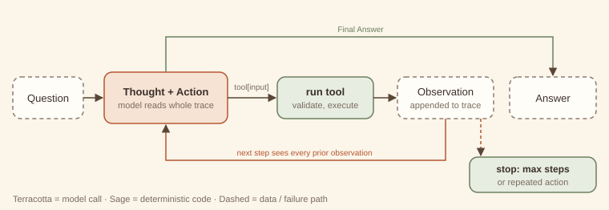
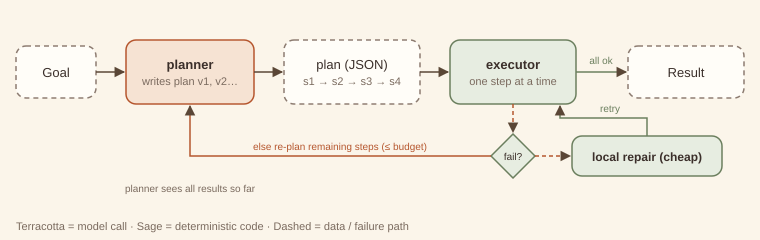
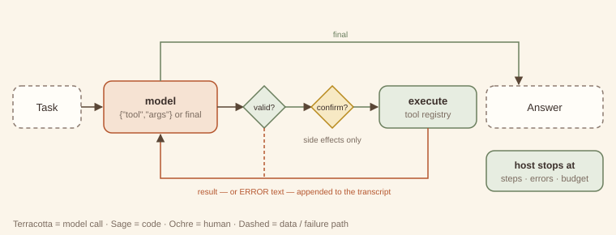
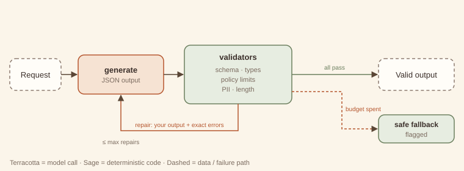
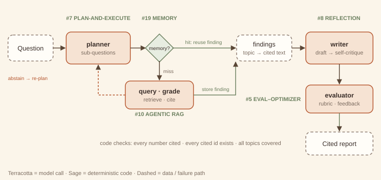

# Agentic Design Patterns

*A pattern catalog for systems built on language models — with runnable code*


<!-- ===== Front matter ===== -->


---

# Preface — How to read this book

This book is a pattern catalog for systems built around language models. It follows the Gang of Four tradition: each pattern has a name, a one-sentence intent, a structure diagram, forces, consequences, and code. The book adds two things that LLM systems need more than object-oriented ones did: an explicit **theory** of why each pattern works, and an explicit **cost and latency model**. Every extra model call costs money and time, so a pattern that buys nothing is worse than no pattern at all.

## The three questions behind every pattern

Every chapter answers the same three questions.

1. **Who decides the control flow?** In Part 1 your *code* decides; the model only fills in steps. In Part 2 a *single model* decides what happens next. In Part 3 *several models* with distinct roles coordinate. Each step to the right buys flexibility and costs predictability.
2. **Who judges the output?** Deterministic code, the same model, a separate model, a peer, or a human. Many patterns differ only in this answer. The scope sheet's overlap table keeps them apart.
3. **What is the cheaper alternative?** Every "when to use" section names the simpler thing you should try first and the signal that tells you it is no longer enough.

## The catalog at a glance

| Part | Patterns | Control flow decided by |
|---|---|---|
| 1 · Workflow | Prompt chaining · Routing · Parallelization · Orchestrator–workers · Evaluator–optimizer | your code |
| 2 · Single-agent reasoning | ReAct · Plan-and-execute · Reflection · Tool-use loop · Agentic RAG · Guardrailed generation | one model |
| 3 · Multi-agent coordination | Supervisor · Hierarchical teams · Sequential handoffs · Debate · Critic–reviewer · Human-in-the-loop · Swarm | several models (and people) |
| 4 · Cross-cutting | Memory tiers · Context management · Eval harness | applies to any structure |

Three capstones show the patterns working together: a **support-triage system** (Part 1 pilot), a **deep-research agent**, and a **multi-agent coding team**.

## Anatomy of a chapter

Every chapter uses the same sections in the same order, so you can compare patterns side by side.

- **Intent**: one sentence.
- **Structure**: a hand-drawn diagram with a fixed colour key: *terracotta* = model call, *sage* = deterministic code, *ochre* = human, *dashed* = data or external system.
- **Design concept & theory**: the mechanism, why it works, the invariants that make it *this* pattern, and its closest classic ancestor.
- **When to use / when not to use**, naming the cheaper alternative.
- **Forces & trade-offs**: latency, cost, reliability, complexity.
- **Trade-off analysis & usage guidance**: a back-of-envelope model, a decision checklist, and production defaults.
- **Worked example**: first *example-first* (what the code does when you run it), then *why-first* (why it is built that way).
- **Failure modes & guardrails**, **Variations**, **Try it** (solutions are kept separately, at the back), and a **60-second interview lens**.

## The companion code

Every pattern has a runnable example under `code/patterns/<name>/`. The examples follow four rules.

- **Standard library only.** The examples need Python 3.10 or later and nothing else, with no `pip install`.
- **Offline and deterministic.** A *mock LLM* (`code/agentkit/llm.py`) stands in for a real model. Each example writes its model's behaviour as a short list of rules next to the code that uses it, so you can see exactly what the "model" will say. The same input always gives the same output.
- **One interface.** Patterns depend only on `complete(prompt, system="") -> str`. To use a real model, implement that one method; the docstring in `agentkit/llm.py` shows a ten-line adapter.
- **Nothing ships unless it runs green.** `python3 code/verify.py` runs every example, exercise solution and capstone. It fails if any script errors, if any output drifts from its recorded expected output, or if a README or a chapter in this book quotes output that is no longer what the code prints. Every console listing in this book is checked by that command.

A mock model cannot show you how *often* a real model fails. It can show you *how a pattern behaves when it does*, and that behaviour is the subject of this book. Where a number in a cost model is illustrative rather than measured, the text says so.

## A note on names

Pattern names in this field are not yet stable. Where a pattern is widely known by another name, the chapter lists it under **Also known as**. The boundaries in the scope sheet decide which chapter a technique belongs to, whatever it is called elsewhere.


---


<!-- ===== Part 1 — Workflow patterns ===== -->


---

# Part 1 — Workflow patterns

> In a workflow, **your code owns the control flow**. The model fills in the steps; it never decides which step comes next.

That single property makes workflows the default starting point. A workflow can be read like a flowchart, tested like a function, and given a cost ceiling before it runs. In every Part 1 pattern you can predict the number of model calls, or at least bound it.

The five patterns differ in the shape of that control flow:

| Pattern | Shape | Who splits or judges the work |
|---|---|---|
| [1. Prompt chaining](01-prompt-chaining.md) | a line | code, at design time |
| [2. Routing](02-routing.md) | a fork with exactly one branch taken | a classifier, once |
| [3. Parallelization](03-parallelization.md) | fan-out, fan-in | code, statically |
| [4. Orchestrator–workers](04-orchestrator-workers.md) | fan-out decided at runtime | a model, once |
| [5. Evaluator–optimizer](05-evaluator-optimizer.md) | a loop | a separate evaluator model |

Two ideas run through all five.

**Gates are code.** Between model calls, deterministic checks (a regex, a schema, a length limit, a known-route test) turn silent failures into explicit ones. They are almost free and they are the cheapest reliability you can buy. In this book they are always drawn in sage.

**Cost is countable.** Each chapter's usage guidance gives a formula in calls, tokens and wall-clock time. If you cannot write the formula for a design, it is probably not a workflow any more; check Parts 2 and 3.

**The ladder of escalation.** Use one well-prompted call if it is good enough. Use a chain when the task splits into distinct steps, a router when inputs differ in kind, parallelization when sub-checks are independent, orchestrator–workers when the split can only be known at runtime, and an evaluator loop when quality is measurable but rarely right the first time. Reach for agents (Part 2) only when the *sequence of steps* itself cannot be known in advance.

The Part 1 pilot ends with the [support-triage capstone](../capstones/support-triage.md). It composes routing and parallelization with three modules from later parts: guardrailed generation (#11), human-in-the-loop (#17) and the eval harness (#21).


---

# 1. Prompt chaining

> **Intent.** Split a task into a fixed sequence of model calls, each consuming the previous call's output, with cheap code gates between steps that stop the chain as soon as something goes wrong.

**Also known as:** pipeline, sequential prompting, multi-step prompting · **Part:** 1 — Workflow · **Code:** `code/patterns/prompt_chaining/`

## Structure


Release notes pass through three model calls (*extract → draft → compress*). Code gates (sage diamonds) sit after the steps whose output can be checked mechanically. A failing gate ends the run with a reason, and the later calls never happen.

## Design concept & theory

**Core idea.** One hard prompt becomes several easy ones. Each step has a single job, its own instructions, and an output you can inspect. The sequence is fixed when you write the code. The model never chooses what runs next.

**Why it works: difficulty and detection.** Two effects combine.

1. *Each step is easier.* A model asked to "read these notes, pick the user-facing changes, write a warm announcement and keep it under 200 characters" juggles four constraints at once. Split up, each call juggles one. Per-step accuracy rises because each prompt is narrower and its examples can be more specific.
2. *Failures become visible.* Errors compound along a chain. If each of *n* steps succeeds with probability *p*, the whole chain succeeds with probability *pⁿ*. That looks like an argument *against* chaining (0.95³ ≈ 0.86), but the comparison is with the single call doing all the work, not with one step. Suppose the monolithic prompt succeeds 80% of the time and each focused step 97%: the chain wins, 0.97³ ≈ 0.91. More importantly, gates convert some of the remaining failures from *silent and shipped* into *detected and stopped*. A chain without gates has all the cost of decomposition and only half the benefit.

**Invariants.** (1) The step order is fixed at design time. (2) Each step sees only what the previous step produced, plus its own instructions. (3) Gates are deterministic code, not model calls. If a model decides the next step, you have an agent (Part 2). If the steps are agents that pass ownership of a conversation to each other, you have [sequential handoffs (#14)](../part-3-multi-agent/14-sequential-handoffs.md).

**Lineage.** *Pipes and Filters* (POSA, 1996) and the *Pipeline* in Enterprise Integration Patterns: independent filters connected by pipes, each filter replaceable on its own. The gates play the part of a *Message Filter*.

## When to use / when not to use

| Use it when | Don't use it when |
|---|---|
| The task splits cleanly into ordered stages (extract → transform → format). | One well-written prompt already meets the quality bar. |
| Intermediate outputs can be checked mechanically (has a version number, is valid JSON, under N chars). | The next step depends on *what you find* (go to [ReAct (#6)](../part-2-single-agent/06-react.md) or [plan-and-execute (#7)](../part-2-single-agent/07-plan-and-execute.md)). |
| Different stages benefit from different prompts, models or temperatures. | Stages are independent of each other (go to [parallelization (#3)](03-parallelization.md)). |
| You need an audit trail of how the output was produced. | Latency budgets cannot absorb several sequential round trips. |

**Cheaper alternative:** a single well-structured prompt with explicit numbered sub-steps, sometimes called "chain inside one prompt." Upgrade to a real chain when you need to *inspect, gate, or swap* an intermediate result, or when the single prompt's error rate plateaus however you reword it.

## Forces & trade-offs

| Force | vs. a single prompt | Why |
|---|---|---|
| Latency | ↑ worse | Calls are sequential: total ≈ sum of step latencies. |
| Cost | ≈ to ↑ | More calls, but each prompt is shorter, and early exits skip later steps entirely. |
| Reliability | ↑ better | Narrower steps are more accurate, and gates catch bad intermediates before they spread. |
| Complexity | ↑ slightly | More prompts to version, but each is simple and unit-testable. |

## Trade-off analysis & usage guidance

**Cost and latency model.** For *n* steps with per-step latency *tᵢ* and cost *cᵢ*, and gate pass rate *gᵢ* after step *i*:

- Latency, happy path: *T = Σ tᵢ* (gates add microseconds).
- Expected cost: *E[C] = c₁ + g₁·c₂ + g₁g₂·c₃ + …*. Early gates are worth the most, because every later step is multiplied by their pass rate. In the companion run, the internal-only release stops at gate 1 and costs one call instead of three.

**Decision checklist.**

1. Can you name each stage's output in a noun phrase ("the facts list", "the draft")? If not, the split is wrong.
2. Can at least one intermediate be checked by code? If none can, a chain buys little over one prompt.
3. Is the order fixed for *every* input? If it varies, you need routing or an agent.
4. Does the latency budget allow *n* sequential calls?
5. Would you want to swap one stage's model or prompt independently? Chains make that a one-line change.

**Usage in production.**

- Log every intermediate with the run ID. It is the main debugging benefit of the pattern.
- Put the strictest, cheapest gate as early as possible.
- Use a cheaper or faster model for mechanical stages (extraction, formatting) and spend on the creative stage.
- Version prompts per step. A regression is then traceable to one step's change.
- Alert on gate failure *rate* per step. A sudden rise means an upstream prompt, model or data change.

## Worked example

### Example first: what happens

The companion code turns raw release notes into a social post. It runs the same three-step chain twice: once on notes with real user-facing changes, and once on an internal-only release.

```
python3 code/patterns/prompt_chaining/main.py
```

<!-- expected-output: code/patterns/prompt_chaining/main.py -->
```text
Prompt chaining
===============
-- run 1: release with user-facing changes
[extract] v2.4 | - Dark mode across all screens | - CSV export for reports | - 40% faster search
[gate:extract] pass
[draft] Big news: version 2.4 is here! You asked, we listened: dark mode now covers every screen, you can export any report to CSV, and search is 40% faster. Update today and enjoy.
[compress] v2.4 is live: dark mode everywhere, CSV export for reports, and 40% faster search. Update now!
[gate:compress] pass
result: ok=True (94 chars)
-- run 2: internal-only release
[extract] NO_USER_FACING_CHANGES
[gate:extract] STOP — nothing user-facing to announce
result: ok=False stopped_at=extract
calls: run1=3, run2=1
```

Run 1 goes straight through. The `extract` gate checks that the first line is a version and that there are at least two bullets. The `compress` gate checks the 200-character limit. Run 2's extraction honestly reports `NO_USER_FACING_CHANGES`, and the gate stops the chain there, so `draft` and `compress` never run. The last line shows the saving: one call instead of three.

The whole architecture is a list:

```python
STEPS = [
    Step("extract", "Extract the USER-FACING changes ... {input}", gate=facts_gate),
    Step("draft",   "Write a friendly customer announcement from these facts:\n\n{input}"),
    Step("compress","Rewrite as one social post of at most 200 characters:\n\n{input}",
         gate=length_gate),
]
```

and the runner (`chain.py`) is about twenty lines: call, record, gate, continue or stop.

### Why first: why it is built this way

- **Steps are data, not code paths.** A `Step` is a name, a template and an optional gate. Adding, removing or reordering stages does not touch the runner. The exercise adds a whole new check with one line.
- **The extractor is allowed to say "nothing here".** Giving the first step an explicit escape value (`NO_USER_FACING_CHANGES`) is what makes the cheap early exit possible. Without it, the model invents changes to satisfy the prompt, which is a classic chaining failure.
- **Gates return reasons, not booleans.** `ChainResult.reason` says *why* the chain stopped. That reason is what you log, alert on, or show to the user.
- **The draft has no gate.** Not every step needs one. "Is this announcement friendly?" is a judgement, not a check. If it mattered enough to verify, that would be a job for an [evaluator–optimizer (#5)](05-evaluator-optimizer.md) step, not a regex.

## Failure modes & guardrails

| Failure mode | Symptom | Guardrail |
|---|---|---|
| Error propagation | A wrong fact in step 1 is fluently restated by every later step. | Gate the earliest step hardest; give it an explicit "none/unknown" escape. |
| Instruction drift | Late steps lose constraints stated only in step 1 (tone, audience). | Repeat key constraints in every step's prompt, or pass them as a shared header. |
| Format mismatch | Step *k* outputs prose when step *k+1* expects a list. | Schema-check the handoff (a gate), or use [guardrailed generation (#11)](../part-2-single-agent/11-guardrailed-generation.md) for that step. |
| Over-chaining | Ten steps where three would do; latency balloons. | Merge adjacent steps that share inputs and have no gate between them. |
| Hidden loss | A summarising step drops a detail a later step needed. | Pass the original input alongside the intermediate when later steps need it. |

## Variations

- **Gated chain with retry.** On gate failure, re-run *that step* once with the gate's reason appended before giving up. This is a tiny, local form of [guardrailed generation (#11)](../part-2-single-agent/11-guardrailed-generation.md).
- **Branch-free conditional steps.** A step can be skipped by code (`if lang != "en": translate`). The order is still fixed. A step that might be skipped is not routing.
- **Mixed-model chain.** Small model for extraction, large model for drafting, small model for formatting. This is often the largest single cost lever.
- **Chain inside a single prompt.** The cheaper alternative: numbered sub-steps in one call. No gates, but one round trip.

## Try it

The draft step sometimes leaks internal ticket IDs (such as `JIRA-412`) into customer-facing copy. Add a gate after `draft` that stops the chain when that happens, *without adding any model calls*, and show it firing on a leaky draft. How many calls does the stopped run cost?

→ Solution: [Solutions — Prompt chaining](../solutions/01-prompt-chaining.md)

## 60-second interview lens

- **Say:** "A prompt chain is a fixed pipeline of model calls with code checks between them. I use it when a task has distinct stages and at least one intermediate result I can verify mechanically."
- **Trade-off to name:** latency is the sum of the steps, so it buys accuracy and debuggability with wall-clock time; early gates make expected cost *lower* than it looks.
- **Expect the follow-up:** "Doesn't error compound across steps?" Answer: yes, *pⁿ*, but each step's *p* is higher than the monolithic prompt's, and gates turn silent failures into detected ones.
- **Red flag to avoid:** calling a chain "an agent". The model never chooses the next step.

## Related patterns

- [Sequential handoffs (#14)](../part-3-multi-agent/14-sequential-handoffs.md): the steps are autonomous agents passing ownership, chosen at runtime, not fixed calls.
- [Routing (#2)](02-routing.md): often the *first* step of a chain, choosing which chain runs.
- [Guardrailed generation (#11)](../part-2-single-agent/11-guardrailed-generation.md): a chain step whose gate is allowed to request a repair.
- [Evaluator–optimizer (#5)](05-evaluator-optimizer.md): when a step's quality needs judgement, not a check.


---

# 2. Routing

> **Intent.** Classify an input once and dispatch it to exactly one specialised handler, so that each handler can be simple, cheap and good at one kind of input.

**Also known as:** classifier dispatch, intent routing, model routing · **Part:** 1 — Workflow · **Code:** `code/patterns/routing/`

## Structure


A ticket first meets a free keyword pre-filter (code). A unique hit goes straight to validation and costs no model call. Otherwise a small LLM classifier returns `{route, confidence}`. Code validates that answer: the route must be known and the confidence at least the threshold τ. Anything invalid goes down the dashed path to a safe fallback. Exactly one handler runs.

## Design concept & theory

**Core idea.** Inputs differ in kind. One prompt written for all of them is mediocre at each. Specialised prompts (or models) are good at one kind and cheap to improve in isolation. A router sits in front and sends each input to its specialist.

**Why it works: specialisation and the cost of mistakes.**

- *Specialisation.* A billing handler's prompt can include refund policy, plan names and billing examples, and none of that pollutes the technical handler. Each prompt shrinks and its examples become relevant, which is usually worth more than any amount of "you are an expert in everything" prompting.
- *A router is a classifier, so think in confusion matrices.* Overall quality ≈ Σ P(route = r) · P(correct handler output | correctly routed) minus the damage from misroutes. Misroutes are not equally costly. Sending a billing question to the general fallback is mildly annoying; sending a security incident to the "marketing" handler is not. That asymmetry is why the fallback should be the *safest* handler, not the most common one.
- *Cascades cut cost.* The keyword pre-filter is a cheap first classifier that answers only when it is sure (exactly one hit). The LLM classifier sees only the ambiguous remainder. This is the same idea as a cascade of models: expected classification cost = (1 − *k*) · *c_cls*, where *k* is the share of inputs the free stage resolves.

**Invariants.** (1) Exactly one handler runs per input. (2) The classification decision is made once, then the router exits. (3) Every possible classifier answer (garbage, unknown label, low confidence) maps to a defined route.

**Lineage.** *Content-Based Router* (Enterprise Integration Patterns): inspect the message, forward it to one channel. The handler table resembles *Strategy*, with the strategy selected per request.

## When to use / when not to use

| Use it when | Don't use it when |
|---|---|
| Inputs fall into distinct categories that need different instructions, tools or models. | All inputs need roughly the same treatment. |
| Some categories are cheap (FAQ) and others expensive (complex reasoning): route to match model size to difficulty. | Categories overlap so heavily that a classifier cannot separate them reliably. |
| You want to improve one category without regression-testing the others. | The handling must change *during* the conversation based on results. That calls for a [supervisor (#12)](../part-3-multi-agent/12-supervisor.md), which re-decides each turn. |
| A misroute has a safe default you can fall back on. | There is no safe fallback and a misroute is costly (add [human-in-the-loop (#17)](../part-3-multi-agent/17-human-in-the-loop.md) first). |

**Cheaper alternative:** one general prompt with conditional instructions ("if the question is about billing, …"), or keyword or regex routing alone. Upgrade when the general prompt's instructions start contradicting each other, or keyword rules start colliding (as "crashes on *login*" does in the example).

## Forces & trade-offs

| Force | vs. one general prompt | Why |
|---|---|---|
| Latency | ↑ slightly | One extra classification call for ambiguous inputs only; zero for keyword hits. |
| Cost | ↓ often better | Cheap inputs go to cheap handlers; the classifier is a small model with short output. |
| Reliability | ↑ better per route, with a new failure: misroutes | Specialised prompts are more accurate; a confusion matrix now matters. |
| Complexity | ↑ | *N* handlers to maintain, a classifier to evaluate, and a fallback to design. |

## Trade-off analysis & usage guidance

**Cost model.** With keyword resolution rate *k*, classifier cost *c_cls* and handler cost *c_r* for route *r*:

*E[C] = (1 − k)·c_cls + Σ_r P(r)·c_r*

In the companion run *k* = 2/5, so the classifier ran on 3 of the 5 tickets. Routing pays off when the gap between the cheapest and the most expensive handler is large. Sending 60% of traffic to a model one-tenth the price easily covers a small classifier.

**Choosing τ.** The confidence threshold trades misroutes against fallback volume. Plot both on your eval set as τ varies and pick the knee. Re-check whenever the classifier model changes, because self-reported confidence is not calibrated across models.

**Decision checklist.**

1. Can you name the routes, and does each have a meaningfully different handler?
2. Do you have labelled examples per route to evaluate the classifier? (See the [eval harness (#21)](../part-4-cross-cutting/21-eval-harness.md).)
3. Is there a safe fallback?
4. Can a cheap rule resolve a meaningful share of inputs?
5. Will the route set be stable for months? If routes change weekly, a single prompt may be easier.

**Usage in production.**

- Log `(route, method, confidence)` for every input. The method mix (keyword / llm / fallback) is your first health dashboard.
- Alert on a rising fallback rate. It signals new kinds of input your routes do not cover.
- Evaluate the router separately from the handlers. A handler regression and a routing regression look the same from outside.
- Keep the classifier's output tiny (a JSON label), so it stays fast and cheap.

## Worked example

### Example first: what happens

Five support tickets meet four handlers and one fallback:

```
python3 code/patterns/routing/main.py
```

<!-- expected-output: code/patterns/routing/main.py -->
```text
Routing
=======
[billing  ] via keyword conf=1.00 :: I was charged twice for March.
            -> I've refunded the duplicate charge; it will appear in 3-5 days.
[technical] via llm conf=0.86 :: The app crashes on login since yesterday.
            -> Please update to 3.2.1, which fixes the login crash.
[account  ] via keyword conf=1.00 :: How do I update my email address?
            -> You can change your email under Settings > Profile.
[general  ] via fallback conf=0.55 (low confidence for 'billing') :: Do you offer a student discount?
            -> Thanks for reaching out! A teammate will follow up shortly.
[general  ] via fallback conf=0.90 (unknown route 'sales') :: We'd like to discuss a partnership.
            -> Thanks for reaching out! A teammate will follow up shortly.
classifier calls: 3 of 5 tickets
```

- *"charged twice"* and *"update my email"* each hit exactly one keyword list, so they are routed free.
- *"crashes on login"* hits two lists (technical: `crash`; account: `login`). The pre-filter declines, and the LLM decides `technical` with 0.86.
- *"student discount"*: the model guesses `billing` at 0.55, below τ = 0.7, so it falls back to `general`.
- *"partnership"*: the model invents a route, `sales`, that does not exist. It is rejected as unknown and goes to `general`.

### Why first: why it is built this way

- **Unique match or nothing.** The pre-filter answers only when exactly one route's keywords appear. Ambiguity is detected, not resolved by list order, which is the bug the [eval harness](../part-4-cross-cutting/21-eval-harness.md) example catches in a naive keyword router.
- **Validate the classifier like user input.** The LLM's answer is parsed, checked against the known route set, and thresholded. The model can say anything, and the router turns *anything* into one of four outcomes.
- **The fallback is the safest handler.** `general` promises a human follow-up rather than guessing, so the cost of a misroute into it is a delay, not a wrong answer.
- **`parse()` is a hook.** Normalising sloppy labels ("Billing ") is a subclass override, not a fork of the router. The exercise uses it.
- **Different models per stage.** The mock declares the classifier as `small-classifier` with a lower price than the `large-specialist`. Routing is where model-size choices pay off.

## Failure modes & guardrails

| Failure mode | Symptom | Guardrail |
|---|---|---|
| Invented route | Classifier returns a label not in the set. | Validate against the known set; unknown → fallback. |
| Overconfident misroute | High confidence, wrong route. | Eval per route; add a few-shot example for the confused pair; consider a second-opinion vote for costly routes. |
| Fallback flood | Too many inputs land in `general`. | Monitor the fallback rate; mine fallback inputs for a new route. |
| Keyword collisions | Order-dependent keyword lists misroute silently. | Unique-match-only pre-filter; send ambiguity to the classifier. |
| Route-set drift | Product adds a category; the classifier's menu is stale. | Generate the classifier prompt from the route table (as `Router` does), so it cannot drift. |
| Mixed-intent inputs | "Refund me *and* fix the crash." | Allow multi-label output and handle with [parallelization (#3)](03-parallelization.md), or route to a handler that can do both. |

## Variations

- **Model routing (cascade).** Route by *difficulty* rather than topic: easy queries to a small model, hard ones to a large one. The classifier predicts difficulty, or the small model's own low confidence triggers escalation.
- **Embedding router.** Route by nearest centroid of example embeddings. No LLM call; well suited to many routes with plentiful examples.
- **Hierarchical routing.** Route to a domain, then to a sub-intent. Keep depth at two; deeper trees compound misroutes.
- **Multi-label routing.** The classifier returns several routes and the outputs are merged. That is no longer pure routing but [parallelization (#3)](03-parallelization.md) with a router in front.

## Try it

The classifier sometimes answers `"Billing "` or `"TECHNICAL"` instead of the exact route name, and every such answer is wrongly treated as unknown and falls back. Make the router tolerant of case and whitespace *without* accepting genuinely unknown routes such as `"Sales"`. Change as little code as possible.

→ Solution: [Solutions — Routing](../solutions/02-routing.md)

## 60-second interview lens

- **Say:** "Routing classifies an input once and dispatches it to one specialised handler. It lets each prompt be narrow, and it lets cheap inputs go to cheap models."
- **Trade-off to name:** you gain specialisation and cost control, and you take on a new failure mode, the misroute, which you manage with validation, a confidence threshold and a safe fallback.
- **Expect the follow-up:** "How do you pick the threshold?" Sweep τ on a labelled eval set and plot misroute rate against fallback rate; pick the knee; re-tune when the model changes.
- **Red flag to avoid:** trusting the classifier's label without checking it is in the route set.

## Related patterns

- [Supervisor (#12)](../part-3-multi-agent/12-supervisor.md): re-decides after every worker turn; a router decides once and exits.
- [Prompt chaining (#1)](01-prompt-chaining.md): the chosen handler is often a chain.
- [Eval harness (#21)](../part-4-cross-cutting/21-eval-harness.md): how you know the router is good enough to ship.
- [Support-triage capstone](../capstones/support-triage.md): this exact `Router` in production-shaped glue.


---

# 3. Parallelization (fan-out / fan-in)

> **Intent.** Run several independent model calls at the same time — different subtasks of one input (*sectioning*) or the same task several times (*voting*) — and combine their results in code.

**Also known as:** scatter-gather, fan-out/fan-in, map-reduce, self-consistency (voting variant) · **Part:** 1 — Workflow · **Code:** `code/patterns/parallelization/`

## Structure


Code fans a draft reply out to three independent checks that run concurrently. A code fan-in step aggregates their verdicts. Here it *fails closed*: one failing branch, or one branch that crashed, blocks the draft. In the voting variant every branch gets the same prompt, and the fan-in takes a majority, subject to a quorum.

## Design concept & theory

**Core idea.** If two pieces of work do not depend on each other, there is no reason to wait for one before starting the other. And if one model answer is noisy, several answers combined are less noisy, *provided their errors are not all the same error*.

**Why it works: two separate mechanisms.**

1. *Sectioning buys latency and focus.* Sequential checks take *Σ tᵢ*; parallel ones take *max tᵢ* (plus overhead). Separately, each branch has a single concern: a tone checker that is not also checking refund policy pays full attention to tone. That is the same narrowing benefit as chaining, without the sequential penalty.
2. *Voting buys reliability, under an independence assumption.* If each of three voters is right with probability *p* = 0.8 *and their errors are independent*, the majority is right with probability 3p²(1−p) + p³ ≈ **0.896** (Condorcet's jury theorem). The catch is the condition: three samples from the same model on the same prompt make *correlated* errors. If the model misreads the input, it usually misreads it every time. Voting helps against *random* slips (a flipped label, a sampling accident), and helps little against *systematic* misunderstanding. Diversify prompts, models or input order to decorrelate the voters.

**Invariants.** (1) The split is known *before* runtime; code, not a model, decides the branches. (2) Branches do not communicate. (3) Aggregation is done in code, with an explicit rule for failed branches.

**Lineage.** *Scatter-Gather* and *Aggregator* (Enterprise Integration Patterns); *fork-join* in concurrent programming; *MapReduce* when the split is over data. The voting variant is ensemble learning applied at inference time.

## When to use / when not to use

| Use it when | Don't use it when |
|---|---|
| Subtasks are independent and you know them in advance (several guardrail checks, several documents). | Each step needs the previous step's output ([chain it, #1](01-prompt-chaining.md)). |
| Latency matters and calls are I/O-bound. | The split depends on the input's content (use [orchestrator–workers, #4](04-orchestrator-workers.md)). |
| A single answer is too noisy and errors look random (vote). | Errors are systematic. Voting the same mistake three times does not fix it. |
| Rate limits allow the extra concurrent calls. | Cost is the binding constraint and one good call suffices. |

**Cheaper alternative:** do all checks in *one* call ("check tone, policy and facts; return three verdicts"), or run them sequentially. Upgrade when the combined prompt's checks interfere with each other, or when latency is the bottleneck.

## Forces & trade-offs

| Force | vs. one combined call / sequential calls | Why |
|---|---|---|
| Latency | ↓ better than sequential | Wall time ≈ slowest branch, not the sum. |
| Cost | ↑ | *N* calls instead of one; voting multiplies cost by the number of voters. |
| Reliability | ↑ | Focused branches (sectioning); averaged noise (voting, if errors are independent). |
| Complexity | ↑ moderately | Concurrency, partial failures, an aggregation rule, rate limits. |

## Trade-off analysis & usage guidance

**Model.** For *N* branches with latencies *tᵢ* and costs *cᵢ*:

- Latency ≈ *max tᵢ + overhead* (bounded by your concurrency limit: with *W* workers, ≈ ⌈N/W⌉ waves).
- Cost = *Σ cᵢ*: parallelism saves time, never money.
- Voting with *k* voters: cost ×*k*. The reliability gain shrinks as voter correlation rises, and is roughly zero for perfectly correlated voters.

**Aggregation rules (choose deliberately).**

| Rule | Use for | Failed branch counts as |
|---|---|---|
| All must pass | guardrails, safety | fail (closed) |
| Any passes | recall-oriented search | ignored |
| Majority with quorum | classification votes | not a vote; may break quorum |
| Merge / concatenate | sectioned content | gap flagged in output |

**Decision checklist.**

1. Are the branches truly independent (no branch needs another's output)?
2. Is the aggregation rule written down, *including what a crashed branch means*?
3. Do rate limits and concurrency limits allow *N* simultaneous calls?
4. For voting: what makes your voters' errors *different* from each other?
5. Is the latency saving worth *N*× the calls?

**Usage in production.**

- Give every branch a timeout. One slow branch sets your latency.
- Return results in a stable order (input order, not completion order) so logs and tests are deterministic. `fan_out` does this.
- Record per-branch outcomes, not just the aggregate. "Policy check fails 12% of drafts" is actionable; "drafts fail 15%" is not.
- Use a bounded worker pool. Unbounded fan-out against a rate-limited API turns into retries and gets slower.

## Worked example

### Example first: what happens

```
python3 code/patterns/parallelization/main.py
```

<!-- expected-output: code/patterns/parallelization/main.py -->
```text
Parallelization
===============
-- sectioning: three independent guardrail checks on a draft reply
[check:tone] pass=True — warm and professional
[check:policy] pass=False — promises a refund above the $50 agent limit
[check:facts] pass=True — order number and dates match the record
[fan-in] approved=False
[timing] parallel faster than sequential: True
-- voting: three judges on one email
[judge:A] PHISHING
[judge:B] PHISHING
[judge:C] discarded ("I'm not sure, it could be either.")
[fan-in] verdict=PHISHING agreement=1.00 from 2 usable votes
```

*Sectioning.* Three checks (tone, policy, facts) run concurrently on the same draft. The mock adds 0.15 s of simulated latency per call, and the run asserts that wall time beat the sequential sum. Policy fails (a $120 refund exceeds the $50 limit), so the fail-closed fan-in blocks the draft, even though two of three checks passed.

*Voting.* Three judges classify a suspicious email. Judge C's answer is unusable and is discarded rather than counted. The verdict is PHISHING. But look at the last line: *"agreement=1.00 from 2 usable votes"*. That number overstates the evidence, and the exercise fixes it.

### Why first: why it is built this way

- **Branches never raise.** `fan_out` catches every exception and returns a `Branch` with either a value or an error. One branch's failure is data for the aggregator, never a crash that kills its siblings.
- **The aggregator owns the semantics.** `fan_out` does not know whether a failure should block (guardrails) or be ignored (search). That choice lives in the caller, in one visible line: `all(b.ok and b.value["pass"] for b in branches)`.
- **Unparseable votes are not votes.** Counting "I'm not sure" as a vote for either side would be invented evidence. Discarding it is correct, but then *agreement* must be reported against votes cast, not votes kept.
- **Input-order results.** Branch results come back in the order they were submitted, so the trace is identical on every run even though completion order is not.
- **Reuse.** [Orchestrator–workers (#4)](04-orchestrator-workers.md) and the [support-triage capstone](../capstones/support-triage.md) import this exact `fan_out`. There is one implementation of concurrency in the codebase.

## Failure modes & guardrails

| Failure mode | Symptom | Guardrail |
|---|---|---|
| Correlated voters | Votes agree and are all wrong. | Diversify prompts, models or example order; measure inter-voter agreement on an eval set. |
| Silent partial failure | A crashed branch is treated as a pass. | Explicit per-rule semantics; fail closed for safety checks. |
| Quorum collapse | Verdict from 1–2 usable votes looks confident. | Require a quorum; report agreement against votes cast. |
| Rate-limit storm | Fan-out triggers 429s, then retries, then slower than sequential. | Bounded pool; exponential backoff; per-provider concurrency limits. |
| Tail latency | One slow branch dominates. | Per-branch timeout; treat a timeout as a failed branch under the aggregation rule. |
| Merge conflicts (sectioning) | Two branches produce contradictory content. | Make sections disjoint; or add a final reconciliation call, and accept that this makes it a small chain. |

## Variations

- **Self-consistency.** Sample several reasoning paths for one question and vote on the final answer. This is the voting variant applied to chain-of-thought.
- **Best-of-N with a scorer.** Generate *N* candidates in parallel and pick the best with a deterministic scorer or a judge. This is the step before [evaluator–optimizer (#5)](05-evaluator-optimizer.md) iterates.
- **Map-reduce over documents.** Sectioning by data: summarise each chunk in parallel, then reduce.
- **Hedged requests.** Send the same request to two providers and take the first good answer. Parallelism used for tail latency, not quality.
- **Guardrail fan-out.** Run safety and policy checks *in parallel with* generation, and cancel or withhold the output if a check fails.

## Try it

In the voting run, judge C's vote was unusable, yet the verdict was reported with "agreement 1.00". Add a **quorum**: require at least three usable votes or return no verdict (escalate). Report agreement against votes *cast*, not votes kept. Show both the no-quorum case and a three-vote case.

→ Solution: [Solutions — Parallelization](../solutions/03-parallelization.md)

## 60-second interview lens

- **Say:** "Parallelization runs independent calls concurrently and aggregates in code: sectioning splits one task into independent checks; voting repeats one task to reduce noise."
- **Trade-off to name:** it saves wall-clock time, never money, and voting only helps if the voters' errors are independent.
- **Expect the follow-up:** "What happens when one branch fails?" Answer: that is a design decision. Fail closed for safety checks, ignore for recall-oriented search, and break quorum for votes. Never let it crash the others.
- **Red flag to avoid:** claiming three samples from the same model at the same temperature are three independent opinions.

## Related patterns

- [Orchestrator–workers (#4)](04-orchestrator-workers.md): the split is decided by a model at runtime, not by code in advance.
- [Swarm (#18)](../part-3-multi-agent/18-swarm.md): agents interact and the workload is emergent. Parallel branches never talk to each other.
- [Debate (#15)](../part-3-multi-agent/15-debate.md): voters that *see and respond to* each other's arguments over rounds.
- [Guardrailed generation (#11)](../part-2-single-agent/11-guardrailed-generation.md): deterministic checks are cheaper than LLM-judged branches; use them first.


---

# 4. Orchestrator–workers

> **Intent.** Let a model decompose a task into subtasks *at runtime*, run each subtask with a focused worker call, and merge the results with one synthesis call — in a single pass.

**Also known as:** dynamic decomposition, planner–workers, master–worker · **Part:** 1 — Workflow · **Code:** `code/patterns/orchestrator_workers/`

## Structure


The orchestrator (a model) writes a plan: a list of subtasks, each naming the source it needs. Code validates the plan (size cap, known sources) before anything runs. Workers execute concurrently, each seeing only its own subtask and source. The orchestrator then synthesises the outputs. There is one plan and one synthesis, with no loop back.

## Design concept & theory

**Core idea.** This is [parallelization (#3)](03-parallelization.md) for the case where you cannot write the split in advance. How many files does this change touch? Which documents matter for this question? Only the input can say, so a model reads the input and decides the fan-out.

**Why it works.**

- *Decomposition is a skill models are good at.* Listing the parts of a task is usually much easier than doing all the parts at once. The orchestrator does the cheap, global part (what needs doing); workers do the expensive, local parts (doing it).
- *Context isolation.* Each worker sees one subtask and one source, not the whole task. Smaller, focused contexts mean less distraction and cheaper calls, and the possibility of using a smaller model for workers. Total tokens can even *fall*, because no single call has to hold everything.
- *Separation of planning from execution makes both auditable.* The plan is an inspectable artefact (JSON) *before* any work is done. You can validate it, cap it, log it, and reject it, as the third run in the example does.

**Invariants.** (1) A model decides the subtasks at runtime. (2) Workers are stateless calls that do not talk to each other. (3) Single pass: plan, execute, synthesise. If the plan is revised based on what workers return, you have [plan-and-execute (#7)](../part-2-single-agent/07-plan-and-execute.md). If the coordinator keeps delegating turn by turn to stateful agents, you have a [supervisor (#12)](../part-3-multi-agent/12-supervisor.md).

**Lineage.** *Master–worker* (task farm) from parallel computing; the *Process Manager* and *Splitter → Aggregator* pair from Enterprise Integration Patterns, with the routing slip computed dynamically.

## When to use / when not to use

| Use it when | Don't use it when |
|---|---|
| The number or kind of subtasks depends on the input (files in a diff, sources for a question). | You can write the split in code (use [parallelization, #3](03-parallelization.md)). |
| Subtasks are independent once identified. | Subtask *k* needs subtask *k−1*'s result (use a chain or [plan-and-execute, #7](../part-2-single-agent/07-plan-and-execute.md)). |
| The whole input is too large or too distracting for one call. | The task is small enough that one call handles it well. |
| You want a reviewable plan before spending on execution. | Failures discovered during execution should change the plan (that needs re-planning). |

**Cheaper alternative:** a fixed fan-out over an obvious unit (one worker per file, always), which is parallelization with a code-computed split. Upgrade when the obvious unit is wrong: some files need no work, some need two kinds of work, and some subtasks span several files.

## Forces & trade-offs

| Force | vs. fixed fan-out | Why |
|---|---|---|
| Latency | ↑ | Plan and synthesis are two extra sequential calls around the parallel phase. |
| Cost | ≈ | Extra orchestrator calls, offset by skipping unnecessary workers and using small worker models. |
| Reliability | ↑ when the split matters, with a new risk | Better decomposition, but the plan itself can be wrong (missing, extra or hallucinated subtasks). |
| Complexity | ↑ | Plan schema, plan validation, worker isolation, synthesis prompt. |

## Trade-off analysis & usage guidance

**Model.** With plan cost *c_p*, *N* workers at *c_w*, and synthesis *c_s*:

- Cost = *c_p + N·c_w + c_s*. Workers on a small model often make *N·c_w* the smallest term. The example's worker is priced at a tenth of the orchestrator's.
- Latency ≈ *t_p + max(t_w) + t_s*: three sequential phases, the middle one parallel.
- Cap *N*. Without a cap, cost is unbounded and set by the model's enthusiasm for decomposition.

**Decision checklist.**

1. Would a human need to *read the input* to know how to split the work?
2. Once split, are the pieces independent?
3. Can you write a plan schema and validate it (size, allowed sources and tools)?
4. Is one pass enough, or will workers' findings need to reshape the plan?
5. Can workers run on a cheaper model?

**Usage in production.**

- Validate the plan *as untrusted input*: schema, maximum subtasks, allowed sources, no duplicates. The plan is model output, and it decides what your system touches.
- Log the plan separately from the result. Most quality issues trace to the plan, not the workers.
- Pass workers the minimum context they need. Isolation is a feature.
- Make the synthesis prompt cite subtask IDs, so the result is traceable to the worker that produced each claim.

## Worked example

### Example first: what happens

The same orchestrator receives three tasks over a small code repository:

```
python3 code/patterns/orchestrator_workers/main.py
```

<!-- expected-output: code/patterns/orchestrator_workers/main.py -->
```text
Orchestrator-workers
====================
-- Write the PR description for the auth hardening change
[plan] 3 subtask(s): login, session, docs
[worker:login] Adds rate limiting: 5 failed attempts per 15 minutes.
[worker:session] Session lifetime reduced from 24h to 8h.
[worker:docs] Docs say 8 hours — consistent with the code.
[synthesize] Security hardening: login is rate-limited (5 tries / 15 min) and sessions now last 8h instead of 24h. Docs updated and consistent.
-- Write a customer note about the auth change
[plan] 1 subtask(s): session
[worker:session] Users are signed out after 8h instead of 24h.
[synthesize] Heads-up: for your security you'll now be asked to sign in again after 8 hours.
-- Audit everything touching customer data
[plan] REJECTED — plan references unknown sources ['db/prod.sql']
orchestrator: 5 calls; workers: 4 calls
```

- **PR description:** the orchestrator plans three subtasks (two code files and the docs). It ignores `billing/invoice.py`, which is unchanged. Three workers run concurrently, and the synthesis merges them.
- **Customer note:** the same repository and a different task give a *different plan*, one subtask focused on user impact. A fixed fan-out over files would have run four workers here.
- **Audit:** the orchestrator proposes reading `db/prod.sql`, which is not an allowed source. Plan validation rejects it before any worker runs, at the cost of one call.

The final line, *5 orchestrator calls and 4 worker calls*, is the whole cost of three tasks, and the worker calls are the cheap ones.

### Why first: why it is built this way

- **The plan is JSON, and it is validated.** `plan()` checks shape, size and sources. Free-text plans cannot be capped or audited, and an unchecked plan lets the model choose what your system reads.
- **Workers reuse `fan_out`.** Concurrency, error capture and stable ordering come from [parallelization (#3)](03-parallelization.md). The orchestrator only adds planning and synthesis.
- **A failed worker is visible in the synthesis.** A worker error becomes `[worker failed: …]` in the synthesis input, so the final answer can say what is missing instead of silently omitting it. The exercise adds a retry without touching `orchestrate()`.
- **Same model for planning and synthesis.** Both are global, judgement-heavy steps that need the whole task in view. Workers do local, mechanical work and use the cheap model.

## Failure modes & guardrails

| Failure mode | Symptom | Guardrail |
|---|---|---|
| Hallucinated subtask | Plan references a file, tool or source that does not exist or is not allowed. | Validate the plan against an allow-list; reject or re-plan once. |
| Over-decomposition | Ten tiny subtasks; cost and synthesis quality suffer. | Hard cap; prompt for "at most N, merge small items"; track N per task type. |
| Missed subtask | The plan omits something needed; synthesis is confidently incomplete. | Coverage check in code where possible (every changed file is in some subtask). |
| Inconsistent workers | Workers contradict each other; synthesis blends them. | Have workers return structured fields; let the synthesis flag conflicts rather than average them. |
| Synthesis hallucination | Final answer contains claims no worker produced. | Require citations to subtask IDs; spot-check with an [eval harness (#21)](../part-4-cross-cutting/21-eval-harness.md) scorer. |
| Lost failure | A worker failed; the answer does not say so. | Pass failures into synthesis explicitly; mark the result partial. |

## Variations

- **Typed workers.** The plan assigns each subtask a worker *type* (summariser, test-writer, translator), each with its own prompt. This is a router per subtask.
- **Coverage-checked plan.** Code computes the units that must be covered (changed files, required sections) and rejects plans that miss any.
- **Two-level decomposition.** A worker may itself orchestrate. Stop at two levels; beyond that, see [hierarchical teams (#13)](../part-3-multi-agent/13-hierarchical-teams.md).
- **Map-reduce synthesis.** With many workers, synthesise in a tree (pairs, then pairs of pairs) to keep each synthesis context small.

## Try it

One worker call times out on its first attempt. Today the synthesis receives `[worker failed: …]`. Make workers retry once on transient errors **without changing `orchestrate()`**, then show that the synthesis receives all three results and that exactly one retry happened. (Hint: what single interface do all patterns depend on?)

→ Solution: [Solutions — Orchestrator–workers](../solutions/04-orchestrator-workers.md)

## 60-second interview lens

- **Say:** "Orchestrator–workers is dynamic fan-out: a model reads the task and decides the subtasks, workers do them in parallel with isolated context, and one call synthesises, all in a single pass."
- **Trade-off to name:** you gain a decomposition fitted to the input, and you add a new failure surface, the plan, which must be validated like untrusted input.
- **Expect the follow-up:** "How is this different from a supervisor agent?" One pass, stateless workers, no turn-by-turn re-delegation. A supervisor stays in the loop and adapts.
- **Red flag to avoid:** letting the plan reference arbitrary tools or data without an allow-list.

## Related patterns

- [Parallelization (#3)](03-parallelization.md): same fan-out, but code fixes the split in advance.
- [Plan-and-execute (#7)](../part-2-single-agent/07-plan-and-execute.md): the plan is revised as results come in.
- [Supervisor (#12)](../part-3-multi-agent/12-supervisor.md): ongoing, multi-turn delegation to stateful agents.
- [Hierarchical teams (#13)](../part-3-multi-agent/13-hierarchical-teams.md): orchestration with two or more levels and scoped context per team.


---

# 5. Evaluator–optimizer

> **Intent.** Pair a generator with a *separate* evaluator that judges each draft against an explicit rubric and returns actionable feedback, looping until the draft passes, a round budget is spent, or progress stalls.

**Also known as:** generate–critique–revise, LLM-as-judge loop, iterative refinement · **Part:** 1 — Workflow · **Code:** `code/patterns/evaluator_optimizer/`

## Structure


The generator writes a draft. The evaluator, a different role with its own rubric, returns pass or fail plus one fix per failed criterion. Failing feedback flows back to the generator for revision. Code ends the loop on a pass, on a round budget, or on a stall (the same feedback twice), and in the last two cases escalates.

## Design concept & theory

**Core idea.** Getting something right on the first try is hard; recognising what is wrong with a draft is often easier. The pattern exploits that asymmetry by separating the two jobs and iterating.

**Why it works.**

- *The generation–verification gap.* For many tasks, checking a candidate against criteria is more reliable than producing a candidate that meets them. The evaluator only has to say *which criterion fails and what would fix it*; the generator only has to apply a specific fix. Each call does the easier half of the problem.
- *Explicit rubrics turn vague quality into checkable claims.* "Write a good apology" has no failure signal. "Offers a concrete remedy" does. A rubric is also where business rules enter: no blame, no promises we cannot keep.
- *Separation reduces self-agreement.* A model asked to critique its *own* draft in the same context tends to approve it. A separate evaluator call, with its own instructions ("you did not write this") and ideally a different model, behaves more like a reviewer. This is the line between this pattern and [reflection (#8)](../part-2-single-agent/08-reflection.md).
- *Iteration has diminishing returns.* Most of the gain arrives in the first one or two revisions. Expected cost grows linearly with rounds while quality improvement flattens, which is why the loop needs a budget and a stall detector, not just a pass condition.

**Invariants.** (1) Generator and evaluator are distinct roles with distinct prompts. (2) The evaluator judges against an explicit rubric and returns *actionable* feedback. (3) Code owns termination. If the check is deterministic code rather than a judgement, the pattern is [guardrailed generation (#11)](../part-2-single-agent/11-guardrailed-generation.md). If both sides are tool-using agents trading itemised review comments, it is the [critic–reviewer loop (#16)](../part-3-multi-agent/16-critic-reviewer.md).

**Lineage.** A closed-loop feedback controller (setpoint = rubric, error signal = feedback); *test-driven* revision; loosely, the actor–critic split from reinforcement learning, without any learning, since nothing is updated between tasks.

## When to use / when not to use

| Use it when | Don't use it when |
|---|---|
| Quality criteria can be stated, and a reviewer can tell when they are met. | Criteria are purely subjective or cannot be articulated. |
| First drafts are often *close* but miss specific criteria. | First drafts are usually fine. You would pay ×2–×6 for nothing. |
| Feedback can be specific enough for a revision to act on. | The criterion is checkable in code (length, schema, regex): use a validator (#11), which is cheaper and exact. |
| Latency allows several sequential rounds. | The generator lacks the information to fix the problem. No feedback helps; escalate instead. |

**Cheaper alternative:** a single generation with the rubric in the prompt, plus deterministic checks for whatever criteria are mechanical. Upgrade when you can show, on an eval set, that rubric failures are frequent *and* fixable by revision.

## Forces & trade-offs

| Force | vs. single generation | Why |
|---|---|---|
| Latency | ↑↑ | Each round is two sequential calls; three rounds ≈ six calls of latency. |
| Cost | ↑↑ | Rounds × (generator + evaluator). Evaluator prompts include the draft *and* the rubric. |
| Reliability | ↑ on stated criteria | Failures against the rubric are caught and usually fixed; unstated criteria are not. |
| Complexity | ↑ | Rubric design, feedback format, termination logic, evaluator calibration. |

## Trade-off analysis & usage guidance

**Model.** With generator cost *c_g*, evaluator cost *c_e*, and *R* rounds used (≤ budget *B*):

- Cost = *R·(c_g + c_e)*. Worst case *B·(c_g + c_e)*. Set *B* from the eval set's distribution of rounds-to-pass: typically 2–3.
- Latency = *R·(t_g + t_e)*, all sequential.
- Every criterion you move from the evaluator to code (as the exercise does for word count) cuts both cost and variance.

**Decision checklist.**

1. Can you write the rubric as 3–6 criteria, each answerable yes/no?
2. Which criteria are checkable in code? Move those out of the evaluator.
3. Does feedback name a *specific fix*, not just a score?
4. What happens when the budget runs out: ship best effort, flag it, or escalate?
5. Is the evaluator a different prompt, and ideally a different model, from the generator?

**Usage in production.**

- Log every round's draft and feedback. Rounds-to-pass by task type is the key metric.
- Detect stalls: the same feedback twice means more rounds will not help. Stop and escalate.
- Calibrate the evaluator against human labels on a sample (see [eval harness, #21](../part-4-cross-cutting/21-eval-harness.md)). An evaluator that passes everything is a cost with no benefit.
- Use a cheaper model for the evaluator only if calibration shows it agrees with the stronger one.

## Worked example

### Example first: what happens

An apology email must meet four criteria: acknowledges the order and delay, offers a concrete remedy, no blame, under 60 words.

```
python3 code/patterns/evaluator_optimizer/main.py
```

<!-- expected-output: code/patterns/evaluator_optimizer/main.py -->
```text
Evaluator-optimizer
===================
-- Apology to Sam: order #4471 arrived 6 days late
[round 1 draft] Hi Sam, sorry order #4471 was late — the courier had problems. We'll make it up to you somehow.
[round 1 eval] FAIL: Remove blame on the courier; take ownership; Offer a concrete remedy, e.g. refund the shipping fee
[round 2 draft] Hi Sam, I'm sorry order #4471 arrived 6 days late. That's on us. We'll make it up to you.
[round 2 eval] FAIL: Offer a concrete remedy, e.g. refund the shipping fee
[round 3 draft] Hi Sam, I'm sorry order #4471 arrived 6 days late. That's on us. I've refunded your $9.99 shipping fee today and added free express shipping to your next order.
[round 3 eval] PASS
result: passed=True rounds=3 stop=passed
-- Reply to Lee promising same-day delivery tomorrow
[round 1 draft] Hi Lee, we guarantee same-day delivery tomorrow!
[round 1 eval] FAIL: Same-day delivery cannot be guaranteed; do not promise it
[round 2 draft] Hi Lee, we guarantee same-day delivery tomorrow!
[round 2 eval] FAIL: Same-day delivery cannot be guaranteed; do not promise it
result: passed=False rounds=2 stop=stalled -> escalate to a human
total model calls: 10
```

*Apology to Sam.* Round 1 blames the courier and offers a vague remedy, and the evaluator returns two fixes. Round 2 fixes only one, as real models often do. Round 3 fixes the other and passes. Each round the feedback names exactly what remains.

*Reply to Lee.* The task asks for something the rubric forbids (guaranteeing same-day delivery). The generator cannot satisfy both, so the evaluator returns identical feedback twice and the loop stops as *stalled* after two rounds instead of burning the budget. The right outcome is escalation to a human. More rounds would not fix this.

### Why first: why it is built this way

- **Feedback is a list of fixes, not a score.** `{"pass": false, "feedback": ["Remove blame…", "Offer a concrete remedy…"]}` tells the generator what to change. A score of 6/10 does not.
- **The revision prompt carries the previous draft *and* all outstanding feedback.** The generator edits rather than starting over, which converges faster and keeps what was already right.
- **Three stop reasons, all explicit.** `passed`, `budget`, `stalled`. Callers branch on `stop_reason`, so a stalled loop can route to a human rather than ship.
- **The evaluator fails closed.** Unparseable evaluator output counts as a failed round with a visible note. It is never a pass.
- **The evaluator is told it did not write the draft.** It is a small prompt detail that pushes against self-approval.

## Failure modes & guardrails

| Failure mode | Symptom | Guardrail |
|---|---|---|
| Rubber-stamp evaluator | Everything passes round 1; quality unchanged. | Calibrate against human labels; use a different model; include known-bad drafts in the eval set. |
| Infinite polishing | Rounds hit the budget on most tasks. | Budget; stall detection; check whether the rubric is satisfiable. |
| Oscillation | Fixing criterion A breaks B, and back again. | Revision prompt includes *all* outstanding feedback and the full rubric. |
| Vague feedback | "Improve tone." The generator changes random things. | Require one concrete, actionable fix per failed criterion. |
| Unsatisfiable task | Same feedback every round. | Stall detector → escalate (the Lee case). |
| Rubric gaming | Draft meets the letter of the rubric, misses its intent. | Add an intent criterion; review samples manually. |
| Cost blow-up | Evaluator re-checks mechanical criteria every round. | Move mechanical checks to code (exercise). |

## Variations

- **Best-of-N + evaluator.** Generate *N* drafts in [parallel (#3)](03-parallelization.md), evaluate all, pick the best. This trades rounds for breadth and gives lower latency at higher cost.
- **Scored rubric.** The evaluator returns per-criterion scores. Pass when all clear a threshold; keep the best-scoring draft if the budget runs out.
- **Tiered evaluators.** Cheap code checks first, then a cheap model, then an expensive model only for drafts that clear both.
- **Human as the evaluator, sometimes.** Sample some rounds for human review to keep the model evaluator calibrated. This is a bridge to [human-in-the-loop (#17)](../part-3-multi-agent/17-human-in-the-loop.md).

## Try it

The rubric's "under 60 words" criterion is checkable in code. Put a free deterministic pre-check in front of the evaluator so over-long drafts are rejected **without spending an evaluator call**, and count the calls saved. You must not modify `optimize()`.

→ Solution: [Solutions — Evaluator–optimizer](../solutions/05-evaluator-optimizer.md)

## 60-second interview lens

- **Say:** "Evaluator–optimizer loops a generator and a separate rubric-driven evaluator: the evaluator returns specific fixes, the generator revises, and code stops the loop on pass, budget or stall."
- **Trade-off to name:** each round doubles calls and latency for gains that diminish fast; anything checkable in code should be a validator, not an evaluator criterion.
- **Expect the follow-up:** "How do you know the evaluator is any good?" Calibrate it against human labels on an eval set, and watch for an evaluator that passes everything.
- **Red flag to avoid:** looping until pass with no budget or stall detection.

## Related patterns

- [Reflection (#8)](../part-2-single-agent/08-reflection.md): the same model critiques itself. Cheaper, but it shares its own blind spots.
- [Guardrailed generation (#11)](../part-2-single-agent/11-guardrailed-generation.md): deterministic validators instead of a judging model.
- [Critic–reviewer loop (#16)](../part-3-multi-agent/16-critic-reviewer.md): both sides are tool-using agents exchanging itemised findings over turns.
- [Eval harness (#21)](../part-4-cross-cutting/21-eval-harness.md): development-time measurement across many cases. Evaluator–optimizer improves one output at runtime.


---


<!-- ===== Part 2 — Single-agent reasoning ===== -->


---

# Part 2 — Single-agent reasoning

> In Part 2, **one model decides what happens next**. The code supplies tools, limits and checks, and the model chooses the sequence.

That one change, moving control flow from your code to the model, is what people usually mean by *agent*. It buys flexibility: the agent can take a path you did not anticipate, react to a tool's surprising answer, or decide it needs more evidence. It costs predictability. You can no longer write the number of calls in advance, only bound it.

So every pattern in this part has the same shape: **a model in a loop, and a host that owns the loop's edges**. The host validates what the model asks for, executes it, decides what counts as done, and stops the loop when it is not converging.

| Pattern | The model decides… | The host owns… |
|---|---|---|
| [6. ReAct](06-react.md) | the next thought and action | parsing, tool execution, repeat and step guards |
| [7. Plan-and-execute](07-plan-and-execute.md) | the whole plan, and when to re-plan | plan validation, step execution, re-plan budget |
| [8. Reflection](08-reflection.md) | what is wrong with its own answer | the number of rounds |
| [9. Tool-use loop](09-tool-use-loop.md) | which tool to call, with what arguments | schemas, confirmations, errors-as-observations, stop conditions |
| [10. Agentic RAG](10-agentic-rag.md) | whether, what and how often to retrieve | retrieval, citation checking, abstention |
| [11. Guardrailed generation](11-guardrailed-generation.md) | the content | every validity rule, the repair budget, the fallback |

Two patterns here are *runtimes* rather than strategies. The [tool-use loop](09-tool-use-loop.md) is the machinery every agent in this book runs on, and [guardrailed generation](11-guardrailed-generation.md) is the generate–check–repair discipline that keeps any single output valid. The other four are *reasoning strategies* that run on top of them.

**When to come here from Part 1:** when you cannot write the sequence of steps down, because it depends on what the agent finds. If you can write it down, stay in Part 1: it is cheaper, faster and easier to test.

The part closes with the [deep-research capstone](../capstones/deep-research.md), which composes plan-and-execute, agentic RAG and reflection with evaluator–optimizer (#5) and memory tiers (#19).


---

# 6. ReAct

> **Intent.** Let a model alternate between writing down a *thought*, taking an *action* with a tool, and reading the *observation*, in one growing trace, so that every next step is grounded in what was actually observed.

**Also known as:** reason + act, thought–action–observation loop · **Part:** 2 — Single-agent reasoning · **Code:** `code/patterns/react/`

## Structure



The model reads the whole trace so far and writes a Thought and an Action (`tool[input]`). Code parses the action, runs the tool, and appends the Observation to the trace. The loop repeats until the model writes a Final Answer. A step limit and a repeated-action guard stop it when it is not making progress.

## Design concept & theory

**Core idea.** Reasoning without acting hallucinates; acting without reasoning flails. ReAct interleaves the two at the granularity of a single step: think about what you know, do one thing to learn more, look at the result, think again.

**Why it works.**

- *Grounding.* Each thought is written *after* the latest observation is in the context. Facts the model would otherwise invent ("Orbit X1 is made by…") are instead looked up, and the lookup result is right there for the next step to use.
- *Adaptivity.* The plan is implicit and one step deep. When an observation surprises the model ("No results."), the very next thought can change course. In the example, an over-specific search fails and the agent broadens it.
- *Legibility.* The trace *is* the explanation. You can read why the agent did each thing, which is the main reason to choose ReAct over a silent tool loop.
- *The cost is quadratic-ish context.* Each step re-sends the whole trace. Over *n* steps, prompt tokens grow roughly as *n²/2 × step size*. ReAct is for short horizons (a handful of steps); long ones need [plan-and-execute (#7)](07-plan-and-execute.md) or [context management (#20)](../part-4-cross-cutting/20-context-management.md).

**Invariants.** (1) One action per step, and its observation is appended before the next thought. (2) The trace format is fixed and machine-parseable. (3) The host enforces termination; the model only *proposes* finishing.

**Lineage.** The OODA loop (observe–orient–decide–act); the read–eval–print loop with commentary. In research, the 2022 ReAct paper (Yao et al.) named the prompting format.

## When to use / when not to use

| Use it when | Don't use it when |
|---|---|
| The next step depends on what the last tool returned (multi-hop lookup, debugging). | The steps are known in advance ([prompt chaining, #1](../part-1-workflow/01-prompt-chaining.md)). |
| You need a human-readable reasoning trail for audit or debugging. | The task is long-horizon (dozens of steps). Context and cost grow every step. |
| Tasks are short: a few hops, not dozens. | Visible "thoughts" would leak sensitive reasoning to end users. |
| Tools are cheap and safe to call speculatively. | Every action has expensive side effects; plan first ([#7](07-plan-and-execute.md)). |

**Cheaper alternative:** a single tool-calling turn (model picks one tool, answers from its result), or a [tool-use loop (#9)](09-tool-use-loop.md) without explicit thoughts. Upgrade to ReAct when multi-hop questions fail because the model does not reason about intermediate results, or when you need the trace.

## Forces & trade-offs

| Force | vs. a plain tool loop | Why |
|---|---|---|
| Latency | ↑ | Thoughts are extra output tokens every step; steps are sequential. |
| Cost | ↑ | Whole trace re-sent each step, plus thought tokens. |
| Reliability | ↑ on multi-hop | Explicit intermediate reasoning reduces skipped hops and unjustified leaps. |
| Complexity | ≈ | A parser and two guards on top of a tool loop. |

## Trade-off analysis & usage guidance

**Model.** With *n* steps, a fixed prompt *P*, and an average step size *s* (thought + action + observation):

- Prompt tokens ≈ *n·P + s·n(n−1)/2*. The second term dominates past a few steps.
- Latency ≈ *n × (model time + tool time)*.
- In the example: 5 steps for a 3-hop question (one wasted on an empty search), 7 model calls in total across both questions.

**Decision checklist.**

1. Does the next step depend on the last observation? If not, use a chain.
2. Is the horizon short (under ~8 steps)? If not, plan first or compact.
3. Are tools safe to call exploratorily?
4. Will someone read the trace? If nobody will, the thoughts are cost without benefit; use a tool loop.
5. Do you have a stop rule beyond "the model says it's done"?

**Usage in production.**

- Cap steps and detect repeated actions; both are cheap and catch most loops.
- Keep observations short: truncate or summarise tool output before appending, because it is re-sent every step.
- Log the trace verbatim. It is your debugging record.
- Do not show raw thoughts to end users by default; they can contain guesses the final answer rightly discards.

## Worked example

### Example first: what happens

```
python3 code/patterns/react/main.py
```

<!-- expected-output: code/patterns/react/main.py -->
```text
ReAct
=====
-- Q1: What's the weather at the HQ of the company that makes the Orbit X1?
[thought 1] First find who makes the Orbit X1 headset.
[action 1] search[Orbit X1 headset maker]
[observe 1] No results.
[thought 2] The phrase was too specific; search the product name alone.
[action 2] search[Orbit X1]
[observe 2] Orbit X1 is a VR headset made by Lumen Labs.
[thought 3] The maker is Lumen Labs; find where it is headquartered.
[action 3] search[Lumen Labs]
[observe 3] Lumen Labs is headquartered in Lisbon, Portugal.
[thought 4] The HQ is Lisbon; now get the weather there.
[action 4] weather[Lisbon]
[observe 4] Lisbon: 21°C, sunny
[thought 5] I have the city and its weather.
[final] Lisbon — currently 21°C and sunny.
result: answered in 5 steps
-- Q2: What is the Lumen Labs CEO's shoe size?
[thought 1] I should search for the CEO's shoe size.
[action 1] search[Lumen Labs CEO shoe size]
[observe 1] No results.
[thought 2] I should search for the CEO's shoe size.
[stop] repeated action search[Lumen Labs CEO shoe size] — not making progress
result: repeated_action after 2 steps, answer=None
model calls: 7
```

**Q1** needs three hops: product → maker → headquarters → weather. The first search is too specific and returns *No results*. The next thought reacts to that observation and broadens the query, which is exactly the adaptivity ReAct is for. From there each observation feeds the next action, and the final answer uses only what was observed.

**Q2** asks for something no tool can know. The model repeats the identical search, and the *repeated-action guard* stops the loop after two steps instead of letting it spin until the step limit.

### Why first: why it is built this way

- **One regex for actions, one for the final answer.** A strict, line-oriented format is easy for models to follow and trivial to parse. Anything else becomes an "Invalid format" *observation*, so the model can fix it, rather than an exception.
- **Tool errors are observations too.** `ToolError` text is appended like any result, so the agent can see "No weather data for X" and adapt.
- **The repeated-action guard compares (tool, input) pairs.** Repeating an action with identical input cannot produce new information in a deterministic tool world, so it is a reliable "stuck" signal and much cheaper than waiting for `max_steps`.
- **The mock reasons from the trace.** It chooses each step by checking what observations are present, which mirrors how the real pattern works. Read `model()` in `main.py` as a specification of good ReAct behaviour.

## Failure modes & guardrails

| Failure mode | Symptom | Guardrail |
|---|---|---|
| Looping | Same action repeated; no new information. | Repeated-action detection; step cap. |
| Ungrounded final answer | Final answer states facts no observation contains. | Post-hoc grounding check (the exercise); require citations to observations. |
| Format drift | Model writes two actions, or prose instead of `Action:`. | Strict parser; invalid format becomes an observation asking for the format. |
| Context blow-up | Long tool outputs re-sent every step. | Truncate or summarise observations; [compaction (#20)](../part-4-cross-cutting/20-context-management.md). |
| Premature finish | Final answer after one hop, skipping verification. | Prompt examples showing multi-hop; check required facts in code where possible. |
| Thought leakage | Speculative reasoning shown to users. | Show only the final answer; keep traces internal. |

## Variations

- **ReAct with native tool calls.** The model emits structured tool calls and the thoughts go in a separate text field. This is the same pattern, running on the [tool-use loop (#9)](09-tool-use-loop.md) runtime.
- **ReAct + reflection.** After a failed episode, write a lesson and retry (Reflexion). See [reflection (#8)](08-reflection.md) and its exercise.
- **Self-ask.** The thought is always a sub-question; the action is always a search. This is a narrowed ReAct for multi-hop QA.
- **Budgeted ReAct.** The trace header shows remaining steps and cost, so the model can trade thoroughness for budget explicitly.

## Try it

A model can skip the tools and write a confident `Final Answer` from memory. Write a **post-hoc grounding check**: every number and capitalised name in the final answer must appear in some Observation. Show it passing the real Q1 run and flagging an answer produced with no tool calls.

→ Solution: [Solutions — ReAct](../solutions/06-react.md)

## 60-second interview lens

- **Say:** "ReAct interleaves a written thought, one tool action and its observation in a growing trace, so each decision is grounded in what was actually observed."
- **Trade-off to name:** the trace makes it adaptive and auditable, but the whole trace is re-sent every step, so cost grows roughly quadratically and it suits short horizons.
- **Expect the follow-up:** "How do you stop it looping?" A step cap, repeated-action detection, and treating errors as observations so the model can recover rather than retry blindly.
- **Red flag to avoid:** confusing ReAct (a reasoning *format*) with the tool-use loop (the *runtime*); they compose.

## Related patterns

- [Tool-use loop (#9)](09-tool-use-loop.md): the runtime mechanics (schemas, dispatch, confirmation, termination) ReAct runs on.
- [Plan-and-execute (#7)](07-plan-and-execute.md): decides the whole sequence up front instead of one step at a time.
- [Agentic RAG (#10)](10-agentic-rag.md): a specialised ReAct where the action is always retrieval and observations are graded.
- [Reflection (#8)](08-reflection.md): learn from a failed trajectory before the next attempt.


---

# 7. Plan-and-execute (with re-planning)

> **Intent.** Have a model write an explicit multi-step plan before acting, execute the steps one by one (often without a large model), and call the planner again only when results invalidate the remaining plan.

**Also known as:** planner–executor, plan-then-act, LLM compiler (variant) · **Part:** 2 — Single-agent reasoning · **Code:** `code/patterns/plan_and_execute/`

## Structure



The planner, a capable model, writes the whole plan as JSON. Code validates it, and an executor runs it step by step, here with plain functions and no model at all. When a step fails, an optional *local repair* in code gets the first chance to fix it. Otherwise the planner sees all results so far and writes a new plan for the *remaining* work, within a re-plan budget.

## Design concept & theory

**Core idea.** Separate *deciding what to do* from *doing it*. Planning is expensive and benefits from a strong model that sees the whole goal; execution is usually mechanical and can be cheap. Re-planning brings back the adaptivity a fixed plan lacks, but only when it is needed.

**Why it works.**

- *Global view.* A plan written up front considers the whole goal at once: ordering, dependencies, budget. ReAct's one-step-ahead reasoning can paint itself into a corner; a planner sees the corner coming.
- *Cost asymmetry.* Plan with the big model once (or a few times); execute *n* steps with tools or a small model. Expected cost ≈ *c_plan × (1 + replans) + n × c_exec*, against ReAct's *n × c_big × (growing context)*.
- *Re-planning as exception handling.* Most steps succeed, so you pay for adaptivity only on failure. That is the same economics as exceptions in code.
- *An inspectable artefact.* The plan can be shown to a user, approved ([HITL, #17](../part-3-multi-agent/17-human-in-the-loop.md)), validated against an action allow-list, and diffed between versions.

**Invariants.** (1) The plan exists as data before execution starts. (2) Execution follows the plan; it does not invent steps. (3) Plan changes go through the planner (or an explicit repair hook) and are recorded as new versions.

**Lineage.** Classical AI planning (STRIPS, HTN) with replanning; the *Interpreter* pattern (plan = program, executor = interpreter); query planning in databases.

## When to use / when not to use

| Use it when | Don't use it when |
|---|---|
| The task has several dependent steps you can't fix in code but a model can foresee. | The steps are always the same ([prompt chaining, #1](../part-1-workflow/01-prompt-chaining.md)). |
| Execution steps are expensive or have side effects, so you want to think before acting. | Each step's choice depends heavily on the last observation (ReAct is simpler). |
| You want a plan a human can review or approve. | Tasks are one or two steps; a plan is overhead. |
| Most steps can run without a large model. | The environment changes so fast that plans are stale on arrival. |

**Cheaper alternative:** [ReAct (#6)](06-react.md) for short horizons, or [orchestrator–workers (#4)](../part-1-workflow/04-orchestrator-workers.md) when the subtasks are independent and one pass suffices. Upgrade when ReAct wanders or repeats itself on longer tasks, or when step failures should change the remaining work.

## Forces & trade-offs

| Force | vs. ReAct | Why |
|---|---|---|
| Latency | ≈ to ↓ | No big-model call per step; one planning call up front, more only on failure. |
| Cost | ↓ on long tasks | Execution is cheap; planning is amortised over many steps. |
| Reliability | ↑ on long tasks; ↓ when reality diverges | Global plan avoids dead ends; a stale plan wastes steps until a failure triggers a re-plan. |
| Complexity | ↑ | Plan schema, validation, versioning, re-plan prompt, repair hooks. |

## Trade-off analysis & usage guidance

**Model.** With *n* executed steps, *r* re-plans, planner cost *c_p* and step cost *c_s*:

- Cost = *(1 + r)·c_p + n·c_s*. In the example *r = 1* and *c_s = 0* (tools only): 2 planner calls for the whole task.
- A local repair hook that resolves a failure without the planner lowers *r*; the exercise cuts planner calls from 2 to 1.
- Bound *r* (`max_replans`) and *n* (`max_steps` per plan).

**Decision checklist.**

1. Can a model write the steps before seeing any results? If not, stay with ReAct.
2. Can execution run on tools or a small model?
3. Which failures are mechanical (local repair) and which need judgement (re-plan)?
4. Does anyone need to approve the plan before it runs?
5. What is the re-plan budget, and what happens when it is spent?

**Usage in production.**

- Validate every plan version against an action allow-list, a step cap, and argument schemas.
- Log plan versions and the reason for each re-plan. "Replan rate" by task type is a key metric.
- Give the re-planner *results so far* and the *failure reason*, not the whole history verbatim.
- Make steps idempotent where possible, so a re-plan can safely repeat one.

## Worked example

### Example first: what happens

The goal: an offsite in Porto for 12 people on 14 Nov, under €2,000, and then draft the invite.

```
python3 code/patterns/plan_and_execute/main.py
```

<!-- expected-output: code/patterns/plan_and_execute/main.py -->
```text
Plan-and-execute
================
[plan v1] s1:search_venues → s2:check_availability → s3:get_quote → s4:draft_invite
[exec s1] ok  ['Casa Azul', 'Quinta Verde']
[exec s2] FAIL booked (Casa Azul unavailable)
[plan v2] s2b:check_availability → s3b:get_quote → s4b:draft_invite
[exec s2b] ok  free
[exec s3b] ok  EUR 1800
[exec s4b] ok  Invite: offsite at Quinta Verde on 14 Nov
result: completed; plans written=2, replans=1, steps executed=5, planner calls=2
final: Invite: offsite at Quinta Verde on 14 Nov
```

Plan v1 has four steps. Step `s2` discovers that Casa Azul is booked. The rest of plan v1 (quote and invite for Casa Azul) is now *stale*, and it is never executed. The planner receives the results so far, including the failure note, and writes plan v2 for the remaining work at Quinta Verde. Five steps ran, with two planner calls and zero model calls in execution.

### Why first: why it is built this way

- **The executor is a plain function.** `execute(step, results)` dispatches on `step.action`. Nothing in execution needs a language model, which is the main cost advantage over ReAct.
- **Plans are validated like untrusted input.** `_parse_plan` checks the JSON shape, the action allow-list and the step cap. A plan that names an unknown action never runs.
- **Only the remaining steps are re-planned.** The re-plan prompt carries completed results, so the planner does not redo the venue search. Completed work is never thrown away.
- **Every plan version is kept.** `PlanRun.plans` is the audit trail of how the agent changed its mind.
- **A `repair` hook comes before the planner.** Some failures have a mechanical fix: try the next candidate. The hook lets code handle those for free (see the exercise) and leaves judgement calls to the planner.

## Failure modes & guardrails

| Failure mode | Symptom | Guardrail |
|---|---|---|
| Stale plan | Steps keep running after the world changed. | Treat unexpected results as failures; re-plan on them. |
| Re-plan thrash | Every step triggers a re-plan. | Re-plan budget; local repair hooks; better planner context. |
| Hallucinated action | Plan names a tool that does not exist. | Allow-list validation before execution. |
| Lost progress | Re-plan redoes completed steps. | Pass results so far; ask only for the remaining steps. |
| Over-planning | 15-step plans for 3-step tasks. | Step cap; examples of short plans; plan-length metric. |
| Unsafe plan | Plan includes an irreversible action. | Plan review by a human ([#17](../part-3-multi-agent/17-human-in-the-loop.md)) or a policy check before execution. |

## Variations

- **Plan-and-solve prompting.** A single call: "first write a plan, then follow it". The cheap, no-runtime version.
- **Parallel plan execution (LLM compiler).** The plan is a DAG, and independent steps run concurrently via [parallelization (#3)](../part-1-workflow/03-parallelization.md).
- **Hierarchical planning.** Each plan step expands into its own sub-plan. Cap the depth.
- **Plan approval.** The plan is shown to a human before execution, which is the cheapest place to put human oversight.

## Try it

Re-planning costs a large-model call. When an availability check fails and the earlier search already returned other venues, the fix is mechanical: check the next venue and swap it into the remaining steps. Implement this as a `repair` hook and show the planner calls drop from 2 to 1.

→ Solution: [Solutions — Plan-and-execute](../solutions/07-plan-and-execute.md)

## 60-second interview lens

- **Say:** "Plan-and-execute has a strong model write the whole plan as data, a cheap executor run it, and the planner re-plan only the remaining steps when something fails."
- **Trade-off to name:** it is cheaper and more coherent than ReAct on long tasks, but a plan can go stale, so failure detection and a re-plan budget are essential.
- **Expect the follow-up:** "How is this different from orchestrator–workers?" Steps here can depend on each other and the plan is revised on failure. Orchestrator–workers is one pass over independent subtasks.
- **Red flag to avoid:** executing the plan without validating it against an allow-list.

## Related patterns

- [ReAct (#6)](06-react.md): decides one step at a time; simpler for short, observation-driven tasks.
- [Orchestrator–workers (#4)](../part-1-workflow/04-orchestrator-workers.md): single-pass decomposition with no re-planning.
- [Hierarchical teams (#13)](../part-3-multi-agent/13-hierarchical-teams.md): planning and delegation across levels of agents.
- [Deep-research capstone](../capstones/deep-research.md): plan-and-execute driving agentic RAG, with a real re-plan.


---

# 8. Reflection / self-critique

> **Intent.** Have the same model critique its own output and then revise it, catching the errors it can recognise on a second look, at the cost of one or two extra calls and no extra infrastructure.

**Also known as:** self-critique, self-refine, self-correction; Reflexion (trajectory variant) · **Part:** 2 — Single-agent reasoning · **Code:** `code/patterns/reflection/`

## Structure


One model drafts. The same model is then asked to critique its own draft: concrete errors, missed edge cases, unsupported claims, or `NO ISSUES`. If there are issues, it revises, and the loop runs at most a small number of rounds. Every box is the same model, which is what makes this reflection and not [evaluator–optimizer (#5)](../part-1-workflow/05-evaluator-optimizer.md).

## Design concept & theory

**Core idea.** Generation is one pass; critique is a second pass with a different instruction. Asking a model to *look for problems* points its attention at different features of the same text than asking it to *write* did.

**Why it works, partially.**

- *Mode switch.* While writing, the model optimises for fluency and completeness; while critiquing, it is told to hunt for errors, edge cases and unsupported claims. Many slips (a missed edge case, a contradiction with the task) are visible in the second mode.
- *Cheap.* No rubric to maintain, no second model, no tools: 2–3 calls per round.
- *Bounded by the model's own knowledge.* Self-critique can only find errors the model can recognise. If the model *believes* February always has 28 days, its critique will approve that belief. This is the **shared blind spot**, and the example shows it happening. Reflection improves outputs on average; it does not verify them.

That last point sets the pattern's place. Use reflection to remove cheap, recognisable errors before a stronger check, not *as* the check.

**Invariants.** (1) Critique and revision use the same model as generation; no external judge or ground truth enters the loop. (2) The critique is explicit text that the revision must address. (3) Rounds are bounded.

**Lineage.** Proofreading your own writing; the "rubber-duck" review. In research: Self-Refine (2023), and Reflexion (2023) for learning from failed trajectories across attempts.

## When to use / when not to use

| Use it when | Don't use it when |
|---|---|
| First drafts contain errors the model *can* recognise when asked (missed edge cases, contradictions). | Correctness can be checked in code. Run the check ([#11](11-guardrailed-generation.md)), which is cheaper and exact. |
| You want a quality bump without a separate evaluator or rubric. | The stakes need independent verification ([#5](../part-1-workflow/05-evaluator-optimizer.md), [#16](../part-3-multi-agent/16-critic-reviewer.md), or a human). |
| Latency allows one extra round trip or two. | The model lacks the knowledge to see the error. Reflection will just approve it. |
| As a first, cheap pass before a stronger reviewer. | You need to *prove* quality improved; reflection's verdict is not evidence. |

**Cheaper alternative:** put the critique checklist *in the original prompt* ("before answering, check for X, Y, Z"), which costs one call and no loop. Upgrade to reflection when measured error rates show the second pass catches enough to pay for it.

## Forces & trade-offs

| Force | vs. single generation | Why |
|---|---|---|
| Latency | ↑ | +2 sequential calls per round (critique, revise). |
| Cost | ↑ ×2–3 | Critique and revision re-read the draft. |
| Reliability | ↑ modestly | Catches recognisable errors; cannot catch blind spots; can occasionally make a correct answer worse. |
| Complexity | ≈ | Two prompt templates and a loop bound. |

## Trade-off analysis & usage guidance

**Model.** Per task: 1 draft + *r* × (critique + revision) + 1 final critique when it returns `NO ISSUES`. For *r* = 1, that is 4 calls. In the example: 4 calls for `is_leap` (one revision) and 2 for `days_in_month` (approved at once).

**Measure the delta, not the verdict.** The only honest way to know reflection helps is an [eval harness (#21)](../part-4-cross-cutting/21-eval-harness.md) comparing outputs with and without it. The example measures with tests: 3/4 → 4/4 on one task and 3/4 → 3/4 on the other.

**Decision checklist.**

1. Do first drafts fail in ways the model would recognise if asked?
2. Is there a code check you could run instead? Prefer it.
3. Have you measured the improvement on an eval set?
4. Is one round enough? Usually yes; the second round has small returns.
5. Where does the output go after reflection: straight to users, or to a stronger check?

**Usage in production.**

- Default to one round. Make the critique prompt *specific* to your task's known failure modes.
- Require the critique to name concrete problems; "looks good, maybe improve clarity" should be treated as `NO ISSUES`.
- Track how often reflection changes the output, and how often the change is an improvement, on an eval set.
- For trajectory reflection, store lessons with the failure that taught them, and expire lessons that stop helping.

## Worked example

### Example first: what happens

```
python3 code/patterns/reflection/main.py
```

<!-- expected-output: code/patterns/reflection/main.py -->
```text
Reflection
==========
-- Write Python is_leap(y) for the Gregorian calendar.
[draft] def is_leap(y): …
[critique 1] Missed the Gregorian century rule: 1900 is not a leap year, 2000 is.
[revision 1] def is_leap(y): …
[critique 2] NO ISSUES
measured: first draft 3/4 tests, final 4/4 tests; revisions=1
-- Write Python days_in_month(m, y).
[draft] def days_in_month(m, y): …
[critique 1] NO ISSUES
measured: first draft 3/4 tests, final 3/4 tests; revisions=0
model calls: 6 (same model throughout)
```

**`is_leap`:** the first draft only checks `y % 4`. The self-critique spots the Gregorian century rule (1900 is not a leap year, 2000 is), the revision fixes it, and the second critique returns `NO ISSUES`. Tests, run only to *measure*, go from 3/4 to 4/4.

**`days_in_month`:** the first draft ignores leap years in February. The critique says `NO ISSUES`. The model does not see the bug in its own code, and the measured result stays at 3/4. That is the shared blind spot, reproduced on purpose.

### Why first: why it is built this way

- **Tests are outside the loop.** If test results fed the critique, it would be an evaluator with ground truth: a better pattern, but a different one. Keeping them outside shows what reflection achieves alone.
- **`NO ISSUES` is an exact token.** It makes "stop" unambiguous to parse and easy for a model to emit.
- **The critique sees the task and the draft; the revision also sees the critique.** The revision must address named points, not rewrite freely.
- **`first_draft` is recorded.** You cannot measure what reflection did unless you keep what it started from.

## Failure modes & guardrails

| Failure mode | Symptom | Guardrail |
|---|---|---|
| Shared blind spot | Critique approves a wrong answer. | Use external checks for anything verifiable; measure with an eval set. |
| Sycophantic critique | Always `NO ISSUES`, or only cosmetic notes. | Task-specific critique checklist; treat vague critiques as no-ops. |
| Over-correction | Revision "fixes" a correct answer into a wrong one. | Keep the first draft; compare on evals; limit rounds. |
| Cost creep | Reflection added everywhere "just in case". | Enable per task type only where evals show gains. |
| Endless polishing | Each round finds a new nit. | Round cap of 1–2. |

## Variations

- **Trajectory reflection (Reflexion).** After a failed *episode*, write a lesson and carry it into the next attempt or task as context. The exercise implements it.
- **Checklist reflection.** The critique prompt is a fixed list of task-specific checks, which reduces vagueness.
- **Reflection then evaluate.** A cheap self-critique pass first, then an independent [evaluator (#5)](../part-1-workflow/05-evaluator-optimizer.md). The deep-research capstone does exactly this.
- **Chain-of-verification.** The model writes verification questions about its own claims, answers them independently, then revises.

## Try it

Self-critique missed the February bug. Add **trajectory reflection**: when an outside signal (tests, a user report) reveals a failure, have the model write a one-line lesson, store it, and pass stored lessons as system text on later tasks. Show that a related task (`days_left`) fails without the lesson and passes with it.

→ Solution: [Solutions — Reflection](../solutions/08-reflection.md)

## 60-second interview lens

- **Say:** "Reflection asks the same model to critique and revise its own output. It is cheap and catches errors the model can recognise on a second look."
- **Trade-off to name:** it costs two or three times the calls and cannot catch the model's own blind spots, so it is a quality bump, not verification.
- **Expect the follow-up:** "How is that different from LLM-as-judge?" A judge is a separate role (ideally a separate model) with an explicit rubric. Reflection is the same model, introspecting.
- **Red flag to avoid:** citing the model's "I checked and it's correct" as evidence of correctness.

## Related patterns

- [Evaluator–optimizer (#5)](../part-1-workflow/05-evaluator-optimizer.md): a separate evaluator with a rubric, more independent and more expensive.
- [Critic–reviewer loop (#16)](../part-3-multi-agent/16-critic-reviewer.md): a separate reviewer *agent* with tools such as running tests.
- [Guardrailed generation (#11)](11-guardrailed-generation.md): when the check can be code, use code.
- [Memory tiers (#19)](../part-4-cross-cutting/19-memory-tiers.md): where trajectory lessons should live.


---

# 9. Tool-use loop

> **Intent.** Run an agent as a loop in which the model emits one structured tool call at a time and the *host* validates, confirms, executes, and returns the result (or the error) as the next observation, until the model gives a final answer or a host-enforced limit stops it.

**Also known as:** function-calling loop, agent runtime, agent executor · **Part:** 2 — Single-agent reasoning · **Code:** `code/patterns/tool_use_loop/`

## Structure



The model replies with exactly one JSON object: a tool call or a final answer. The host validates the call against the tool's schema. Calls to side-effecting tools need confirmation (a person, or a policy). The host executes the call and appends the result, or the error *as text*, to the transcript. Stop conditions (step limit, consecutive errors, budget) belong to the host, not the model.

## Design concept & theory

**Core idea.** This is the minimal, correct runtime under every agent in this book. ReAct, agentic RAG and the coding team's developer are all *policies* running on this loop. This chapter is about the loop itself: the contract between a model that proposes and a host that disposes.

**Why it works: the host is the trusted computing base.**

- *Errors are observations, not exceptions.* A model that calls `list_events(date=20261016)` should *see* "argument 'date' must be str" and fix it on the next step. Raising an exception would end the run, and silently coercing the value would hide the bug. Recovery from errors is the most valuable behaviour a tool loop enables, and it only works if errors are fed back.
- *Validation before execution.* Arguments are checked against the schema *before* the tool runs. Tools never see malformed input, and the model gets a precise error.
- *Separation of proposal and authority.* The model can propose `create_event`; only the host, through a confirmation policy, can let it happen. This is the same principle as [human-in-the-loop (#17)](../part-3-multi-agent/17-human-in-the-loop.md), applied per call.
- *Termination is a host decision.* Models are bad at knowing when they are stuck. Step limits, consecutive-error limits and cost budgets are cheap, deterministic and always on.

**Invariants.** (1) Exactly one structured action per model turn. (2) Every action's result or error is appended before the next turn. (3) The host validates, authorises and terminates.

**Lineage.** The *Command* pattern (a call is a request object the invoker validates and executes); an OS system-call boundary (user code requests, the kernel checks and performs); the event loop.

## When to use / when not to use

| Use it when | Don't use it when |
|---|---|
| The model must call tools whose sequence it decides. | A single tool call answers the question (one-shot function calling). |
| Tools can fail and the model should recover. | The sequence is known; call the tools from code ([Part 1](../part-1-workflow/00-part-intro.md)). |
| Some tools have side effects that need gating. | You cannot bound steps or cost: fix that before shipping. |
| You need a runtime other patterns can share. | Real-time constraints forbid several sequential round trips. |

**Cheaper alternative:** a single model call with tool *results pre-fetched by code* (retrieve, then answer). Upgrade when the model needs to choose *which* tools to call or *react* to a result.

## Forces & trade-offs

| Force | vs. pre-fetching in code | Why |
|---|---|---|
| Latency | ↑ | One model round trip per tool call. |
| Cost | ↑ | The transcript grows with every call. |
| Reliability | ↑ in open-ended tasks | Recovery from errors; the model adapts to results. |
| Complexity | ↑ | Schemas, a confirmation policy, transcript management, stop conditions. |

## Trade-off analysis & usage guidance

**Model.** With *k* tool calls, an average transcript growth *g* per call, and a fixed prompt *P*:

- Calls = *k + 1* (the final answer). Prompt tokens ≈ *(k+1)·P + g·k(k+1)/2*.
- Each failed call costs a full step. In the example, one type error made a three-call task take four steps.
- Bound everything: `max_steps`, `max_errors`, and in production a token or cost budget.

**Decision checklist.**

1. Does every tool have a typed schema the host checks?
2. Which tools have side effects, and who confirms them?
3. Do errors come back as text the model can act on?
4. What are the step, error and cost limits, and what does the user see when one trips?
5. Are side-effecting tools idempotent, or deduplicated by the host (exercise)?

**Usage in production.**

- Write tool descriptions for the model: what the tool does, when to use it, argument formats with examples.
- Keep tool results small and structured; truncate large payloads.
- Log every call with arguments, result status and latency. Per-tool error rate is the best signal of a confusing schema.
- Use an allow-list per task: an agent booking meetings does not need `delete_account` in its tool set.

## Worked example

### Example first: what happens

```
python3 code/patterns/tool_use_loop/main.py
```

<!-- expected-output: code/patterns/tool_use_loop/main.py -->
```text
Tool-use loop
=============
-- Book a 30-minute sync with Dana tomorrow afternoon (2026-10-16)
[call 1] list_events({"date": 20261016})
[result 1] ERROR: list_events: argument 'date' must be str
[call 2] list_events({"date": "2026-10-16"})
[result 2] [{"title": "Design review", "start": "13:00", "end": "14:00"}]
[call 3] create_event({"title": "Sync with Dana", "date": "2026-10-16", "start": "14:00", "end": "14:30"})
[result 3] {"created": true, "title": "Sync with Dana", "date": "2026-10-16", "start": "14:00", "end": "14:30"}
[final] Booked Sync with Dana on 2026-10-16, 14:00-14:30 (after your design review).
result: final in 4 steps; confirmations asked: ['create_event']
-- Summarise my week
[call 1] list_events({"date": "2026-10-16"})
[result 1] [{"title": "Design review", "start": "13:00", "end": "14:00"}, {"title": "Sync with Dana", "date": "2026-10-16", "start": "14:00", "end": "14:30"}]
[call 2] list_events({"date": "2026-10-16"})
[result 2] [{"title": "Design review", "start": "13:00", "end": "14:00"}, {"title": "Sync with Dana", "date": "2026-10-16", "start": "14:00", "end": "14:30"}]
[call 3] list_events({"date": "2026-10-16"})
[result 3] [{"title": "Design review", "start": "13:00", "end": "14:00"}, {"title": "Sync with Dana", "date": "2026-10-16", "start": "14:00", "end": "14:30"}]
[stop] step limit 3 reached
result: max_steps, final=None
```

**Booking:** the first call passes the date as an integer. The registry rejects it *before* the tool runs and returns the error as an observation. The model fixes the type, reads the existing 13:00–14:00 meeting, and proposes a 14:00 slot. `create_event` is side-effecting, so the host asks for confirmation (recorded as `['create_event']`) before executing. Then the model finishes.

**"Summarise my week":** a model that never decides it is done calls `list_events` again and again. The host stops it at the step limit with `final=None`, rather than letting it run until the money runs out.

### Why first: why it is built this way

- **`ToolRegistry` validates; `ToolLoop` orchestrates.** Schemas and type checks live with the tools, and the loop stays generic. Any registry-compatible object works, which is how the exercise adds idempotency without touching the loop.
- **Confirmation is a callback.** `confirm(name, args) -> bool` might be a UI prompt, a policy check, or a [review queue (#17)](../part-3-multi-agent/17-human-in-the-loop.md). The loop does not care which.
- **`render` is pluggable.** The coding-team capstone passes a [context manager (#20)](../part-4-cross-cutting/20-context-management.md) here so long transcripts are compacted. The loop logic is unchanged.
- **Consecutive errors, not total errors.** An agent that makes and then fixes a mistake is working. One that fails three times in a row is not.

## Failure modes & guardrails

| Failure mode | Symptom | Guardrail |
|---|---|---|
| Runaway loop | Repeated calls, no final answer. | Step cap; cost budget; repeated-call detection. |
| Malformed calls | Wrong types, missing args. | Schema validation before execution; error text with the fix. |
| Duplicate side effects | Two identical bookings or payments. | Idempotency keys; host-side dedupe (exercise). |
| Unauthorised action | A destructive tool called without consent. | Confirmation policy; per-task tool allow-lists. |
| Error spiral | Model keeps retrying the same failing call. | Consecutive-error limit; include the corrective hint in the error. |
| Prompt injection via results | Tool output contains instructions. | Treat tool output as data; never let it change permissions; quote or label it in the transcript. |

## Variations

- **Parallel tool calls.** The model emits several independent calls per turn and the host runs them concurrently ([#3](../part-1-workflow/03-parallelization.md)).
- **Native function calling.** The provider's API carries tool schemas and calls as structured fields. Same loop, less parsing.
- **Tool search / progressive disclosure.** With hundreds of tools, expose a `find_tool` tool and load full schemas on demand ([#20](../part-4-cross-cutting/20-context-management.md)).
- **Sandboxed execution.** Code-executing tools run in an isolated process with resource limits.

## Try it

A model that loses track of progress may call `create_event` twice with identical arguments, double-booking the meeting. Make side-effecting tools **idempotent in the host**: an identical repeat call returns the earlier result with a `duplicate_ignored` note and never re-executes. Do not change `ToolLoop`.

→ Solution: [Solutions — Tool-use loop](../solutions/09-tool-use-loop.md)

## 60-second interview lens

- **Say:** "The tool-use loop is the agent runtime: the model proposes one structured call, the host validates, authorises and executes it, feeds back the result or the error, and owns every stop condition."
- **Trade-off to name:** flexibility and error recovery in exchange for one round trip per call and a growing transcript, so bound steps, errors and cost.
- **Expect the follow-up:** "How do you handle a tool error?" Return it as an observation with enough detail to fix, count consecutive errors, and stop at a limit. Never crash the loop, and never hide the error.
- **Red flag to avoid:** letting the model decide when to stop with no host-side limit.

## Related patterns

- [ReAct (#6)](06-react.md): a reasoning format that runs on this loop with visible thoughts.
- [Human-in-the-loop (#17)](../part-3-multi-agent/17-human-in-the-loop.md): the durable version of the confirmation callback.
- [Context management (#20)](../part-4-cross-cutting/20-context-management.md): keeps the growing transcript within budget.
- [Coding-team capstone](../capstones/coding-team.md): this loop drives the developer agent.


---

# 10. Agentic RAG

> **Intent.** Make retrieval a decision inside the agent's loop: decide whether to retrieve at all, write the query, grade what came back, reformulate when evidence is insufficient, answer only from graded evidence with citations that code verifies, and abstain when the corpus does not have the answer.

**Also known as:** iterative retrieval, self-RAG, corrective RAG · **Part:** 2 — Single-agent reasoning · **Code:** `code/patterns/agentic_rag/`

## Structure


The agent first decides whether the question needs the knowledge base; if not, it answers directly. Otherwise it writes a query, code retrieves the top-k passages, and the agent grades them for relevance and sufficiency. Insufficient evidence goes back as "what is still missing" for a reformulated query. Sufficient evidence produces an answer whose citations code checks against what was actually retrieved. When the query budget is spent, it abstains.

## Design concept & theory

**Core idea.** Classic RAG retrieves once with the user's words and hopes. Most retrieval failures are *query* failures: the user's phrasing does not match the document's. Agentic RAG lets the model notice that and fix it.

**Why it works.**

- *Retrieval quality is mostly query quality.* "Can I get a refund on my annual plan after 6 weeks?" contains the generic words *refund* and *plan*, which match several documents. Grading exposes that the passages are about monthly plans and downgrades, and naming what is missing ("the refund rule for annual plans") produces a query that finds the right document.
- *Grading separates retrieved from relevant.* Top-k is a ranking, not a guarantee. A grading step turns "these came back" into "these answer the question", and only graded passages become evidence.
- *Citation checking makes grounding verifiable.* If every claim cites an id, and code checks that every cited id was retrieved, fabricated sources are caught mechanically.
- *Abstention is a feature.* A corpus that does not contain the answer should produce "I don't know", not a fluent guess. Bounded reformulation plus abstention converts "unanswerable" from a hallucination risk into a known outcome.

**Invariants.** (1) The model decides whether, what and when to retrieve. (2) Only graded evidence is used to answer. (3) Citations are checked in code. (4) The query budget is bounded, and abstention is a legitimate exit.

**Lineage.** Information retrieval's *relevance feedback* and query reformulation (Rocchio, 1971), with the model acting as both searcher and assessor. In research: Self-RAG and Corrective-RAG (2023).

## When to use / when not to use

| Use it when | Don't use it when |
|---|---|
| User phrasing often differs from document phrasing. | Retrieve-once already works on your eval set. |
| Some questions need no retrieval and some need several hops. | Latency budgets allow only one round trip. |
| Wrong answers are costly, so abstaining beats guessing. | The corpus is tiny enough to put in the prompt whole. |
| You must show sources a user can check. | The answer must come from the agent's own history ([memory, #19](../part-4-cross-cutting/19-memory-tiers.md)), not an external corpus. |

**Cheaper alternative:** classic RAG (embed the question, retrieve top-k once, answer), optionally with a query-rewrite step. Upgrade when evaluation shows retrieval misses that a second, better-phrased query would have caught, or when you need abstention.

## Forces & trade-offs

| Force | vs. retrieve-once RAG | Why |
|---|---|---|
| Latency | ↑ | Route, query, grade and answer calls, plus up to *q* query rounds. |
| Cost | ↑ ×3–6 | Each round adds a query call and a grading call over *k* passages. |
| Reliability | ↑ | Reformulation recovers misses; grading filters noise; citation checks catch fabrication; abstention avoids guesses. |
| Complexity | ↑ | Grader prompt, query budget, citation validator, abstention UX. |

## Trade-off analysis & usage guidance

**Model.** With *q* query rounds (≤ budget):

- Calls = 1 (route) + *q* × (query + grade) + 1 (answer), where grading is skipped when a query returns nothing. That gives 6 calls for the refund question (*q* = 2), 2 for the direct question, and 5 for the abstained question (three queries, only one of which returned passages to grade, and no answer call).
- Grading cost scales with *k × passage length*. Keep *k* small and passages short.
- The route call can often be skipped for free (exercise): a distinctive corpus term in the question means retrieve.

**Decision checklist.**

1. What fraction of eval questions fail with retrieve-once because of a bad query?
2. Is abstention acceptable, and what does the user see?
3. Can you check citations against retrieved ids? (Always do.)
4. What is the query budget, given your latency target?
5. Is the grader calibrated? Measure its precision on labelled passages.

**Usage in production.**

- Log queries, retrieved ids, grades and the final citations. Most quality problems are visible in that log.
- Track the abstention rate. A rising rate signals corpus gaps you can fill.
- Pass "what is still missing" into the next query prompt. Reformulation without that signal tends to paraphrase the same miss.
- Keep the answer prompt strict: "using ONLY this evidence".

## Worked example

### Example first: what happens

```
python3 code/patterns/agentic_rag/main.py
```

<!-- expected-output: code/patterns/agentic_rag/main.py -->
```text
Agentic RAG
===========
-- Can I get a refund on my annual plan after 6 weeks?
[route] RETRIEVE
[query 1] 'cancel plan refund' -> ['billing-downgrade', 'billing-monthly']
[grade] relevant=[] sufficient=False missing='the refund rule for annual plans specifically'
[query 2] 'annual plan refund after 30 days' -> ['billing-annual', 'billing-downgrade']
[grade] relevant=['billing-annual'] sufficient=True
[answer] Not a full refund: the full-refund window is 30 days. At 6 weeks you'd get a prorated refund for the unused months [billing-annual].
result: answered; queries=2; citations=['billing-annual']
-- How do you say 'thank you' in Portuguese?
[route] DIRECT
[answer] Obrigado (or obrigada, depending on the speaker).
result: direct; queries=0; citations=[]
-- Do you offer an on-premise deployment?
[route] RETRIEVE
[query 1] 'on-premise deployment' -> no hits
[query 2] 'self-hosted installation' -> no hits
[query 3] 'enterprise deployment options' -> ['security-sso']
[grade] relevant=[] sufficient=False missing='anything about on-premise or self-hosted deployment'
[abstain] I couldn't find this in our documentation, so I won't guess. A specialist can confirm.
result: abstained; queries=3; citations=[]
model calls: 13
```

- **Refund question:** the first query, `cancel plan refund`, retrieves the monthly-plan and downgrade documents. Both are about refunds; neither is about annual plans. The grader says *insufficient* and names what is missing. The second query finds `billing-annual`, the answer cites it, and the citation check passes.
- **"Thank you" in Portuguese:** the route step decides no retrieval is needed: 2 calls, no search.
- **On-premise deployment:** three queries, nothing relevant, so the agent abstains rather than guess from the SSO document that came back on the third query.

### Why first: why it is built this way

- **A real (tiny) retriever.** `Retriever` is a deterministic TF-IDF ranker in a few lines. The example's first miss is a genuine ranking outcome, not a scripted one: generic words match the wrong documents.
- **The grader returns `missing`.** That one field is what makes the next query *better* rather than merely different.
- **Relevant ids are intersected with retrieved ids.** A grader that names a document that was not retrieved is ignored. Evidence can only come from the actual search results.
- **Citation check in code, not in a prompt.** `CITE.findall(answer)` must be a non-empty subset of the evidence ids. If it is not, the answer is rejected and the loop continues.
- **Abstention text is fixed.** It is written by you, not the model, so the "I don't know" path never improvises.

## Failure modes & guardrails

| Failure mode | Symptom | Guardrail |
|---|---|---|
| Query paraphrase loop | Reformulations retrieve the same documents. | Feed `missing` into the query prompt; show previous queries; cap rounds. |
| Lenient grader | Off-topic passages marked sufficient. | Calibrate the grader on labelled pairs; require it to name the supporting sentence. |
| Fabricated citation | Answer cites an id that was not retrieved. | Code-level citation check (built in). |
| Unsupported synthesis | Cited, but the claim goes beyond the passage. | Sentence-level citation; an evaluator pass ([#5](../part-1-workflow/05-evaluator-optimizer.md)) for high-stakes answers. |
| Over-retrieval | Retrieving for chit-chat. | Route step, or the free heuristic in the exercise. |
| Corpus injection | A retrieved document contains instructions. | Treat passages as data; never execute instructions from them. |

## Variations

- **Multi-hop agentic RAG.** Each answer becomes context for the next sub-question. With an explicit plan, that is the [deep-research capstone](../capstones/deep-research.md).
- **Hybrid retrieval.** Keyword and embedding retrievers fused; the agent chooses per query.
- **Tool-routed RAG.** Several corpora (docs, tickets, code); the agent picks the source as part of the query.
- **Corrective RAG.** When grading fails, fall back to a different source (web, another index) instead of reformulating.

## Try it

The route call costs a model call on every question. Make it free when the answer is obvious: if the question contains a *distinctive corpus term* (high IDF), skip the route call and retrieve directly; otherwise keep asking the model. Count the calls saved.

→ Solution: [Solutions — Agentic RAG](../solutions/10-agentic-rag.md)

## 60-second interview lens

- **Say:** "Agentic RAG puts retrieval inside the agent loop: it decides whether to retrieve, writes and reformulates queries, grades the passages, answers only from graded evidence with citations checked in code, and abstains when evidence never arrives."
- **Trade-off to name:** three to six times the calls of retrieve-once RAG, in exchange for recovering bad queries, filtering noise and refusing to guess.
- **Expect the follow-up:** "How do you stop it hallucinating citations?" Code checks that every cited id is among the retrieved and graded ids, and rejects the answer otherwise.
- **Red flag to avoid:** answering from retrieved passages without grading them, or treating top-k as evidence.

## Related patterns

- [ReAct (#6)](06-react.md): the general loop; agentic RAG is ReAct specialised to retrieval with grading.
- [Memory tiers (#19)](../part-4-cross-cutting/19-memory-tiers.md): retrieval over the agent's *own* history, with write policies; RAG reads a corpus it does not own.
- [Guardrailed generation (#11)](11-guardrailed-generation.md): the citation check is a validator; repair-or-fallback is the same discipline.
- [Deep-research capstone](../capstones/deep-research.md): agentic RAG per sub-question, inside a plan.


---

# 11. Guardrailed generation (generate → validate → repair)

> **Intent.** Wrap a generation in deterministic validators. When output fails, send the model its own output plus the exact errors and ask for a repair; after a fixed repair budget, return a safe fallback and flag it, so invalid output never reaches users or downstream systems.

**Also known as:** validate-and-retry, output guardrails, structured-output repair · **Part:** 2 — Single-agent reasoning · **Code:** `code/patterns/guardrailed_generation/` *(canonical module, imported by the support-triage capstone)*

## Structure



The model generates structured output. A list of validators, plain functions, checks schema and types, policy limits, PII and length. If all pass, the output goes on. If not, the errors go back to the model in a targeted repair prompt. After the repair budget is spent, a pre-written safe fallback is returned with `used_fallback=True`.

## Design concept & theory

**Core idea.** Some properties of an output are matters of judgement (is it kind?), and some are matters of fact (is it valid JSON? does it contain a card number? is the refund under the limit?). Facts should be checked by code: exactly, cheaply, every time. Models are good at *fixing* a specific error once it is pointed out.

**Why it works.**

- *Deterministic checks are cheap and exact.* A regex or a schema check costs microseconds and has no variance. A model asked "does this contain PII?" costs a call and is sometimes wrong. Anything checkable in code should be.
- *Targeted repair converges fast.* "Your previous output … failed: reply must not contain a card number" is far more actionable than regenerating from scratch. The model edits a nearly-right output instead of rolling the dice again.
- *A fallback bounds the worst case.* With repair budget *r* and per-attempt pass probability *p*, the chance of needing the fallback is *(1−p)^(r+1)*, and when it happens the output is still *safe*: a holding reply, flagged for a human. The system never ships invalid output; at worst it ships a known-safe one.
- *Validators are the spec.* A list of validators is an executable statement of what "valid" means, versioned with the code and unit-testable without any model.

**Invariants.** (1) Validators are deterministic code returning error messages. (2) Repairs include the failing output and the exact errors. (3) The repair budget is fixed. (4) Exhausting it yields a safe, flagged fallback, never the last invalid attempt.

**Lineage.** Design by contract (postconditions); input validation at trust boundaries; the retry-with-backoff loop, with feedback instead of backoff.

## When to use / when not to use

| Use it when | Don't use it when |
|---|---|
| Output feeds code (JSON, SQL, API calls) or a strict format. | The only "requirement" is subjective quality. Use an [evaluator (#5)](../part-1-workflow/05-evaluator-optimizer.md). |
| Business rules are mechanical (limits, allowed values, forbidden patterns). | You can constrain decoding directly (grammar or JSON mode) and that covers every rule. |
| Some outputs must never escape (PII, over-limit refunds). | There is no safe fallback and no one to escalate to. |
| You need an audit trail of what was rejected and why. | Validation needs knowledge only a model has. |

**Cheaper alternative:** constrained decoding or a provider's JSON mode, which guarantees *shape* for free. Add guardrailed generation for the rules shape cannot express: values, limits, PII, cross-field consistency.

## Forces & trade-offs

| Force | vs. unvalidated generation | Why |
|---|---|---|
| Latency | ↑ on failures only | Validators are ~free; each repair is one more call. |
| Cost | ↑ slightly | Repair calls, only for failing outputs. |
| Reliability | ↑↑ | Invalid output cannot pass; the worst case is a safe fallback. |
| Complexity | ↑ | Validators to write and test; fallback design; repair prompt. |

## Trade-off analysis & usage guidance

**Model.** With per-attempt pass rate *p* and repair budget *r*:

- Expected calls ≈ *1 + (1−p) + (1−p)² + … + (1−p)^r*. At *p* = 0.8 and *r* = 2 that is ≈ 1.24 calls.
- Fallback rate = *(1−p)^(r+1)*: 0.8% at *p* = 0.8, *r* = 2.
- Watch for *non-convergence*: if the same error repeats every attempt, more repairs will not help. Ticket #5120 in the example is exactly that.

**Decision checklist.**

1. List every rule the output must satisfy. Which can code check?
2. Is each validator's error message specific enough for a repair?
3. What is the safe fallback, and who sees flagged outputs?
4. What repair budget does your latency allow? Usually 1–2.
5. Are validators unit-tested on known-good and known-bad examples, including false positives (exercise)?

**Usage in production.**

- Log every rejection with the validator name. The rejection histogram tells you which prompt rule to improve.
- Alert on fallback rate. A jump means a model or prompt change broke something.
- Version validators with the prompt. A new rule without a prompt update causes fallback storms.
- Keep validators *pure* (no network). Checks that need lookups belong in the generation context, not the validator.

## Worked example

### Example first: what happens

```
python3 code/patterns/guardrailed_generation/main.py
```

<!-- expected-output: code/patterns/guardrailed_generation/main.py -->
```text
Guardrailed generation
======================
-- ticket #4471: double charge of $45
[attempt 1] INVALID: unparseable output: no JSON found in model output
[attempt 2] INVALID: reply must not contain a card number
[attempt 3] valid
result: ok=True attempts=3 reply='Refunded $45 to your card. Sorry for the trouble!'
-- ticket #5120: wants a full $180 refund
[attempt 1] INVALID: refund 180.0 exceeds the agent limit of 50.0
[attempt 2] INVALID: refund 180.0 exceeds the agent limit of 50.0
[attempt 3] INVALID: refund 180.0 exceeds the agent limit of 50.0
[fallback] {"reply": "Thanks for your patience — a teammate will review your case today.", "refund": 0.0, "tags": ["needs-human"]}
result: ok=False attempts=3 used_fallback=True tags=['needs-human']
```

**Ticket #4471:** attempt 1 is prose ("Sure! Here's a reply…"), not JSON, so the parse error becomes a validation error. Attempt 2 is valid JSON but echoes the customer's card number, and the PII validator rejects it. Attempt 3 is valid. Two repairs, each aimed at one exact failure.

**Ticket #5120:** the model offers a $180 refund three times against a $50 limit. It is not converging, so the safe fallback is returned with the tag `needs-human`. The customer gets a correct holding reply; the over-limit refund never leaves the system.

### Why first: why it is built this way

- **Validators are functions returning lists of strings.** They compose with `+`, can be unit-tested alone, and their messages go straight into the repair prompt. `require_fields`, `forbid_pattern`, `max_value`, `max_words` and `one_of` cover most needs; domain rules are three-line closures (the capstone adds `refund_within_order`).
- **Parse failure is a validation failure.** The model gets "unparseable output: no JSON found" like any other error, and one code path handles all failures.
- **The repair prompt repeats the original request.** The model must still satisfy everything, not just the flagged rule. Otherwise fixing one error tends to break another.
- **The fallback is data you wrote.** It is never "the last attempt, but flagged". Invalid output is not shipped, even with a warning.
- **`GuardResult.errors` keeps every attempt's errors.** That is the audit trail, and the input to the rejection dashboard.

## Failure modes & guardrails

| Failure mode | Symptom | Guardrail |
|---|---|---|
| Non-converging repairs | Same error every attempt. | Fixed budget, then fallback; consider stall detection like [#5](../part-1-workflow/05-evaluator-optimizer.md). |
| False-positive validator | Valid output rejected (an order number flagged as a card). | Precise rules (Luhn check, exercise); test validators on real samples. |
| Whack-a-mole | Fixing A breaks B. | Repair prompt includes the full request and *all* current errors. |
| Fallback overuse | Many users get holding replies. | Monitor the fallback rate; fix the root prompt or rule. |
| Validator drift | Rules change; the prompt does not mention them. | Version prompt and validators together; generate rule text from the validators. |
| Over-trusting validity | Valid but wrong content passes. | Validity ≠ correctness: add evaluation or review where content matters. |

## Variations

- **Constrained decoding first.** Use a grammar or JSON schema at decode time for shape, and validators for semantics.
- **Validator-generated instructions.** Render the rule list into the generation prompt from the same validator objects, so the prompt cannot drift from the checks.
- **Partial repair.** For large outputs, re-generate only the failing field or section.
- **Fail closed to a human.** Instead of a canned fallback, route to [human-in-the-loop (#17)](../part-3-multi-agent/17-human-in-the-loop.md). The support-triage capstone does both.

## Try it

The `CARD_NUMBER` regex blocks any 13–16 digit run, so a reply quoting a 16-digit *order* number is rejected and repaired for nothing. Add a **Luhn checksum** so only digit runs that could be real card numbers are blocked. Show the order number passing and a test card still blocked.

→ Solution: [Solutions — Guardrailed generation](../solutions/11-guardrailed-generation.md)

## 60-second interview lens

- **Say:** "Guardrailed generation wraps a model call in deterministic validators. Failures go back to the model with the exact errors for a targeted repair, and after a fixed budget a safe fallback is returned and flagged."
- **Trade-off to name:** a little extra latency on failing outputs buys a hard guarantee that invalid output never ships. The catch is validator quality, especially false positives.
- **Expect the follow-up:** "Why not just use JSON mode?" JSON mode guarantees shape. It cannot enforce refund limits, PII rules or cross-field consistency.
- **Red flag to avoid:** returning the last invalid attempt "with a warning" when the budget runs out.

## Related patterns

- [Evaluator–optimizer (#5)](../part-1-workflow/05-evaluator-optimizer.md): the same loop with an LLM judge for qualities code cannot check.
- [Prompt chaining (#1)](../part-1-workflow/01-prompt-chaining.md): gates between steps are validators without the repair.
- [Human-in-the-loop (#17)](../part-3-multi-agent/17-human-in-the-loop.md): where flagged fallbacks should go.
- [Support-triage capstone](../capstones/support-triage.md): this module in production-shaped use.


---


<!-- ===== Capstones ===== -->


---

# Capstone 1 — Support triage system

> **Composes:** [Routing (#2)](../part-1-workflow/02-routing.md) · [Parallelization (#3)](../part-1-workflow/03-parallelization.md) · [Guardrailed generation (#11)](../part-2-single-agent/11-guardrailed-generation.md) · [Human-in-the-loop (#17)](../part-3-multi-agent/17-human-in-the-loop.md) · [Eval harness (#21)](../part-4-cross-cutting/21-eval-harness.md)
> **Code:** `code/capstones/support_triage/` · **Run:** `python3 code/capstones/support_triage/main.py`

The capstones are where patterns stop being diagrams. This one is deliberately *workflow-shaped*: no step lets a model choose what happens next. Every decision about control flow — which handler, whether to repair, whether a human must look — is made by code, using model outputs as inputs. That is what makes the system testable against a written spec.

## 1. The brief (written first)

The full brief is in `code/capstones/support_triage/brief.md`. In short:

| ID | Requirement | Pattern |
|---|---|---|
| R1 | Look up the customer, classify sentiment and search the KB **concurrently**; a failed lookup must not block the others. | Parallelization |
| R2 | Exactly one route from `billing / technical / account / general`; unambiguous tickets cost no LLM call; low-confidence or invalid answers go to `general`. | Routing |
| R3 | JSON reply `{reply, refund}` that passes schema, no card numbers, ≤ 60 words, refund ≤ order total; ≤ 2 repairs then a safe holding reply. | Guardrailed generation |
| R4 | Human approval before sending when: refund > $50; VIP *and* angry; route fell back; or guardrail fallback used. Survives restart; never sends twice. | Human-in-the-loop |
| R5 | A fixed eval set and one command reporting route accuracy, escalation accuracy, PII safety and reply quality. | Eval harness |

**Acceptance criteria:** route accuracy ≥ 0.85 · escalation accuracy = 1.00 · PII safety = 1.00 · reply quality ≥ 0.80.

The expected route and status for each of the eight eval tickets were written from the brief *before* the solution existed, including one ticket (TK-104) where the honest expectation is that the system will *not* get the route right.

## 2. Architecture


The capstone owns only three files:

- `triage.py`: the glue (about 100 lines). It imports `Router`, `fan_out`, `guarded_generate`, the validators, `Policy`, `ReviewQueue` and `submit_or_execute`, and re-implements none of them.
- `fixtures.py`: everything that would be "the outside world": mock CRM, mock KB, the eval set, the mock model, and a *separate* judge model.
- `main.py`: one traced walkthrough, then the eval and the acceptance check.

## 3. Example first: one ticket, end to end

TK-108 is the hardest ticket: the customer pasted their card number into the message.

<!-- expected-output: code/capstones/support_triage/main.py -->
```text
Support triage capstone
=======================
-- walkthrough: TK-108 (card number in the ticket)
[enrich] customer={'tier': 'standard', 'order_total': 30} sentiment=neutral kb='Duplicate charges and refunds'
[route] billing via keyword (1.00) unique keyword match
[attempt 1] INVALID: reply must not contain a card number
[attempt 2] valid
[decide] sent
-- eval
[TK-101] billing   sent    refund=29
[TK-102] technical sent    refund=0
[TK-103] billing   pending refund=240
[TK-104] general   pending refund=0
[TK-105] account   sent    refund=0
[TK-106] billing   pending refund=0
[TK-107] technical sent    refund=0
[TK-108] billing   sent    refund=15
support-triage v1:
  route_correct    0.88  [critical] 1.00  fails: TK-104
  status_correct   1.00  [critical] 1.00  fails: -
  pii_safe         1.00  [critical] 1.00  fails: -
  quality          0.86  [critical] 0.80  fails: TK-106
auto-send rate: 5/8; outbox=5; pending review: R001, R002, R003
model usage: 23 calls, 1002 in / 292 out tokens, $0.0074
-- acceptance
[PASS] route_correct 0.88 (>= 0.85)
[PASS] status_correct 1.00 (>= 1.00)
[PASS] pii_safe 1.00 (>= 1.00)
[PASS] quality 0.86 (>= 0.80)
```

The first block is the walkthrough. Enrichment ran three branches concurrently. Routing was free (the unique keyword "charged"). The first draft echoed the card number back to the customer, the PII validator rejected it, and the targeted repair produced a reply mentioning only the last four digits. The $15 refund is under the $50 review threshold, so it was sent automatically.

The second block is the eval over all eight tickets:

- **TK-103** (VIP, angry, $240 refund) is held for review, for two separate reasons.
- **TK-104** (*"How do I export my data?"*) is routed `general`. The classifier said `account` at 0.62, below the 0.7 threshold, so it fell back, and the fallback rule held it for review. The route is "wrong" by the eval's truth label, and the system still did the right thing. That is the one route miss (0.88 ≥ 0.85).
- **TK-105**: the CRM lookup *failed* (customer c5 does not exist). The other two branches still completed, triage continued with `tier=unknown`, and the prose-not-JSON first draft was repaired.
- **TK-106**: the model kept offering a $900 refund on a $60 order. Three attempts failed the `refund ≤ order total` validator, the safe holding reply was used, and the guardrail-fallback rule held it for review. The judge scored this generic reply 0.6, its only quality failure.

All four acceptance criteria pass, and `verify.py` re-checks them on every run.

## 4. Why first: the design decisions

**Concurrency only where it is free.** Enrichment branches are independent, so they fan out. Routing, drafting and the policy decision depend on each other, so they are sequential. Parallelization (#3) is a tool for independent work, not a default.

**Two thresholds, two jobs.** The guardrail's refund check (≤ order total) is a *validity* rule: a reply that violates it is wrong and must never be sent. The policy's $50 rule is a *risk* rule: the reply may be right, but a person should see it first. Keeping them in different patterns (#11 vs #17) keeps each one simple and independently testable.

**Policy is built per ticket, from context.** The escalation rules depend on things the action itself does not carry: the customer's tier, the sentiment, how the route was chosen, whether the guardrail fell back. `escalation_policy()` closes over that context. The model never decides its own oversight.

**Fail toward a person, never toward silence.** Every degraded path (unknown route, guardrail fallback, failed lookup) still produces a reply. When the system is unsure, that reply is held for a human rather than sent.

**The judge is a different model.** The quality scorer uses `make_judge()`, not the model that wrote the replies. An earlier draft of this capstone used the same model for both; reviewing the first run exposed it. Self-grading inflates scores; see the [eval harness chapter](../part-4-cross-cutting/21-eval-harness.md).

**Graded scorers need a pass mark.** Reply quality is a 0–1 score. Counting every score below 1.0 as a failure made the report list all eight tickets as "failing". The harness now carries a per-scorer `pass_mark` (0.7 for the judge), so `fails: TK-106` points at the one reply that needs attention.

## 5. Cost and latency

From the run: **23 model calls for 8 tickets** (plus 8 judge calls at eval time only). Per ticket that is 1 sentiment call + 0–1 classifier calls + 1–3 draft attempts. The illustrative cost model:

- Happy path (keyword route, first draft valid): 2 calls, with latency ≈ max(enrichment) + draft.
- Worst path (LLM route, full repair budget): 5 calls.
- The keyword pre-filter resolved 5 of 8 tickets, and the eval quantifies that saving.

## 6. Extending it (exercises for the reader)

1. Add a `security` route whose handler *always* requires review, and add two eval cases for it, one tagged `critical`.
2. Run the eval with the routing threshold at 0.6 and at 0.8, and use `compare()` to decide which to ship.
3. Simulate a restart between `submit` and the reviewer's decision (see the [human-in-the-loop](../part-3-multi-agent/17-human-in-the-loop.md) example) and confirm no reply is sent twice.


---

# Capstone 2 — Deep-research agent

> **Composes:** [Plan-and-execute (#7)](../part-2-single-agent/07-plan-and-execute.md) · [Agentic RAG (#10)](../part-2-single-agent/10-agentic-rag.md) · [Reflection (#8)](../part-2-single-agent/08-reflection.md) · [Evaluator–optimizer (#5)](../part-1-workflow/05-evaluator-optimizer.md) · [Memory tiers (#19)](../part-4-cross-cutting/19-memory-tiers.md)
> **Code:** `code/capstones/deep_research/` · **Run:** `python3 code/capstones/deep_research/main.py`

The support-triage capstone was a workflow: code decided every step. This one is an *agent*: a planner decides which sub-questions to research, a retrieval agent decides how to search, and the plan changes when the sources run dry. What keeps it trustworthy is that every claim must trace to a retrieved source, and code, not the model, checks that.

## 1. The brief (written first)

The full brief is in `code/capstones/deep_research/brief.md`. The question is *"Should we move our 500 GB Postgres to the managed service? Cover cost, migration downtime, compliance and lock-in."*

| ID | Requirement | Pattern |
|---|---|---|
| R1 | Explicit plan of sub-questions; re-plan when one cannot be answered. | Plan-and-execute |
| R2 | Each sub-question answered by query → grade → reformulate → cite, or abstain. | Agentic RAG |
| R3 | Recall findings from long-term memory before researching; store new findings with provenance. | Memory tiers |
| R4 | The writer critiques its own draft for unsupported claims. | Reflection |
| R5 | A separate evaluator holds the report to a rubric within a round budget. | Evaluator–optimizer |

**Acceptance criteria:** 4/4 topics covered with citations · every number cited and every cited id real · zero unsupported claims in the final report · evaluator pass within 3 rounds · a follow-up question on known topics makes **zero** retrieval-agent calls.

## 2. Architecture



`research.py` is about 120 lines of glue. One plan step is "recall from memory, else research with agentic RAG and store the finding". After the plan completes, the writer reflects on its own draft, and a separate evaluator drives rubric revisions through `optimize()`. All five patterns are imported unchanged; the only adapter is a ten-line wrapper that lets `optimize()` start from the reflected draft instead of writing a new one.

## 3. Example first: the run

<!-- expected-output: code/capstones/deep_research/main.py -->
```text
Deep-research capstone
======================
-- session 1: Should we move our 500 GB Postgres to the managed service? Cover cost, migration downtime, compliance and lock-in.
[plan v1] q1:research → q2:research → q3:research → q4:research
[query 1] 'managed postgres month cost self-managed' -> ['src-pricing', 'src-compliance']
[grade] relevant=['src-pricing'] sufficient=True
[answer] Managed costs about $1,450/month vs about $900/month self-managed plus an estimated 10 engineer-hours/month o…
[exec q1] ok  Managed costs about $1,450/month vs about $900/month self-managed plus an estimated 10 engineer-hours/mon…
[query 1] 'migration cutover downtime logical replication' -> ['src-migration', 'src-portability']
[grade] relevant=['src-migration'] sufficient=True
[answer] Logical-replication cutover needs about 5-15 minutes of write downtime; dump-and-restore of 500 GB takes hour…
[exec q2] ok  Logical-replication cutover needs about 5-15 minutes of write downtime; dump-and-restore of 500 GB takes…
[query 1] 'EU region residency SOC certified' -> ['src-compliance']
[grade] relevant=['src-compliance'] sufficient=True
[answer] EU-region hosting, SOC 2 Type II and ISO 27001 certified; residency can be pinned to eu-west [src-compliance].
[exec q3] ok  EU-region hosting, SOC 2 Type II and ISO 27001 certified; residency can be pinned to eu-west [src-complia…
[query 1] 'vendor lock-in exit fee' -> no hits
[query 2] 'contract termination penalty' -> no hits
[abstain] I couldn't find this in our documentation, so I won't guess. A specialist can confirm.
[exec q4] FAIL None (no sources for 'What exit fees or contract lock-in apply?')
[plan v2] q5:research
[query 1] 'leaving export pg_dump replication' -> ['src-portability', 'src-migration']
[grade] relevant=['src-portability'] sufficient=True
[answer] Leaving uses standard pg_dump or logical replication out, the same tools as arriving [src-portability].
[exec q5] ok  Leaving uses standard pg_dump or logical replication out, the same tools as arriving [src-portability].
[draft] Recommendation: move, using logical replication and a scheduled cutover window. Cost: managed runs about $1,4…
[critique 1] Overclaim: 'near-zero downtime' is not in the findings, which say about 5-15 minutes of write downtime [src-m…
[revision 1] Recommendation: move, using logical replication and a scheduled cutover window. Cost: managed runs about $1,4…
[round 1 draft] Recommendation: move, using logical replication and a scheduled cutover window. Cost: managed runs about $1,4…
[round 1 eval] FAIL: State that the operations-hours figure is a vendor estimate we have not measured
[round 2 draft] Recommendation: move, using logical replication and a scheduled cutover window. Cost: managed runs about $1,4…
[round 2 eval] PASS
-- final report
Recommendation: move, using logical replication and a scheduled cutover window. Cost: managed runs about $1,450/month versus about $900/month self-managed plus an estimated 10 engineer-hours/month of operations [src-pricing]. Downtime: plan for 5-15 minutes of write downtime at cutover with logical replication; dump-and-restore would take hours [src-migration]. Compliance: EU-region hosting with SOC 2 Type II and ISO 27001, pinned to eu-west [src-compliance]. Lock-in: low, because leaving uses pg_dump or logical replication, the same tools as arriving [src-portability]. Uncertainty: the operations-hours figure is the vendor's estimate, not our measurement; check it against our on-call logs.
-- session 2 (new process): For the Postgres move, what downtime and cost should we expect?
[plan v1] q2:research → q1:research
[exec q2] ok  Logical-replication cutover needs about 5-15 minutes of write downtime; dump-and-restore of 500 GB takes…
[exec q1] ok  Managed costs about $1,450/month vs about $900/month self-managed plus an estimated 10 engineer-hours/mon…
[draft] Downtime: plan for 5-15 minutes of write downtime at cutover with logical replication; dump-and-restore would…
[critique 1] NO ISSUES
[round 1 draft] Downtime: plan for 5-15 minutes of write downtime at cutover with logical replication; dump-and-restore would…
[round 1 eval] PASS
-- acceptance
session 1: plan versions=2, retrieval-agent calls=14
[PASS] coverage: 4/4 topics cited
[PASS] citation integrity: 0 problems
[PASS] unsupported claims: 'near-zero' removed
[PASS] evaluator: passed=True in 2 round(s)
[PASS] follow-up from memory: retrieval-agent calls=0, memory hits=['downtime', 'cost']
```

Read it as four acts:

1. **Research.** Plan v1 has four sub-questions. Cost, downtime and compliance each take one query: retrieve, grade, cite. The lock-in sub-question asks about *exit fees*. Two queries find nothing, the retrieval agent abstains, and the step fails.
2. **Re-plan.** The planner sees the failure and replaces the dead sub-question with one the sources *can* answer: data portability. Plan v2 has one step, and it succeeds. This is plan-and-execute doing its job: the goal (cover lock-in) survived the failure of one route to it.
3. **Write.** The first draft claims "near-zero downtime", which no finding supports. Reflection catches it, since the critique compares the draft with the findings, and the revision cites the 5–15 minutes from `src-migration`. The evaluator then asks for one more thing the rubric requires: say that the operations-hours figure is a vendor estimate. Round 2 passes.
4. **Remember.** Session 2 is a new process with the same memory file. Its follow-up question plans two sub-questions, both are memory hits, and the retrieval agent is never called.

## 4. Why first: the design decisions

**Memory sits inside the plan step, not around the agent.** Recall happens per sub-question (`finding:<topic>`), so a follow-up that overlaps partly with earlier research reuses exactly the overlap and researches the rest. Storing whole reports would make reuse all-or-nothing.

**Abstention is what makes re-planning possible.** If the retrieval agent had guessed an answer about exit fees, the step would have "succeeded" and the report would contain an invented claim. Because it abstained, the failure was visible, and the planner could route around it.

**Two reviewers, in cost order.** Reflection is cheap (same model, no rubric) and catches the obvious overclaim. The evaluator is more expensive and independent, and catches what the writer does not see as a problem (missing uncertainty). Running the cheap check first means the expensive one starts from a better draft.

**Code has the last word.** `citation_problems()` checks that every sentence with a number cites a source and that every cited id exists. Coverage is checked by looking for each topic's source id in the report. Neither check trusts the evaluator's verdict.

**One retrieval model, one counter.** `CountingLLM` wraps only the retrieval agent's model, so "0 calls in session 2" is a measurement, not a claim.

## 5. Cost and latency

From the run: session 1 makes 14 retrieval-agent calls (four answered sub-questions at query + grade + answer, plus two unanswered queries), 2 planner calls, 4 writer calls and 2 evaluator calls. Session 2 makes 1 planner call, 2 writer calls, 1 evaluator call and **0** retrieval calls.

The illustrative economics: retrieval and grading run on the small model (priced at a twelfth of the planner's input rate in the fixtures), so the expensive model is used only to plan and write. Memory turns repeated research into lookups. The more a team asks about the same system, the cheaper each question gets.

## 6. Extending it

1. Add a `src-sla` document and a fifth topic ("availability SLA"). Confirm the planner's sub-question is answered and the coverage check now expects 5/5.
2. Make findings expire: store a `researched_at` session and treat findings older than *N* sessions as misses ([memory tiers, #19](../part-4-cross-cutting/19-memory-tiers.md)).
3. Replace the evaluator's single verdict with the [eval harness (#21)](../part-4-cross-cutting/21-eval-harness.md) over five research questions, and compare runs with and without the reflection step.


---


<!-- ===== Appendix — Exercise solutions ===== -->


---

# Solution — 1. Prompt chaining

**Exercise.** Stop the chain when the draft leaks internal ticket IDs, without adding model calls.

**Approach.** A gate is a plain function returning `None` (pass) or a reason. Attach one to the `draft` step. Because steps are data, the rest of the chain is reused unchanged:

```python
INTERNAL_ID = re.compile(r"\b[A-Z]{2,10}-\d+\b")

def no_internal_ids(out: str):
    found = INTERNAL_ID.findall(out)
    return f"internal ticket id(s) leaked: {', '.join(found)}" if found else None

SOLUTION_STEPS = [STEPS[0], Step(STEPS[1].name, STEPS[1].template, gate=no_internal_ids), STEPS[2]]
```

Run: `python3 code/patterns/prompt_chaining/exercise_solution.py`

<!-- expected-output: code/patterns/prompt_chaining/exercise_solution.py -->
```text
Prompt chaining — exercise solution
===================================
[extract] v2.5 | - Bulk edit for tasks | - Calendar sync
[gate:extract] pass
[draft] Version 2.5 brings bulk edit (JIRA-412) and calendar sync (JIRA-418)!
[gate:draft] STOP — internal ticket id(s) leaked: JIRA-412, JIRA-418
result: ok=False stopped_at=draft; calls=2
```

**Answer.** The stopped run costs **two** calls (extract, draft). `compress` never runs.

**Discussion.** The regex is deliberately narrow (`PROJ-123` style). It could also match legitimate product codes such as `ISO-9001`. In production, keep an allow-list or match only your tracker's project keys. A gate's false positives are cheap here (the run stops and someone looks), which is why a simple rule is acceptable. Where a false positive is expensive, prefer a repair step ([#11](../part-2-single-agent/11-guardrailed-generation.md)) over a hard stop.


---

# Solution — 2. Routing

**Exercise.** Accept `"Billing "` and `"TECHNICAL"` as valid routes; keep rejecting unknown ones like `"Sales"`.

**Approach.** Normalise *before* validation, and change nothing else. `Router.parse()` is the hook for exactly this:

```python
class NormalisingRouter(Router):
    def parse(self, raw):
        route, conf = super().parse(raw)
        return route.strip().lower(), conf  # still validated against ROUTES afterwards
```

Run: `python3 code/patterns/routing/exercise_solution.py`

<!-- expected-output: code/patterns/routing/exercise_solution.py -->
```text
Routing — exercise solution
===========================
[I was charged twice.] before=general (fallback)  after=billing (llm)
[App crashes on start.] before=general (fallback)  after=technical (llm)
[Partnership enquiry.] before=general (fallback)  after=general (fallback)
```

**Discussion.** The order matters: normalise, *then* check membership in the route set. Fuzzy matching ("bill" → billing) would go too far, because it starts guessing on the model's behalf, and a guessed route is an unvalidated route. If a model often emits near-miss labels, fix the classifier prompt (list the exact labels, give examples) and measure it in the [eval harness](../part-4-cross-cutting/21-eval-harness.md). Normalisation is a safety net, not a substitute.

*Note on the mock:* the first version of this exercise's mock used the bare trigger `"crashes"`, which also matched the route menu inside every classifier prompt, so *"Partnership enquiry"* was routed to `technical`. `verify.py` caught it. Real-model analogue: prompts that include your label descriptions can leak those words into classification. That is one reason to evaluate on held-out inputs.


---

# Solution — 3. Parallelization

**Exercise.** Require a quorum of three usable votes, and report agreement against votes *cast*.

**Approach.** Keep `majority_vote` and wrap it with the two rules:

```python
def vote_with_quorum(votes, cast: int, quorum: int):
    if len(votes) < quorum:
        return None, f"no quorum ({len(votes)}/{cast} usable, need {quorum})"
    winner, _ = majority_vote(votes)
    agreement = votes.count(winner) / cast if winner else 0.0
    return winner, f"agreement {agreement:.2f} of {cast} cast"
```

Run: `python3 code/patterns/parallelization/exercise_solution.py`

<!-- expected-output: code/patterns/parallelization/exercise_solution.py -->
```text
Parallelization — exercise solution
===================================
[2 usable of 3] verdict=None — no quorum (2/3 usable, need 3)
[3 usable of 3] verdict=PHISHING — agreement 0.67 of 3 cast
```

**Discussion.** With two usable votes out of three, the honest answer is "no verdict". Escalate, or cast one more vote with a *different* prompt or model, which also decorrelates the voters. Reporting agreement against votes cast (0.67, not 1.00) keeps downstream thresholds meaningful: a policy of "auto-act above 0.9 agreement" would otherwise fire on two votes.


---

# Solution — 4. Orchestrator–workers

**Exercise.** Retry transient worker failures once, without changing `orchestrate()`.

**Approach.** Every pattern depends only on the `complete(prompt, system)` protocol. A *decorator* that implements the same protocol can add retries around any model, and the orchestrator never knows:

```python
class RetryingLLM:
    def __init__(self, inner, attempts: int = 2, retry_on=(TimeoutError, ConnectionError)):
        self.inner, self.attempts, self.retry_on = inner, attempts, retry_on
        self.retries = 0

    def complete(self, prompt, system=""):
        for i in range(self.attempts):
            try:
                return self.inner.complete(prompt, system)
            except self.retry_on:
                if i == self.attempts - 1:
                    raise
                self.retries += 1
```

Run: `python3 code/patterns/orchestrator_workers/exercise_solution.py`

<!-- expected-output: code/patterns/orchestrator_workers/exercise_solution.py -->
```text
Orchestrator-workers — exercise solution
========================================
-- without retry
[plan] 3 subtask(s): login, session, docs
[worker:login] Adds rate limiting: 5 failed attempts per 15 minutes.
[worker:session] [worker failed: TimeoutError: worker call timed out]
[worker:docs] Docs say 8 hours — consistent with the code.
[synthesize] Security hardening: login is rate-limited (5 tries / 15 min) and sessions now last 8h instead of 24h. Docs updated and consistent.
-- with RetryingLLM
[plan] 3 subtask(s): login, session, docs
[worker:login] Adds rate limiting: 5 failed attempts per 15 minutes.
[worker:session] Session lifetime reduced from 24h to 8h.
[worker:docs] Docs say 8 hours — consistent with the code.
[synthesize] Security hardening: login is rate-limited (5 tries / 15 min) and sessions now last 8h instead of 24h. Docs updated and consistent.
retries used: 1
```

**Discussion.** Retry only *transient* errors (timeouts, connection resets, rate limits). A worker that returns nonsense will return nonsense again, so retrying it just doubles cost. Notice also that in the "without retry" run the mock synthesis did not mention the missing session result. A real synthesis prompt should be told to report failed subtasks, and the [eval harness](../part-4-cross-cutting/21-eval-harness.md) should include a case with a forced worker failure to check that it does.


---

# Solution — 5. Evaluator–optimizer

**Exercise.** Reject over-long drafts with a free code check before the evaluator runs. Do not modify `optimize()`.

**Approach.** Wrap the evaluator in an object with the same `complete()` protocol. It answers deterministically when the cheap check fails, and delegates otherwise:

```python
class PrecheckedEvaluator:
    def __init__(self, inner, max_words: int):
        self.inner, self.max_words, self.short_circuits = inner, max_words, 0

    def complete(self, prompt, system=""):
        draft = prompt.split("Draft:\n", 1)[1].split("\n\nReply", 1)[0]
        words = len(draft.split())
        if words >= self.max_words:
            self.short_circuits += 1
            return json.dumps({"pass": False, "feedback": [f"Cut to under {self.max_words} words (now {words})"]})
        return self.inner.complete(prompt, system)
```

Run: `python3 code/patterns/evaluator_optimizer/exercise_solution.py`

<!-- expected-output: code/patterns/evaluator_optimizer/exercise_solution.py -->
```text
Evaluator-optimizer — exercise solution
=======================================
[round 1 draft] Hi Sam, I am so incredibly sorry to hear that your order #4471 arrived six whole days later than we promised. I completely understand how frustrating it must have been to wait, especially after you had planned around the original delivery date. That's on us, and we take it seriously. I've refunded your $9.99 shipping fee today, and our whole team is reviewing what went wrong so it never happens again.
[round 1 eval] FAIL: Cut to under 60 words (now 71)
[round 2 draft] Hi Sam, I'm sorry order #4471 arrived 6 days late. That's on us. I've refunded your $9.99 shipping fee today.
[round 2 eval] PASS
passed=True rounds=2; evaluator calls=1, saved by pre-check=1
```

**Discussion.** One evaluator call saved out of two. On real traffic the saving is the share of drafts failing *any* mechanical criterion. The feedback is also *better* than a model's: an exact count ("now 71") instead of "too long". Parsing the draft back out of the prompt is a shortcut that suits an exercise. In production, give the optimizer an explicit `precheck(draft)` hook. This is a small step toward [guardrailed generation (#11)](../part-2-single-agent/11-guardrailed-generation.md): code checks first, model judgement only for what code cannot decide.


---

# Solution — 6. ReAct

**Exercise.** Flag final answers that contain names or numbers no Observation supports.

**Approach.** Collect all Observation lines from the scratchpad and extract the answer's "claims": capitalised words and numbers. Any claim absent from the observations is unsupported.

```python
CLAIM = re.compile(r"\b(?:[A-Z][a-z]+|\d+(?:\.\d+)?)\b")

def ungrounded_claims(result: ReActResult) -> list[str]:
    observed = " ".join(line for step in result.scratchpad for line in step.splitlines()
                        if line.startswith("Observation:"))
    return [c for c in CLAIM.findall(result.answer or "") if c not in observed]
```

Run: `python3 code/patterns/react/exercise_solution.py`

<!-- expected-output: code/patterns/react/exercise_solution.py -->
```text
ReAct — exercise solution
=========================
[tool-using run] answer='Lisbon — currently 21°C and sunny.' grounded=True
[from-memory run] answer='Berlin — 18°C and cloudy.' grounded=False unsupported=['Berlin', '18']
```

**Discussion.** This is a heuristic, and both kinds of error are possible. A legitimate word like "Currently" at the start of a sentence would be flagged, and a claim phrased in lower case would slip through. It is still valuable as a *tripwire*: an answer with zero observed support (the lazy run) is caught with certainty. For higher stakes, require the model to cite observation numbers and check them, the same move [agentic RAG](../part-2-single-agent/10-agentic-rag.md) makes with document ids.


---

# Solution — 7. Plan-and-execute

**Exercise.** Repair a failed availability check in code, using venues from the earlier search, so that the planner is not called.

**Approach.** Use the `repair` hook. It sees the failed step, the remaining plan and all results. When the failure is an availability check and an untried venue exists, it returns a new remaining plan: re-check with the next venue, then the old remaining steps with the venue swapped in. Otherwise it returns `None` and the planner decides.

```python
def next_venue_repair(step, result, remaining, results):
    if step.action != "check_availability":
        return None
    candidates = next((r.output for r in results.values() if isinstance(r.output, list)), [])
    tried = {r.note.removesuffix(" unavailable") for r in results.values() if r.note.endswith("unavailable")}
    nxt = next((v for v in candidates if v not in tried), None)
    if nxt is None:
        return None  # nothing local to try: let the planner think
    old = step.args["venue"]
    retry = Step(step.id + "r", "check_availability", {**step.args, "venue": nxt}, "local repair")
    swapped = [replace(s, id=s.id + "r", args={k: (nxt if v == old else v) for k, v in s.args.items()})
               for s in remaining]
    return [retry, *swapped]
```

Run: `python3 code/patterns/plan_and_execute/exercise_solution.py`

<!-- expected-output: code/patterns/plan_and_execute/exercise_solution.py -->
```text
Plan-and-execute — exercise solution
====================================
[plan v1] s1:search_venues → s2:check_availability → s3:get_quote → s4:draft_invite
[exec s1] ok  ['Casa Azul', 'Quinta Verde']
[exec s2] FAIL booked (Casa Azul unavailable)
[local repair] s2r:check_availability → s3r:get_quote → s4r:draft_invite
[exec s2r] ok  free
[exec s3r] ok  EUR 1800
[exec s4r] ok  Invite: offsite at Quinta Verde on 14 Nov
result: completed; replans=0; planner calls=1 (was 2)
```

**Discussion.** The repair is deliberately narrow. It handles one failure type with an obvious mechanical fix and declines everything else. A repair hook that tries to be clever becomes a second, worse planner. Note the step ids get an `r` suffix, so the audit trail shows which steps came from repair rather than from a plan version.


---

# Solution — 8. Reflection

**Exercise.** Learn a lesson from an externally revealed failure and carry it into the next task.

**Approach.** Lessons are a list of strings, passed as system text to `reflect()`. After a task, an outside signal (here, tests) decides whether a lesson is needed, and the model writes it.

```python
before = reflect(model, task)
if not passes(before.output):  # an outside signal reveals the failure
    lessons.append(model.complete(f"LESSON from failure on: {task}"))
after = reflect(model, task, system="\n".join(lessons))
```

Run: `python3 code/patterns/reflection/exercise_solution.py`

<!-- expected-output: code/patterns/reflection/exercise_solution.py -->
```text
Reflection — exercise solution
==============================
[without lessons] tests pass=False
[stored] Lesson: month-length code must handle February in leap years.
[with lessons] tests pass=True
```

**Discussion.** The lesson works because it carries information the model's self-critique lacked: *that it fails at leap-year Februaries*. Reflection alone could not produce that; the test result did. This is the Reflexion insight: self-improvement needs an external signal, and memory carries it forward. In production, store lessons in [memory (#19)](../part-4-cross-cutting/19-memory-tiers.md) with the failure that produced them, cap how many are injected, and retire lessons that stop correlating with better outcomes.


---

# Solution — 9. Tool-use loop

**Exercise.** Make side-effecting tools idempotent in the host, without changing `ToolLoop`.

**Approach.** Wrap the registry. `ToolLoop` depends only on `specs()` and `call()`, so a wrapper with the same two methods can dedupe calls by `(name, args)` for the named side-effecting tools.

```python
class IdempotentTools(ToolRegistry):
    def __init__(self, inner: ToolRegistry, side_effecting: set[str]):
        super().__init__()
        self.inner, self.side_effecting = inner, side_effecting
        self._done: dict[str, object] = {}

    def specs(self):
        return self.inner.specs()

    def call(self, name, args):
        if name not in self.side_effecting:
            return self.inner.call(name, args)
        key = name + json.dumps(args, sort_keys=True)
        if key in self._done:
            return {"duplicate_ignored": True, "previous_result": self._done[key]}
        self._done[key] = self.inner.call(name, args)
        return self._done[key]
```

Run: `python3 code/patterns/tool_use_loop/exercise_solution.py`

<!-- expected-output: code/patterns/tool_use_loop/exercise_solution.py -->
```text
Tool-use loop — exercise solution
=================================
[call 1] create_event({"title": "Standup", "date": "2026-10-19"})
[result 1] {"created": true, "title": "Standup", "date": "2026-10-19"}
[call 2] create_event({"title": "Standup", "date": "2026-10-19"})
[result 2] {"duplicate_ignored": true, "previous_result": {"created": true, "title": "Standup", "date": "2026-10-19"}}
[final] Your standup is booked for 2026-10-19.
events actually created: 1
```

**Discussion.** Returning `duplicate_ignored` (rather than silently returning the old result) tells the model what happened, and here it is what lets the model conclude it is done. The dedupe window is one run. Across runs, use real idempotency keys at the service, because two *intended* identical bookings on different days are legitimate.


---

# Solution — 10. Agentic RAG

**Exercise.** Skip the model's route decision when the question obviously needs the corpus.

**Approach.** The retriever already knows each term's IDF. A question containing a high-IDF corpus term (a word that is rare and therefore distinctive in the corpus, like *annual*) is in-domain, so retrieve without asking. Questions with no such term still go through the route call.

```python
def obviously_in_domain(retriever: Retriever, question: str, min_idf: float = 1.0) -> list[str]:
    return [w for w in tokenize(question) if retriever.idf.get(w, 0) >= min_idf]

r = agentic_rag(model, retriever, q, skip_route=bool(obviously_in_domain(retriever, q)))
```

Run: `python3 code/patterns/agentic_rag/exercise_solution.py`

<!-- expected-output: code/patterns/agentic_rag/exercise_solution.py -->
```text
Agentic RAG — exercise solution
===============================
[skip ROUTE] 'Can I get a refund on my annual plan after 6 weeks?' distinctive terms=['annual'] -> answered, 5 calls
[ask ROUTE] "How do you say 'thank you' in Portuguese?" distinctive terms=[] -> direct, 2 calls
```

**Discussion.** The refund question now takes 5 calls instead of 6, and the Portuguese question is unchanged because it has no distinctive corpus term. The first version of this solution flagged the word *get* as distinctive (it occurs in one document), so `get`, `give` and `say` were added to the stop-word list. That is a reminder that cheap heuristics need their own small eval. The heuristic is one-sided by design: it may only *skip* the route call, never block retrieval.


---

# Solution — 11. Guardrailed generation

**Exercise.** Stop the card-number validator rejecting long order numbers.

**Approach.** Keep the regex as a cheap candidate finder, then confirm each candidate with the Luhn checksum that real card numbers satisfy.

```python
def luhn_ok(digits: str) -> bool:
    total, parity = 0, len(digits) % 2
    for i, ch in enumerate(digits):
        d = int(ch)
        if i % 2 == parity:
            d = d * 2 - 9 if d > 4 else d * 2
        total += d
    return total % 10 == 0

def forbid_card_numbers(key: str):
    rx = re.compile(CARD_NUMBER)
    def check(v):
        text = str(v.get(key, "")) if isinstance(v, dict) else ""
        hits = [re.sub(r"\D", "", m.group(0)) for m in rx.finditer(text)]
        return ["reply must not contain a card number"] if any(luhn_ok(h) for h in hits) else []
    return check
```

Run: `python3 code/patterns/guardrailed_generation/exercise_solution.py`

<!-- expected-output: code/patterns/guardrailed_generation/exercise_solution.py -->
```text
Guardrailed generation — exercise solution
==========================================
[order number] regex-only blocks=True  regex+Luhn blocks=False
[test card] regex-only blocks=True  regex+Luhn blocks=True
```

**Discussion.** About one random 16-digit number in ten passes Luhn, so some order numbers will still be blocked. The false-positive rate drops tenfold, not to zero. If that matters, add a prefix check (card networks use known IIN ranges) or exempt numbers preceded by "order". The general lesson: a validator is code with its own error rates, so test it on real samples of valid output, not only on the bad cases it was written for.

