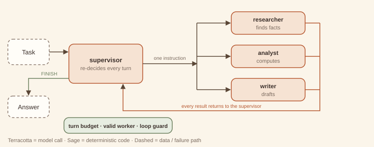
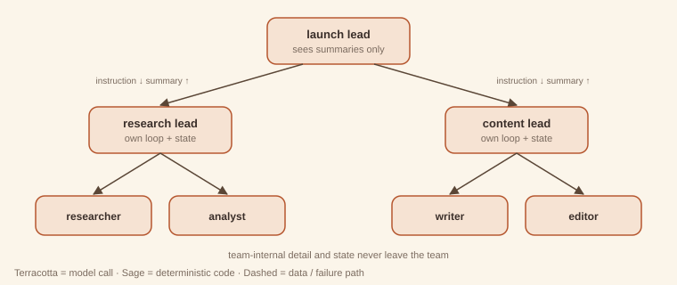
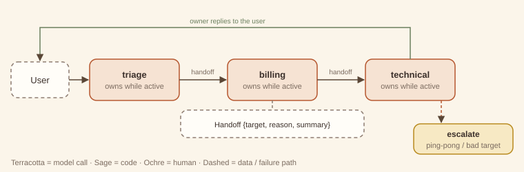
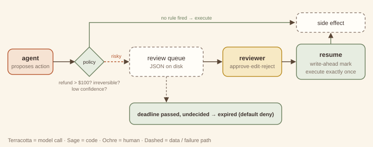
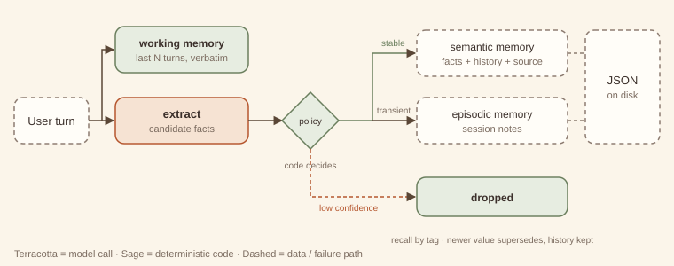
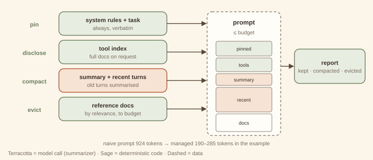

# Agentic Design Patterns

*A pattern catalog for systems built on language models — with runnable code*


<!-- ===== Front matter ===== -->


---

# Preface — How to read this book

This book is a pattern catalog for systems built around language models. It follows the Gang of Four tradition: each pattern has a name, a one-sentence intent, a structure diagram, forces, consequences, and code. The book adds two things that LLM systems need more than object-oriented ones did: an explicit **theory** of why each pattern works, and an explicit **cost and latency model**. Every extra model call costs money and time, so a pattern that buys nothing is worse than no pattern at all.

## The three questions behind every pattern

Every chapter answers the same three questions.

1. **Who decides the control flow?** In Part 1 your *code* decides; the model only fills in steps. In Part 2 a *single model* decides what happens next. In Part 3 *several models* with distinct roles coordinate. Each step to the right buys flexibility and costs predictability.
2. **Who judges the output?** Deterministic code, the same model, a separate model, a peer, or a human. Many patterns differ only in this answer. The overlap table in [Appendix A](../appendix/boundaries.md) keeps them apart.
3. **What is the cheaper alternative?** Every "when to use" section names the simpler thing you should try first and the signal that tells you it is no longer enough.

## The catalog at a glance

| Part | Patterns | Control flow decided by |
|---|---|---|
| 1 · Workflow | Prompt chaining · Routing · Parallelization · Orchestrator–workers · Evaluator–optimizer | your code |
| 2 · Single-agent reasoning | ReAct · Plan-and-execute · Reflection · Tool-use loop · Agentic RAG · Guardrailed generation | one model |
| 3 · Multi-agent coordination | Supervisor · Hierarchical teams · Sequential handoffs · Debate · Critic–reviewer · Human-in-the-loop · Swarm | several models (and people) |
| 4 · Cross-cutting | Memory tiers · Context management · Eval harness | applies to any structure |

Three capstones show the patterns working together: a **support-triage system** (Part 1 pilot), a **deep-research agent**, and a **multi-agent coding team**.

## Anatomy of a chapter

Every chapter uses the same sections in the same order, so you can compare patterns side by side.

- **Intent**: one sentence.
- **Structure**: a hand-drawn diagram with a fixed colour key: *terracotta* = model call, *sage* = deterministic code, *ochre* = human, *dashed* = data or external system.
- **Design concept & theory**: the mechanism, why it works, the invariants that make it *this* pattern, and its closest classic ancestor.
- **When to use / when not to use**, naming the cheaper alternative.
- **Forces & trade-offs**: latency, cost, reliability, complexity.
- **Trade-off analysis & usage guidance**: a back-of-envelope model, a decision checklist, and production defaults.
- **Worked example**: first *example-first* (what the code does when you run it), then *why-first* (why it is built that way).
- **Failure modes & guardrails**, **Variations**, **Try it** (solutions are kept separately, at the back), and a **60-second interview lens**.

## The companion code

Every pattern has a runnable example under `code/patterns/<name>/`. The examples follow four rules.

- **Standard library only.** The examples need Python 3.10 or later and nothing else, with no `pip install`.
- **Offline and deterministic.** A *mock LLM* (`code/agentkit/llm.py`) stands in for a real model. Each example writes its model's behaviour as a short list of rules next to the code that uses it, so you can see exactly what the "model" will say. The same input always gives the same output.
- **One interface.** Patterns depend only on `complete(prompt, system="") -> str`. To use a real model, implement that one method; the docstring in `agentkit/llm.py` shows a ten-line adapter.
- **Nothing ships unless it runs green.** `python3 code/verify.py` runs every example, exercise solution and capstone. It fails if any script errors, if any output drifts from its recorded expected output, or if a README or a chapter in this book quotes output that is no longer what the code prints. Every console listing in this book is checked by that command.

A mock model cannot show you how *often* a real model fails. It can show you *how a pattern behaves when it does*, and that behaviour is the subject of this book. Where a number in a cost model is illustrative rather than measured, the text says so.

## A note on names

Pattern names in this field are not yet stable. Where a pattern is widely known by another name, the chapter lists it under **Also known as**. The boundaries in [Appendix A](../appendix/boundaries.md) decide which chapter a technique belongs to, whatever it is called elsewhere.


---


<!-- ===== Part 1 — Workflow patterns ===== -->


---

# Part 1 — Workflow patterns

> In a workflow, **your code owns the control flow**. The model fills in the steps; it never decides which step comes next.

That single property makes workflows the default starting point. A workflow can be read like a flowchart, tested like a function, and given a cost ceiling before it runs. In every Part 1 pattern you can predict the number of model calls, or at least bound it.

The five patterns differ in the shape of that control flow:

| Pattern | Shape | Who splits or judges the work |
|---|---|---|
| [1. Prompt chaining](01-prompt-chaining.md) | a line | code, at design time |
| [2. Routing](02-routing.md) | a fork with exactly one branch taken | a classifier, once |
| [3. Parallelization](03-parallelization.md) | fan-out, fan-in | code, statically |
| [4. Orchestrator–workers](04-orchestrator-workers.md) | fan-out decided at runtime | a model, once |
| [5. Evaluator–optimizer](05-evaluator-optimizer.md) | a loop | a separate evaluator model |

Two ideas run through all five.

**Gates are code.** Between model calls, deterministic checks (a regex, a schema, a length limit, a known-route test) turn silent failures into explicit ones. They are almost free and they are the cheapest reliability you can buy. In this book they are always drawn in sage.

**Cost is countable.** Each chapter's usage guidance gives a formula in calls, tokens and wall-clock time. If you cannot write the formula for a design, it is probably not a workflow any more; check Parts 2 and 3.

**The ladder of escalation.** Use one well-prompted call if it is good enough. Use a chain when the task splits into distinct steps, a router when inputs differ in kind, parallelization when sub-checks are independent, orchestrator–workers when the split can only be known at runtime, and an evaluator loop when quality is measurable but rarely right the first time. Reach for agents (Part 2) only when the *sequence of steps* itself cannot be known in advance.

The Part 1 pilot ends with the [support-triage capstone](../capstones/support-triage.md). It composes routing and parallelization with three modules from later parts: guardrailed generation (#11), human-in-the-loop (#17) and the eval harness (#21).


---

# 1. Prompt chaining

> **Intent.** Split a task into a fixed sequence of model calls, each consuming the previous call's output, with cheap code gates between steps that stop the chain as soon as something goes wrong.

**Also known as:** pipeline, sequential prompting, multi-step prompting · **Part:** 1 — Workflow · **Code:** `code/patterns/prompt_chaining/`

## Structure


Release notes pass through three model calls (*extract → draft → compress*). Code gates (sage diamonds) sit after the steps whose output can be checked mechanically. A failing gate ends the run with a reason, and the later calls never happen.

## Design concept & theory

**Core idea.** One hard prompt becomes several easy ones. Each step has a single job, its own instructions, and an output you can inspect. The sequence is fixed when you write the code. The model never chooses what runs next.

**Why it works: difficulty and detection.** Two effects combine.

1. *Each step is easier.* A model asked to "read these notes, pick the user-facing changes, write a warm announcement and keep it under 200 characters" juggles four constraints at once. Split up, each call juggles one. Per-step accuracy rises because each prompt is narrower and its examples can be more specific.
2. *Failures become visible.* Errors compound along a chain. If each of *n* steps succeeds with probability *p*, the whole chain succeeds with probability *pⁿ*. That looks like an argument *against* chaining (0.95³ ≈ 0.86), but the comparison is with the single call doing all the work, not with one step. Suppose the monolithic prompt succeeds 80% of the time and each focused step 97%: the chain wins, 0.97³ ≈ 0.91. More importantly, gates convert some of the remaining failures from *silent and shipped* into *detected and stopped*. A chain without gates has all the cost of decomposition and only half the benefit.

**Invariants.** (1) The step order is fixed at design time. (2) Each step sees only what the previous step produced, plus its own instructions. (3) Gates are deterministic code, not model calls. If a model decides the next step, you have an agent (Part 2). If the steps are agents that pass ownership of a conversation to each other, you have [sequential handoffs (#14)](../part-3-multi-agent/14-sequential-handoffs.md).

**Lineage.** *Pipes and Filters* (POSA, 1996) and the *Pipeline* in Enterprise Integration Patterns: independent filters connected by pipes, each filter replaceable on its own. The gates play the part of a *Message Filter*.

## When to use / when not to use

| Use it when | Don't use it when |
|---|---|
| The task splits cleanly into ordered stages (extract → transform → format). | One well-written prompt already meets the quality bar. |
| Intermediate outputs can be checked mechanically (has a version number, is valid JSON, under N chars). | The next step depends on *what you find* (go to [ReAct (#6)](../part-2-single-agent/06-react.md) or [plan-and-execute (#7)](../part-2-single-agent/07-plan-and-execute.md)). |
| Different stages benefit from different prompts, models or temperatures. | Stages are independent of each other (go to [parallelization (#3)](03-parallelization.md)). |
| You need an audit trail of how the output was produced. | Latency budgets cannot absorb several sequential round trips. |

**Cheaper alternative:** a single well-structured prompt with explicit numbered sub-steps, sometimes called "chain inside one prompt." Upgrade to a real chain when you need to *inspect, gate, or swap* an intermediate result, or when the single prompt's error rate plateaus however you reword it.

## Forces & trade-offs

| Force | vs. a single prompt | Why |
|---|---|---|
| Latency | ↑ worse | Calls are sequential: total ≈ sum of step latencies. |
| Cost | ≈ to ↑ | More calls, but each prompt is shorter, and early exits skip later steps entirely. |
| Reliability | ↑ better | Narrower steps are more accurate, and gates catch bad intermediates before they spread. |
| Complexity | ↑ slightly | More prompts to version, but each is simple and unit-testable. |

## Trade-off analysis & usage guidance

**Cost and latency model.** For *n* steps with per-step latency *tᵢ* and cost *cᵢ*, and gate pass rate *gᵢ* after step *i*:

- Latency, happy path: *T = Σ tᵢ* (gates add microseconds).
- Expected cost: *E[C] = c₁ + g₁·c₂ + g₁g₂·c₃ + …*. Early gates are worth the most, because every later step is multiplied by their pass rate. In the companion run, the internal-only release stops at gate 1 and costs one call instead of three.

**Decision checklist.**

1. Can you name each stage's output in a noun phrase ("the facts list", "the draft")? If not, the split is wrong.
2. Can at least one intermediate be checked by code? If none can, a chain buys little over one prompt.
3. Is the order fixed for *every* input? If it varies, you need routing or an agent.
4. Does the latency budget allow *n* sequential calls?
5. Would you want to swap one stage's model or prompt independently? Chains make that a one-line change.

**Usage in production.**

- Log every intermediate with the run ID. It is the main debugging benefit of the pattern.
- Put the strictest, cheapest gate as early as possible.
- Use a cheaper or faster model for mechanical stages (extraction, formatting) and spend on the creative stage.
- Version prompts per step. A regression is then traceable to one step's change.
- Alert on gate failure *rate* per step. A sudden rise means an upstream prompt, model or data change.

## Worked example

### Example first: what happens

The companion code turns raw release notes into a social post. It runs the same three-step chain twice: once on notes with real user-facing changes, and once on an internal-only release.

```
python3 code/patterns/prompt_chaining/main.py
```

<!-- expected-output: code/patterns/prompt_chaining/main.py -->
```text
Prompt chaining
===============
-- run 1: release with user-facing changes
[extract] v2.4 | - Dark mode across all screens | - CSV export for reports | - 40% faster search
[gate:extract] pass
[draft] Big news: version 2.4 is here! You asked, we listened: dark mode now covers every screen, you can export any report to CSV, and search is 40% faster. Update today and enjoy.
[compress] v2.4 is live: dark mode everywhere, CSV export for reports, and 40% faster search. Update now!
[gate:compress] pass
result: ok=True (94 chars)
-- run 2: internal-only release
[extract] NO_USER_FACING_CHANGES
[gate:extract] STOP — nothing user-facing to announce
result: ok=False stopped_at=extract
calls: run1=3, run2=1
```

Run 1 goes straight through. The `extract` gate checks that the first line is a version and that there are at least two bullets. The `compress` gate checks the 200-character limit. Run 2's extraction honestly reports `NO_USER_FACING_CHANGES`, and the gate stops the chain there, so `draft` and `compress` never run. The last line shows the saving: one call instead of three.

The whole architecture is a list:

```python
STEPS = [
    Step("extract", "Extract the USER-FACING changes ... {input}", gate=facts_gate),
    Step("draft",   "Write a friendly customer announcement from these facts:\n\n{input}"),
    Step("compress","Rewrite as one social post of at most 200 characters:\n\n{input}",
         gate=length_gate),
]
```

and the runner (`chain.py`) is about twenty lines: call, record, gate, continue or stop.

### Why first: why it is built this way

- **Steps are data, not code paths.** A `Step` is a name, a template and an optional gate. Adding, removing or reordering stages does not touch the runner. The exercise adds a whole new check with one line.
- **The extractor is allowed to say "nothing here".** Giving the first step an explicit escape value (`NO_USER_FACING_CHANGES`) is what makes the cheap early exit possible. Without it, the model invents changes to satisfy the prompt, which is a classic chaining failure.
- **Gates return reasons, not booleans.** `ChainResult.reason` says *why* the chain stopped. That reason is what you log, alert on, or show to the user.
- **The draft has no gate.** Not every step needs one. "Is this announcement friendly?" is a judgement, not a check. If it mattered enough to verify, that would be a job for an [evaluator–optimizer (#5)](05-evaluator-optimizer.md) step, not a regex.

## Failure modes & guardrails

| Failure mode | Symptom | Guardrail |
|---|---|---|
| Error propagation | A wrong fact in step 1 is fluently restated by every later step. | Gate the earliest step hardest; give it an explicit "none/unknown" escape. |
| Instruction drift | Late steps lose constraints stated only in step 1 (tone, audience). | Repeat key constraints in every step's prompt, or pass them as a shared header. |
| Format mismatch | Step *k* outputs prose when step *k+1* expects a list. | Schema-check the handoff (a gate), or use [guardrailed generation (#11)](../part-2-single-agent/11-guardrailed-generation.md) for that step. |
| Over-chaining | Ten steps where three would do; latency balloons. | Merge adjacent steps that share inputs and have no gate between them. |
| Hidden loss | A summarising step drops a detail a later step needed. | Pass the original input alongside the intermediate when later steps need it. |

## Variations

- **Gated chain with retry.** On gate failure, re-run *that step* once with the gate's reason appended before giving up. This is a tiny, local form of [guardrailed generation (#11)](../part-2-single-agent/11-guardrailed-generation.md).
- **Branch-free conditional steps.** A step can be skipped by code (`if lang != "en": translate`). The order is still fixed. A step that might be skipped is not routing.
- **Mixed-model chain.** Small model for extraction, large model for drafting, small model for formatting. This is often the largest single cost lever.
- **Chain inside a single prompt.** The cheaper alternative: numbered sub-steps in one call. No gates, but one round trip.

## Try it

The draft step sometimes leaks internal ticket IDs (such as `JIRA-412`) into customer-facing copy. Add a gate after `draft` that stops the chain when that happens, *without adding any model calls*, and show it firing on a leaky draft. How many calls does the stopped run cost?

→ Solution: [Solutions — Prompt chaining](../solutions/01-prompt-chaining.md)

## 60-second interview lens

- **Say:** "A prompt chain is a fixed pipeline of model calls with code checks between them. I use it when a task has distinct stages and at least one intermediate result I can verify mechanically."
- **Trade-off to name:** latency is the sum of the steps, so it buys accuracy and debuggability with wall-clock time; early gates make expected cost *lower* than it looks.
- **Expect the follow-up:** "Doesn't error compound across steps?" Answer: yes, *pⁿ*, but each step's *p* is higher than the monolithic prompt's, and gates turn silent failures into detected ones.
- **Red flag to avoid:** calling a chain "an agent". The model never chooses the next step.

## Related patterns

- [Sequential handoffs (#14)](../part-3-multi-agent/14-sequential-handoffs.md): the steps are autonomous agents passing ownership, chosen at runtime, not fixed calls.
- [Routing (#2)](02-routing.md): often the *first* step of a chain, choosing which chain runs.
- [Guardrailed generation (#11)](../part-2-single-agent/11-guardrailed-generation.md): a chain step whose gate is allowed to request a repair.
- [Evaluator–optimizer (#5)](05-evaluator-optimizer.md): when a step's quality needs judgement, not a check.


---

# 2. Routing

> **Intent.** Classify an input once and dispatch it to exactly one specialised handler, so that each handler can be simple, cheap and good at one kind of input.

**Also known as:** classifier dispatch, intent routing, model routing · **Part:** 1 — Workflow · **Code:** `code/patterns/routing/`

## Structure


A ticket first meets a free keyword pre-filter (code). A unique hit goes straight to validation and costs no model call. Otherwise a small LLM classifier returns `{route, confidence}`. Code validates that answer: the route must be known and the confidence at least the threshold τ. Anything invalid goes down the dashed path to a safe fallback. Exactly one handler runs.

## Design concept & theory

**Core idea.** Inputs differ in kind. One prompt written for all of them is mediocre at each. Specialised prompts (or models) are good at one kind and cheap to improve in isolation. A router sits in front and sends each input to its specialist.

**Why it works: specialisation and the cost of mistakes.**

- *Specialisation.* A billing handler's prompt can include refund policy, plan names and billing examples, and none of that pollutes the technical handler. Each prompt shrinks and its examples become relevant, which is usually worth more than any amount of "you are an expert in everything" prompting.
- *A router is a classifier, so think in confusion matrices.* Overall quality ≈ Σ P(route = r) · P(correct handler output | correctly routed) minus the damage from misroutes. Misroutes are not equally costly. Sending a billing question to the general fallback is mildly annoying; sending a security incident to the "marketing" handler is not. That asymmetry is why the fallback should be the *safest* handler, not the most common one.
- *Cascades cut cost.* The keyword pre-filter is a cheap first classifier that answers only when it is sure (exactly one hit). The LLM classifier sees only the ambiguous remainder. This is the same idea as a cascade of models: expected classification cost = (1 − *k*) · *c_cls*, where *k* is the share of inputs the free stage resolves.

**Invariants.** (1) Exactly one handler runs per input. (2) The classification decision is made once, then the router exits. (3) Every possible classifier answer (garbage, unknown label, low confidence) maps to a defined route.

**Lineage.** *Content-Based Router* (Enterprise Integration Patterns): inspect the message, forward it to one channel. The handler table resembles *Strategy*, with the strategy selected per request.

## When to use / when not to use

| Use it when | Don't use it when |
|---|---|
| Inputs fall into distinct categories that need different instructions, tools or models. | All inputs need roughly the same treatment. |
| Some categories are cheap (FAQ) and others expensive (complex reasoning): route to match model size to difficulty. | Categories overlap so heavily that a classifier cannot separate them reliably. |
| You want to improve one category without regression-testing the others. | The handling must change *during* the conversation based on results. That calls for a [supervisor (#12)](../part-3-multi-agent/12-supervisor.md), which re-decides each turn. |
| A misroute has a safe default you can fall back on. | There is no safe fallback and a misroute is costly (add [human-in-the-loop (#17)](../part-3-multi-agent/17-human-in-the-loop.md) first). |

**Cheaper alternative:** one general prompt with conditional instructions ("if the question is about billing, …"), or keyword or regex routing alone. Upgrade when the general prompt's instructions start contradicting each other, or keyword rules start colliding (as "crashes on *login*" does in the example).

## Forces & trade-offs

| Force | vs. one general prompt | Why |
|---|---|---|
| Latency | ↑ slightly | One extra classification call for ambiguous inputs only; zero for keyword hits. |
| Cost | ↓ often better | Cheap inputs go to cheap handlers; the classifier is a small model with short output. |
| Reliability | ↑ better per route, with a new failure: misroutes | Specialised prompts are more accurate; a confusion matrix now matters. |
| Complexity | ↑ | *N* handlers to maintain, a classifier to evaluate, and a fallback to design. |

## Trade-off analysis & usage guidance

**Cost model.** With keyword resolution rate *k*, classifier cost *c_cls* and handler cost *c_r* for route *r*:

*E[C] = (1 − k)·c_cls + Σ_r P(r)·c_r*

In the companion run *k* = 2/5, so the classifier ran on 3 of the 5 tickets. Routing pays off when the gap between the cheapest and the most expensive handler is large. Sending 60% of traffic to a model one-tenth the price easily covers a small classifier.

**Choosing τ.** The confidence threshold trades misroutes against fallback volume. Plot both on your eval set as τ varies and pick the knee. Re-check whenever the classifier model changes, because self-reported confidence is not calibrated across models.

**Decision checklist.**

1. Can you name the routes, and does each have a meaningfully different handler?
2. Do you have labelled examples per route to evaluate the classifier? (See the [eval harness (#21)](../part-4-cross-cutting/21-eval-harness.md).)
3. Is there a safe fallback?
4. Can a cheap rule resolve a meaningful share of inputs?
5. Will the route set be stable for months? If routes change weekly, a single prompt may be easier.

**Usage in production.**

- Log `(route, method, confidence)` for every input. The method mix (keyword / llm / fallback) is your first health dashboard.
- Alert on a rising fallback rate. It signals new kinds of input your routes do not cover.
- Evaluate the router separately from the handlers. A handler regression and a routing regression look the same from outside.
- Keep the classifier's output tiny (a JSON label), so it stays fast and cheap.

## Worked example

### Example first: what happens

Five support tickets meet four handlers and one fallback:

```
python3 code/patterns/routing/main.py
```

<!-- expected-output: code/patterns/routing/main.py -->
```text
Routing
=======
[billing  ] via keyword conf=1.00 :: I was charged twice for March.
            -> I've refunded the duplicate charge; it will appear in 3-5 days.
[technical] via llm conf=0.86 :: The app crashes on login since yesterday.
            -> Please update to 3.2.1, which fixes the login crash.
[account  ] via keyword conf=1.00 :: How do I update my email address?
            -> You can change your email under Settings > Profile.
[general  ] via fallback conf=0.55 (low confidence for 'billing') :: Do you offer a student discount?
            -> Thanks for reaching out! A teammate will follow up shortly.
[general  ] via fallback conf=0.90 (unknown route 'sales') :: We'd like to discuss a partnership.
            -> Thanks for reaching out! A teammate will follow up shortly.
classifier calls: 3 of 5 tickets
```

- *"charged twice"* and *"update my email"* each hit exactly one keyword list, so they are routed free.
- *"crashes on login"* hits two lists (technical: `crash`; account: `login`). The pre-filter declines, and the LLM decides `technical` with 0.86.
- *"student discount"*: the model guesses `billing` at 0.55, below τ = 0.7, so it falls back to `general`.
- *"partnership"*: the model invents a route, `sales`, that does not exist. It is rejected as unknown and goes to `general`.

### Why first: why it is built this way

- **Unique match or nothing.** The pre-filter answers only when exactly one route's keywords appear. Ambiguity is detected, not resolved by list order, which is the bug the [eval harness](../part-4-cross-cutting/21-eval-harness.md) example catches in a naive keyword router.
- **Validate the classifier like user input.** The LLM's answer is parsed, checked against the known route set, and thresholded. The model can say anything, and the router turns *anything* into one of four outcomes.
- **The fallback is the safest handler.** `general` promises a human follow-up rather than guessing, so the cost of a misroute into it is a delay, not a wrong answer.
- **`parse()` is a hook.** Normalising sloppy labels ("Billing ") is a subclass override, not a fork of the router. The exercise uses it.
- **Different models per stage.** The mock declares the classifier as `small-classifier` with a lower price than the `large-specialist`. Routing is where model-size choices pay off.

## Failure modes & guardrails

| Failure mode | Symptom | Guardrail |
|---|---|---|
| Invented route | Classifier returns a label not in the set. | Validate against the known set; unknown → fallback. |
| Overconfident misroute | High confidence, wrong route. | Eval per route; add a few-shot example for the confused pair; consider a second-opinion vote for costly routes. |
| Fallback flood | Too many inputs land in `general`. | Monitor the fallback rate; mine fallback inputs for a new route. |
| Keyword collisions | Order-dependent keyword lists misroute silently. | Unique-match-only pre-filter; send ambiguity to the classifier. |
| Route-set drift | Product adds a category; the classifier's menu is stale. | Generate the classifier prompt from the route table (as `Router` does), so it cannot drift. |
| Mixed-intent inputs | "Refund me *and* fix the crash." | Allow multi-label output and handle with [parallelization (#3)](03-parallelization.md), or route to a handler that can do both. |

## Variations

- **Model routing (cascade).** Route by *difficulty* rather than topic: easy queries to a small model, hard ones to a large one. The classifier predicts difficulty, or the small model's own low confidence triggers escalation.
- **Embedding router.** Route by nearest centroid of example embeddings. No LLM call; well suited to many routes with plentiful examples.
- **Hierarchical routing.** Route to a domain, then to a sub-intent. Keep depth at two; deeper trees compound misroutes.
- **Multi-label routing.** The classifier returns several routes and the outputs are merged. That is no longer pure routing but [parallelization (#3)](03-parallelization.md) with a router in front.

## Try it

The classifier sometimes answers `"Billing "` or `"TECHNICAL"` instead of the exact route name, and every such answer is wrongly treated as unknown and falls back. Make the router tolerant of case and whitespace *without* accepting genuinely unknown routes such as `"Sales"`. Change as little code as possible.

→ Solution: [Solutions — Routing](../solutions/02-routing.md)

## 60-second interview lens

- **Say:** "Routing classifies an input once and dispatches it to one specialised handler. It lets each prompt be narrow, and it lets cheap inputs go to cheap models."
- **Trade-off to name:** you gain specialisation and cost control, and you take on a new failure mode, the misroute, which you manage with validation, a confidence threshold and a safe fallback.
- **Expect the follow-up:** "How do you pick the threshold?" Sweep τ on a labelled eval set and plot misroute rate against fallback rate; pick the knee; re-tune when the model changes.
- **Red flag to avoid:** trusting the classifier's label without checking it is in the route set.

## Related patterns

- [Supervisor (#12)](../part-3-multi-agent/12-supervisor.md): re-decides after every worker turn; a router decides once and exits.
- [Prompt chaining (#1)](01-prompt-chaining.md): the chosen handler is often a chain.
- [Eval harness (#21)](../part-4-cross-cutting/21-eval-harness.md): how you know the router is good enough to ship.
- [Support-triage capstone](../capstones/support-triage.md): this exact `Router` in production-shaped glue.


---

# 3. Parallelization (fan-out / fan-in)

> **Intent.** Run several independent model calls at the same time — different subtasks of one input (*sectioning*) or the same task several times (*voting*) — and combine their results in code.

**Also known as:** scatter-gather, fan-out/fan-in, map-reduce, self-consistency (voting variant) · **Part:** 1 — Workflow · **Code:** `code/patterns/parallelization/`

## Structure


Code fans a draft reply out to three independent checks that run concurrently. A code fan-in step aggregates their verdicts. Here it *fails closed*: one failing branch, or one branch that crashed, blocks the draft. In the voting variant every branch gets the same prompt, and the fan-in takes a majority, subject to a quorum.

## Design concept & theory

**Core idea.** If two pieces of work do not depend on each other, there is no reason to wait for one before starting the other. And if one model answer is noisy, several answers combined are less noisy, *provided their errors are not all the same error*.

**Why it works: two separate mechanisms.**

1. *Sectioning buys latency and focus.* Sequential checks take *Σ tᵢ*; parallel ones take *max tᵢ* (plus overhead). Separately, each branch has a single concern: a tone checker that is not also checking refund policy pays full attention to tone. That is the same narrowing benefit as chaining, without the sequential penalty.
2. *Voting buys reliability, under an independence assumption.* If each of three voters is right with probability *p* = 0.8 *and their errors are independent*, the majority is right with probability 3p²(1−p) + p³ ≈ **0.896** (Condorcet's jury theorem). The catch is the condition: three samples from the same model on the same prompt make *correlated* errors. If the model misreads the input, it usually misreads it every time. Voting helps against *random* slips (a flipped label, a sampling accident), and helps little against *systematic* misunderstanding. Diversify prompts, models or input order to decorrelate the voters.

**Invariants.** (1) The split is known *before* runtime; code, not a model, decides the branches. (2) Branches do not communicate. (3) Aggregation is done in code, with an explicit rule for failed branches.

**Lineage.** *Scatter-Gather* and *Aggregator* (Enterprise Integration Patterns); *fork-join* in concurrent programming; *MapReduce* when the split is over data. The voting variant is ensemble learning applied at inference time.

## When to use / when not to use

| Use it when | Don't use it when |
|---|---|
| Subtasks are independent and you know them in advance (several guardrail checks, several documents). | Each step needs the previous step's output ([chain it, #1](01-prompt-chaining.md)). |
| Latency matters and calls are I/O-bound. | The split depends on the input's content (use [orchestrator–workers, #4](04-orchestrator-workers.md)). |
| A single answer is too noisy and errors look random (vote). | Errors are systematic. Voting the same mistake three times does not fix it. |
| Rate limits allow the extra concurrent calls. | Cost is the binding constraint and one good call suffices. |

**Cheaper alternative:** do all checks in *one* call ("check tone, policy and facts; return three verdicts"), or run them sequentially. Upgrade when the combined prompt's checks interfere with each other, or when latency is the bottleneck.

## Forces & trade-offs

| Force | vs. one combined call / sequential calls | Why |
|---|---|---|
| Latency | ↓ better than sequential | Wall time ≈ slowest branch, not the sum. |
| Cost | ↑ | *N* calls instead of one; voting multiplies cost by the number of voters. |
| Reliability | ↑ | Focused branches (sectioning); averaged noise (voting, if errors are independent). |
| Complexity | ↑ moderately | Concurrency, partial failures, an aggregation rule, rate limits. |

## Trade-off analysis & usage guidance

**Model.** For *N* branches with latencies *tᵢ* and costs *cᵢ*:

- Latency ≈ *max tᵢ + overhead* (bounded by your concurrency limit: with *W* workers, ≈ ⌈N/W⌉ waves).
- Cost = *Σ cᵢ*: parallelism saves time, never money.
- Voting with *k* voters: cost ×*k*. The reliability gain shrinks as voter correlation rises, and is roughly zero for perfectly correlated voters.

**Aggregation rules (choose deliberately).**

| Rule | Use for | Failed branch counts as |
|---|---|---|
| All must pass | guardrails, safety | fail (closed) |
| Any passes | recall-oriented search | ignored |
| Majority with quorum | classification votes | not a vote; may break quorum |
| Merge / concatenate | sectioned content | gap flagged in output |

**Decision checklist.**

1. Are the branches truly independent (no branch needs another's output)?
2. Is the aggregation rule written down, *including what a crashed branch means*?
3. Do rate limits and concurrency limits allow *N* simultaneous calls?
4. For voting: what makes your voters' errors *different* from each other?
5. Is the latency saving worth *N*× the calls?

**Usage in production.**

- Give every branch a timeout. One slow branch sets your latency.
- Return results in a stable order (input order, not completion order) so logs and tests are deterministic. `fan_out` does this.
- Record per-branch outcomes, not just the aggregate. "Policy check fails 12% of drafts" is actionable; "drafts fail 15%" is not.
- Use a bounded worker pool. Unbounded fan-out against a rate-limited API turns into retries and gets slower.

## Worked example

### Example first: what happens

```
python3 code/patterns/parallelization/main.py
```

<!-- expected-output: code/patterns/parallelization/main.py -->
```text
Parallelization
===============
-- sectioning: three independent guardrail checks on a draft reply
[check:tone] pass=True — warm and professional
[check:policy] pass=False — promises a refund above the $50 agent limit
[check:facts] pass=True — order number and dates match the record
[fan-in] approved=False
[timing] parallel faster than sequential: True
-- voting: three judges on one email
[judge:A] PHISHING
[judge:B] PHISHING
[judge:C] discarded ("I'm not sure, it could be either.")
[fan-in] verdict=PHISHING agreement=1.00 from 2 usable votes
```

*Sectioning.* Three checks (tone, policy, facts) run concurrently on the same draft. The mock adds 0.15 s of simulated latency per call, and the run asserts that wall time beat the sequential sum. Policy fails (a $120 refund exceeds the $50 limit), so the fail-closed fan-in blocks the draft, even though two of three checks passed.

*Voting.* Three judges classify a suspicious email. Judge C's answer is unusable and is discarded rather than counted. The verdict is PHISHING. But look at the last line: *"agreement=1.00 from 2 usable votes"*. That number overstates the evidence, and the exercise fixes it.

### Why first: why it is built this way

- **Branches never raise.** `fan_out` catches every exception and returns a `Branch` with either a value or an error. One branch's failure is data for the aggregator, never a crash that kills its siblings.
- **The aggregator owns the semantics.** `fan_out` does not know whether a failure should block (guardrails) or be ignored (search). That choice lives in the caller, in one visible line: `all(b.ok and b.value["pass"] for b in branches)`.
- **Unparseable votes are not votes.** Counting "I'm not sure" as a vote for either side would be invented evidence. Discarding it is correct, but then *agreement* must be reported against votes cast, not votes kept.
- **Input-order results.** Branch results come back in the order they were submitted, so the trace is identical on every run even though completion order is not.
- **Reuse.** [Orchestrator–workers (#4)](04-orchestrator-workers.md) and the [support-triage capstone](../capstones/support-triage.md) import this exact `fan_out`. There is one implementation of concurrency in the codebase.

## Failure modes & guardrails

| Failure mode | Symptom | Guardrail |
|---|---|---|
| Correlated voters | Votes agree and are all wrong. | Diversify prompts, models or example order; measure inter-voter agreement on an eval set. |
| Silent partial failure | A crashed branch is treated as a pass. | Explicit per-rule semantics; fail closed for safety checks. |
| Quorum collapse | Verdict from 1–2 usable votes looks confident. | Require a quorum; report agreement against votes cast. |
| Rate-limit storm | Fan-out triggers 429s, then retries, then slower than sequential. | Bounded pool; exponential backoff; per-provider concurrency limits. |
| Tail latency | One slow branch dominates. | Per-branch timeout; treat a timeout as a failed branch under the aggregation rule. |
| Merge conflicts (sectioning) | Two branches produce contradictory content. | Make sections disjoint; or add a final reconciliation call, and accept that this makes it a small chain. |

## Variations

- **Self-consistency.** Sample several reasoning paths for one question and vote on the final answer. This is the voting variant applied to chain-of-thought.
- **Best-of-N with a scorer.** Generate *N* candidates in parallel and pick the best with a deterministic scorer or a judge. This is the step before [evaluator–optimizer (#5)](05-evaluator-optimizer.md) iterates.
- **Map-reduce over documents.** Sectioning by data: summarise each chunk in parallel, then reduce.
- **Hedged requests.** Send the same request to two providers and take the first good answer. Parallelism used for tail latency, not quality.
- **Guardrail fan-out.** Run safety and policy checks *in parallel with* generation, and cancel or withhold the output if a check fails.

## Try it

In the voting run, judge C's vote was unusable, yet the verdict was reported with "agreement 1.00". Add a **quorum**: require at least three usable votes or return no verdict (escalate). Report agreement against votes *cast*, not votes kept. Show both the no-quorum case and a three-vote case.

→ Solution: [Solutions — Parallelization](../solutions/03-parallelization.md)

## 60-second interview lens

- **Say:** "Parallelization runs independent calls concurrently and aggregates in code: sectioning splits one task into independent checks; voting repeats one task to reduce noise."
- **Trade-off to name:** it saves wall-clock time, never money, and voting only helps if the voters' errors are independent.
- **Expect the follow-up:** "What happens when one branch fails?" Answer: that is a design decision. Fail closed for safety checks, ignore for recall-oriented search, and break quorum for votes. Never let it crash the others.
- **Red flag to avoid:** claiming three samples from the same model at the same temperature are three independent opinions.

## Related patterns

- [Orchestrator–workers (#4)](04-orchestrator-workers.md): the split is decided by a model at runtime, not by code in advance.
- [Swarm (#18)](../part-3-multi-agent/18-swarm.md): agents interact and the workload is emergent. Parallel branches never talk to each other.
- [Debate (#15)](../part-3-multi-agent/15-debate.md): voters that *see and respond to* each other's arguments over rounds.
- [Guardrailed generation (#11)](../part-2-single-agent/11-guardrailed-generation.md): deterministic checks are cheaper than LLM-judged branches; use them first.


---

# 4. Orchestrator–workers

> **Intent.** Let a model decompose a task into subtasks *at runtime*, run each subtask with a focused worker call, and merge the results with one synthesis call — in a single pass.

**Also known as:** dynamic decomposition, planner–workers, master–worker · **Part:** 1 — Workflow · **Code:** `code/patterns/orchestrator_workers/`

## Structure


The orchestrator (a model) writes a plan: a list of subtasks, each naming the source it needs. Code validates the plan (size cap, known sources) before anything runs. Workers execute concurrently, each seeing only its own subtask and source. The orchestrator then synthesises the outputs. There is one plan and one synthesis, with no loop back.

## Design concept & theory

**Core idea.** This is [parallelization (#3)](03-parallelization.md) for the case where you cannot write the split in advance. How many files does this change touch? Which documents matter for this question? Only the input can say, so a model reads the input and decides the fan-out.

**Why it works.**

- *Decomposition is a skill models are good at.* Listing the parts of a task is usually much easier than doing all the parts at once. The orchestrator does the cheap, global part (what needs doing); workers do the expensive, local parts (doing it).
- *Context isolation.* Each worker sees one subtask and one source, not the whole task. Smaller, focused contexts mean less distraction and cheaper calls, and the possibility of using a smaller model for workers. Total tokens can even *fall*, because no single call has to hold everything.
- *Separation of planning from execution makes both auditable.* The plan is an inspectable artefact (JSON) *before* any work is done. You can validate it, cap it, log it, and reject it, as the third run in the example does.

**Invariants.** (1) A model decides the subtasks at runtime. (2) Workers are stateless calls that do not talk to each other. (3) Single pass: plan, execute, synthesise. If the plan is revised based on what workers return, you have [plan-and-execute (#7)](../part-2-single-agent/07-plan-and-execute.md). If the coordinator keeps delegating turn by turn to stateful agents, you have a [supervisor (#12)](../part-3-multi-agent/12-supervisor.md).

**Lineage.** *Master–worker* (task farm) from parallel computing; the *Process Manager* and *Splitter → Aggregator* pair from Enterprise Integration Patterns, with the routing slip computed dynamically.

## When to use / when not to use

| Use it when | Don't use it when |
|---|---|
| The number or kind of subtasks depends on the input (files in a diff, sources for a question). | You can write the split in code (use [parallelization, #3](03-parallelization.md)). |
| Subtasks are independent once identified. | Subtask *k* needs subtask *k−1*'s result (use a chain or [plan-and-execute, #7](../part-2-single-agent/07-plan-and-execute.md)). |
| The whole input is too large or too distracting for one call. | The task is small enough that one call handles it well. |
| You want a reviewable plan before spending on execution. | Failures discovered during execution should change the plan (that needs re-planning). |

**Cheaper alternative:** a fixed fan-out over an obvious unit (one worker per file, always), which is parallelization with a code-computed split. Upgrade when the obvious unit is wrong: some files need no work, some need two kinds of work, and some subtasks span several files.

## Forces & trade-offs

| Force | vs. fixed fan-out | Why |
|---|---|---|
| Latency | ↑ | Plan and synthesis are two extra sequential calls around the parallel phase. |
| Cost | ≈ | Extra orchestrator calls, offset by skipping unnecessary workers and using small worker models. |
| Reliability | ↑ when the split matters, with a new risk | Better decomposition, but the plan itself can be wrong (missing, extra or hallucinated subtasks). |
| Complexity | ↑ | Plan schema, plan validation, worker isolation, synthesis prompt. |

## Trade-off analysis & usage guidance

**Model.** With plan cost *c_p*, *N* workers at *c_w*, and synthesis *c_s*:

- Cost = *c_p + N·c_w + c_s*. Workers on a small model often make *N·c_w* the smallest term. The example's worker is priced at a tenth of the orchestrator's.
- Latency ≈ *t_p + max(t_w) + t_s*: three sequential phases, the middle one parallel.
- Cap *N*. Without a cap, cost is unbounded and set by the model's enthusiasm for decomposition.

**Decision checklist.**

1. Would a human need to *read the input* to know how to split the work?
2. Once split, are the pieces independent?
3. Can you write a plan schema and validate it (size, allowed sources and tools)?
4. Is one pass enough, or will workers' findings need to reshape the plan?
5. Can workers run on a cheaper model?

**Usage in production.**

- Validate the plan *as untrusted input*: schema, maximum subtasks, allowed sources, no duplicates. The plan is model output, and it decides what your system touches.
- Log the plan separately from the result. Most quality issues trace to the plan, not the workers.
- Pass workers the minimum context they need. Isolation is a feature.
- Make the synthesis prompt cite subtask IDs, so the result is traceable to the worker that produced each claim.

## Worked example

### Example first: what happens

The same orchestrator receives three tasks over a small code repository:

```
python3 code/patterns/orchestrator_workers/main.py
```

<!-- expected-output: code/patterns/orchestrator_workers/main.py -->
```text
Orchestrator-workers
====================
-- Write the PR description for the auth hardening change
[plan] 3 subtask(s): login, session, docs
[worker:login] Adds rate limiting: 5 failed attempts per 15 minutes.
[worker:session] Session lifetime reduced from 24h to 8h.
[worker:docs] Docs say 8 hours — consistent with the code.
[synthesize] Security hardening: login is rate-limited (5 tries / 15 min) and sessions now last 8h instead of 24h. Docs updated and consistent.
-- Write a customer note about the auth change
[plan] 1 subtask(s): session
[worker:session] Users are signed out after 8h instead of 24h.
[synthesize] Heads-up: for your security you'll now be asked to sign in again after 8 hours.
-- Audit everything touching customer data
[plan] REJECTED — plan references unknown sources ['db/prod.sql']
orchestrator: 5 calls; workers: 4 calls
```

- **PR description:** the orchestrator plans three subtasks (two code files and the docs). It ignores `billing/invoice.py`, which is unchanged. Three workers run concurrently, and the synthesis merges them.
- **Customer note:** the same repository and a different task give a *different plan*, one subtask focused on user impact. A fixed fan-out over files would have run four workers here.
- **Audit:** the orchestrator proposes reading `db/prod.sql`, which is not an allowed source. Plan validation rejects it before any worker runs, at the cost of one call.

The final line, *5 orchestrator calls and 4 worker calls*, is the whole cost of three tasks, and the worker calls are the cheap ones.

### Why first: why it is built this way

- **The plan is JSON, and it is validated.** `plan()` checks shape, size and sources. Free-text plans cannot be capped or audited, and an unchecked plan lets the model choose what your system reads.
- **Workers reuse `fan_out`.** Concurrency, error capture and stable ordering come from [parallelization (#3)](03-parallelization.md). The orchestrator only adds planning and synthesis.
- **A failed worker is visible in the synthesis.** A worker error becomes `[worker failed: …]` in the synthesis input, so the final answer can say what is missing instead of silently omitting it. The exercise adds a retry without touching `orchestrate()`.
- **Same model for planning and synthesis.** Both are global, judgement-heavy steps that need the whole task in view. Workers do local, mechanical work and use the cheap model.

## Failure modes & guardrails

| Failure mode | Symptom | Guardrail |
|---|---|---|
| Hallucinated subtask | Plan references a file, tool or source that does not exist or is not allowed. | Validate the plan against an allow-list; reject or re-plan once. |
| Over-decomposition | Ten tiny subtasks; cost and synthesis quality suffer. | Hard cap; prompt for "at most N, merge small items"; track N per task type. |
| Missed subtask | The plan omits something needed; synthesis is confidently incomplete. | Coverage check in code where possible (every changed file is in some subtask). |
| Inconsistent workers | Workers contradict each other; synthesis blends them. | Have workers return structured fields; let the synthesis flag conflicts rather than average them. |
| Synthesis hallucination | Final answer contains claims no worker produced. | Require citations to subtask IDs; spot-check with an [eval harness (#21)](../part-4-cross-cutting/21-eval-harness.md) scorer. |
| Lost failure | A worker failed; the answer does not say so. | Pass failures into synthesis explicitly; mark the result partial. |

## Variations

- **Typed workers.** The plan assigns each subtask a worker *type* (summariser, test-writer, translator), each with its own prompt. This is a router per subtask.
- **Coverage-checked plan.** Code computes the units that must be covered (changed files, required sections) and rejects plans that miss any.
- **Two-level decomposition.** A worker may itself orchestrate. Stop at two levels; beyond that, see [hierarchical teams (#13)](../part-3-multi-agent/13-hierarchical-teams.md).
- **Map-reduce synthesis.** With many workers, synthesise in a tree (pairs, then pairs of pairs) to keep each synthesis context small.

## Try it

One worker call times out on its first attempt. Today the synthesis receives `[worker failed: …]`. Make workers retry once on transient errors **without changing `orchestrate()`**, then show that the synthesis receives all three results and that exactly one retry happened. (Hint: what single interface do all patterns depend on?)

→ Solution: [Solutions — Orchestrator–workers](../solutions/04-orchestrator-workers.md)

## 60-second interview lens

- **Say:** "Orchestrator–workers is dynamic fan-out: a model reads the task and decides the subtasks, workers do them in parallel with isolated context, and one call synthesises, all in a single pass."
- **Trade-off to name:** you gain a decomposition fitted to the input, and you add a new failure surface, the plan, which must be validated like untrusted input.
- **Expect the follow-up:** "How is this different from a supervisor agent?" One pass, stateless workers, no turn-by-turn re-delegation. A supervisor stays in the loop and adapts.
- **Red flag to avoid:** letting the plan reference arbitrary tools or data without an allow-list.

## Related patterns

- [Parallelization (#3)](03-parallelization.md): same fan-out, but code fixes the split in advance.
- [Plan-and-execute (#7)](../part-2-single-agent/07-plan-and-execute.md): the plan is revised as results come in.
- [Supervisor (#12)](../part-3-multi-agent/12-supervisor.md): ongoing, multi-turn delegation to stateful agents.
- [Hierarchical teams (#13)](../part-3-multi-agent/13-hierarchical-teams.md): orchestration with two or more levels and scoped context per team.


---

# 5. Evaluator–optimizer

> **Intent.** Pair a generator with a *separate* evaluator that judges each draft against an explicit rubric and returns actionable feedback, looping until the draft passes, a round budget is spent, or progress stalls.

**Also known as:** generate–critique–revise, LLM-as-judge loop, iterative refinement · **Part:** 1 — Workflow · **Code:** `code/patterns/evaluator_optimizer/`

## Structure


The generator writes a draft. The evaluator, a different role with its own rubric, returns pass or fail plus one fix per failed criterion. Failing feedback flows back to the generator for revision. Code ends the loop on a pass, on a round budget, or on a stall (the same feedback twice), and in the last two cases escalates.

## Design concept & theory

**Core idea.** Getting something right on the first try is hard; recognising what is wrong with a draft is often easier. The pattern exploits that asymmetry by separating the two jobs and iterating.

**Why it works.**

- *The generation–verification gap.* For many tasks, checking a candidate against criteria is more reliable than producing a candidate that meets them. The evaluator only has to say *which criterion fails and what would fix it*; the generator only has to apply a specific fix. Each call does the easier half of the problem.
- *Explicit rubrics turn vague quality into checkable claims.* "Write a good apology" has no failure signal. "Offers a concrete remedy" does. A rubric is also where business rules enter: no blame, no promises we cannot keep.
- *Separation reduces self-agreement.* A model asked to critique its *own* draft in the same context tends to approve it. A separate evaluator call, with its own instructions ("you did not write this") and ideally a different model, behaves more like a reviewer. This is the line between this pattern and [reflection (#8)](../part-2-single-agent/08-reflection.md).
- *Iteration has diminishing returns.* Most of the gain arrives in the first one or two revisions. Expected cost grows linearly with rounds while quality improvement flattens, which is why the loop needs a budget and a stall detector, not just a pass condition.

**Invariants.** (1) Generator and evaluator are distinct roles with distinct prompts. (2) The evaluator judges against an explicit rubric and returns *actionable* feedback. (3) Code owns termination. If the check is deterministic code rather than a judgement, the pattern is [guardrailed generation (#11)](../part-2-single-agent/11-guardrailed-generation.md). If both sides are tool-using agents trading itemised review comments, it is the [critic–reviewer loop (#16)](../part-3-multi-agent/16-critic-reviewer.md).

**Lineage.** A closed-loop feedback controller (setpoint = rubric, error signal = feedback); *test-driven* revision; loosely, the actor–critic split from reinforcement learning, without any learning, since nothing is updated between tasks.

## When to use / when not to use

| Use it when | Don't use it when |
|---|---|
| Quality criteria can be stated, and a reviewer can tell when they are met. | Criteria are purely subjective or cannot be articulated. |
| First drafts are often *close* but miss specific criteria. | First drafts are usually fine. You would pay ×2–×6 for nothing. |
| Feedback can be specific enough for a revision to act on. | The criterion is checkable in code (length, schema, regex): use a validator (#11), which is cheaper and exact. |
| Latency allows several sequential rounds. | The generator lacks the information to fix the problem. No feedback helps; escalate instead. |

**Cheaper alternative:** a single generation with the rubric in the prompt, plus deterministic checks for whatever criteria are mechanical. Upgrade when you can show, on an eval set, that rubric failures are frequent *and* fixable by revision.

## Forces & trade-offs

| Force | vs. single generation | Why |
|---|---|---|
| Latency | ↑↑ | Each round is two sequential calls; three rounds ≈ six calls of latency. |
| Cost | ↑↑ | Rounds × (generator + evaluator). Evaluator prompts include the draft *and* the rubric. |
| Reliability | ↑ on stated criteria | Failures against the rubric are caught and usually fixed; unstated criteria are not. |
| Complexity | ↑ | Rubric design, feedback format, termination logic, evaluator calibration. |

## Trade-off analysis & usage guidance

**Model.** With generator cost *c_g*, evaluator cost *c_e*, and *R* rounds used (≤ budget *B*):

- Cost = *R·(c_g + c_e)*. Worst case *B·(c_g + c_e)*. Set *B* from the eval set's distribution of rounds-to-pass: typically 2–3.
- Latency = *R·(t_g + t_e)*, all sequential.
- Every criterion you move from the evaluator to code (as the exercise does for word count) cuts both cost and variance.

**Decision checklist.**

1. Can you write the rubric as 3–6 criteria, each answerable yes/no?
2. Which criteria are checkable in code? Move those out of the evaluator.
3. Does feedback name a *specific fix*, not just a score?
4. What happens when the budget runs out: ship best effort, flag it, or escalate?
5. Is the evaluator a different prompt, and ideally a different model, from the generator?

**Usage in production.**

- Log every round's draft and feedback. Rounds-to-pass by task type is the key metric.
- Detect stalls: the same feedback twice means more rounds will not help. Stop and escalate.
- Calibrate the evaluator against human labels on a sample (see [eval harness, #21](../part-4-cross-cutting/21-eval-harness.md)). An evaluator that passes everything is a cost with no benefit.
- Use a cheaper model for the evaluator only if calibration shows it agrees with the stronger one.

## Worked example

### Example first: what happens

An apology email must meet four criteria: acknowledges the order and delay, offers a concrete remedy, no blame, under 60 words.

```
python3 code/patterns/evaluator_optimizer/main.py
```

<!-- expected-output: code/patterns/evaluator_optimizer/main.py -->
```text
Evaluator-optimizer
===================
-- Apology to Sam: order #4471 arrived 6 days late
[round 1 draft] Hi Sam, sorry order #4471 was late — the courier had problems. We'll make it up to you somehow.
[round 1 eval] FAIL: Remove blame on the courier; take ownership; Offer a concrete remedy, e.g. refund the shipping fee
[round 2 draft] Hi Sam, I'm sorry order #4471 arrived 6 days late. That's on us. We'll make it up to you.
[round 2 eval] FAIL: Offer a concrete remedy, e.g. refund the shipping fee
[round 3 draft] Hi Sam, I'm sorry order #4471 arrived 6 days late. That's on us. I've refunded your $9.99 shipping fee today and added free express shipping to your next order.
[round 3 eval] PASS
result: passed=True rounds=3 stop=passed
-- Reply to Lee promising same-day delivery tomorrow
[round 1 draft] Hi Lee, we guarantee same-day delivery tomorrow!
[round 1 eval] FAIL: Same-day delivery cannot be guaranteed; do not promise it
[round 2 draft] Hi Lee, we guarantee same-day delivery tomorrow!
[round 2 eval] FAIL: Same-day delivery cannot be guaranteed; do not promise it
result: passed=False rounds=2 stop=stalled -> escalate to a human
total model calls: 10
```

*Apology to Sam.* Round 1 blames the courier and offers a vague remedy, and the evaluator returns two fixes. Round 2 fixes only one, as real models often do. Round 3 fixes the other and passes. Each round the feedback names exactly what remains.

*Reply to Lee.* The task asks for something the rubric forbids (guaranteeing same-day delivery). The generator cannot satisfy both, so the evaluator returns identical feedback twice and the loop stops as *stalled* after two rounds instead of burning the budget. The right outcome is escalation to a human. More rounds would not fix this.

### Why first: why it is built this way

- **Feedback is a list of fixes, not a score.** `{"pass": false, "feedback": ["Remove blame…", "Offer a concrete remedy…"]}` tells the generator what to change. A score of 6/10 does not.
- **The revision prompt carries the previous draft *and* all outstanding feedback.** The generator edits rather than starting over, which converges faster and keeps what was already right.
- **Three stop reasons, all explicit.** `passed`, `budget`, `stalled`. Callers branch on `stop_reason`, so a stalled loop can route to a human rather than ship.
- **The evaluator fails closed.** Unparseable evaluator output counts as a failed round with a visible note. It is never a pass.
- **The evaluator is told it did not write the draft.** It is a small prompt detail that pushes against self-approval.

## Failure modes & guardrails

| Failure mode | Symptom | Guardrail |
|---|---|---|
| Rubber-stamp evaluator | Everything passes round 1; quality unchanged. | Calibrate against human labels; use a different model; include known-bad drafts in the eval set. |
| Infinite polishing | Rounds hit the budget on most tasks. | Budget; stall detection; check whether the rubric is satisfiable. |
| Oscillation | Fixing criterion A breaks B, and back again. | Revision prompt includes *all* outstanding feedback and the full rubric. |
| Vague feedback | "Improve tone." The generator changes random things. | Require one concrete, actionable fix per failed criterion. |
| Unsatisfiable task | Same feedback every round. | Stall detector → escalate (the Lee case). |
| Rubric gaming | Draft meets the letter of the rubric, misses its intent. | Add an intent criterion; review samples manually. |
| Cost blow-up | Evaluator re-checks mechanical criteria every round. | Move mechanical checks to code (exercise). |

## Variations

- **Best-of-N + evaluator.** Generate *N* drafts in [parallel (#3)](03-parallelization.md), evaluate all, pick the best. This trades rounds for breadth and gives lower latency at higher cost.
- **Scored rubric.** The evaluator returns per-criterion scores. Pass when all clear a threshold; keep the best-scoring draft if the budget runs out.
- **Tiered evaluators.** Cheap code checks first, then a cheap model, then an expensive model only for drafts that clear both.
- **Human as the evaluator, sometimes.** Sample some rounds for human review to keep the model evaluator calibrated. This is a bridge to [human-in-the-loop (#17)](../part-3-multi-agent/17-human-in-the-loop.md).

## Try it

The rubric's "under 60 words" criterion is checkable in code. Put a free deterministic pre-check in front of the evaluator so over-long drafts are rejected **without spending an evaluator call**, and count the calls saved. You must not modify `optimize()`.

→ Solution: [Solutions — Evaluator–optimizer](../solutions/05-evaluator-optimizer.md)

## 60-second interview lens

- **Say:** "Evaluator–optimizer loops a generator and a separate rubric-driven evaluator: the evaluator returns specific fixes, the generator revises, and code stops the loop on pass, budget or stall."
- **Trade-off to name:** each round doubles calls and latency for gains that diminish fast; anything checkable in code should be a validator, not an evaluator criterion.
- **Expect the follow-up:** "How do you know the evaluator is any good?" Calibrate it against human labels on an eval set, and watch for an evaluator that passes everything.
- **Red flag to avoid:** looping until pass with no budget or stall detection.

## Related patterns

- [Reflection (#8)](../part-2-single-agent/08-reflection.md): the same model critiques itself. Cheaper, but it shares its own blind spots.
- [Guardrailed generation (#11)](../part-2-single-agent/11-guardrailed-generation.md): deterministic validators instead of a judging model.
- [Critic–reviewer loop (#16)](../part-3-multi-agent/16-critic-reviewer.md): both sides are tool-using agents exchanging itemised findings over turns.
- [Eval harness (#21)](../part-4-cross-cutting/21-eval-harness.md): development-time measurement across many cases. Evaluator–optimizer improves one output at runtime.


---


<!-- ===== Part 2 — Single-agent reasoning ===== -->


---

# Part 2 — Single-agent reasoning

> In Part 2, **one model decides what happens next**. The code supplies tools, limits and checks, and the model chooses the sequence.

That one change, moving control flow from your code to the model, is what people usually mean by *agent*. It buys flexibility: the agent can take a path you did not anticipate, react to a tool's surprising answer, or decide it needs more evidence. It costs predictability. You can no longer write the number of calls in advance, only bound it.

So every pattern in this part has the same shape: **a model in a loop, and a host that owns the loop's edges**. The host validates what the model asks for, executes it, decides what counts as done, and stops the loop when it is not converging.

| Pattern | The model decides… | The host owns… |
|---|---|---|
| [6. ReAct](06-react.md) | the next thought and action | parsing, tool execution, repeat and step guards |
| [7. Plan-and-execute](07-plan-and-execute.md) | the whole plan, and when to re-plan | plan validation, step execution, re-plan budget |
| [8. Reflection](08-reflection.md) | what is wrong with its own answer | the number of rounds |
| [9. Tool-use loop](09-tool-use-loop.md) | which tool to call, with what arguments | schemas, confirmations, errors-as-observations, stop conditions |
| [10. Agentic RAG](10-agentic-rag.md) | whether, what and how often to retrieve | retrieval, citation checking, abstention |
| [11. Guardrailed generation](11-guardrailed-generation.md) | the content | every validity rule, the repair budget, the fallback |

Two patterns here are *runtimes* rather than strategies. The [tool-use loop](09-tool-use-loop.md) is the machinery every agent in this book runs on, and [guardrailed generation](11-guardrailed-generation.md) is the generate–check–repair discipline that keeps any single output valid. The other four are *reasoning strategies* that run on top of them.

**When to come here from Part 1:** when you cannot write the sequence of steps down, because it depends on what the agent finds. If you can write it down, stay in Part 1: it is cheaper, faster and easier to test.

The part closes with the [deep-research capstone](../capstones/deep-research.md), which composes plan-and-execute, agentic RAG and reflection with evaluator–optimizer (#5) and memory tiers (#19).


---

# 6. ReAct

> **Intent.** Let a model alternate between writing down a *thought*, taking an *action* with a tool, and reading the *observation*, in one growing trace, so that every next step is grounded in what was actually observed.

**Also known as:** reason + act, thought–action–observation loop · **Part:** 2 — Single-agent reasoning · **Code:** `code/patterns/react/`

## Structure


The model reads the whole trace so far and writes a Thought and an Action (`tool[input]`). Code parses the action, runs the tool, and appends the Observation to the trace. The loop repeats until the model writes a Final Answer. A step limit and a repeated-action guard stop it when it is not making progress.

## Design concept & theory

**Core idea.** Reasoning without acting hallucinates; acting without reasoning flails. ReAct interleaves the two at the granularity of a single step: think about what you know, do one thing to learn more, look at the result, think again.

**Why it works.**

- *Grounding.* Each thought is written *after* the latest observation is in the context. Facts the model would otherwise invent ("Orbit X1 is made by…") are instead looked up, and the lookup result is right there for the next step to use.
- *Adaptivity.* The plan is implicit and one step deep. When an observation surprises the model ("No results."), the very next thought can change course. In the example, an over-specific search fails and the agent broadens it.
- *Legibility.* The trace *is* the explanation. You can read why the agent did each thing, which is the main reason to choose ReAct over a silent tool loop.
- *The cost is quadratic-ish context.* Each step re-sends the whole trace. Over *n* steps, prompt tokens grow roughly as *n²/2 × step size*. ReAct is for short horizons (a handful of steps); long ones need [plan-and-execute (#7)](07-plan-and-execute.md) or [context management (#20)](../part-4-cross-cutting/20-context-management.md).

**Invariants.** (1) One action per step, and its observation is appended before the next thought. (2) The trace format is fixed and machine-parseable. (3) The host enforces termination; the model only *proposes* finishing.

**Lineage.** The OODA loop (observe–orient–decide–act); the read–eval–print loop with commentary. In research, the 2022 ReAct paper (Yao et al.) named the prompting format.

## When to use / when not to use

| Use it when | Don't use it when |
|---|---|
| The next step depends on what the last tool returned (multi-hop lookup, debugging). | The steps are known in advance ([prompt chaining, #1](../part-1-workflow/01-prompt-chaining.md)). |
| You need a human-readable reasoning trail for audit or debugging. | The task is long-horizon (dozens of steps). Context and cost grow every step. |
| Tasks are short: a few hops, not dozens. | Visible "thoughts" would leak sensitive reasoning to end users. |
| Tools are cheap and safe to call speculatively. | Every action has expensive side effects; plan first ([#7](07-plan-and-execute.md)). |

**Cheaper alternative:** a single tool-calling turn (model picks one tool, answers from its result), or a [tool-use loop (#9)](09-tool-use-loop.md) without explicit thoughts. Upgrade to ReAct when multi-hop questions fail because the model does not reason about intermediate results, or when you need the trace.

## Forces & trade-offs

| Force | vs. a plain tool loop | Why |
|---|---|---|
| Latency | ↑ | Thoughts are extra output tokens every step; steps are sequential. |
| Cost | ↑ | Whole trace re-sent each step, plus thought tokens. |
| Reliability | ↑ on multi-hop | Explicit intermediate reasoning reduces skipped hops and unjustified leaps. |
| Complexity | ≈ | A parser and two guards on top of a tool loop. |

## Trade-off analysis & usage guidance

**Model.** With *n* steps, a fixed prompt *P*, and an average step size *s* (thought + action + observation):

- Prompt tokens ≈ *n·P + s·n(n−1)/2*. The second term dominates past a few steps.
- Latency ≈ *n × (model time + tool time)*.
- In the example: 5 steps for a 3-hop question (one wasted on an empty search), 7 model calls in total across both questions.

**Decision checklist.**

1. Does the next step depend on the last observation? If not, use a chain.
2. Is the horizon short (under ~8 steps)? If not, plan first or compact.
3. Are tools safe to call exploratorily?
4. Will someone read the trace? If nobody will, the thoughts are cost without benefit; use a tool loop.
5. Do you have a stop rule beyond "the model says it's done"?

**Usage in production.**

- Cap steps and detect repeated actions; both are cheap and catch most loops.
- Keep observations short: truncate or summarise tool output before appending, because it is re-sent every step.
- Log the trace verbatim. It is your debugging record.
- Do not show raw thoughts to end users by default; they can contain guesses the final answer rightly discards.

## Worked example

### Example first: what happens

```
python3 code/patterns/react/main.py
```

<!-- expected-output: code/patterns/react/main.py -->
```text
ReAct
=====
-- Q1: What's the weather at the HQ of the company that makes the Orbit X1?
[thought 1] First find who makes the Orbit X1 headset.
[action 1] search[Orbit X1 headset maker]
[observe 1] No results.
[thought 2] The phrase was too specific; search the product name alone.
[action 2] search[Orbit X1]
[observe 2] Orbit X1 is a VR headset made by Lumen Labs.
[thought 3] The maker is Lumen Labs; find where it is headquartered.
[action 3] search[Lumen Labs]
[observe 3] Lumen Labs is headquartered in Lisbon, Portugal.
[thought 4] The HQ is Lisbon; now get the weather there.
[action 4] weather[Lisbon]
[observe 4] Lisbon: 21°C, sunny
[thought 5] I have the city and its weather.
[final] Lisbon — currently 21°C and sunny.
result: answered in 5 steps
-- Q2: What is the Lumen Labs CEO's shoe size?
[thought 1] I should search for the CEO's shoe size.
[action 1] search[Lumen Labs CEO shoe size]
[observe 1] No results.
[thought 2] I should search for the CEO's shoe size.
[stop] repeated action search[Lumen Labs CEO shoe size] — not making progress
result: repeated_action after 2 steps, answer=None
model calls: 7
```

**Q1** needs three hops: product → maker → headquarters → weather. The first search is too specific and returns *No results*. The next thought reacts to that observation and broadens the query, which is exactly the adaptivity ReAct is for. From there each observation feeds the next action, and the final answer uses only what was observed.

**Q2** asks for something no tool can know. The model repeats the identical search, and the *repeated-action guard* stops the loop after two steps instead of letting it spin until the step limit.

### Why first: why it is built this way

- **One regex for actions, one for the final answer.** A strict, line-oriented format is easy for models to follow and trivial to parse. Anything else becomes an "Invalid format" *observation*, so the model can fix it, rather than an exception.
- **Tool errors are observations too.** `ToolError` text is appended like any result, so the agent can see "No weather data for X" and adapt.
- **The repeated-action guard compares (tool, input) pairs.** Repeating an action with identical input cannot produce new information in a deterministic tool world, so it is a reliable "stuck" signal and much cheaper than waiting for `max_steps`.
- **The mock reasons from the trace.** It chooses each step by checking what observations are present, which mirrors how the real pattern works. Read `model()` in `main.py` as a specification of good ReAct behaviour.

## Failure modes & guardrails

| Failure mode | Symptom | Guardrail |
|---|---|---|
| Looping | Same action repeated; no new information. | Repeated-action detection; step cap. |
| Ungrounded final answer | Final answer states facts no observation contains. | Post-hoc grounding check (the exercise); require citations to observations. |
| Format drift | Model writes two actions, or prose instead of `Action:`. | Strict parser; invalid format becomes an observation asking for the format. |
| Context blow-up | Long tool outputs re-sent every step. | Truncate or summarise observations; [compaction (#20)](../part-4-cross-cutting/20-context-management.md). |
| Premature finish | Final answer after one hop, skipping verification. | Prompt examples showing multi-hop; check required facts in code where possible. |
| Thought leakage | Speculative reasoning shown to users. | Show only the final answer; keep traces internal. |

## Variations

- **ReAct with native tool calls.** The model emits structured tool calls and the thoughts go in a separate text field. This is the same pattern, running on the [tool-use loop (#9)](09-tool-use-loop.md) runtime.
- **ReAct + reflection.** After a failed episode, write a lesson and retry (Reflexion). See [reflection (#8)](08-reflection.md) and its exercise.
- **Self-ask.** The thought is always a sub-question; the action is always a search. This is a narrowed ReAct for multi-hop QA.
- **Budgeted ReAct.** The trace header shows remaining steps and cost, so the model can trade thoroughness for budget explicitly.

## Try it

A model can skip the tools and write a confident `Final Answer` from memory. Write a **post-hoc grounding check**: every number and capitalised name in the final answer must appear in some Observation. Show it passing the real Q1 run and flagging an answer produced with no tool calls.

→ Solution: [Solutions — ReAct](../solutions/06-react.md)

## 60-second interview lens

- **Say:** "ReAct interleaves a written thought, one tool action and its observation in a growing trace, so each decision is grounded in what was actually observed."
- **Trade-off to name:** the trace makes it adaptive and auditable, but the whole trace is re-sent every step, so cost grows roughly quadratically and it suits short horizons.
- **Expect the follow-up:** "How do you stop it looping?" A step cap, repeated-action detection, and treating errors as observations so the model can recover rather than retry blindly.
- **Red flag to avoid:** confusing ReAct (a reasoning *format*) with the tool-use loop (the *runtime*); they compose.

## Related patterns

- [Tool-use loop (#9)](09-tool-use-loop.md): the runtime mechanics (schemas, dispatch, confirmation, termination) ReAct runs on.
- [Plan-and-execute (#7)](07-plan-and-execute.md): decides the whole sequence up front instead of one step at a time.
- [Agentic RAG (#10)](10-agentic-rag.md): a specialised ReAct where the action is always retrieval and observations are graded.
- [Reflection (#8)](08-reflection.md): learn from a failed trajectory before the next attempt.


---

# 7. Plan-and-execute (with re-planning)

> **Intent.** Have a model write an explicit multi-step plan before acting, execute the steps one by one (often without a large model), and call the planner again only when results invalidate the remaining plan.

**Also known as:** planner–executor, plan-then-act, LLM compiler (variant) · **Part:** 2 — Single-agent reasoning · **Code:** `code/patterns/plan_and_execute/`

## Structure


The planner, a capable model, writes the whole plan as JSON. Code validates it, and an executor runs it step by step, here with plain functions and no model at all. When a step fails, an optional *local repair* in code gets the first chance to fix it. Otherwise the planner sees all results so far and writes a new plan for the *remaining* work, within a re-plan budget.

## Design concept & theory

**Core idea.** Separate *deciding what to do* from *doing it*. Planning is expensive and benefits from a strong model that sees the whole goal; execution is usually mechanical and can be cheap. Re-planning brings back the adaptivity a fixed plan lacks, but only when it is needed.

**Why it works.**

- *Global view.* A plan written up front considers the whole goal at once: ordering, dependencies, budget. ReAct's one-step-ahead reasoning can paint itself into a corner; a planner sees the corner coming.
- *Cost asymmetry.* Plan with the big model once (or a few times); execute *n* steps with tools or a small model. Expected cost ≈ *c_plan × (1 + replans) + n × c_exec*, against ReAct's *n × c_big × (growing context)*.
- *Re-planning as exception handling.* Most steps succeed, so you pay for adaptivity only on failure. That is the same economics as exceptions in code.
- *An inspectable artefact.* The plan can be shown to a user, approved ([HITL, #17](../part-3-multi-agent/17-human-in-the-loop.md)), validated against an action allow-list, and diffed between versions.

**Invariants.** (1) The plan exists as data before execution starts. (2) Execution follows the plan; it does not invent steps. (3) Plan changes go through the planner (or an explicit repair hook) and are recorded as new versions.

**Lineage.** Classical AI planning (STRIPS, HTN) with replanning; the *Interpreter* pattern (plan = program, executor = interpreter); query planning in databases.

## When to use / when not to use

| Use it when | Don't use it when |
|---|---|
| The task has several dependent steps you can't fix in code but a model can foresee. | The steps are always the same ([prompt chaining, #1](../part-1-workflow/01-prompt-chaining.md)). |
| Execution steps are expensive or have side effects, so you want to think before acting. | Each step's choice depends heavily on the last observation (ReAct is simpler). |
| You want a plan a human can review or approve. | Tasks are one or two steps; a plan is overhead. |
| Most steps can run without a large model. | The environment changes so fast that plans are stale on arrival. |

**Cheaper alternative:** [ReAct (#6)](06-react.md) for short horizons, or [orchestrator–workers (#4)](../part-1-workflow/04-orchestrator-workers.md) when the subtasks are independent and one pass suffices. Upgrade when ReAct wanders or repeats itself on longer tasks, or when step failures should change the remaining work.

## Forces & trade-offs

| Force | vs. ReAct | Why |
|---|---|---|
| Latency | ≈ to ↓ | No big-model call per step; one planning call up front, more only on failure. |
| Cost | ↓ on long tasks | Execution is cheap; planning is amortised over many steps. |
| Reliability | ↑ on long tasks; ↓ when reality diverges | Global plan avoids dead ends; a stale plan wastes steps until a failure triggers a re-plan. |
| Complexity | ↑ | Plan schema, validation, versioning, re-plan prompt, repair hooks. |

## Trade-off analysis & usage guidance

**Model.** With *n* executed steps, *r* re-plans, planner cost *c_p* and step cost *c_s*:

- Cost = *(1 + r)·c_p + n·c_s*. In the example *r = 1* and *c_s = 0* (tools only): 2 planner calls for the whole task.
- A local repair hook that resolves a failure without the planner lowers *r*; the exercise cuts planner calls from 2 to 1.
- Bound *r* (`max_replans`) and *n* (`max_steps` per plan).

**Decision checklist.**

1. Can a model write the steps before seeing any results? If not, stay with ReAct.
2. Can execution run on tools or a small model?
3. Which failures are mechanical (local repair) and which need judgement (re-plan)?
4. Does anyone need to approve the plan before it runs?
5. What is the re-plan budget, and what happens when it is spent?

**Usage in production.**

- Validate every plan version against an action allow-list, a step cap, and argument schemas.
- Log plan versions and the reason for each re-plan. "Replan rate" by task type is a key metric.
- Give the re-planner *results so far* and the *failure reason*, not the whole history verbatim.
- Make steps idempotent where possible, so a re-plan can safely repeat one.

## Worked example

### Example first: what happens

The goal: an offsite in Porto for 12 people on 14 Nov, under €2,000, and then draft the invite.

```
python3 code/patterns/plan_and_execute/main.py
```

<!-- expected-output: code/patterns/plan_and_execute/main.py -->
```text
Plan-and-execute
================
[plan v1] s1:search_venues → s2:check_availability → s3:get_quote → s4:draft_invite
[exec s1] ok  ['Casa Azul', 'Quinta Verde']
[exec s2] FAIL booked (Casa Azul unavailable)
[plan v2] s2b:check_availability → s3b:get_quote → s4b:draft_invite
[exec s2b] ok  free
[exec s3b] ok  EUR 1800
[exec s4b] ok  Invite: offsite at Quinta Verde on 14 Nov
result: completed; plans written=2, replans=1, steps executed=5, planner calls=2
final: Invite: offsite at Quinta Verde on 14 Nov
```

Plan v1 has four steps. Step `s2` discovers that Casa Azul is booked. The rest of plan v1 (quote and invite for Casa Azul) is now *stale*, and it is never executed. The planner receives the results so far, including the failure note, and writes plan v2 for the remaining work at Quinta Verde. Five steps ran, with two planner calls and zero model calls in execution.

### Why first: why it is built this way

- **The executor is a plain function.** `execute(step, results)` dispatches on `step.action`. Nothing in execution needs a language model, which is the main cost advantage over ReAct.
- **Plans are validated like untrusted input.** `_parse_plan` checks the JSON shape, the action allow-list and the step cap. A plan that names an unknown action never runs.
- **Only the remaining steps are re-planned.** The re-plan prompt carries completed results, so the planner does not redo the venue search. Completed work is never thrown away.
- **Every plan version is kept.** `PlanRun.plans` is the audit trail of how the agent changed its mind.
- **A `repair` hook comes before the planner.** Some failures have a mechanical fix: try the next candidate. The hook lets code handle those for free (see the exercise) and leaves judgement calls to the planner.

## Failure modes & guardrails

| Failure mode | Symptom | Guardrail |
|---|---|---|
| Stale plan | Steps keep running after the world changed. | Treat unexpected results as failures; re-plan on them. |
| Re-plan thrash | Every step triggers a re-plan. | Re-plan budget; local repair hooks; better planner context. |
| Hallucinated action | Plan names a tool that does not exist. | Allow-list validation before execution. |
| Lost progress | Re-plan redoes completed steps. | Pass results so far; ask only for the remaining steps. |
| Over-planning | 15-step plans for 3-step tasks. | Step cap; examples of short plans; plan-length metric. |
| Unsafe plan | Plan includes an irreversible action. | Plan review by a human ([#17](../part-3-multi-agent/17-human-in-the-loop.md)) or a policy check before execution. |

## Variations

- **Plan-and-solve prompting.** A single call: "first write a plan, then follow it". The cheap, no-runtime version.
- **Parallel plan execution (LLM compiler).** The plan is a DAG, and independent steps run concurrently via [parallelization (#3)](../part-1-workflow/03-parallelization.md).
- **Hierarchical planning.** Each plan step expands into its own sub-plan. Cap the depth.
- **Plan approval.** The plan is shown to a human before execution, which is the cheapest place to put human oversight.

## Try it

Re-planning costs a large-model call. When an availability check fails and the earlier search already returned other venues, the fix is mechanical: check the next venue and swap it into the remaining steps. Implement this as a `repair` hook and show the planner calls drop from 2 to 1.

→ Solution: [Solutions — Plan-and-execute](../solutions/07-plan-and-execute.md)

## 60-second interview lens

- **Say:** "Plan-and-execute has a strong model write the whole plan as data, a cheap executor run it, and the planner re-plan only the remaining steps when something fails."
- **Trade-off to name:** it is cheaper and more coherent than ReAct on long tasks, but a plan can go stale, so failure detection and a re-plan budget are essential.
- **Expect the follow-up:** "How is this different from orchestrator–workers?" Steps here can depend on each other and the plan is revised on failure. Orchestrator–workers is one pass over independent subtasks.
- **Red flag to avoid:** executing the plan without validating it against an allow-list.

## Related patterns

- [ReAct (#6)](06-react.md): decides one step at a time; simpler for short, observation-driven tasks.
- [Orchestrator–workers (#4)](../part-1-workflow/04-orchestrator-workers.md): single-pass decomposition with no re-planning.
- [Hierarchical teams (#13)](../part-3-multi-agent/13-hierarchical-teams.md): planning and delegation across levels of agents.
- [Deep-research capstone](../capstones/deep-research.md): plan-and-execute driving agentic RAG, with a real re-plan.


---

# 8. Reflection / self-critique

> **Intent.** Have the same model critique its own output and then revise it, catching the errors it can recognise on a second look, at the cost of one or two extra calls and no extra infrastructure.

**Also known as:** self-critique, self-refine, self-correction; Reflexion (trajectory variant) · **Part:** 2 — Single-agent reasoning · **Code:** `code/patterns/reflection/`

## Structure


One model drafts. The same model is then asked to critique its own draft: concrete errors, missed edge cases, unsupported claims, or `NO ISSUES`. If there are issues, it revises, and the loop runs at most a small number of rounds. Every box is the same model, which is what makes this reflection and not [evaluator–optimizer (#5)](../part-1-workflow/05-evaluator-optimizer.md).

## Design concept & theory

**Core idea.** Generation is one pass; critique is a second pass with a different instruction. Asking a model to *look for problems* points its attention at different features of the same text than asking it to *write* did.

**Why it works, partially.**

- *Mode switch.* While writing, the model optimises for fluency and completeness; while critiquing, it is told to hunt for errors, edge cases and unsupported claims. Many slips (a missed edge case, a contradiction with the task) are visible in the second mode.
- *Cheap.* No rubric to maintain, no second model, no tools: 2–3 calls per round.
- *Bounded by the model's own knowledge.* Self-critique can only find errors the model can recognise. If the model *believes* February always has 28 days, its critique will approve that belief. This is the **shared blind spot**, and the example shows it happening. Reflection improves outputs on average; it does not verify them.

That last point sets the pattern's place. Use reflection to remove cheap, recognisable errors before a stronger check, not *as* the check.

**Invariants.** (1) Critique and revision use the same model as generation; no external judge or ground truth enters the loop. (2) The critique is explicit text that the revision must address. (3) Rounds are bounded.

**Lineage.** Proofreading your own writing; the "rubber-duck" review. In research: Self-Refine (2023), and Reflexion (2023) for learning from failed trajectories across attempts.

## When to use / when not to use

| Use it when | Don't use it when |
|---|---|
| First drafts contain errors the model *can* recognise when asked (missed edge cases, contradictions). | Correctness can be checked in code. Run the check ([#11](11-guardrailed-generation.md)), which is cheaper and exact. |
| You want a quality bump without a separate evaluator or rubric. | The stakes need independent verification ([#5](../part-1-workflow/05-evaluator-optimizer.md), [#16](../part-3-multi-agent/16-critic-reviewer.md), or a human). |
| Latency allows one extra round trip or two. | The model lacks the knowledge to see the error. Reflection will just approve it. |
| As a first, cheap pass before a stronger reviewer. | You need to *prove* quality improved; reflection's verdict is not evidence. |

**Cheaper alternative:** put the critique checklist *in the original prompt* ("before answering, check for X, Y, Z"), which costs one call and no loop. Upgrade to reflection when measured error rates show the second pass catches enough to pay for it.

## Forces & trade-offs

| Force | vs. single generation | Why |
|---|---|---|
| Latency | ↑ | +2 sequential calls per round (critique, revise). |
| Cost | ↑ ×2–3 | Critique and revision re-read the draft. |
| Reliability | ↑ modestly | Catches recognisable errors; cannot catch blind spots; can occasionally make a correct answer worse. |
| Complexity | ≈ | Two prompt templates and a loop bound. |

## Trade-off analysis & usage guidance

**Model.** Per task: 1 draft + *r* × (critique + revision) + 1 final critique when it returns `NO ISSUES`. For *r* = 1, that is 4 calls. In the example: 4 calls for `is_leap` (one revision) and 2 for `days_in_month` (approved at once).

**Measure the delta, not the verdict.** The only honest way to know reflection helps is an [eval harness (#21)](../part-4-cross-cutting/21-eval-harness.md) comparing outputs with and without it. The example measures with tests: 3/4 → 4/4 on one task and 3/4 → 3/4 on the other.

**Decision checklist.**

1. Do first drafts fail in ways the model would recognise if asked?
2. Is there a code check you could run instead? Prefer it.
3. Have you measured the improvement on an eval set?
4. Is one round enough? Usually yes; the second round has small returns.
5. Where does the output go after reflection: straight to users, or to a stronger check?

**Usage in production.**

- Default to one round. Make the critique prompt *specific* to your task's known failure modes.
- Require the critique to name concrete problems; "looks good, maybe improve clarity" should be treated as `NO ISSUES`.
- Track how often reflection changes the output, and how often the change is an improvement, on an eval set.
- For trajectory reflection, store lessons with the failure that taught them, and expire lessons that stop helping.

## Worked example

### Example first: what happens

```
python3 code/patterns/reflection/main.py
```

<!-- expected-output: code/patterns/reflection/main.py -->
```text
Reflection
==========
-- Write Python is_leap(y) for the Gregorian calendar.
[draft] def is_leap(y): …
[critique 1] Missed the Gregorian century rule: 1900 is not a leap year, 2000 is.
[revision 1] def is_leap(y): …
[critique 2] NO ISSUES
measured: first draft 3/4 tests, final 4/4 tests; revisions=1
-- Write Python days_in_month(m, y).
[draft] def days_in_month(m, y): …
[critique 1] NO ISSUES
measured: first draft 3/4 tests, final 3/4 tests; revisions=0
model calls: 6 (same model throughout)
```

**`is_leap`:** the first draft only checks `y % 4`. The self-critique spots the Gregorian century rule (1900 is not a leap year, 2000 is), the revision fixes it, and the second critique returns `NO ISSUES`. Tests, run only to *measure*, go from 3/4 to 4/4.

**`days_in_month`:** the first draft ignores leap years in February. The critique says `NO ISSUES`. The model does not see the bug in its own code, and the measured result stays at 3/4. That is the shared blind spot, reproduced on purpose.

### Why first: why it is built this way

- **Tests are outside the loop.** If test results fed the critique, it would be an evaluator with ground truth: a better pattern, but a different one. Keeping them outside shows what reflection achieves alone.
- **`NO ISSUES` is an exact token.** It makes "stop" unambiguous to parse and easy for a model to emit.
- **The critique sees the task and the draft; the revision also sees the critique.** The revision must address named points, not rewrite freely.
- **`first_draft` is recorded.** You cannot measure what reflection did unless you keep what it started from.

## Failure modes & guardrails

| Failure mode | Symptom | Guardrail |
|---|---|---|
| Shared blind spot | Critique approves a wrong answer. | Use external checks for anything verifiable; measure with an eval set. |
| Sycophantic critique | Always `NO ISSUES`, or only cosmetic notes. | Task-specific critique checklist; treat vague critiques as no-ops. |
| Over-correction | Revision "fixes" a correct answer into a wrong one. | Keep the first draft; compare on evals; limit rounds. |
| Cost creep | Reflection added everywhere "just in case". | Enable per task type only where evals show gains. |
| Endless polishing | Each round finds a new nit. | Round cap of 1–2. |

## Variations

- **Trajectory reflection (Reflexion).** After a failed *episode*, write a lesson and carry it into the next attempt or task as context. The exercise implements it.
- **Checklist reflection.** The critique prompt is a fixed list of task-specific checks, which reduces vagueness.
- **Reflection then evaluate.** A cheap self-critique pass first, then an independent [evaluator (#5)](../part-1-workflow/05-evaluator-optimizer.md). The deep-research capstone does exactly this.
- **Chain-of-verification.** The model writes verification questions about its own claims, answers them independently, then revises.

## Try it

Self-critique missed the February bug. Add **trajectory reflection**: when an outside signal (tests, a user report) reveals a failure, have the model write a one-line lesson, store it, and pass stored lessons as system text on later tasks. Show that a related task (`days_left`) fails without the lesson and passes with it.

→ Solution: [Solutions — Reflection](../solutions/08-reflection.md)

## 60-second interview lens

- **Say:** "Reflection asks the same model to critique and revise its own output. It is cheap and catches errors the model can recognise on a second look."
- **Trade-off to name:** it costs two or three times the calls and cannot catch the model's own blind spots, so it is a quality bump, not verification.
- **Expect the follow-up:** "How is that different from LLM-as-judge?" A judge is a separate role (ideally a separate model) with an explicit rubric. Reflection is the same model, introspecting.
- **Red flag to avoid:** citing the model's "I checked and it's correct" as evidence of correctness.

## Related patterns

- [Evaluator–optimizer (#5)](../part-1-workflow/05-evaluator-optimizer.md): a separate evaluator with a rubric, more independent and more expensive.
- [Critic–reviewer loop (#16)](../part-3-multi-agent/16-critic-reviewer.md): a separate reviewer *agent* with tools such as running tests.
- [Guardrailed generation (#11)](11-guardrailed-generation.md): when the check can be code, use code.
- [Memory tiers (#19)](../part-4-cross-cutting/19-memory-tiers.md): where trajectory lessons should live.


---

# 9. Tool-use loop

> **Intent.** Run an agent as a loop in which the model emits one structured tool call at a time and the *host* validates, confirms, executes, and returns the result (or the error) as the next observation, until the model gives a final answer or a host-enforced limit stops it.

**Also known as:** function-calling loop, agent runtime, agent executor · **Part:** 2 — Single-agent reasoning · **Code:** `code/patterns/tool_use_loop/`

## Structure


The model replies with exactly one JSON object: a tool call or a final answer. The host validates the call against the tool's schema. Calls to side-effecting tools need confirmation (a person, or a policy). The host executes the call and appends the result, or the error *as text*, to the transcript. Stop conditions (step limit, consecutive errors, budget) belong to the host, not the model.

## Design concept & theory

**Core idea.** This is the minimal, correct runtime under every agent in this book. ReAct, agentic RAG and the coding team's developer are all *policies* running on this loop. This chapter is about the loop itself: the contract between a model that proposes and a host that disposes.

**Why it works: the host is the trusted computing base.**

- *Errors are observations, not exceptions.* A model that calls `list_events(date=20261016)` should *see* "argument 'date' must be str" and fix it on the next step. Raising an exception would end the run, and silently coercing the value would hide the bug. Recovery from errors is the most valuable behaviour a tool loop enables, and it only works if errors are fed back.
- *Validation before execution.* Arguments are checked against the schema *before* the tool runs. Tools never see malformed input, and the model gets a precise error.
- *Separation of proposal and authority.* The model can propose `create_event`; only the host, through a confirmation policy, can let it happen. This is the same principle as [human-in-the-loop (#17)](../part-3-multi-agent/17-human-in-the-loop.md), applied per call.
- *Termination is a host decision.* Models are bad at knowing when they are stuck. Step limits, consecutive-error limits and cost budgets are cheap, deterministic and always on.

**Invariants.** (1) Exactly one structured action per model turn. (2) Every action's result or error is appended before the next turn. (3) The host validates, authorises and terminates.

**Lineage.** The *Command* pattern (a call is a request object the invoker validates and executes); an OS system-call boundary (user code requests, the kernel checks and performs); the event loop.

## When to use / when not to use

| Use it when | Don't use it when |
|---|---|
| The model must call tools whose sequence it decides. | A single tool call answers the question (one-shot function calling). |
| Tools can fail and the model should recover. | The sequence is known; call the tools from code ([Part 1](../part-1-workflow/00-part-intro.md)). |
| Some tools have side effects that need gating. | You cannot bound steps or cost: fix that before shipping. |
| You need a runtime other patterns can share. | Real-time constraints forbid several sequential round trips. |

**Cheaper alternative:** a single model call with tool *results pre-fetched by code* (retrieve, then answer). Upgrade when the model needs to choose *which* tools to call or *react* to a result.

## Forces & trade-offs

| Force | vs. pre-fetching in code | Why |
|---|---|---|
| Latency | ↑ | One model round trip per tool call. |
| Cost | ↑ | The transcript grows with every call. |
| Reliability | ↑ in open-ended tasks | Recovery from errors; the model adapts to results. |
| Complexity | ↑ | Schemas, a confirmation policy, transcript management, stop conditions. |

## Trade-off analysis & usage guidance

**Model.** With *k* tool calls, an average transcript growth *g* per call, and a fixed prompt *P*:

- Calls = *k + 1* (the final answer). Prompt tokens ≈ *(k+1)·P + g·k(k+1)/2*.
- Each failed call costs a full step. In the example, one type error made a three-call task take four steps.
- Bound everything: `max_steps`, `max_errors`, and in production a token or cost budget.

**Decision checklist.**

1. Does every tool have a typed schema the host checks?
2. Which tools have side effects, and who confirms them?
3. Do errors come back as text the model can act on?
4. What are the step, error and cost limits, and what does the user see when one trips?
5. Are side-effecting tools idempotent, or deduplicated by the host (exercise)?

**Usage in production.**

- Write tool descriptions for the model: what the tool does, when to use it, argument formats with examples.
- Keep tool results small and structured; truncate large payloads.
- Log every call with arguments, result status and latency. Per-tool error rate is the best signal of a confusing schema.
- Use an allow-list per task: an agent booking meetings does not need `delete_account` in its tool set.

## Worked example

### Example first: what happens

```
python3 code/patterns/tool_use_loop/main.py
```

<!-- expected-output: code/patterns/tool_use_loop/main.py -->
```text
Tool-use loop
=============
-- Book a 30-minute sync with Dana tomorrow afternoon (2026-10-16)
[call 1] list_events({"date": 20261016})
[result 1] ERROR: list_events: argument 'date' must be str
[call 2] list_events({"date": "2026-10-16"})
[result 2] [{"title": "Design review", "start": "13:00", "end": "14:00"}]
[call 3] create_event({"title": "Sync with Dana", "date": "2026-10-16", "start": "14:00", "end": "14:30"})
[result 3] {"created": true, "title": "Sync with Dana", "date": "2026-10-16", "start": "14:00", "end": "14:30"}
[final] Booked Sync with Dana on 2026-10-16, 14:00-14:30 (after your design review).
result: final in 4 steps; confirmations asked: ['create_event']
-- Summarise my week
[call 1] list_events({"date": "2026-10-16"})
[result 1] [{"title": "Design review", "start": "13:00", "end": "14:00"}, {"title": "Sync with Dana", "date": "2026-10-16", "start": "14:00", "end": "14:30"}]
[call 2] list_events({"date": "2026-10-16"})
[result 2] [{"title": "Design review", "start": "13:00", "end": "14:00"}, {"title": "Sync with Dana", "date": "2026-10-16", "start": "14:00", "end": "14:30"}]
[call 3] list_events({"date": "2026-10-16"})
[result 3] [{"title": "Design review", "start": "13:00", "end": "14:00"}, {"title": "Sync with Dana", "date": "2026-10-16", "start": "14:00", "end": "14:30"}]
[stop] step limit 3 reached
result: max_steps, final=None
```

**Booking:** the first call passes the date as an integer. The registry rejects it *before* the tool runs and returns the error as an observation. The model fixes the type, reads the existing 13:00–14:00 meeting, and proposes a 14:00 slot. `create_event` is side-effecting, so the host asks for confirmation (recorded as `['create_event']`) before executing. Then the model finishes.

**"Summarise my week":** a model that never decides it is done calls `list_events` again and again. The host stops it at the step limit with `final=None`, rather than letting it run until the money runs out.

### Why first: why it is built this way

- **`ToolRegistry` validates; `ToolLoop` orchestrates.** Schemas and type checks live with the tools, and the loop stays generic. Any registry-compatible object works, which is how the exercise adds idempotency without touching the loop.
- **Confirmation is a callback.** `confirm(name, args) -> bool` might be a UI prompt, a policy check, or a [review queue (#17)](../part-3-multi-agent/17-human-in-the-loop.md). The loop does not care which.
- **`render` is pluggable.** The coding-team capstone passes a [context manager (#20)](../part-4-cross-cutting/20-context-management.md) here so long transcripts are compacted. The loop logic is unchanged.
- **Consecutive errors, not total errors.** An agent that makes and then fixes a mistake is working. One that fails three times in a row is not.

## Failure modes & guardrails

| Failure mode | Symptom | Guardrail |
|---|---|---|
| Runaway loop | Repeated calls, no final answer. | Step cap; cost budget; repeated-call detection. |
| Malformed calls | Wrong types, missing args. | Schema validation before execution; error text with the fix. |
| Duplicate side effects | Two identical bookings or payments. | Idempotency keys; host-side dedupe (exercise). |
| Unauthorised action | A destructive tool called without consent. | Confirmation policy; per-task tool allow-lists. |
| Error spiral | Model keeps retrying the same failing call. | Consecutive-error limit; include the corrective hint in the error. |
| Prompt injection via results | Tool output contains instructions. | Treat tool output as data; never let it change permissions; quote or label it in the transcript. |

## Variations

- **Parallel tool calls.** The model emits several independent calls per turn and the host runs them concurrently ([#3](../part-1-workflow/03-parallelization.md)).
- **Native function calling.** The provider's API carries tool schemas and calls as structured fields. Same loop, less parsing.
- **Tool search / progressive disclosure.** With hundreds of tools, expose a `find_tool` tool and load full schemas on demand ([#20](../part-4-cross-cutting/20-context-management.md)).
- **Sandboxed execution.** Code-executing tools run in an isolated process with resource limits.

## Try it

A model that loses track of progress may call `create_event` twice with identical arguments, double-booking the meeting. Make side-effecting tools **idempotent in the host**: an identical repeat call returns the earlier result with a `duplicate_ignored` note and never re-executes. Do not change `ToolLoop`.

→ Solution: [Solutions — Tool-use loop](../solutions/09-tool-use-loop.md)

## 60-second interview lens

- **Say:** "The tool-use loop is the agent runtime: the model proposes one structured call, the host validates, authorises and executes it, feeds back the result or the error, and owns every stop condition."
- **Trade-off to name:** flexibility and error recovery in exchange for one round trip per call and a growing transcript, so bound steps, errors and cost.
- **Expect the follow-up:** "How do you handle a tool error?" Return it as an observation with enough detail to fix, count consecutive errors, and stop at a limit. Never crash the loop, and never hide the error.
- **Red flag to avoid:** letting the model decide when to stop with no host-side limit.

## Related patterns

- [ReAct (#6)](06-react.md): a reasoning format that runs on this loop with visible thoughts.
- [Human-in-the-loop (#17)](../part-3-multi-agent/17-human-in-the-loop.md): the durable version of the confirmation callback.
- [Context management (#20)](../part-4-cross-cutting/20-context-management.md): keeps the growing transcript within budget.
- [Coding-team capstone](../capstones/coding-team.md): this loop drives the developer agent.


---

# 10. Agentic RAG

> **Intent.** Make retrieval a decision inside the agent's loop: decide whether to retrieve at all, write the query, grade what came back, reformulate when evidence is insufficient, answer only from graded evidence with citations that code verifies, and abstain when the corpus does not have the answer.

**Also known as:** iterative retrieval, self-RAG, corrective RAG · **Part:** 2 — Single-agent reasoning · **Code:** `code/patterns/agentic_rag/`

## Structure


The agent first decides whether the question needs the knowledge base; if not, it answers directly. Otherwise it writes a query, code retrieves the top-k passages, and the agent grades them for relevance and sufficiency. Insufficient evidence goes back as "what is still missing" for a reformulated query. Sufficient evidence produces an answer whose citations code checks against what was actually retrieved. When the query budget is spent, it abstains.

## Design concept & theory

**Core idea.** Classic RAG retrieves once with the user's words and hopes. Most retrieval failures are *query* failures: the user's phrasing does not match the document's. Agentic RAG lets the model notice that and fix it.

**Why it works.**

- *Retrieval quality is mostly query quality.* "Can I get a refund on my annual plan after 6 weeks?" contains the generic words *refund* and *plan*, which match several documents. Grading exposes that the passages are about monthly plans and downgrades, and naming what is missing ("the refund rule for annual plans") produces a query that finds the right document.
- *Grading separates retrieved from relevant.* Top-k is a ranking, not a guarantee. A grading step turns "these came back" into "these answer the question", and only graded passages become evidence.
- *Citation checking makes grounding verifiable.* If every claim cites an id, and code checks that every cited id was retrieved, fabricated sources are caught mechanically.
- *Abstention is a feature.* A corpus that does not contain the answer should produce "I don't know", not a fluent guess. Bounded reformulation plus abstention converts "unanswerable" from a hallucination risk into a known outcome.

**Invariants.** (1) The model decides whether, what and when to retrieve. (2) Only graded evidence is used to answer. (3) Citations are checked in code. (4) The query budget is bounded, and abstention is a legitimate exit.

**Lineage.** Information retrieval's *relevance feedback* and query reformulation (Rocchio, 1971), with the model acting as both searcher and assessor. In research: Self-RAG and Corrective-RAG (2023).

## When to use / when not to use

| Use it when | Don't use it when |
|---|---|
| User phrasing often differs from document phrasing. | Retrieve-once already works on your eval set. |
| Some questions need no retrieval and some need several hops. | Latency budgets allow only one round trip. |
| Wrong answers are costly, so abstaining beats guessing. | The corpus is tiny enough to put in the prompt whole. |
| You must show sources a user can check. | The answer must come from the agent's own history ([memory, #19](../part-4-cross-cutting/19-memory-tiers.md)), not an external corpus. |

**Cheaper alternative:** classic RAG (embed the question, retrieve top-k once, answer), optionally with a query-rewrite step. Upgrade when evaluation shows retrieval misses that a second, better-phrased query would have caught, or when you need abstention.

## Forces & trade-offs

| Force | vs. retrieve-once RAG | Why |
|---|---|---|
| Latency | ↑ | Route, query, grade and answer calls, plus up to *q* query rounds. |
| Cost | ↑ ×3–6 | Each round adds a query call and a grading call over *k* passages. |
| Reliability | ↑ | Reformulation recovers misses; grading filters noise; citation checks catch fabrication; abstention avoids guesses. |
| Complexity | ↑ | Grader prompt, query budget, citation validator, abstention UX. |

## Trade-off analysis & usage guidance

**Model.** With *q* query rounds (≤ budget):

- Calls = 1 (route) + *q* × (query + grade) + 1 (answer), where grading is skipped when a query returns nothing. That gives 6 calls for the refund question (*q* = 2), 2 for the direct question, and 5 for the abstained question (three queries, only one of which returned passages to grade, and no answer call).
- Grading cost scales with *k × passage length*. Keep *k* small and passages short.
- The route call can often be skipped for free (exercise): a distinctive corpus term in the question means retrieve.

**Decision checklist.**

1. What fraction of eval questions fail with retrieve-once because of a bad query?
2. Is abstention acceptable, and what does the user see?
3. Can you check citations against retrieved ids? (Always do.)
4. What is the query budget, given your latency target?
5. Is the grader calibrated? Measure its precision on labelled passages.

**Usage in production.**

- Log queries, retrieved ids, grades and the final citations. Most quality problems are visible in that log.
- Track the abstention rate. A rising rate signals corpus gaps you can fill.
- Pass "what is still missing" into the next query prompt. Reformulation without that signal tends to paraphrase the same miss.
- Keep the answer prompt strict: "using ONLY this evidence".

## Worked example

### Example first: what happens

```
python3 code/patterns/agentic_rag/main.py
```

<!-- expected-output: code/patterns/agentic_rag/main.py -->
```text
Agentic RAG
===========
-- Can I get a refund on my annual plan after 6 weeks?
[route] RETRIEVE
[query 1] 'cancel plan refund' -> ['billing-downgrade', 'billing-monthly']
[grade] relevant=[] sufficient=False missing='the refund rule for annual plans specifically'
[query 2] 'annual plan refund after 30 days' -> ['billing-annual', 'billing-downgrade']
[grade] relevant=['billing-annual'] sufficient=True
[answer] Not a full refund: the full-refund window is 30 days. At 6 weeks you'd get a prorated refund for the unused months [billing-annual].
result: answered; queries=2; citations=['billing-annual']
-- How do you say 'thank you' in Portuguese?
[route] DIRECT
[answer] Obrigado (or obrigada, depending on the speaker).
result: direct; queries=0; citations=[]
-- Do you offer an on-premise deployment?
[route] RETRIEVE
[query 1] 'on-premise deployment' -> no hits
[query 2] 'self-hosted installation' -> no hits
[query 3] 'enterprise deployment options' -> ['security-sso']
[grade] relevant=[] sufficient=False missing='anything about on-premise or self-hosted deployment'
[abstain] I couldn't find this in our documentation, so I won't guess. A specialist can confirm.
result: abstained; queries=3; citations=[]
model calls: 13
```

- **Refund question:** the first query, `cancel plan refund`, retrieves the monthly-plan and downgrade documents. Both are about refunds; neither is about annual plans. The grader says *insufficient* and names what is missing. The second query finds `billing-annual`, the answer cites it, and the citation check passes.
- **"Thank you" in Portuguese:** the route step decides no retrieval is needed: 2 calls, no search.
- **On-premise deployment:** three queries, nothing relevant, so the agent abstains rather than guess from the SSO document that came back on the third query.

### Why first: why it is built this way

- **A real (tiny) retriever.** `Retriever` is a deterministic TF-IDF ranker in a few lines. The example's first miss is a genuine ranking outcome, not a scripted one: generic words match the wrong documents.
- **The grader returns `missing`.** That one field is what makes the next query *better* rather than merely different.
- **Relevant ids are intersected with retrieved ids.** A grader that names a document that was not retrieved is ignored. Evidence can only come from the actual search results.
- **Citation check in code, not in a prompt.** `CITE.findall(answer)` must be a non-empty subset of the evidence ids. If it is not, the answer is rejected and the loop continues.
- **Abstention text is fixed.** It is written by you, not the model, so the "I don't know" path never improvises.

## Failure modes & guardrails

| Failure mode | Symptom | Guardrail |
|---|---|---|
| Query paraphrase loop | Reformulations retrieve the same documents. | Feed `missing` into the query prompt; show previous queries; cap rounds. |
| Lenient grader | Off-topic passages marked sufficient. | Calibrate the grader on labelled pairs; require it to name the supporting sentence. |
| Fabricated citation | Answer cites an id that was not retrieved. | Code-level citation check (built in). |
| Unsupported synthesis | Cited, but the claim goes beyond the passage. | Sentence-level citation; an evaluator pass ([#5](../part-1-workflow/05-evaluator-optimizer.md)) for high-stakes answers. |
| Over-retrieval | Retrieving for chit-chat. | Route step, or the free heuristic in the exercise. |
| Corpus injection | A retrieved document contains instructions. | Treat passages as data; never execute instructions from them. |

## Variations

- **Multi-hop agentic RAG.** Each answer becomes context for the next sub-question. With an explicit plan, that is the [deep-research capstone](../capstones/deep-research.md).
- **Hybrid retrieval.** Keyword and embedding retrievers fused; the agent chooses per query.
- **Tool-routed RAG.** Several corpora (docs, tickets, code); the agent picks the source as part of the query.
- **Corrective RAG.** When grading fails, fall back to a different source (web, another index) instead of reformulating.

## Try it

The route call costs a model call on every question. Make it free when the answer is obvious: if the question contains a *distinctive corpus term* (high IDF), skip the route call and retrieve directly; otherwise keep asking the model. Count the calls saved.

→ Solution: [Solutions — Agentic RAG](../solutions/10-agentic-rag.md)

## 60-second interview lens

- **Say:** "Agentic RAG puts retrieval inside the agent loop: it decides whether to retrieve, writes and reformulates queries, grades the passages, answers only from graded evidence with citations checked in code, and abstains when evidence never arrives."
- **Trade-off to name:** three to six times the calls of retrieve-once RAG, in exchange for recovering bad queries, filtering noise and refusing to guess.
- **Expect the follow-up:** "How do you stop it hallucinating citations?" Code checks that every cited id is among the retrieved and graded ids, and rejects the answer otherwise.
- **Red flag to avoid:** answering from retrieved passages without grading them, or treating top-k as evidence.

## Related patterns

- [ReAct (#6)](06-react.md): the general loop; agentic RAG is ReAct specialised to retrieval with grading.
- [Memory tiers (#19)](../part-4-cross-cutting/19-memory-tiers.md): retrieval over the agent's *own* history, with write policies; RAG reads a corpus it does not own.
- [Guardrailed generation (#11)](11-guardrailed-generation.md): the citation check is a validator; repair-or-fallback is the same discipline.
- [Deep-research capstone](../capstones/deep-research.md): agentic RAG per sub-question, inside a plan.


---

# 11. Guardrailed generation (generate → validate → repair)

> **Intent.** Wrap a generation in deterministic validators. When output fails, send the model its own output plus the exact errors and ask for a repair; after a fixed repair budget, return a safe fallback and flag it, so invalid output never reaches users or downstream systems.

**Also known as:** validate-and-retry, output guardrails, structured-output repair · **Part:** 2 — Single-agent reasoning · **Code:** `code/patterns/guardrailed_generation/` *(canonical module, imported by the support-triage capstone)*

## Structure


The model generates structured output. A list of validators, plain functions, checks schema and types, policy limits, PII and length. If all pass, the output goes on. If not, the errors go back to the model in a targeted repair prompt. After the repair budget is spent, a pre-written safe fallback is returned with `used_fallback=True`.

## Design concept & theory

**Core idea.** Some properties of an output are matters of judgement (is it kind?), and some are matters of fact (is it valid JSON? does it contain a card number? is the refund under the limit?). Facts should be checked by code: exactly, cheaply, every time. Models are good at *fixing* a specific error once it is pointed out.

**Why it works.**

- *Deterministic checks are cheap and exact.* A regex or a schema check costs microseconds and has no variance. A model asked "does this contain PII?" costs a call and is sometimes wrong. Anything checkable in code should be.
- *Targeted repair converges fast.* "Your previous output … failed: reply must not contain a card number" is far more actionable than regenerating from scratch. The model edits a nearly-right output instead of rolling the dice again.
- *A fallback bounds the worst case.* With repair budget *r* and per-attempt pass probability *p*, the chance of needing the fallback is *(1−p)^(r+1)*, and when it happens the output is still *safe*: a holding reply, flagged for a human. The system never ships invalid output; at worst it ships a known-safe one.
- *Validators are the spec.* A list of validators is an executable statement of what "valid" means, versioned with the code and unit-testable without any model.

**Invariants.** (1) Validators are deterministic code returning error messages. (2) Repairs include the failing output and the exact errors. (3) The repair budget is fixed. (4) Exhausting it yields a safe, flagged fallback, never the last invalid attempt.

**Lineage.** Design by contract (postconditions); input validation at trust boundaries; the retry-with-backoff loop, with feedback instead of backoff.

## When to use / when not to use

| Use it when | Don't use it when |
|---|---|
| Output feeds code (JSON, SQL, API calls) or a strict format. | The only "requirement" is subjective quality. Use an [evaluator (#5)](../part-1-workflow/05-evaluator-optimizer.md). |
| Business rules are mechanical (limits, allowed values, forbidden patterns). | You can constrain decoding directly (grammar or JSON mode) and that covers every rule. |
| Some outputs must never escape (PII, over-limit refunds). | There is no safe fallback and no one to escalate to. |
| You need an audit trail of what was rejected and why. | Validation needs knowledge only a model has. |

**Cheaper alternative:** constrained decoding or a provider's JSON mode, which guarantees *shape* for free. Add guardrailed generation for the rules shape cannot express: values, limits, PII, cross-field consistency.

## Forces & trade-offs

| Force | vs. unvalidated generation | Why |
|---|---|---|
| Latency | ↑ on failures only | Validators are ~free; each repair is one more call. |
| Cost | ↑ slightly | Repair calls, only for failing outputs. |
| Reliability | ↑↑ | Invalid output cannot pass; the worst case is a safe fallback. |
| Complexity | ↑ | Validators to write and test; fallback design; repair prompt. |

## Trade-off analysis & usage guidance

**Model.** With per-attempt pass rate *p* and repair budget *r*:

- Expected calls ≈ *1 + (1−p) + (1−p)² + … + (1−p)^r*. At *p* = 0.8 and *r* = 2 that is ≈ 1.24 calls.
- Fallback rate = *(1−p)^(r+1)*: 0.8% at *p* = 0.8, *r* = 2.
- Watch for *non-convergence*: if the same error repeats every attempt, more repairs will not help. Ticket #5120 in the example is exactly that.

**Decision checklist.**

1. List every rule the output must satisfy. Which can code check?
2. Is each validator's error message specific enough for a repair?
3. What is the safe fallback, and who sees flagged outputs?
4. What repair budget does your latency allow? Usually 1–2.
5. Are validators unit-tested on known-good and known-bad examples, including false positives (exercise)?

**Usage in production.**

- Log every rejection with the validator name. The rejection histogram tells you which prompt rule to improve.
- Alert on fallback rate. A jump means a model or prompt change broke something.
- Version validators with the prompt. A new rule without a prompt update causes fallback storms.
- Keep validators *pure* (no network). Checks that need lookups belong in the generation context, not the validator.

## Worked example

### Example first: what happens

```
python3 code/patterns/guardrailed_generation/main.py
```

<!-- expected-output: code/patterns/guardrailed_generation/main.py -->
```text
Guardrailed generation
======================
-- ticket #4471: double charge of $45
[attempt 1] INVALID: unparseable output: no JSON found in model output
[attempt 2] INVALID: reply must not contain a card number
[attempt 3] valid
result: ok=True attempts=3 reply='Refunded $45 to your card. Sorry for the trouble!'
-- ticket #5120: wants a full $180 refund
[attempt 1] INVALID: refund 180.0 exceeds the agent limit of 50.0
[attempt 2] INVALID: refund 180.0 exceeds the agent limit of 50.0
[attempt 3] INVALID: refund 180.0 exceeds the agent limit of 50.0
[fallback] {"reply": "Thanks for your patience — a teammate will review your case today.", "refund": 0.0, "tags": ["needs-human"]}
result: ok=False attempts=3 used_fallback=True tags=['needs-human']
```

**Ticket #4471:** attempt 1 is prose ("Sure! Here's a reply…"), not JSON, so the parse error becomes a validation error. Attempt 2 is valid JSON but echoes the customer's card number, and the PII validator rejects it. Attempt 3 is valid. Two repairs, each aimed at one exact failure.

**Ticket #5120:** the model offers a $180 refund three times against a $50 limit. It is not converging, so the safe fallback is returned with the tag `needs-human`. The customer gets a correct holding reply; the over-limit refund never leaves the system.

### Why first: why it is built this way

- **Validators are functions returning lists of strings.** They compose with `+`, can be unit-tested alone, and their messages go straight into the repair prompt. `require_fields`, `forbid_pattern`, `max_value`, `max_words` and `one_of` cover most needs; domain rules are three-line closures (the capstone adds `refund_within_order`).
- **Parse failure is a validation failure.** The model gets "unparseable output: no JSON found" like any other error, and one code path handles all failures.
- **The repair prompt repeats the original request.** The model must still satisfy everything, not just the flagged rule. Otherwise fixing one error tends to break another.
- **The fallback is data you wrote.** It is never "the last attempt, but flagged". Invalid output is not shipped, even with a warning.
- **`GuardResult.errors` keeps every attempt's errors.** That is the audit trail, and the input to the rejection dashboard.

## Failure modes & guardrails

| Failure mode | Symptom | Guardrail |
|---|---|---|
| Non-converging repairs | Same error every attempt. | Fixed budget, then fallback; consider stall detection like [#5](../part-1-workflow/05-evaluator-optimizer.md). |
| False-positive validator | Valid output rejected (an order number flagged as a card). | Precise rules (Luhn check, exercise); test validators on real samples. |
| Whack-a-mole | Fixing A breaks B. | Repair prompt includes the full request and *all* current errors. |
| Fallback overuse | Many users get holding replies. | Monitor the fallback rate; fix the root prompt or rule. |
| Validator drift | Rules change; the prompt does not mention them. | Version prompt and validators together; generate rule text from the validators. |
| Over-trusting validity | Valid but wrong content passes. | Validity ≠ correctness: add evaluation or review where content matters. |

## Variations

- **Constrained decoding first.** Use a grammar or JSON schema at decode time for shape, and validators for semantics.
- **Validator-generated instructions.** Render the rule list into the generation prompt from the same validator objects, so the prompt cannot drift from the checks.
- **Partial repair.** For large outputs, re-generate only the failing field or section.
- **Fail closed to a human.** Instead of a canned fallback, route to [human-in-the-loop (#17)](../part-3-multi-agent/17-human-in-the-loop.md). The support-triage capstone does both.

## Try it

The `CARD_NUMBER` regex blocks any 13–16 digit run, so a reply quoting a 16-digit *order* number is rejected and repaired for nothing. Add a **Luhn checksum** so only digit runs that could be real card numbers are blocked. Show the order number passing and a test card still blocked.

→ Solution: [Solutions — Guardrailed generation](../solutions/11-guardrailed-generation.md)

## 60-second interview lens

- **Say:** "Guardrailed generation wraps a model call in deterministic validators. Failures go back to the model with the exact errors for a targeted repair, and after a fixed budget a safe fallback is returned and flagged."
- **Trade-off to name:** a little extra latency on failing outputs buys a hard guarantee that invalid output never ships. The catch is validator quality, especially false positives.
- **Expect the follow-up:** "Why not just use JSON mode?" JSON mode guarantees shape. It cannot enforce refund limits, PII rules or cross-field consistency.
- **Red flag to avoid:** returning the last invalid attempt "with a warning" when the budget runs out.

## Related patterns

- [Evaluator–optimizer (#5)](../part-1-workflow/05-evaluator-optimizer.md): the same loop with an LLM judge for qualities code cannot check.
- [Prompt chaining (#1)](../part-1-workflow/01-prompt-chaining.md): gates between steps are validators without the repair.
- [Human-in-the-loop (#17)](../part-3-multi-agent/17-human-in-the-loop.md): where flagged fallbacks should go.
- [Support-triage capstone](../capstones/support-triage.md): this module in production-shaped use.


---


<!-- ===== Part 3 — Multi-agent coordination ===== -->


---

# Part 3 — Multi-agent coordination

> In Part 3, **several model-driven agents with distinct roles** work on one job, and sometimes a human is one of them. The design question shifts from "what should the agent do?" to "who decides, who judges, and what does each one see?"

A second agent is worth adding for one of three reasons: it brings **different instructions** (a specialist), it brings **different tools or authority** (a reviewer that can run tests, a human who can approve a refund), or it brings an **independent view** (a peer who might disagree). If a proposed agent brings none of these, it is just another prompt, and a [chain](../part-1-workflow/01-prompt-chaining.md) or a [router](../part-1-workflow/02-routing.md) will do the job more cheaply.

The seven patterns differ in topology and in who holds authority:

| Pattern | Topology | Who decides what happens next | Who judges |
|---|---|---|---|
| [12. Supervisor](12-supervisor.md) | hub and spoke | one supervisor, every turn | the supervisor |
| [13. Hierarchical teams](13-hierarchical-teams.md) | tree | a lead at each level | each level's lead |
| [14. Sequential handoffs](14-sequential-handoffs.md) | chain chosen at runtime | the current owner | the current owner |
| [15. Debate](15-debate.md) | peers, then a judge | fixed rounds | a judge (or consensus) |
| [16. Critic–reviewer loop](16-critic-reviewer.md) | author ↔ reviewer | the review status | the reviewer, with tools |
| [17. Human-in-the-loop](17-human-in-the-loop.md) | agent → checkpoint → human | a code policy | a person |
| [18. Swarm](18-swarm.md) | many peers, shared board | nobody (local rules) | nobody (emergent) |

**Three costs come with every extra agent.** First, *coordination calls*: every hand-off, delegation or round is a model call that does no work itself. Second, *context duplication*: shared facts get re-sent to each agent that needs them. Third, *debuggability*: a failure now has a cast of suspects. The hierarchical-teams example measures the first two directly: more calls, smaller contexts. Each chapter's usage guidance tells you how to keep the third under control.

**Read the swarm chapter last, and honestly.** It is in the catalog because you will be asked about it and because the blackboard idea is genuinely useful. It is also the pattern whose "when not to use" section is longer than its "when to use" section.

The part ends with the [coding-team capstone](../capstones/coding-team.md): a supervisor over hierarchical teams, with a tool-using developer, a critic–reviewer QA loop, and context management keeping every prompt within budget.


---

# 12. Supervisor

> **Intent.** Put one coordinating agent in charge of a set of specialist agents: it delegates one instruction at a time, reads every result, and decides again — another specialist, a retry with new instructions, or finish.

**Also known as:** coordinator, manager agent, hub-and-spoke multi-agent · **Part:** 3 — Multi-agent coordination · **Code:** `code/patterns/supervisor/`

## Structure



The supervisor model sees the task, the roster of workers with one-line descriptions, and the history of results. It returns `{"next", "instruction"}` or `{"next": "FINISH", "final"}`. Code validates the worker name, refuses an exact repeat of an earlier delegation (loop guard), runs the worker, and appends the result. A turn budget bounds the whole run.

## Design concept & theory

**Core idea.** A [router (#2)](../part-1-workflow/02-routing.md) decides once and leaves. A supervisor stays: after each worker's turn it re-reads the situation and decides again. That makes it the simplest multi-agent pattern that can *notice a gap and send work back*.

**Why it works.**

- *Separation of judgement from execution.* Workers are narrow and good at one thing. The supervisor does none of the work; it judges progress against the goal. Narrow workers with a judging coordinator are easier to prompt, test and swap than one agent that does everything.
- *Closed-loop control.* Each decision is conditioned on actual results, not on a plan written before anything happened. In the example the writer's first draft lacks numbers, the supervisor sees that, and it sends the analyst in. A fixed pipeline would have shipped the vague draft.
- *Single point of authority.* Exactly one agent decides what happens next, so there are no conflicting instructions and no deadlocks between peers. The cost is that the supervisor is a bottleneck and a single point of failure, which is why its decisions are validated in code.
- *Cost grows with turns × history.* Every decision re-reads the history, so supervisor prompt tokens grow roughly quadratically in turns unless worker outputs are kept short (the exercise).

**Invariants.** (1) One supervisor; workers never talk to each other directly. (2) The supervisor re-decides after every worker turn. (3) Code owns validation, loop detection and the turn budget.

**Lineage.** The *Mediator* pattern (colleagues communicate only through the mediator); a scheduler with a work queue; a human team lead doing stand-ups.

## When to use / when not to use

| Use it when | Don't use it when |
|---|---|
| The order of specialist work depends on intermediate results. | The order is fixed: use a [chain (#1)](../part-1-workflow/01-prompt-chaining.md). |
| Work may need to be sent back ("redraft with numbers"). | One decision suffices: use a [router (#2)](../part-1-workflow/02-routing.md). |
| Specialists have meaningfully different prompts or tools. | "Specialists" are the same model with cosmetic role names. |
| You need one place to enforce budgets and stop conditions. | More than ~6 workers or deep sub-structure: use [hierarchical teams (#13)](13-hierarchical-teams.md). |

**Cheaper alternative:** a [prompt chain](../part-1-workflow/01-prompt-chaining.md) with a code gate that loops back one step when the gate fails. Upgrade to a supervisor when the *choice* of who works next genuinely needs judgement.

## Forces & trade-offs

| Force | vs. a fixed chain | Why |
|---|---|---|
| Latency | ↑ | One supervisor call between every worker call. |
| Cost | ↑ | Supervisor calls re-read growing history. |
| Reliability | ↑ on variable tasks | Gaps are noticed and fixed; a bad supervisor decision is a new failure mode. |
| Complexity | ↑ | Roster, decision schema, validation, loop guard, budget. |

## Trade-off analysis & usage guidance

**Model.** With *w* worker turns, supervisor calls = *w + 1* (the last one says FINISH). In the example: 4 worker turns, 5 supervisor calls. Supervisor prompt tokens ≈ Σ over turns of (roster + history so far), roughly *w²/2 × average result size*. That is why the exercise clips history entries: 1,446 → 523 prompt tokens with no change in behaviour.

**Decision checklist.**

1. Is there a real decision between worker turns, or is the order fixed?
2. Are worker outputs short, or summarised before the supervisor sees them?
3. What is the turn budget, and what does the user get when it is spent?
4. How is "done" defined? Is it in the supervisor's prompt, and checkable by code where possible?
5. Can a worker failure be represented as a result the supervisor can act on?

**Usage in production.**

- Log every decision with the history length at that point. Supervisor quality problems show up as long, repetitive histories.
- Keep worker outputs concise and put full artefacts in shared state, not in the supervisor's prompt.
- Make the roster descriptions precise. The supervisor can only delegate well to workers it understands.
- Alert on budget exhaustion; it usually means a missing worker or an impossible task.

## Worked example

### Example first: what happens

```
python3 code/patterns/supervisor/main.py
```

<!-- expected-output: code/patterns/supervisor/main.py -->
```text
Supervisor
==========
-- Write a one-sentence pricing brief
[supervisor → researcher] Collect competitor list prices
[researcher] Monthly list prices: Acme (us) $49, Beta $59, Gamma $45
[supervisor → writer] Draft one sentence positioning our price
[writer] Acme sits between Beta and Gamma on price.
[supervisor → analyst] Compute our price difference vs each competitor in %
[analyst] Acme vs competitors: -17% vs Beta, +9% vs Gamma
[supervisor → writer] Redraft using the percentage comparison
[writer] Acme is priced mid-market: 17% below Beta and 9% above Gamma.
[supervisor] FINISH: Acme is priced mid-market: 17% below Beta and 9% above Gamma.
result: finished after 4 worker turns, 5 supervisor calls
-- Same task, a supervisor that repeats itself
[supervisor → researcher] Collect competitor list prices
[researcher] Monthly list prices: Acme (us) $49, Beta $59, Gamma $45
[supervisor] STOP — loop: researcher already did 'Collect competitor list prices'
result: ok=False, loop: researcher already did 'Collect competitor list prices'
```

The supervisor gets prices, then asks for a draft. The first draft, "Acme sits between Beta and Gamma on price", is vague, and the supervisor's next decision reacts to that by sending the analyst to compute percentages, then the writer to redraft. Then it finishes. Nobody planned the analyst step in advance; it was decided from what the draft lacked.

The second run shows a supervisor that keeps asking the researcher for the same thing. Code detects the exact repeat and stops after one turn instead of burning the budget.

### Why first: why it is built this way

- **Workers are plain callables `(instruction, state) -> str`.** A worker can be an agent, a chain, a tool or a whole team, which is exactly how [hierarchical teams (#13)](13-hierarchical-teams.md) reuses this class.
- **Shared `state` carries artefacts; the history carries summaries.** The analyst reads prices from `state`, not from the supervisor's prompt. Keeping data out of the coordinator's context is what keeps the coordinator cheap.
- **The loop guard compares (worker, instruction).** An exact repeat is a strong "stuck" signal. A *different* instruction to the same worker (redraft with numbers) is allowed, because that is the pattern working.
- **Unknown worker names stop the run.** A supervisor that invents a worker is misconfigured; failing loudly beats guessing.

## Failure modes & guardrails

| Failure mode | Symptom | Guardrail |
|---|---|---|
| Ping-pong | Same worker, same instruction, repeatedly. | Exact-repeat guard; turn budget. |
| Premature FINISH | Ends before the task is complete. | Explicit done criteria; code checks on the final artefact. |
| Never finishes | Keeps polishing. | Turn budget; "is this good enough?" criterion in the prompt. |
| Context bloat | Supervisor prompt grows with each verbose result. | Clip or summarise history (exercise); artefacts in state. |
| Doing the work itself | Supervisor writes the answer instead of delegating. | Instruction "delegate; do not do the work"; FINISH only with worker-produced output. |
| Invented workers | Delegates to a name not in the roster. | Validate names; stop or re-ask. |

## Variations

- **Supervisor with tools.** The supervisor can also call cheap tools directly (look up status) without delegating.
- **Parallel delegation.** The supervisor issues several independent instructions per turn and gets results back together ([#3](../part-1-workflow/03-parallelization.md)).
- **Plan-guided supervisor.** The supervisor first writes a plan ([#7](../part-2-single-agent/07-plan-and-execute.md)), then delegates against it, re-planning on surprises.
- **Supervisor of teams.** Workers are themselves supervisors: [hierarchical teams (#13)](13-hierarchical-teams.md).

## Try it

The supervisor re-reads every worker's full output on every turn. Clip each history entry to a fixed number of characters (workers keep full results in shared state) and show the run still finishes with far fewer supervisor prompt tokens, *without changing `Supervisor.run()`*.

→ Solution: [Solutions — Supervisor](../solutions/12-supervisor.md)

## 60-second interview lens

- **Say:** "A supervisor is a coordinating agent that delegates one instruction at a time to specialists, reads every result and decides again, so it can notice gaps and send work back."
- **Trade-off to name:** you gain adaptivity, and you pay a coordination call per turn on a growing history, with a single point of failure.
- **Expect the follow-up:** "Supervisor or router?" A router decides once and exits; a supervisor stays in the loop. Use a router unless results need to change who works next.
- **Red flag to avoid:** no turn budget or loop detection, because "the supervisor will know when to stop".

## Related patterns

- [Routing (#2)](../part-1-workflow/02-routing.md): one decision, then exit.
- [Orchestrator–workers (#4)](../part-1-workflow/04-orchestrator-workers.md): one planning pass over stateless workers; no turn-by-turn re-decision.
- [Hierarchical teams (#13)](13-hierarchical-teams.md): supervisors of supervisors.
- [Coding-team capstone](../capstones/coding-team.md): this class as the tech lead and both team leads.


---

# 13. Hierarchical teams

> **Intent.** Organise agents as supervisors of supervisors: a top lead delegates to team leads, each team works with its own private context and state, and only a short summary flows back up, so no single agent has to hold the whole job in its head.

**Also known as:** nested supervisors, multi-level delegation, team of teams · **Part:** 3 — Multi-agent coordination · **Code:** `code/patterns/hierarchical_teams/`

## Structure



The launch lead delegates to two team leads. Each team lead is a full [supervisor (#12)](12-supervisor.md) over its own workers, with its own loop and private state. The top lead sends one instruction and receives one summary per team. Team-internal detail (interview notes, drafts, intermediate numbers) never leaves the team.

## Design concept & theory

**Core idea.** A flat supervisor's context grows with every worker it manages and every result they return. Hierarchy bounds that growth by *scoping*: each lead sees only its own level. It is the organisational chart, applied to context windows.

**Why it works.**

- *Context scoping.* The top lead's prompt contains two summaries, not four workers' raw output. In the example its largest prompt is 67 words against the flat supervisor's 237. Smaller contexts mean cheaper calls and less distraction for the agent making the highest-level decisions.
- *Encapsulation.* A team is a unit with an interface: one instruction in, one summary out. Teams can be developed, tested and replaced independently, and different teams can use different models.
- *Fault containment.* A failure inside a team can be handled inside the team (the exercise) and surfaced upward as a summary, rather than crashing the whole job.
- *The price is coordination.* Every level adds supervisor calls: 9 in the example against 5 for the flat version. Hierarchy trades *more* calls for *smaller* ones. It pays off when per-call context size is the binding constraint (quality degrades, or the window overflows), not when call count is.

**Invariants.** (1) Two or more levels of delegation. (2) Each team has private state and its own coordinator. (3) Only summaries cross level boundaries.

**Lineage.** The *Composite* pattern (a team is a worker); organisational hierarchy and span of control; layered architectures, where each layer talks only to its neighbours.

## When to use / when not to use

| Use it when | Don't use it when |
|---|---|
| A flat supervisor's context is too large or too noisy to decide well. | A flat supervisor with ≤ 5 workers works fine. Hierarchy is pure overhead there. |
| Work divides into teams with distinct expertise and little cross-talk. | Teams would need constant fine-grained exchange. |
| You want to develop, test or swap subsystems independently. | Latency budgets cannot absorb extra coordination calls. |
| Failures should be contained and summarised, not propagated. | Total call count is the binding cost. |

**Cheaper alternative:** a single [supervisor (#12)](12-supervisor.md) with clipped history (its exercise). Upgrade to hierarchy when, even with clipping, the coordinator has too many workers to choose between or too much detail to read.

## Forces & trade-offs

| Force | vs. a flat supervisor | Why |
|---|---|---|
| Latency | ↑ | Extra coordination calls at each level. |
| Cost | ↑ calls, ↓ tokens per call | More decisions, each over a smaller context. |
| Reliability | ↑ at scale | Focused leads decide better; failures are contained. |
| Complexity | ↑ | Team interfaces, summary contracts, multi-level debugging. |

## Trade-off analysis & usage guidance

**Model.** For *L* levels with fan-out *f* and *w* workers per team, coordination calls ≈ Σ over leads of (delegations + 1). The largest context at the top ≈ *f* × summary size, independent of *w*: that is the whole point. The example has 3 + 3 + 3 = 9 lead calls, a largest top-lead prompt of 67 words, and a largest team-lead prompt of 203 (research, with long interview notes); the flat version has 5 calls with a largest prompt of 237.

**Decision checklist.**

1. Is the flat coordinator's context actually a problem (quality, window, cost per call)?
2. Do the teams have natural boundaries with little cross-traffic?
3. What is each team's summary contract: what must it contain, and how long may it be?
4. How do team failures surface to the parent?
5. Is the depth ≤ 3? Every level adds latency and indirection.

**Usage in production.**

- Define summary contracts explicitly ("status, result, open questions, ≤ 60 words"). Summaries are the API between levels.
- Trace with level-aware ids (`launch/content/editor`) so a failure can be located in the tree.
- Budget per team, not just globally, so one team cannot starve the others.
- Prefer two levels; reach for three only with evidence.

## Worked example

### Example first: what happens

```
python3 code/patterns/hierarchical_teams/main.py
```

<!-- expected-output: code/patterns/hierarchical_teams/main.py -->
```text
Hierarchical teams
==================
-- hierarchical: launch_lead → {research_lead, content_lead} → 4 workers
[launch_lead → research_team] Establish demand for scheduled exports
[research_lead → market_researcher] Survey admins about exports
[market_researcher] Findings: 62% of surveyed admins export reports weekly. Interview note: customers export weekly rep…
[research_lead → data_analyst] Pull CSV export usage
[data_analyst] Usage data: 41% of active teams used CSV export last month; median 3 exports/week. Interview note:…
[research_lead] FINISH: Demand is real: 62% export weekly by hand; 41% of teams used CSV export last month.
[research_team] Demand is real: 62% export weekly by hand; 41% of teams used CSV export last month.
[launch_lead → content_team] Write the launch headline
[content_lead → writer] Draft the launch headline
[writer] Draft: Scheduled exports are here — set it once, get your report every Monday.
[content_lead → editor] Tighten the headline
[editor] Edited: Scheduled exports: set it once and your report arrives every Monday.
[content_lead] FINISH: Headline: 'Scheduled exports: set it once and your report arrives every Monday.'
[content_team] Headline: 'Scheduled exports: set it once and your report arrives every Monday.'
[launch_lead] FINISH: Headline: 'Scheduled exports: set it once and your report arrives every Monday.'
-- flat: one supervisor over the same 4 workers
-- comparison (supervisor calls; largest supervisor prompt in words)
[launch_lead] 3 calls, largest prompt 67 words
[research_lead] 3 calls, largest prompt 203 words
[content_lead] 3 calls, largest prompt 60 words
[flat_lead] 5 calls, largest prompt 237 words
```

The launch lead delegates "establish demand" to the research team. Inside it, the research lead runs its own loop over two workers whose outputs are long (interview notes), then finishes with a two-figure summary. Only that summary reaches the launch lead. The content team does the same for the headline.

The comparison block is the point of the chapter: the hierarchy made **more** coordination calls (9 against 5) but its top-level prompts were **much smaller** (67 words against 237). Both produced the same final headline.

### Why first: why it is built this way

- **`team_as_worker` adapts a Supervisor to the worker interface.** A team becomes `(instruction, state) -> summary`. The top lead cannot tell a team from a single worker, which is the Composite pattern at work.
- **Private state per team run.** `team_as_worker` gives each team a fresh dict; only the summary is written to the parent's state. Leakage would defeat the scoping.
- **Failures become summaries.** A team that does not finish returns `[team failed: reason]` rather than raising, so the parent can decide what to do.
- **The measurement is built in.** The demo prints calls and largest prompt per lead, because "hierarchy helps" is a claim about numbers you should check on your own workload.

## Failure modes & guardrails

| Failure mode | Symptom | Guardrail |
|---|---|---|
| Lossy summaries | The top lead decides on missing facts. | Summary contracts with required fields; numbers preserved verbatim. |
| Coordination overhead | Most calls are leads talking to leads. | Flatten levels that have one worker; measure the call mix. |
| Error swallowing | A team fails silently; parent thinks it succeeded. | Explicit failure summaries; status field. |
| Exception propagation | One worker's crash kills the whole tree. | Contain errors at worker boundaries (exercise). |
| Cross-team dependencies | Teams need each other's internals. | Redraw boundaries, or route the shared artefact through parent state. |
| Depth creep | Four levels "for organisation". | Cap depth; justify each level with a context measurement. |

## Variations

- **Heterogeneous teams.** Each team uses a different model size, or a different pattern internally (a chain, a debate).
- **Static hierarchy with dynamic teams.** The top lead spins up a team per subtask from a template.
- **Hierarchical planning.** The top lead plans ([#7](../part-2-single-agent/07-plan-and-execute.md)) and teams execute plan steps.
- **Matrix teams.** A specialist (security review) serves several teams. Use with care: it reintroduces cross-talk.

## Try it

One worker deep inside a team raises an exception, which propagates up and kills the entire hierarchy. Contain failures at the worker boundary so that the team lead sees an error *result*, can finish on its own terms, and the level above receives a summary instead of a crash.

→ Solution: [Solutions — Hierarchical teams](../solutions/13-hierarchical-teams.md)

## 60-second interview lens

- **Say:** "Hierarchical teams are supervisors of supervisors: each team has its own lead, loop and private state, and only summaries flow upward, which keeps every coordinator's context small."
- **Trade-off to name:** more coordination calls in exchange for smaller, more focused contexts. Worth it when per-call context is the problem, not when call count is.
- **Expect the follow-up:** "How do you stop information loss between levels?" Summary contracts with required fields, numbers preserved verbatim, and explicit failure status.
- **Red flag to avoid:** adding levels for neatness without measuring context size or quality.

## Related patterns

- [Supervisor (#12)](12-supervisor.md): one level; the building block.
- [Orchestrator–workers (#4)](../part-1-workflow/04-orchestrator-workers.md): one-pass decomposition, no nested coordinators.
- [Context management (#20)](../part-4-cross-cutting/20-context-management.md): the same goal (bounded context) within a single agent.
- [Coding-team capstone](../capstones/coding-team.md): tech lead over dev and QA teams.


---

# 14. Sequential handoffs

> **Intent.** Let exactly one agent own a live conversation at a time, and let the owner transfer that ownership to a better-suited agent with an explicit handoff object (target, reason, summary), with no central coordinator.

**Also known as:** agent handoff, transfer of control, relay · **Part:** 3 — Multi-agent coordination · **Code:** `code/patterns/sequential_handoffs/`

## Structure



The user talks to whichever agent currently owns the conversation. The owner either replies or hands off. A handoff carries a target, a reason and a summary, and the new owner starts with that brief plus the recent transcript. The runtime has no opinion about content. It enforces only the allowed handoff graph, a per-turn handoff cap, and a ping-pong guard that escalates to a human.

## Design concept & theory

**Core idea.** Many conversations change topic: a billing question becomes a technical one. Instead of a coordinator in the middle of every exchange, the current specialist recognises it is no longer the right owner and passes the conversation on, the way a good support desk transfers a call *with a summary*.

**Why it works.**

- *Ownership is unambiguous.* At any moment exactly one agent is responsible, so there is no supervisor to consult, no committee and no conflicting replies. That makes conversations fast and the transcript easy to follow.
- *The handoff object is the contract.* A summary like "duplicate March charge already refunded; now: app crashes opening Reports" lets the next agent pick up without re-asking. In the example the technical agent opens by acknowledging the refund it never processed.
- *Local decisions scale.* Each agent only needs to know its own scope and its allowed targets. Adding a new specialist means adding it to some agents' handoff lists, not retraining a central router.
- *But nothing global watches the whole.* Without a coordinator, cycles are possible: billing thinks it is an account matter, and account thinks it is billing. The ping-pong guard is the minimum global property the runtime must enforce.

**Invariants.** (1) One owner at a time. (2) Ownership moves only through an explicit handoff object. (3) The runtime enforces the handoff graph and cycle limits; it does not coordinate content.

**Lineage.** Call transfer in contact centres; the *Chain of Responsibility* pattern (a request passes along handlers until one handles it), with the chain chosen at runtime; the *State* pattern, where the active agent is the conversation's state.

## When to use / when not to use

| Use it when | Don't use it when |
|---|---|
| Conversations drift between domains handled by different specialists. | The steps are known in advance ([prompt chaining, #1](../part-1-workflow/01-prompt-chaining.md)). |
| Each specialist needs its own tools and instructions. | Work must be combined from several specialists at once ([supervisor, #12](12-supervisor.md)). |
| Low latency matters: no coordinator call on every turn. | Nobody can define which agent may hand off to which. |
| A summary is enough context for the next owner. | Every agent needs the full history verbatim; handoff summaries will lose too much. |

**Cheaper alternative:** a [router (#2)](../part-1-workflow/02-routing.md) at the start of each *user turn*, with no ownership. Upgrade to handoffs when specialists need to carry state across turns, or decide themselves that the topic has moved on.

## Forces & trade-offs

| Force | vs. a supervisor | Why |
|---|---|---|
| Latency | ↓ | No coordinator call per turn; one extra call only at a handoff. |
| Cost | ↓ | Owners act directly; handoffs are rare events. |
| Reliability | ≈, with different risks | No coordinator bottleneck, but cycles and lossy summaries are possible. |
| Complexity | ↓ in the runtime, ↑ in the graph design | A tiny runtime; the handoff graph and summaries need care. |

## Trade-off analysis & usage guidance

**Model.** Calls per user turn = 1 + (handoffs in that turn). In conversation 1 of the example: turn 1 = 2 calls (triage hands off, billing replies), turn 2 = 2, and turn 3 = 1. A supervisor design would pay at least one extra coordinator call on *every* turn.

**Designing the graph.** Draw the allowed handoffs as a directed graph. Every edge should have a reason you could write down. Then check the cycles: each cycle is a potential ping-pong the guard will have to catch.

**Decision checklist.**

1. Can each agent's scope be stated in one sentence?
2. Is the allowed handoff graph explicit, and are its cycles intentional?
3. What must a handoff summary contain for the next owner to continue without re-asking?
4. What happens on ping-pong or an invalid target: escalation, and to whom?
5. How many handoffs per user turn are acceptable? Usually ≤ 2.

**Usage in production.**

- Log every handoff (from, to, reason). Handoff-reason histograms reveal mis-scoped agents.
- Measure re-asking: a new owner asking for information the user already gave means the summaries are lossy.
- Escalate to a human with the full transcript, never just the last summary.
- Keep the ping-pong guard per user turn, and track repeated cycles across turns too.

## Worked example

### Example first: what happens

```
python3 code/patterns/sequential_handoffs/main.py
```

<!-- expected-output: code/patterns/sequential_handoffs/main.py -->
```text
Sequential handoffs
===================
-- conversation 1
[user] Hi, I was charged twice for March.
[triage ⇒ billing] billing issue | summary: Customer reports a duplicate March charge.
[billing] Found it — the duplicate March charge is refunded; expect it in 3-5 days.
[user] Thanks! Also the app crashes when I open Reports.
[billing ⇒ technical] app crash | summary: Duplicate March charge already refunded. Now: app crashes opening Reports.
[technical] I can see billing already refunded your duplicate charge. The Reports crash is fixed in 3.2.1 — please update and reopen.
[user] Updated — that fixed it.
[technical] Glad to hear it! Your refund is still on its way. Anything else?
owner now: technical; handoffs: triage → billing → technical
-- conversation 2
[user] Can you change my plan and fix my login?
[triage ⇒ billing] plan change | summary: Wants to change plan; also login.
[billing ⇒ account] plans are account settings | summary: Plan change requested.
[escalate] ping-pong: triage → billing → account → billing
escalated: True
```

**Conversation 1:** triage hands the duplicate-charge complaint to billing, which resolves it and keeps ownership. When the customer raises a crash, billing hands off to technical, and its summary records that the refund is done. Technical acknowledges the refund, fixes the crash, and stays the owner for the customer's thank-you.

**Conversation 2:** triage → billing → account → billing. The runtime detects the cycle (billing would become the owner a second time in the same turn) and escalates to a human instead of letting two agents bounce the customer.

### Why first: why it is built this way

- **`visited` is per user turn.** Revisiting an agent across turns is normal (billing could take the conversation back next week); revisiting within one turn means nobody is willing to own it.
- **The handoff graph is data on each agent** (`can_handoff_to`). A handoff outside it is refused by the runtime, not trusted, because an agent's model can name any string.
- **The brief goes into the prompt, not the transcript.** The new owner sees "HANDOFF from billing: app crash. Summary: …" once, at the moment of transfer. The user-visible transcript stays clean.
- **Escalation is fixed text.** The user gets a predictable message, and the transcript gets a `SYSTEM: escalated (…)` line for the human picking it up.

## Failure modes & guardrails

| Failure mode | Symptom | Guardrail |
|---|---|---|
| Ping-pong | Agents bounce the conversation. | Per-turn visited set; escalate on a cycle. |
| Invalid target | Handoff to a non-existent or disallowed agent. | Graph validation; one corrective re-ask (exercise), then escalate. |
| Lossy summary | New owner re-asks known facts. | Required summary fields; measure re-asking. |
| Reluctant owner | Every agent hands off; nobody answers. | Handoff cap per turn; scope instructions with examples. |
| Sticky owner | Agent answers outside its scope instead of handing off. | Scope tests in the eval set; out-of-scope detection. |

## Variations

- **Handoff with return.** A specialist takes the conversation for a subtask and hands it back automatically.
- **Human as a node.** A human agent in the graph, reachable by handoff ([#17](17-human-in-the-loop.md)).
- **Router entry.** The entry agent is a pure [router (#2)](../part-1-workflow/02-routing.md) that never answers. That is triage in the example.
- **Structured handoff payload.** Typed fields (customer id, completed actions, open questions) instead of a free-text summary.

## Try it

The technical agent tries to hand off to `refunds`, an agent that does not exist, and the runtime escalates the whole conversation. Give the agent **one chance to correct** an invalid target (tell it the valid targets) before escalation applies, without modifying `HandoffRuntime`.

→ Solution: [Solutions — Sequential handoffs](../solutions/14-sequential-handoffs.md)

## 60-second interview lens

- **Say:** "With sequential handoffs, one agent owns the conversation at a time and transfers ownership with an explicit handoff object (target, reason, summary), with no central coordinator."
- **Trade-off to name:** lower latency and cost than a supervisor, but nothing global watches the conversation, so you need a handoff graph, cycle detection and good summaries.
- **Expect the follow-up:** "How is this different from prompt chaining?" Chain steps are fixed calls owned by one program; handoffs move a live conversation between autonomous agents, and the target is chosen at runtime.
- **Red flag to avoid:** handoffs without a summary, which force the next agent to re-interview the user.

## Related patterns

- [Prompt chaining (#1)](../part-1-workflow/01-prompt-chaining.md): a fixed sequence of calls, not agents transferring ownership.
- [Routing (#2)](../part-1-workflow/02-routing.md): one-shot dispatch without ownership.
- [Supervisor (#12)](12-supervisor.md): a central coordinator decides every turn instead.
- [Human-in-the-loop (#17)](17-human-in-the-loop.md): where escalations should land.


---

# 15. Debate / peer critique

> **Intent.** Have two or more peer agents argue assigned positions over a few rounds, each responding to the others' latest arguments, then let a judge decide with a rationale. Stop early, with no judge, if the peers converge.

**Also known as:** multi-agent debate, adversarial collaboration, red team / blue team · **Part:** 3 — Multi-agent coordination · **Code:** `code/patterns/debate/`

## Structure


Debaters A and B take assigned positions. In each round, each one sees the question, its own position and the other's latest argument, and may concede. The transcript accumulates. If all debaters agree, the debate ends with a consensus and no judge call. Otherwise a judge reads the transcript and returns a decision with a rationale that cites the arguments it relied on. An optional check re-judges with the order swapped, to catch position bias.

## Design concept & theory

**Core idea.** One model asked for a decision gives you its first framing of the problem. Two models *assigned* opposing positions are forced to find the strongest case on each side, and the weaknesses of the other. A judge then weighs arguments rather than generating them.

**Why it works, and when it doesn't.**

- *Assigned positions counter single-framing bias.* A single model tends to commit to its first framing and then justify it. Forcing a "con" role surfaces considerations (14 shared tables, no owning team) that a single "should we split billing?" answer may omit.
- *Rebuttal rounds expose weak claims.* An argument that cannot survive a direct reply ("ownership is solvable by assigning two engineers") gets refined or dropped. This is the mechanism humans use in design reviews.
- *Judging is easier than arguing.* Like the evaluator in [#5](../part-1-workflow/05-evaluator-optimizer.md), the judge compares rather than generates, and compares against a transcript rather than its own priors.
- *Limits.* Debaters that share a model share its blind spots, so debate surfaces *disagreement the model can generate*, not facts it lacks. Judges can favour eloquence, length or the last speaker (the exercise). Debate is a structured way to see two sides; it does not produce truth.

**Invariants.** (1) Debaters are symmetric peers: same powers, opposing assignments. (2) Each round, every debater sees the others' latest arguments. (3) Resolution is by consensus or by a separate judge with a rationale.

**Lineage.** Adversarial legal process; red team / blue team exercises; architecture decision reviews with a devil's advocate. In ML research: "debate" as a scalable-oversight proposal (Irving et al., 2018), and multi-agent debate for reasoning (Du et al., 2023).

## When to use / when not to use

| Use it when | Don't use it when |
|---|---|
| The decision has real trade-offs and you need both sides surfaced. | The question has a checkable answer. Check it. |
| Single-model answers seem one-sided or overconfident. | Cost or latency allows only one call. |
| You want an auditable rationale (decision records, ADRs). | The participants would need facts that no one in the debate has; add retrieval first. |
| Stakes justify ~5× the calls of a single answer. | One side is plainly unacceptable (policy, safety). Don't debate it. |

**Cheaper alternative:** a single call that is asked to "list the strongest arguments for and against, then decide", which is a one-prompt debate. Upgrade when evaluation shows single-call answers miss the opposing considerations that matter.

## Forces & trade-offs

| Force | vs. a single "pros and cons" call | Why |
|---|---|---|
| Latency | ↑ | Rounds are sequential; the judge waits for the transcript. |
| Cost | ↑ ×(debaters × rounds + 1) | Two debaters × two rounds + judge = 5 calls. |
| Reliability | ↑ on contested decisions | Stronger arguments on both sides; a judge can still be biased. |
| Complexity | ↑ moderately | Positions, round protocol, judge prompt, bias checks. |

## Trade-off analysis & usage guidance

**Model.** Calls = *d × r_used + (judge ? 1 : 0)*. In the example: the contested question used 2 × 2 + 1 = 5 calls; the uncontested index question used 2 × 1 + 0 = 2, because early consensus skips both the second round and the judge.

**Decision checklist.**

1. Is the question genuinely contested, with no ground truth to look up?
2. Do the debaters have the facts they need (retrieval, data)?
3. Is the judge separate from the debaters, ideally a different model?
4. Have you checked the judge for order and length bias (exercise)?
5. What happens with the decision: is it advice to a human, or an automated action?

**Usage in production.**

- Use 2 debaters and 1–2 rounds. More rounds mostly add repetition.
- Require the judge to cite the specific arguments relied on, and store the transcript as the decision record.
- Swap order and re-judge on high-stakes calls. Escalate if the verdict flips.
- Track the early-consensus rate: high consensus on a question type means debate is not needed there.

## Worked example

### Example first: what happens

```
python3 code/patterns/debate/main.py
```

<!-- expected-output: code/patterns/debate/main.py -->
```text
Debate
======
-- Should we split billing out of the monolith this quarter?
[r1 pro] Yes: billing deploys are blocked by unrelated monolith releases twice a month.
[r1 con] No: no team owns billing today, so a new service would be orphaned.
[r2 pro] Ownership is solvable by assigning two engineers; deploy coupling costs us a blocked release every sprint.
[r2 con] Billing shares 14 tables with orders; splitting now means distributed transactions before we have an API boundary.
[judge] Not this quarter: first put billing behind an internal API inside the monolith, then split. — Con's shared-tables point (r2) makes a split now risky; Pro's deploy-blocking cost (r1) is real, so the API boundary should start now to enable the split next quarter.
result: consensus=False, rounds=2
-- Should we add an index on orders.customer_id (queries scan 4M rows)?
[r1 pro] Yes: every lookup scans 4M rows; the index is cheap to add online.
[r1 con] Yes from me too: the write overhead is negligible next to the read savings.
[consensus] all debaters agree after round 1 — no judge needed
result: consensus=True, rounds=1; judge calls in total: 1
```

**Split billing now?** Round 1 states positions: deploys are blocked versus no owning team. Round 2 rebuts. Pro answers the ownership objection, and con raises a stronger one: 14 shared tables mean distributed transactions. The judge decides "not this quarter, but build the API boundary now", citing con's round-2 point *and* pro's round-1 cost. That is a decision neither side proposed, made from both.

**Add an index?** Both sides agree in round 1, so the debate stops at consensus. The judge is never called, and the total cost is 2 calls.

### Why first: why it is built this way

- **Positions are assigned, not chosen.** Letting each debater pick a side tends to produce two debaters on the same side.
- **Rounds are simultaneous.** Within a round, each debater sees only the *previous* round's arguments, so neither gets a structural last-word advantage inside a round.
- **`agree_with_opponents` enables early exit.** Consensus is checked in code after each round. Debating a settled question wastes calls.
- **The judge's rationale must cite arguments.** The prompt asks for it, and the transcript is kept so the citation can be checked. A decision you cannot trace to an argument is just another opinion.

## Failure modes & guardrails

| Failure mode | Symptom | Guardrail |
|---|---|---|
| Position bias | The verdict follows the last speaker. | Swap order and re-judge; escalate on a flip (exercise). |
| Eloquence bias | The longer or more confident argument wins. | Length limits; the judge prompt says "arguments, not style". |
| Collapse | Both debaters converge on the same view in round 1 by default. | Assigned positions; instruct "concede only if persuaded". |
| Shared blind spot | Both miss the same key fact. | Give debaters retrieval tools ([#10](../part-2-single-agent/10-agentic-rag.md)); different models. |
| Debate theatre | Many rounds, repeated points. | 1–2 rounds; stop when arguments repeat. |

## Variations

- **Multi-perspective panel.** Three or more roles (security, cost, UX), each arguing from its lens.
- **Debate with evidence.** Debaters must cite retrieved sources; the judge discounts uncited claims.
- **Peer critique without a judge.** Agents critique each other's drafts and each revises, a symmetric cousin of [critic–reviewer (#16)](16-critic-reviewer.md).
- **Human judge.** The transcript goes to a person as a decision brief.

## Try it

Judges can be swayed by **order** rather than arguments. Detect it: run the judge twice with the debaters' order swapped. If the decision changes, the verdict is order-sensitive and must be escalated. Show the argument-based judge passing and a recency-biased judge being caught.

→ Solution: [Solutions — Debate](../solutions/15-debate.md)

## 60-second interview lens

- **Say:** "Debate assigns peer agents opposing positions, lets them rebut each other for a round or two, and has a separate judge decide with a cited rationale, or stops early if they agree."
- **Trade-off to name:** several times the calls of one answer, in exchange for both sides being argued well. It does not create facts, and judges have biases you must test.
- **Expect the follow-up:** "Debate or critic–reviewer?" Debate is symmetric (either side can be right). Critic–reviewer is asymmetric: an author owns the artefact and a reviewer checks it.
- **Red flag to avoid:** treating the judge's verdict as ground truth without bias checks.

## Related patterns

- [Parallelization: voting (#3)](../part-1-workflow/03-parallelization.md): independent answers, no interaction. Debate adds rebuttal.
- [Critic–reviewer loop (#16)](16-critic-reviewer.md): an asymmetric author/reviewer relationship.
- [Evaluator–optimizer (#5)](../part-1-workflow/05-evaluator-optimizer.md): judge-like evaluation of one artefact against a rubric.
- [Human-in-the-loop (#17)](17-human-in-the-loop.md): where order-unstable verdicts go.


---

# 16. Critic–reviewer loop

> **Intent.** Pair an author agent that produces an artefact with a reviewer agent that has *different tools* (tests, linters, checks) and returns itemised findings with ids and severities. The author answers every finding (fixed, or won't fix with a reason), and code tracks the findings until no blocking ones remain.

**Also known as:** code review loop, author–reviewer, maker–checker · **Part:** 3 — Multi-agent coordination · **Code:** `code/patterns/critic_reviewer/` *(imported by the coding-team capstone)*

## Structure


The author agent writes or revises the artefact. The reviewer agent runs its own tools on it (here: real tests and a lint check) and turns the evidence into findings like `F1 [blocking]` and `F2 [nit]`. The author answers each finding. Code keeps the ledger: a blocking finding can only be closed by fixing it; a nit can be declined with a reason. Approval means no open blocking findings.

## Design concept & theory

**Core idea.** Code review works because the reviewer is *not* the author, *can run things*, and writes *specific comments that must each be answered*. This pattern encodes all three for agents.

**Why it works.**

- *Independent evidence.* The reviewer's findings come from running tests and checks, not from re-reading the code with the author's assumptions. A failing test is evidence that neither [reflection (#8)](../part-2-single-agent/08-reflection.md) nor a rubric judge ([#5](../part-1-workflow/05-evaluator-optimizer.md)) can produce.
- *Itemised findings make progress measurable.* "F1 blocking, F2 blocking, F3 nit" can be tracked across rounds; a score of 6/10 cannot. Each finding has an owner (the author) and a required response.
- *Severity separates must from should.* Blocking findings gate approval; nits do not. Without severities, review loops either never converge (every nit blocks) or approve real bugs (nothing blocks).
- *Asymmetric authority prevents both bad outcomes.* The reviewer cannot edit the artefact, so it cannot "fix" things the author then fails to understand. The author cannot waive blocking findings, so it cannot argue its way past a failing test.

**Invariants.** (1) Two distinct agents: the author owns the artefact, the reviewer owns the findings. (2) The reviewer has evidence-producing tools. (3) Every finding gets a response, and blocking findings close only by being fixed.

**Lineage.** The four-eyes principle; the *maker–checker* control in banking; pull-request review.

## When to use / when not to use

| Use it when | Don't use it when |
|---|---|
| The artefact can be checked by running something (code, configs, SQL, data). | Only subjective quality matters ([evaluator–optimizer, #5](../part-1-workflow/05-evaluator-optimizer.md) is cheaper). |
| Mistakes are expensive enough to justify a second agent. | All checks are deterministic. Run them in a [guardrail (#11)](../part-2-single-agent/11-guardrailed-generation.md), with no reviewer model. |
| Findings need judgement to prioritise (blocking vs nit). | The reviewer would have the same tools and context as the author: that is reflection with extra steps. |
| You want an audit trail of what was raised and how it was resolved. | Latency allows only one pass. |

**Cheaper alternative:** run the tests as a deterministic gate and feed failures back to the author, which is guardrailed generation with tests as validators. Upgrade when you need judgement on top of the tools: severity, missing tests, design concerns.

## Forces & trade-offs

| Force | vs. tests-as-a-gate | Why |
|---|---|---|
| Latency | ↑ | Reviewer call per round, plus author revision. |
| Cost | ↑ | Two agents; the reviewer reads tool evidence each round. |
| Reliability | ↑ | Catches what tests do not (missing tests, unclear API) and prioritises. |
| Complexity | ↑ | Finding schema, ledger, waiver rules, round budget. |

## Trade-off analysis & usage guidance

**Model.** Per round: tool runs (cheap) + 1 reviewer call + 1 author call (except the final approving round). In the example, 2 rounds took 2 reviewer calls and 2 author calls (the initial draft and one revision). Budget 3–4 rounds; a blocking finding still open after that needs a human.

**Decision checklist.**

1. What tools does the reviewer have that the author does not use?
2. What is the severity scale, and who may waive what?
3. Must every finding get a response? (Yes.) What counts as "fixed"? (The reviewer no longer finds it.)
4. What is the round budget, and where do unresolved blockers go?
5. Do you guard against regressions: fixes that break what already worked (exercise)?

**Usage in production.**

- Keep finding ids stable across rounds, so you can tell "F2 still open" from "new F4".
- Log declined nits with their reasons. They are useful signal for tuning the reviewer.
- Sandbox anything the reviewer executes. Model-written code is untrusted.
- Track first-round blocking-finding counts by author model or prompt version. That is your author-quality metric.

## Worked example

### Example first: what happens

```
python3 code/patterns/critic_reviewer/main.py
```

<!-- expected-output: code/patterns/critic_reviewer/main.py -->
```text
Critic–reviewer loop
====================
[review 1] F1[blocking] accents are not transliterated; F2[blocking] separators wrong: want single dashes between words, none at ends; F3[nit] add a docstring
[author F1] fixed: NFKD + ASCII fold → noted
[author F2] fixed: collapse non-alnum runs, strip dashes → noted
[author F3] wont_fix: one-line helper; the name is the doc → accepted
[review 2] no findings
result: approved=True in 2 rounds; remaining findings: none; tests failing now: 0
calls: author=2, reviewer=2
```

The author's first `slugify` lower-cases and swaps spaces for dashes. The reviewer *runs four real tests*: accents survive (F1, blocking), and leading, trailing or repeated separators leak through (F2, blocking). Its lint check notes the missing docstring (F3, nit). The author fixes F1 and F2 and declines F3 with a reason, and the ledger accepts the waiver because F3 is a nit. Round 2: the tests pass, nothing is open, and the reviewer approves. Zero tests fail at the end, and that is measured, not claimed.

### Why first: why it is built this way

- **The reviewer's evidence is real.** `run_tests` executes the author's code against fixed cases, and the reviewer model only *interprets* tool output into findings. Findings are grounded in execution.
- **The ledger lives in `review_loop`, not in either agent.** Code decides whether a waiver is accepted (nits only) and whether approval is reached (no open blockers), so neither agent can talk its way past the rules.
- **Author responses are per finding.** An unanswered finding stays open, and the trace says so.
- **Waived nits are filtered from later rounds.** Without this, a declined nit would be re-raised forever and the loop would never converge.

## Failure modes & guardrails

| Failure mode | Symptom | Guardrail |
|---|---|---|
| Rubber-stamp reviewer | Approves without running anything. | Findings must cite tool evidence; tool runs are logged. |
| Nit storm | Dozens of style findings; real issues buried. | Severity scale; cap nits per round; blocking first. |
| Regression | A fix breaks a previously passing test. | Reviewer memory of past passes → automatic blocking finding (exercise). |
| Waiving blockers | Author declines a failing test. | Code refuses waivers on blocking findings. |
| Endless loop | Same blocker every round. | Round budget; escalate unresolved blockers to a human. |
| Unsafe execution | Reviewer runs hostile code. | Sandbox: separate process, no network, resource limits. |

## Variations

- **Multi-reviewer.** Separate reviewers for correctness, security and performance, with findings merged.
- **Reviewer writes tests.** The reviewer adds failing tests as findings, so the evidence becomes executable.
- **Human reviewer for blockers only.** The model reviewer files findings; a human confirms blocking ones before they gate ([#17](17-human-in-the-loop.md)).
- **Pair mode.** Author and reviewer alternate on small diffs, giving a shorter loop with smaller findings.

## Try it

An author can "fix" one finding and silently break something that already worked. Give the reviewer memory: any test that **passed in an earlier round and fails now** becomes an automatic blocking `REGRESSION` finding. Show a regressing revision being caught and the loop still converging.

→ Solution: [Solutions — Critic–reviewer loop](../solutions/16-critic-reviewer.md)

## 60-second interview lens

- **Say:** "A critic–reviewer loop pairs an author agent with a reviewer agent that has its own tools, such as tests. The reviewer files itemised findings with severities, the author answers each, and code tracks them until no blocking findings remain."
- **Trade-off to name:** two agents and several rounds, in exchange for independent, executable evidence and a clear ledger. Pointless if the reviewer has no tools or context the author lacks.
- **Expect the follow-up:** "Why not just run the tests?" Do, as a gate. The reviewer adds judgement on top: missing tests, severity, design issues.
- **Red flag to avoid:** letting the author waive a failing test.

## Related patterns

- [Evaluator–optimizer (#5)](../part-1-workflow/05-evaluator-optimizer.md): one artefact, a rubric judge, no tools, a score rather than a ledger.
- [Reflection (#8)](../part-2-single-agent/08-reflection.md): the same model reviewing itself, with no independent evidence.
- [Debate (#15)](15-debate.md): symmetric peers rather than author and reviewer.
- [Coding-team capstone](../capstones/coding-team.md): QA's review loop with callbacks to the developer.


---

# 17. Human-in-the-loop

> **Intent.** Pause an agent's risky actions at a checkpoint chosen by code policy, persist the paused state durably, let a person approve, edit or reject (possibly hours later, in a different process), and resume so that each approved action executes exactly once.

**Also known as:** approval gate, human checkpoint, interrupt-and-resume · **Part:** 3 — Multi-agent coordination · **Code:** `code/patterns/human_in_the_loop/` *(canonical module, imported by the support-triage capstone)*

## Structure



An agent proposes an action. A code policy checks it: amount limits, irreversibility, model confidence. Safe actions execute immediately. Risky ones become requests in a durable review queue (a JSON file here; a database in production). A reviewer approves, edits or rejects. Resume marks the request as executing *before* the side effect (write-ahead), runs it, and marks it executed. Requests not decided by their deadline expire to rejected.

## Design concept & theory

**Core idea.** Some decisions should not be fully automated: the cost of a mistake is high, the action is irreversible, or the model is unsure. HITL makes "ask a person" a first-class, reliable step in the workflow rather than an exception handler.

**Why it works.**

- *Policy in code, not in the model.* Whether a refund needs approval is decided by `amount > 100`, not by asking the agent whether it thinks it needs oversight. A model must never decide its own supervision.
- *Durability turns waiting into a state.* People take minutes or days. Holding a process open that long is fragile. Persisting the request (action, reasons, context, deadline) means the agent's process can exit, and *any* process can resume later. The example uses three separate "processes" over one file.
- *Exactly-once needs a write-ahead mark.* Resume can be called twice (a retry, or a duplicate click). Recording `executed` makes a second resume a no-op. Recording `executing` *before* the side effect means a crash in between becomes `needs-reconcile` rather than a silent double refund.
- *Silence is not consent.* Undecided requests expire to *rejected*. A default-allow timeout would turn reviewer absence into automatic approval of exactly the actions that needed review.

**Invariants.** (1) A code policy decides what needs review. (2) Paused state is persisted durably. (3) Each approved action executes at most once. (4) Expiry defaults to deny.

**Lineage.** Maker–checker controls; durable workflow engines (sagas, human tasks in BPM); the two-phase commit's "prepare, then commit" applied to a person.

## When to use / when not to use

| Use it when | Don't use it when |
|---|---|
| An action is irreversible, high-value or regulated. | The action is trivially reversible. Undo beats approve. |
| Model confidence is low and errors are costly. | Volume is so high that review becomes rubber-stamping. Fix the policy or automation first. |
| Accountability requires a named human decision. | Latency must be sub-second for every request. |
| You can define the risky subset precisely in code. | Nobody is staffed to review, or no deadline and default can be set. |

**Cheaper alternative:** automatic execution with *undo* (soft delete, refund reversal window) plus sampling-based audit. Upgrade to HITL when undo is impossible or too costly, or when rules require prior approval.

## Forces & trade-offs

| Force | vs. full automation | Why |
|---|---|---|
| Latency | ↑↑ for gated actions | Minutes to days of human time, for the gated subset only. |
| Cost | ↑ (people) | Reviewer time; queue infrastructure. |
| Reliability | ↑ | High-risk errors caught; accountability recorded. |
| Complexity | ↑ | Durable state, idempotent resume, expiry, review UI. |

## Trade-off analysis & usage guidance

**Model.** Let *g* be the gated fraction, *t_h* the human decision time and *c_h* the reviewer cost per decision. Median latency stays automated for (1 − *g*) of actions. Review cost = *g × volume × c_h*. Tune the policy so *g* is as small as safety allows. In the example, 1 of 4 proposed actions runs automatically and 3 are held.

**Decision checklist.**

1. Which actions need review, written as code predicates?
2. Where does paused state live, and does it survive a restart?
3. What happens on a duplicate resume, or a crash mid-execution?
4. What is the deadline, and is the default *deny*?
5. Can the reviewer *edit* (change the amount), not just approve or reject?

**Usage in production.**

- Show reviewers the context: the ticket, the agent's reasoning, the policy reasons that fired.
- Measure approval rate per rule. A rule approved 99.9% of the time is a candidate for automation; one rejected often signals agent problems.
- Pass the request id to the executor as an idempotency key, so the downstream system also refuses duplicates.
- Treat `needs-reconcile` as a page. A side effect in an unknown state is an incident.

## Worked example

### Example first: what happens

```
python3 code/patterns/human_in_the_loop/main.py
```

<!-- expected-output: code/patterns/human_in_the_loop/main.py -->
```text
Human-in-the-loop
=================
-- process 1 (hour 0): agent proposes actions
[executed] refund {'customer': 'sam', 'amount': 20} auto: no policy rule fired
[pending] refund {'customer': 'lee', 'amount': 140} R001 refund $140 > $100
[pending] close_account {'customer': 'kim'} R002 irreversible action
[pending] refund {'customer': 'ana', 'amount': 35} R003 low confidence 0.55
-- process 2 (hour 3): reviewer works the queue
[pending] R001, R002, R003
[resume R001] executed — edit by maya
[resume R002] rejected — customer has open dispute
[resume R001] already-executed — idempotent: not re-run
-- process 3 (hour 30): nobody decided R003
[expired] R003
[resume R003] expired — default deny
ledger: refund(amount=20, customer=sam) | refund(amount=100, customer=lee)
```

In **process 1**, the agent proposes four actions. A $20 refund runs automatically. A $140 refund (over $100), an account closure (irreversible) and a low-confidence refund are queued, each with the reason that fired. Then the process exits.

In **process 2**, three hours later, a reviewer loads the queue from disk. Maya edits R001 down to $100 and rejects R002. Resuming R001 executes the *edited* action. Resuming R001 again is a no-op (`already-executed`).

In **process 3**, at hour 30, nobody has decided R003, so it expires and resume refuses it. The ledger shows exactly two side effects.

### Why first: why it is built this way

- **`Policy` is a list of functions returning reasons.** Every queued request records *why* it was held, which is the first thing a reviewer needs.
- **Atomic file writes.** `_save` writes a temp file and renames it, so a crash never leaves a half-written queue.
- **Edits merge over the original payload.** The reviewer changes only what they change, and the rest of the action is preserved.
- **Status is a small state machine:** pending → approved/rejected/expired → executing → executed. `resume` handles every state explicitly, including the awkward ones.
- **Time is injected (`now`).** Expiry is testable and deterministic. Never read the wall clock inside the policy.

## Failure modes & guardrails

| Failure mode | Symptom | Guardrail |
|---|---|---|
| Double execution | Two refunds for one approval. | Executed status + idempotency key; write-ahead "executing" mark. |
| Lost pause | Approval arrives; the agent's state is gone. | Persist the full action and context with the request. |
| Default-allow timeout | Unreviewed actions run after a delay. | Expire to rejected; alert on expiries. |
| Rubber-stamping | Reviewers approve everything quickly. | Reduce volume via policy; sample audits; show reasons and context. |
| Model self-exemption | Agent phrases actions to avoid triggers. | Policy on structured fields (amount, kind), not on text. |
| Single approver for huge actions | One person can move large sums. | Dual control (exercise). |

## Variations

- **Approve the plan, not each step.** Review a [plan (#7)](../part-2-single-agent/07-plan-and-execute.md) once, then execute without further gates.
- **Confidence-gated review.** Only low-confidence outputs go to people; the rest are sampled.
- **Human as a handoff target.** A person joins a [handoff graph (#14)](14-sequential-handoffs.md) as an agent.
- **Ask-the-human tool.** The agent can request clarification as a tool call, and the loop pauses for the answer.

## Try it

Add **dual control**: refunds above $500 need approvals from two *different* reviewers before they can execute. One approval leaves the request pending, the same reviewer approving twice does not count twice, and one rejection rejects.

→ Solution: [Solutions — Human-in-the-loop](../solutions/17-human-in-the-loop.md)

## 60-second interview lens

- **Say:** "Human-in-the-loop pauses risky actions at a checkpoint chosen by code policy, persists the paused state, lets a person approve, edit or reject later, and resumes so each approved action executes exactly once."
- **Trade-off to name:** safety and accountability for the gated subset, at the cost of human latency and staffing, so keep the gated fraction small and precise.
- **Expect the follow-up:** "What if the process crashes during execution?" A write-ahead executing mark, an idempotency key at the downstream service, and reconciliation when the state is unknown.
- **Red flag to avoid:** letting the model decide when it needs approval, or approving by default on timeout.

## Related patterns

- [Guardrailed generation (#11)](../part-2-single-agent/11-guardrailed-generation.md): code validators decide validity; HITL decides risk.
- [Tool-use loop (#9)](../part-2-single-agent/09-tool-use-loop.md): the in-process confirmation callback this pattern makes durable.
- [Sequential handoffs (#14)](14-sequential-handoffs.md): escalations land here.
- [Support-triage capstone](../capstones/support-triage.md): this module gating refunds and uncertain replies.


---

# 18. Swarm

> **Intent.** Let many peer agents coordinate without any controller, through local rules over shared state (a blackboard): each agent claims work matching its skills, posts results and follow-up work, and the overall behaviour emerges from these interactions.

**Also known as:** blackboard system, decentralised multi-agent, stigmergy · **Part:** 3 — Multi-agent coordination · **Code:** `code/patterns/swarm/`

## Structure


Peer agents (triager, reproducer, estimator) watch a shared blackboard of tasks. Each tick, each agent claims at most one open task matching its skill (claims are atomic), works it, writes the result, and may post follow-up tasks. No agent assigns work to another. Code supplies the only global controls: de-duplication of identical tasks, a cap on total tasks, and a tick budget.

## Design concept & theory

**Core idea.** Instead of a coordinator deciding who does what, work is *published* and *claimed*. Agents react to the state of the board, not to instructions. Coordination emerges, the way an ant colony's trails emerge from individual ants reacting to pheromones (stigmergy).

**Why it can work.**

- *No coordinator bottleneck.* Adding agents adds capacity without adding a supervisor's context or decision calls.
- *Work appears where it is needed.* A triager posts a repro task only for real bugs. A reproducer posts an estimate only when it reproduced the bug. In the example, 4 reports led to 7 model calls, not 12, because the feature request and the duplicate never generated downstream work.
- *Robust to individual failure*, if claims expire (the exercise). Another agent picks the work up.

**Why it usually shouldn't be your choice.**

- *Emergence is a polite word for "unpredictable".* You cannot write the call count in advance, and runs depend on timing and claim order. In production, with concurrency, two runs of the same input can take different paths.
- *Termination is not guaranteed.* An agent that posts follow-ups faster than the swarm completes them grows the board without bound. The runaway example hits the task cap with work unfinished.
- *Debugging is archaeology.* There is no decision log of "who decided X", only a board history to reconstruct.
- *Every benefit above has a cheaper, controlled equivalent.* The skip-unneeded-work property comes just as well from [routing (#2)](../part-1-workflow/02-routing.md) plus a [chain (#1)](../part-1-workflow/01-prompt-chaining.md); the scalability from [parallelization (#3)](../part-1-workflow/03-parallelization.md) with a queue.

**Invariants.** (1) No agent assigns work to another; agents claim from shared state. (2) Agents act on local rules and the board. (3) Global properties (termination, size) are enforced only by the board's code.

**Lineage.** Blackboard architectures (Hearsay-II, 1970s); tuple spaces (Linda); swarm intelligence and stigmergy; job queues with competing consumers.

## When to use / when not to use (the honest section)

| Use it when (rarely) | Don't use it when (usually) |
|---|---|
| Work is open-ended and discovered during processing, from many sources. | You can draw the workflow. Draw it and build it in Part 1. |
| Many heterogeneous agents must cooperate, and a central coordinator would be a real bottleneck. | You need predictable cost, latency or termination. |
| Partial results are useful, and completion of everything is not required. | You must explain *why* the system did something. |
| You are simulating or researching emergent behaviour. | You have fewer than ~10 agent types: a supervisor will do. |
| Teams already run a queue with competing consumers; agents slot in. | Compliance or safety requires a decision record. |

**Cheaper alternative, almost always:** a job queue with typed tasks and a [supervisor (#12)](12-supervisor.md), or [routing (#2)](../part-1-workflow/02-routing.md) plus [parallelization (#3)](../part-1-workflow/03-parallelization.md). Keep the useful idea, *work published as typed tasks on shared state*, and add a controller that owns termination.

## Forces & trade-offs

| Force | vs. a supervisor over the same agents | Why |
|---|---|---|
| Latency | ≈ to ↓ | Parallel claiming; no coordinator round trips. |
| Cost | unpredictable | Calls depend on emergent task generation; can explode. |
| Reliability | ↓ predictability, ↑ fault tolerance | No single point of failure, but no guarantee of completion. |
| Complexity | ↑↑ to operate | Simple agents, hard system behaviour to reason about. |

## Trade-off analysis & usage guidance

**Model.** Calls = tasks processed, and tasks processed depends on the posting behaviour. If each task spawns on average *b* follow-ups, the task count grows like *b^depth*. With *b* < 1 the swarm terminates; with *b* ≥ 1 only the cap stops it. The runaway agent in the example has *b* = 2.

**If you must use one, the checklist:**

1. Is there a hard cap on tasks, ticks and cost, and a defined result when the cap is hit?
2. Are identical tasks de-duplicated by key?
3. Do claims have leases, so a crashed agent's work returns to the pool?
4. Is every post logged with its author and parent task, so causality can be reconstructed?
5. Is the branching factor measured and alerted on?

**Usage in production.**

- Treat the board as the system of record: typed tasks, statuses, provenance (`posted_by`).
- Put admission control on posting: rate limits per agent, per-kind quotas.
- Run a "janitor" that expires stale claims and closes abandoned branches. At that point you have reintroduced a little central control, which is usually the right move.

## Worked example

### Example first: what happens

```
python3 code/patterns/swarm/main.py
```

<!-- expected-output: code/patterns/swarm/main.py -->
```text
Swarm
=====
-- bug-report swarm (no controller; agents claim by skill)
[t1 triager] T1 report: bug → posted ['T5']
[t1 reproducer] T5 repro: could not reproduce on Safari 18; asked reporter for version
[t2 triager] T2 report: feature request → product backlog
[t3 triager] T3 report: bug
[t4 triager] T4 report: bug → posted ['T6']
[t4 reproducer] T6 repro: reproduced: rounding applied before VAT → posted ['T7']
[t4 estimator] T7 estimate: small: 1 day
result: board empty after 4 ticks; 7 model calls for 4 reports; duplicate repro tasks suppressed by the board
-- runaway swarm: an agent that posts 2 follow-ups per task
result: tick budget 4 spent; 8 calls; tasks=12 (cap 12), unfinished=4, posts rejected by cap=5
```

**Bug-report swarm.** The triager processes reports one per tick. The first Safari report spawns a repro task, which the reproducer picks up *in the same tick* (it could not reproduce, so it asked for the version). The dark-mode report goes to the backlog with no follow-up. The *second* Safari report would post an identical repro task, so the board's de-duplication absorbs it. The VAT report leads to a reproduced bug, then an estimate. The board empties after 4 ticks and 7 calls.

**Runaway swarm.** Two explorers that each post two follow-ups per task fill the 12-task cap within 4 ticks. Five posts are refused, and 4 tasks are left unfinished. Nothing in the swarm *decided* to stop; the cap and the tick budget stopped it.

### Why first: why it is built this way

- **Ticks run agents in a fixed order.** Real swarms are concurrent; this one is sequential so that the book's output is reproducible. Do not mistake that for the production behaviour, which is less predictable.
- **`claim()` is the only coordination primitive.** It is atomic, so two agents can never work the same task. Everything else is local.
- **De-duplication is by (kind, payload).** It is crude but effective. Normalising payloads before posting (the triager writes "export crash on Safari" for both phrasings) is what lets it work.
- **The cap rejects posts rather than crashing.** `rejected` counts them, so you can see the pressure the swarm was under.

## Failure modes & guardrails

| Failure mode | Symptom | Guardrail |
|---|---|---|
| Task explosion | Board grows faster than work completes. | Task cap; per-agent posting quotas; branching-factor alerts. |
| Duplicate work | Same task posted in different words. | Normalised payload keys; de-duplication. |
| Orphaned claims | A crashed agent's task stays claimed forever. | Claim leases that expire (exercise). |
| Starvation | Tasks no agent has the skill to take. | "Stalled" detection; skill coverage check at startup. |
| Non-termination | No natural end state. | Tick and cost budgets; define "done" as an empty board or the budget. |
| Untraceable outcomes | Nobody can say why X happened. | `posted_by` and parent ids on every task; board history. |

## Variations

- **Contract net.** Tasks are announced, agents *bid*, and the board awards. More control, same spirit.
- **Market-based allocation.** Tasks carry budgets; agents spend to claim.
- **Blackboard + controller.** A lightweight controller schedules which agent looks next (Hearsay-II's design). Usually the best compromise.
- **Simulation swarms.** Many agents with personas interact to model a population, for research rather than production.

## Try it

An agent crashes right after claiming a task. With no controller, nobody notices: the task stays claimed forever and the swarm stalls. Add claim **leases**: a claim not completed within *N* board operations expires and the task reopens. Show the plain board stalling and the lease board finishing.

→ Solution: [Solutions — Swarm](../solutions/18-swarm.md)

## 60-second interview lens

- **Say:** "A swarm has peer agents coordinate through a shared blackboard: they claim matching work and post results and follow-ups, with no controller, so the behaviour emerges."
- **Trade-off to name:** no coordinator bottleneck and some fault tolerance, in exchange for unpredictable cost, no termination guarantee and hard debugging.
- **Expect the follow-up:** "Would you use one in production?" Rarely. I'd keep the typed-task blackboard idea and add a controller that owns termination, which is a supervisor over a queue.
- **Red flag to avoid:** presenting emergence as a feature without caps, leases and provenance.

## Related patterns

- [Parallelization (#3)](../part-1-workflow/03-parallelization.md): fixed, known work, with no interaction between branches.
- [Supervisor (#12)](12-supervisor.md): the controlled alternative over the same specialists.
- [Sequential handoffs (#14)](14-sequential-handoffs.md): decentralised too, but one owner at a time.
- [Eval harness (#21)](../part-4-cross-cutting/21-eval-harness.md): essential if you ship one. Measure the cost distribution, not just the mean.


---


<!-- ===== Part 4 — Cross-cutting ===== -->


---

# Part 4 — Cross-cutting concerns

> Parts 1–3 are *structures*: who calls whom, in what shape. Part 4 is about *concerns* that every structure has: what the system remembers, what each call can see, and how you know any of it works.

These three patterns are not alternatives to the others; they apply *to* them. Every capstone in this book uses at least one:

| Pattern | The question it answers | Used by |
|---|---|---|
| [19. Memory tiers](19-memory-tiers.md) | What should survive beyond this call, this session, this process? | Deep-research capstone (findings reused across sessions) |
| [20. Context management](20-context-management.md) | What goes into *this* call's window, given a budget? | Coding-team capstone (developer prompts ≤ 300 tokens) |
| [21. Eval harness](21-eval-harness.md) | Is the new version better, and did anything get worse? | Support-triage capstone (acceptance thresholds) |

Two of them are easy to confuse, so here is the boundary again:

- **Memory** is about *time*: what is stored, how it is updated, how it is recalled later.
- **Context** is about *space*: what fits in one call, and what must be pinned, summarised or left out.

Compaction is where they touch. A summary written to keep this call small may also be worth storing in memory. The decision to *store* belongs to the memory write policy; the decision to *include* belongs to the context budget.

The **eval harness** is different in kind. It runs at development time, not at runtime. It is the reason the other twenty patterns can be changed safely: every claim in this book that "the new version is better" should be backed by a harness run, and every capstone ends with one.


---

# 19. Memory tiers

> **Intent.** Separate what an agent remembers by lifetime and access path (working memory in context, episodic notes per session, durable semantic facts with history) and let code, not the model, decide what gets written, how conflicts resolve, and what gets recalled.

**Also known as:** long-term memory, agent memory, user memory · **Part:** 4 — Cross-cutting · **Code:** `code/patterns/memory_tiers/` *(canonical module, imported by the deep-research capstone)*

## Structure



Each user turn enters **working memory**, a bounded window of the last *N* turns, verbatim. An extractor model proposes memory candidates: key, value, tags, durability and confidence. A **code write policy** sends stable, confident facts to **semantic memory** (with source, session and history), transient facts to **episodic memory**, and drops the rest. Long-term tiers persist to disk; recall is by tag.

## Design concept & theory

**Core idea.** Human memory is not one store, and agent memory should not be either. "I'm vegetarian" should be remembered for months. "I'm in Porto this week" for days. "I think I might like Thai?" probably not at all. A single "memory" list that keeps everything gets both noisy and stale.

**Why tiers work.**

- *Different lifetimes need different stores.* Working memory is cheap and exact but small. Episodic memory is cheap to write and searched only on demand. Semantic memory is curated, small, high-precision and always worth recalling. Each tier has its own write cost, recall cost and staleness risk.
- *The write policy is the quality control.* Models extract candidates eagerly. Code applies the policy: a confidence floor, a durability check, and later on a PII filter. In the example, the 0.45-confidence Thai preference is dropped and the transient Porto location goes to episodic notes only. What is *not* remembered matters as much as what is.
- *Facts change; history must not vanish.* "Vegetarian" becomes "pescatarian". Overwriting loses the audit trail, while appending creates contradictions. Superseding with history (the current value plus prior values and their sessions) gives both a clean current answer and the record.
- *Provenance enables trust and deletion.* Every fact keeps the turn it came from. You can show users why the agent believes something, and delete it properly when asked (the exercise).

**Invariants.** (1) At least two tiers with different lifetimes. (2) Writes go through a code policy. (3) Updates supersede with history and provenance. (4) Long-term tiers survive restarts.

**Lineage.** Cognitive psychology's working, episodic and semantic memory (Tulving, 1972); the memory hierarchy in computer architecture (registers, cache, disk); event sourcing for history.

## When to use / when not to use

| Use it when | Don't use it when |
|---|---|
| The same user or project returns across sessions. | Interactions are one-off and stateless. |
| Repeating questions or re-doing work is costly (the research capstone). | The "memory" is really a document corpus. Use [agentic RAG (#10)](../part-2-single-agent/10-agentic-rag.md). |
| Personal facts must persist, update and be deletable. | You cannot meet privacy obligations for stored personal data. |
| You need to explain why the agent knows something. | The full history fits in context. Keep it simple. |

**Cheaper alternative:** keep the last *N* turns verbatim and a single running summary (working memory plus compaction from [#20](20-context-management.md)). Upgrade when facts must outlive sessions, change over time, or be individually recalled and deleted.

## Forces & trade-offs

| Force | vs. no persistent memory | Why |
|---|---|---|
| Latency | ≈ | Extraction can run asynchronously; recall is a lookup. |
| Cost | ↑ small | One extraction call per turn, often on a small model; saved repeat work can outweigh it. |
| Reliability | ↑ personalisation and continuity; ↓ if the policy is weak | Stale or wrong memories are worse than none. |
| Complexity | ↑ | Policy, schema, persistence, conflict resolution, deletion. |

## Trade-off analysis & usage guidance

**Model.** Write cost ≈ one extraction call per turn (or per session, batched). Recall cost ≈ a lookup plus the tokens of recalled facts in context. The payoff is avoided work: in the deep-research capstone, the follow-up session made 0 retrieval-agent calls where the first session made 14.

**Decision checklist.**

1. Which facts are durable, which are transient, and which should never be stored?
2. What is the confidence floor, and who calibrates it?
3. How do updates resolve: supersede, keep history, ask the user?
4. How is recall scoped: by tag, by user, by recency? How many facts at most?
5. How does a user see and delete what is remembered?

**Usage in production.**

- Run extraction on a small model, asynchronously after the turn.
- Cap recalled facts per call, and prefer specific tags over "recall everything".
- Expire episodic notes on a schedule. Transient facts should not quietly become permanent.
- Log every write with its policy decision. Dropped candidates are your tuning data.
- Never store secrets or credentials, and filter PII by policy.

## Worked example

### Example first: what happens

```
python3 code/patterns/memory_tiers/main.py
```

<!-- expected-output: code/patterns/memory_tiers/main.py -->
```text
Memory tiers
============
-- session s1
[s1 write] name=Ana -> semantic (added)
[s1 write] diet=vegetarian -> semantic (added)
[s1 write] allergy=peanuts -> semantic (added)
[s1 write] location_this_week=Porto -> episodic (transient)
[s1 write] cuisine=Thai -> dropped (confidence 0.45 < 0.7)
[s1 working] last 2 turns only: This week I'm in Porto… | I think I might like T…
-- session s2 (new process): 'Suggest a dinner recipe'
[s2 recall] allergy=peanuts, diet=vegetarian
[s2 episodic] search 'Porto' -> ['location_this_week=Porto']
[s2 write] diet=pescatarian -> semantic (updated)
-- session s3 (new process)
[s3 recall] diet=pescatarian (history: ['vegetarian'], source: 'Actually, I eat fish now.')
[s3 store] 3 semantic facts, 1 episodic notes
```

**Session s1:** three turns produce five candidates. Name, diet and allergy are stable and confident, so they go to semantic memory. The location is transient, so it becomes an episodic note. The Thai guess falls below the confidence floor and is dropped. Working memory keeps only the last two turns.

**Session s2** is a new process, with only the file carried over. A dinner request recalls by tag `food`: the allergy and diet, nothing else. The Porto note is findable in episodic memory but is not volunteered. "Actually, I eat fish now" *updates* the diet.

**Session s3:** the diet is `pescatarian`, with `vegetarian` in its history and the source sentence attached.

### Why first: why it is built this way

- **The extractor proposes; `MemoryManager.observe` disposes.** The prompt asks for candidates with durability and confidence. The policy (floor, durability routing) is ten lines of code you can test without a model.
- **`upsert` returns `added`, `updated` or `unchanged`.** Identical re-statements do not churn history, and every write is classified for logging.
- **Tags drive recall.** A dinner request needs food facts, not the user's name or travel. Tag recall is crude and predictable; embeddings are a drop-in upgrade for larger stores.
- **Atomic file writes.** Temp file, then rename, so a crash cannot corrupt the store, the same as the [HITL queue](../part-3-multi-agent/17-human-in-the-loop.md).

## Failure modes & guardrails

| Failure mode | Symptom | Guardrail |
|---|---|---|
| Memory pollution | Guesses and jokes stored as facts. | Confidence floor; durability classification; user confirmation for sensitive keys. |
| Stale facts | Old preferences override new ones. | Supersede with history; recency wins; periodic review. |
| Contradictions | Two values for one key. | One key, one current value; history for the rest. |
| Over-recall | Every fact injected into every prompt. | Tag-scoped recall; per-call cap. |
| Privacy leak | Deleted data survives in history or notes. | Forget removes history, scrubs notes, and leaves a tombstone (exercise). |
| Cross-user bleed | One user's memory recalled for another. | Partition stores by user or tenant; test it. |

## Variations

- **Procedural memory.** Store *how-to* lessons learned from failures (see the [reflection](../part-2-single-agent/08-reflection.md) exercise).
- **Embedding-based recall.** Semantic similarity instead of tags, for large or unstructured stores.
- **User-editable memory.** Show the semantic store to the user, who can correct or delete entries.
- **Shared team memory.** A project-level store several agents read and write, with stricter write policies.

## Try it

A user says "forget my allergy". Deleting the current value is not enough: superseded history and episodic notes still contain it. Implement `forget(key)` that removes the fact *and its history*, scrubs episodic notes about it, and leaves a **tombstone**, so that a replayed old transcript cannot silently re-add it while a new, explicit request still can.

→ Solution: [Solutions — Memory tiers](../solutions/19-memory-tiers.md)

## 60-second interview lens

- **Say:** "Memory tiers split agent memory by lifetime: working memory in context, episodic notes per session, and durable semantic facts with history and provenance, with code owning the write policy and recall."
- **Trade-off to name:** continuity and less repeated work, against the risk of stale or polluted memories and real privacy obligations. The write policy is where quality is won.
- **Expect the follow-up:** "Memory or RAG?" RAG reads an external corpus you don't own; memory is the agent's own history, which it writes, updates and must be able to delete.
- **Red flag to avoid:** letting the model decide what to store with no policy, confidence floor or deletion path.

## Related patterns

- [Context management (#20)](20-context-management.md): what fits in *this* call; memory is what persists *across* calls.
- [Agentic RAG (#10)](../part-2-single-agent/10-agentic-rag.md): retrieval over a corpus the agent does not own.
- [Reflection (#8)](../part-2-single-agent/08-reflection.md): trajectory lessons are a kind of procedural memory.
- [Deep-research capstone](../capstones/deep-research.md): findings stored and reused across sessions.


---

# 20. Context management (compaction and progressive disclosure)

> **Intent.** Assemble every model call's context deliberately under a token budget: pin what must always be there, disclose tool and document detail only when needed, compact old conversation into a running summary, and evict low-value material, with a report of every decision.

**Also known as:** context engineering, prompt budgeting, compaction · **Part:** 4 — Cross-cutting · **Code:** `code/patterns/context_management/` *(imported by the coding-team capstone)*

## Structure



Four levers, applied in priority order:

- **Pin:** system rules and the task are always included, verbatim.
- **Disclose:** tools appear as a one-line index; full docs load only for tools the model asked about.
- **Compact:** old turns are folded into a running summary by a small model, and recent turns stay verbatim.
- **Evict:** reference documents are added by relevance (above a floor) until the budget is reached.

Every assembly returns a report: section sizes, compacted turns, evicted documents, loaded tool docs, and whether the pinned parts alone exceeded the budget.

## Design concept & theory

**Core idea.** The context window is the agent's working memory, and it is finite, priced per token, and sensitive to noise. Long-running agents fail less from lack of intelligence than from context that is too long, too noisy, or missing the one fact that mattered. Context management treats each prompt as an *assembled artefact* with a budget, not as a log you keep appending to.

**Why it works.**

- *Relevance beats completeness.* Including a 25-paragraph style guide in an incident rollback prompt costs tokens and attention and adds nothing. Relevance-ranked inclusion with a floor drops it. In the example, two of three documents are evicted for low relevance, not just for size.
- *Progressive disclosure keeps the menu cheap.* Six tools at full documentation would dominate the prompt. Six one-liners cost little, and the model asks for the one it needs (`help(deploy)`). This is lazy loading for prompts.
- *Compaction converts growth from linear to roughly constant.* Without it, prompt size grows with every turn. With a running summary plus the last *k* turns, size stays roughly flat. The summary is updated *incrementally* (only new turns are summarised), so compaction costs one small call per *k* turns, not one per call.
- *Pinning protects what must never be lost.* Rules ("never deploy on Fridays without a ticket") and the task are never summarised. A summary can paraphrase a rule into something weaker; pinning prevents that.

**Invariants.** (1) A token budget per call. (2) A fixed priority order: pinned > tools index > summary + recent > documents. (3) Every assembly is observable (the report).

**Lineage.** Virtual memory and paging (working set in RAM, the rest on disk); cache eviction policies; lazy loading in UIs. The running summary is a lossy log compaction.

## When to use / when not to use

| Use it when | Don't use it when |
|---|---|
| Conversations or agent loops run for many turns. | Calls are single-turn and small. |
| Tool catalogs or reference material exceed what one call should carry. | Everything relevant fits comfortably, with headroom. |
| Cost per call matters at volume. | You cannot tolerate any lossy summarisation (legal transcripts); keep full logs and retrieve instead. |
| Quality drops as context grows (lost-in-the-middle effects). | The extra summarizer calls cost more than the tokens they save. |

**Cheaper alternative:** a sliding window, keeping the last *N* turns and dropping the rest. It is fine until a dropped turn contained the one fact you needed (the ticket id). Upgrade when that happens, or when tool and document context crowds out the conversation.

## Forces & trade-offs

| Force | vs. send-everything | Why |
|---|---|---|
| Latency | ↓ | Shorter prompts are faster; occasional summarizer calls add a little. |
| Cost | ↓↓ at volume | 924 → 190 tokens in the example; summarizer calls are small-model calls. |
| Reliability | ↑ (less noise), with a new risk | Lossy summaries can drop facts; pinning and id-preservation mitigate. |
| Complexity | ↑ | Budget, priorities, summarizer prompt, eviction policy, reporting. |

## Trade-off analysis & usage guidance

**Model.** For a session of *T* turns, keep-recent *k*, summary size *S* and turn size *t*: managed prompt ≈ pinned + index + *S* + *k·t* + docs, which is roughly constant in *T*. Send-everything ≈ pinned + full tools + *T·t* + all docs, which is linear in *T*. Summarizer calls ≈ *T / k* with incremental updates.

**Decision checklist.**

1. What must *never* leave the context? Pin it.
2. Which identifiers (tickets, ids, amounts) must survive summarisation verbatim? (Exercise.)
3. Can tools and documents be disclosed lazily?
4. What is the relevance floor, and how is relevance scored?
5. What happens when the pinned parts alone exceed the budget? (`over_budget` must be surfaced, not hidden.)

**Usage in production.**

- Log the report for every call. Section sizes over time show what is crowding the window.
- Use a small, cheap model for compaction, with a strict "keep decisions, facts, ids, open items" prompt.
- Keep compaction incremental: summarise only turns not yet folded in.
- Re-check budgets when switching models; tokenisers differ.

## Worked example

### Example first: what happens

An on-call session: incident INC-4411, a bad deploy, a Friday, and a change ticket. Six tools with long docs and three reference documents. The budget is 300 tokens.

```
python3 code/patterns/context_management/main.py
```

<!-- expected-output: code/patterns/context_management/main.py -->
```text
Context management
==================
-- call 1: nothing loaded yet
[naive prompt] 924 tokens
[managed prompt] 190 tokens (budget 300): system=20, task=12, tools=77, summary=29, recent=31, docs=21
[compacted] 5 old turns → 1 summary (1 summarizer call)
[evicted] postmortem-2025 (relevance 0.40), style-guide (relevance 0.10)
-- call 2: the model asked help(deploy); two more turns happened
[managed prompt] 285 tokens: system=20, task=12, tools=187, summary=29, recent=16, docs=21
[evicted] postmortem-2025 (relevance 0.40), style-guide (relevance 0.10)
[progressive disclosure] full docs loaded for ['deploy']; other 5 tools stay one-liners
[compacted] 7 turns folded in total; summarizer calls=2 (incremental)
[pinned + recalled] rule present=True, CHG-881 present=True, INC-4411 present=True
```

**Call 1:** the naive prompt is 924 tokens; the managed prompt is 190. Five old turns become one summary, and the two irrelevant documents are evicted by the relevance floor. **Call 2:** the model asked for `help(deploy)`, so only that tool's full docs are loaded (tools: 77 → 187 tokens), and the total is still within budget at 285. Compaction is *incremental*: the summarizer folds in only the two turns that aged out. Throughout, the Friday rule is pinned and both ticket ids are present.

### Why first: why it is built this way

- **Sections are assembled in priority order, and documents fill what is left.** The budget is enforced where it is cheapest to give things up.
- **The relevance floor comes before the budget check.** A low-relevance document is noise even when it fits.
- **`over_budget` is reported, not silently fixed.** If the pinned parts alone exceed the budget, that is a design problem (rules too long, task too verbose). Truncating pinned content would be worse.
- **`loop_render` adapts the manager to the [tool-use loop (#9)](../part-2-single-agent/09-tool-use-loop.md).** The coding-team capstone plugs it in, and the loop does not change.

## Failure modes & guardrails

| Failure mode | Symptom | Guardrail |
|---|---|---|
| Lossy summary drops a key id | Agent re-asks, or acts without it. | Extract and pin ids before summarising (exercise). |
| Rule paraphrased away | "Never on Fridays" becomes "be careful on Fridays". | Pin rules; never summarise them. |
| Summary drift | Repeated re-summarising distorts facts. | Incremental summaries; keep original turns in a log for retrieval. |
| Thrashing tool docs | Model keeps requesting docs it was just shown. | Keep loaded docs for several turns; cap disclosures. |
| Silent truncation | Prompt cut mid-section by the API. | Assemble under your own budget with headroom; report `over_budget`. |
| Relevance mis-scoring | The needed runbook is evicted. | Calibrate scoring on real sessions; log evictions. |

## Variations

- **Retrieval-backed history.** Store all turns, and retrieve old ones by relevance instead of summarising.
- **Hierarchical summaries.** Summaries of summaries for very long sessions.
- **Sub-agent offloading.** Push a large sub-task into a fresh agent with its own clean context, and keep only its result. This is the context argument for [hierarchical teams (#13)](../part-3-multi-agent/13-hierarchical-teams.md).
- **Prompt caching awareness.** Keep pinned prefixes byte-stable so provider-side caching can reuse them.

## Try it

Summaries are lossy. A cheaper summarizer drops the incident id `INC-4411`, so the agent can no longer reference the incident. Make identifiers survive compaction **verbatim**: extract ticket-style ids from turns before they are summarised, and keep them in a pinned line of the summary.

→ Solution: [Solutions — Context management](../solutions/20-context-management.md)

## 60-second interview lens

- **Say:** "Context management assembles each call's context under a token budget: pin rules and the task, disclose tool docs on demand, compact old turns into a running summary, and fill the rest with the most relevant documents, logging every decision."
- **Trade-off to name:** big savings in cost and noise, against lossy summaries, so pin rules and identifiers and keep the full log retrievable.
- **Expect the follow-up:** "How is this different from memory?" Memory decides what persists across time; context management decides what goes into this one call.
- **Red flag to avoid:** letting the provider truncate silently, or summarising the rules.

## Related patterns

- [Memory tiers (#19)](19-memory-tiers.md): persistence across calls and sessions.
- [Tool-use loop (#9)](../part-2-single-agent/09-tool-use-loop.md): the runtime whose transcript this pattern keeps in budget.
- [Hierarchical teams (#13)](../part-3-multi-agent/13-hierarchical-teams.md): context scoping by splitting agents.
- [Coding-team capstone](../capstones/coding-team.md): every developer prompt ≤ 300 tokens.


---

# 21. Eval harness

> **Intent.** Measure any LLM system offline against a fixed, versioned set of cases with deterministic scorers (plus calibrated model-judge scorers where needed), and compare versions *case by case*, so that "better on average" can never hide "broken where it matters".

**Also known as:** offline evals, regression suite for prompts, LLM test harness · **Part:** 4 — Cross-cutting · **Code:** `code/patterns/eval_harness/` *(canonical module, imported by the support-triage capstone)*

## Structure


Cases (input, expected values, tags such as `critical`) run through each version of the system. Scorers turn each output into numbers between 0 and 1: exact field checks, budget checks, and optionally an LLM judge from a *different* model. Reports aggregate by scorer and by tag, and list the failing cases. A comparison diffs two reports case by case, and a gate decides: any critical regression blocks, whatever the averages say.

## Design concept & theory

**Core idea.** LLM systems change constantly: prompts, models, retrieval settings, tools. Without measurement, every change is a guess, and regressions are found by users. An eval harness makes changes *testable* the way unit tests make code changes testable, adapted for outputs that are probabilistic and judged rather than exact.

**Why it works.**

- *Fixed cases make versions comparable.* The same inputs, scored the same way, isolate the effect of the change. Cases are data, versioned with the code.
- *Deterministic scorers first.* Route equals expected, field present, under budget, no card number: these are exact, free and stable. Use model judges only for what code cannot check, and fail them closed on unparseable output.
- *Per-case comparison catches what averages hide.* In the example, v2 improves route accuracy from 0.70 to 0.90, a clear win on average, and still breaks `c08`, a *critical* billing case. Simpson's-paradox-style surprises are the norm in LLM evals, because improvements and regressions land on different slices.
- *Tags define what matters.* `critical` marks the cases where a regression is unacceptable regardless of the average. Slice gates (the exercise) turn that policy into data.
- *Judges need calibration.* A judge from the same model as the system grades itself generously (the support-triage capstone hit this). A judge with position bias picks whichever answer came second ([debate](../part-3-multi-agent/15-debate.md) exercise). A judge is a model with error rates, so measure it.

**Invariants.** (1) Fixed, versioned cases. (2) Scorers return 0..1, and crashes score 0 rather than aborting the run. (3) Comparison is per case, with critical slices gated separately. (4) Evaluation is offline and development-time.

**Lineage.** Unit and regression testing; golden-file tests; A/B testing's guardrail metrics; ML's held-out test sets, with tags as slices.

## When to use / when not to use

| Use it when | Don't use it when |
|---|---|
| You will change prompts, models or parameters more than once. | Never. Even a 10-case harness beats none. |
| A regression on some inputs would be costly. | (Scale it down rather than skip it.) |
| You need to justify "the new version is better". | Using it as a *runtime* loop. That is [evaluator–optimizer (#5)](../part-1-workflow/05-evaluator-optimizer.md). |
| Several people change the system. | Treating eval scores as product truth: they are evidence about your cases. |

**Cheaper alternative:** a handful of manual spot-checks before each release. It works for a prototype, but it misses regressions on cases nobody re-checked. The harness is the cheapest *reliable* option, and every capstone here ends with one.

## Forces & trade-offs

| Force | vs. manual spot-checks | Why |
|---|---|---|
| Latency (of the dev loop) | ↓ | Run the whole suite in minutes instead of hours of review. |
| Cost | ↑ small | Model calls per case per version, plus judge calls; deterministic scorers are free. |
| Reliability (of releases) | ↑↑ | Regressions caught before users see them. |
| Complexity | ↑ | Curating cases, writing scorers, calibrating judges, maintaining gates. |

## Trade-off analysis & usage guidance

**Model.** Cost per run ≈ cases × (system calls + judge calls). For 200 cases, 3 system calls each and 1 judge call, that is 800 calls per version. Run on every prompt or model change, not every commit. Keep a fast deterministic subset for every commit.

**Building the case set.**

- Start from real traffic, plus the failures users reported (each bug becomes a case).
- Tag by slice: `critical`, intent type, language, length. Write expected values from the *spec*, before the system exists (as every capstone brief did).
- Include *should-fail* cases: inputs where the right answer is to abstain, escalate or refuse.
- Keep it small enough to run often (tens to hundreds), and grow it with every incident.

**Decision checklist.**

1. Are expected values written from the spec, not from the current output?
2. Which scorers are deterministic, and which judges need calibration?
3. What are the gates: overall thresholds, slice thresholds, and zero critical regressions?
4. Is the judge a different model, and has it been checked for position and length bias?
5. Is the harness wired into the release process, so that it can block?

**Usage in production.**

- Store reports per version, and diff them in code review like test results.
- Add every production incident as a tagged case before fixing it.
- Track judge–human agreement on a sample; re-calibrate when the judge model changes.
- Never tune on the full eval set. Hold out a slice so the system does not overfit to its own tests.

## Worked example

### Example first: what happens

```
python3 code/patterns/eval_harness/main.py
```

<!-- expected-output: code/patterns/eval_harness/main.py -->
```text
Eval harness
============
v1 keywords:
  route_correct    0.70  [critical] 1.00  fails: c05, c09, c10
  llm_calls<=1     1.00  [critical] 1.00  fails: -
v2 llm:
  route_correct    0.90  [critical] 0.67  fails: c08
  llm_calls<=1     1.00  [critical] 1.00  fails: -
comparison:
  route_correct    0.70 -> 0.90 (+0.20)
  llm_calls<=1     1.00 -> 1.00 (+0.00)
  fixed:      c05/route_correct, c09/route_correct, c10/route_correct
  regressed:  c08/route_correct (critical)
  verdict:    BLOCK — 1 critical regression(s)
```

**v1** (ordered keyword rules) gets 0.70: it misroutes a payment error as billing, and misses "declined" and "slow". **v2** (LLM classifier) gets 0.90 and fixes all three, but routes "Invoice shows the wrong company name" to *account*. That case is tagged `critical`, so the comparison lists it as a critical regression and the verdict is **BLOCK**, even though every average improved. The exercise turns this into a gate policy and shows a v3 that fixes `c08` passing.

### Why first: why it is built this way

- **Scorers are plain functions with a name and, for graded scorers, a pass mark.** Reports list failures per scorer, and a 0.86 quality mean with `fails: TK-106` is actionable in a way a bare 0.86 is not.
- **Crashes score zero.** `run_eval` catches system exceptions per case, records them, and keeps going. A partial report is far more useful than a stack trace.
- **`compare` works per case.** Regressions are tuples (case, scorer, critical?), and the verdict reads them. Averages are reported but never decide alone.
- **The verdict is conservative.** Any critical regression blocks; any drop in a mean blocks; only then SHIP. Shipping is the claim that needs evidence.

## Failure modes & guardrails

| Failure mode | Symptom | Guardrail |
|---|---|---|
| Averages hide regressions | Mean up, key case broken. | Per-case diff; critical tags; slice gates. |
| Self-grading judge | Inflated quality scores. | A different judge model; calibrate on human labels. |
| Biased judge | Order or length decides. | Swap-order checks; length-controlled prompts. |
| Overfitting to the eval set | Scores rise, users unhappy. | Held-out slice; refresh cases from real traffic. |
| Expected values copied from outputs | The harness "passes" whatever the system does. | Write expectations from the spec, before the run. |
| Flaky scores | Same version, different results. | Fixed seeds and temperatures for evals; repeat runs on noisy cases. |

## Variations

- **Pairwise comparison.** A judge picks the better of two outputs, which is more sensitive than absolute scores but needs order-swapping.
- **Online evals.** Sample production traffic and score it continuously, alongside the offline gate.
- **Trajectory evals.** Score the steps an agent took (tool calls, cost, turns), not just the final answer.
- **Eval-driven development.** Write the failing case first, then change the prompt until it passes, which is TDD for prompts.

## Try it

Turn the acceptance policy into data: write `gate(report, thresholds)` where a threshold may name a tag slice (`"route_correct@critical": 1.0`). Show that v1 fails the overall bar, v2 fails the critical-slice bar, and a v3 that fixes `c08` passes both.

→ Solution: [Solutions — Eval harness](../solutions/21-eval-harness.md)

## 60-second interview lens

- **Say:** "An eval harness runs a fixed, tagged case set through each version with deterministic scorers first and calibrated judges second, and compares versions case by case, with critical slices gated separately."
- **Trade-off to name:** curation and run cost, in exchange for catching regressions before users do. Averages alone will mislead you.
- **Expect the follow-up:** "How do you trust an LLM judge?" Use a different model, calibrate it against human labels, check for position and length bias, and fail closed on unparseable verdicts.
- **Red flag to avoid:** declaring a change better because the mean went up.

## Related patterns

- [Evaluator–optimizer (#5)](../part-1-workflow/05-evaluator-optimizer.md): runtime improvement of one output, not development-time measurement.
- [Guardrailed generation (#11)](../part-2-single-agent/11-guardrailed-generation.md): the same deterministic checks, as validators at runtime.
- [Debate (#15)](../part-3-multi-agent/15-debate.md): its exercise is the judge-bias check you need here too.
- [Support-triage capstone](../capstones/support-triage.md): acceptance thresholds from the brief, enforced by this harness.


---


<!-- ===== Capstones ===== -->


---

# Capstone 1 — Support triage system

> **Composes:** [Routing (#2)](../part-1-workflow/02-routing.md) · [Parallelization (#3)](../part-1-workflow/03-parallelization.md) · [Guardrailed generation (#11)](../part-2-single-agent/11-guardrailed-generation.md) · [Human-in-the-loop (#17)](../part-3-multi-agent/17-human-in-the-loop.md) · [Eval harness (#21)](../part-4-cross-cutting/21-eval-harness.md)
> **Code:** `code/capstones/support_triage/` · **Run:** `python3 code/capstones/support_triage/main.py`

The capstones are where patterns stop being diagrams. This one is deliberately *workflow-shaped*: no step lets a model choose what happens next. Every decision about control flow — which handler, whether to repair, whether a human must look — is made by code, using model outputs as inputs. That is what makes the system testable against a written spec.

## 1. The brief (written first)

The full brief is in `code/capstones/support_triage/brief.md`. In short:

| ID | Requirement | Pattern |
|---|---|---|
| R1 | Look up the customer, classify sentiment and search the KB **concurrently**; a failed lookup must not block the others. | Parallelization |
| R2 | Exactly one route from `billing / technical / account / general`; unambiguous tickets cost no LLM call; low-confidence or invalid answers go to `general`. | Routing |
| R3 | JSON reply `{reply, refund}` that passes schema, no card numbers, ≤ 60 words, refund ≤ order total; ≤ 2 repairs then a safe holding reply. | Guardrailed generation |
| R4 | Human approval before sending when: refund > $50; VIP *and* angry; route fell back; or guardrail fallback used. Survives restart; never sends twice. | Human-in-the-loop |
| R5 | A fixed eval set and one command reporting route accuracy, escalation accuracy, PII safety and reply quality. | Eval harness |

**Acceptance criteria:** route accuracy ≥ 0.85 · escalation accuracy = 1.00 · PII safety = 1.00 · reply quality ≥ 0.80.

The expected route and status for each of the eight eval tickets were written from the brief *before* the solution existed, including one ticket (TK-104) where the honest expectation is that the system will *not* get the route right.

## 2. Architecture


The capstone owns only three files:

- `triage.py`: the glue (about 100 lines). It imports `Router`, `fan_out`, `guarded_generate`, the validators, `Policy`, `ReviewQueue` and `submit_or_execute`, and re-implements none of them.
- `fixtures.py`: everything that would be "the outside world": mock CRM, mock KB, the eval set, the mock model, and a *separate* judge model.
- `main.py`: one traced walkthrough, then the eval and the acceptance check.

## 3. Example first: one ticket, end to end

TK-108 is the hardest ticket: the customer pasted their card number into the message.

<!-- expected-output: code/capstones/support_triage/main.py -->
```text
Support triage capstone
=======================
-- walkthrough: TK-108 (card number in the ticket)
[enrich] customer={'tier': 'standard', 'order_total': 30} sentiment=neutral kb='Duplicate charges and refunds'
[route] billing via keyword (1.00) unique keyword match
[attempt 1] INVALID: reply must not contain a card number
[attempt 2] valid
[decide] sent
-- eval
[TK-101] billing   sent    refund=29
[TK-102] technical sent    refund=0
[TK-103] billing   pending refund=240
[TK-104] general   pending refund=0
[TK-105] account   sent    refund=0
[TK-106] billing   pending refund=0
[TK-107] technical sent    refund=0
[TK-108] billing   sent    refund=15
support-triage v1:
  route_correct    0.88  [critical] 1.00  fails: TK-104
  status_correct   1.00  [critical] 1.00  fails: -
  pii_safe         1.00  [critical] 1.00  fails: -
  quality          0.86  [critical] 0.80  fails: TK-106
auto-send rate: 5/8; outbox=5; pending review: R001, R002, R003
model usage: 23 calls, 1002 in / 292 out tokens, $0.0074
-- acceptance
[PASS] route_correct 0.88 (>= 0.85)
[PASS] status_correct 1.00 (>= 1.00)
[PASS] pii_safe 1.00 (>= 1.00)
[PASS] quality 0.86 (>= 0.80)
```

The first block is the walkthrough. Enrichment ran three branches concurrently. Routing was free (the unique keyword "charged"). The first draft echoed the card number back to the customer, the PII validator rejected it, and the targeted repair produced a reply mentioning only the last four digits. The $15 refund is under the $50 review threshold, so it was sent automatically.

The second block is the eval over all eight tickets:

- **TK-103** (VIP, angry, $240 refund) is held for review, for two separate reasons.
- **TK-104** (*"How do I export my data?"*) is routed `general`. The classifier said `account` at 0.62, below the 0.7 threshold, so it fell back, and the fallback rule held it for review. The route is "wrong" by the eval's truth label, and the system still did the right thing. That is the one route miss (0.88 ≥ 0.85).
- **TK-105**: the CRM lookup *failed* (customer c5 does not exist). The other two branches still completed, triage continued with `tier=unknown`, and the prose-not-JSON first draft was repaired.
- **TK-106**: the model kept offering a $900 refund on a $60 order. Three attempts failed the `refund ≤ order total` validator, the safe holding reply was used, and the guardrail-fallback rule held it for review. The judge scored this generic reply 0.6, its only quality failure.

All four acceptance criteria pass, and `verify.py` re-checks them on every run.

## 4. Why first: the design decisions

**Concurrency only where it is free.** Enrichment branches are independent, so they fan out. Routing, drafting and the policy decision depend on each other, so they are sequential. Parallelization (#3) is a tool for independent work, not a default.

**Two thresholds, two jobs.** The guardrail's refund check (≤ order total) is a *validity* rule: a reply that violates it is wrong and must never be sent. The policy's $50 rule is a *risk* rule: the reply may be right, but a person should see it first. Keeping them in different patterns (#11 vs #17) keeps each one simple and independently testable.

**Policy is built per ticket, from context.** The escalation rules depend on things the action itself does not carry: the customer's tier, the sentiment, how the route was chosen, whether the guardrail fell back. `escalation_policy()` closes over that context. The model never decides its own oversight.

**Fail toward a person, never toward silence.** Every degraded path (unknown route, guardrail fallback, failed lookup) still produces a reply. When the system is unsure, that reply is held for a human rather than sent.

**The judge is a different model.** The quality scorer uses `make_judge()`, not the model that wrote the replies. An earlier draft of this capstone used the same model for both; reviewing the first run exposed it. Self-grading inflates scores; see the [eval harness chapter](../part-4-cross-cutting/21-eval-harness.md).

**Graded scorers need a pass mark.** Reply quality is a 0–1 score. Counting every score below 1.0 as a failure made the report list all eight tickets as "failing". The harness now carries a per-scorer `pass_mark` (0.7 for the judge), so `fails: TK-106` points at the one reply that needs attention.

## 5. Cost and latency

From the run: **23 model calls for 8 tickets** (plus 8 judge calls at eval time only). Per ticket that is 1 sentiment call + 0–1 classifier calls + 1–3 draft attempts. The illustrative cost model:

- Happy path (keyword route, first draft valid): 2 calls, with latency ≈ max(enrichment) + draft.
- Worst path (LLM route, full repair budget): 5 calls.
- The keyword pre-filter resolved 5 of 8 tickets, and the eval quantifies that saving.

## 6. Extending it (exercises for the reader)

1. Add a `security` route whose handler *always* requires review, and add two eval cases for it, one tagged `critical`.
2. Run the eval with the routing threshold at 0.6 and at 0.8, and use `compare()` to decide which to ship.
3. Simulate a restart between `submit` and the reviewer's decision (see the [human-in-the-loop](../part-3-multi-agent/17-human-in-the-loop.md) example) and confirm no reply is sent twice.


---

# Capstone 2 — Deep-research agent

> **Composes:** [Plan-and-execute (#7)](../part-2-single-agent/07-plan-and-execute.md) · [Agentic RAG (#10)](../part-2-single-agent/10-agentic-rag.md) · [Reflection (#8)](../part-2-single-agent/08-reflection.md) · [Evaluator–optimizer (#5)](../part-1-workflow/05-evaluator-optimizer.md) · [Memory tiers (#19)](../part-4-cross-cutting/19-memory-tiers.md)
> **Code:** `code/capstones/deep_research/` · **Run:** `python3 code/capstones/deep_research/main.py`

The support-triage capstone was a workflow: code decided every step. This one is an *agent*: a planner decides which sub-questions to research, a retrieval agent decides how to search, and the plan changes when the sources run dry. What keeps it trustworthy is that every claim must trace to a retrieved source, and code, not the model, checks that.

## 1. The brief (written first)

The full brief is in `code/capstones/deep_research/brief.md`. The question is *"Should we move our 500 GB Postgres to the managed service? Cover cost, migration downtime, compliance and lock-in."*

| ID | Requirement | Pattern |
|---|---|---|
| R1 | Explicit plan of sub-questions; re-plan when one cannot be answered. | Plan-and-execute |
| R2 | Each sub-question answered by query → grade → reformulate → cite, or abstain. | Agentic RAG |
| R3 | Recall findings from long-term memory before researching; store new findings with provenance. | Memory tiers |
| R4 | The writer critiques its own draft for unsupported claims. | Reflection |
| R5 | A separate evaluator holds the report to a rubric within a round budget. | Evaluator–optimizer |

**Acceptance criteria:** 4/4 topics covered with citations · every number cited and every cited id real · zero unsupported claims in the final report · evaluator pass within 3 rounds · a follow-up question on known topics makes **zero** retrieval-agent calls.

## 2. Architecture


`research.py` is about 120 lines of glue. One plan step is "recall from memory, else research with agentic RAG and store the finding". After the plan completes, the writer reflects on its own draft, and a separate evaluator drives rubric revisions through `optimize()`. All five patterns are imported unchanged; the only adapter is a ten-line wrapper that lets `optimize()` start from the reflected draft instead of writing a new one.

## 3. Example first: the run

<!-- expected-output: code/capstones/deep_research/main.py -->
```text
Deep-research capstone
======================
-- session 1: Should we move our 500 GB Postgres to the managed service? Cover cost, migration downtime, compliance and lock-in.
[plan v1] q1:research → q2:research → q3:research → q4:research
[query 1] 'managed postgres month cost self-managed' -> ['src-pricing', 'src-compliance']
[grade] relevant=['src-pricing'] sufficient=True
[answer] Managed costs about $1,450/month vs about $900/month self-managed plus an estimated 10 engineer-hours/month o…
[exec q1] ok  Managed costs about $1,450/month vs about $900/month self-managed plus an estimated 10 engineer-hours/mon…
[query 1] 'migration cutover downtime logical replication' -> ['src-migration', 'src-portability']
[grade] relevant=['src-migration'] sufficient=True
[answer] Logical-replication cutover needs about 5-15 minutes of write downtime; dump-and-restore of 500 GB takes hour…
[exec q2] ok  Logical-replication cutover needs about 5-15 minutes of write downtime; dump-and-restore of 500 GB takes…
[query 1] 'EU region residency SOC certified' -> ['src-compliance']
[grade] relevant=['src-compliance'] sufficient=True
[answer] EU-region hosting, SOC 2 Type II and ISO 27001 certified; residency can be pinned to eu-west [src-compliance].
[exec q3] ok  EU-region hosting, SOC 2 Type II and ISO 27001 certified; residency can be pinned to eu-west [src-complia…
[query 1] 'vendor lock-in exit fee' -> no hits
[query 2] 'contract termination penalty' -> no hits
[abstain] I couldn't find this in our documentation, so I won't guess. A specialist can confirm.
[exec q4] FAIL None (no sources for 'What exit fees or contract lock-in apply?')
[plan v2] q5:research
[query 1] 'leaving export pg_dump replication' -> ['src-portability', 'src-migration']
[grade] relevant=['src-portability'] sufficient=True
[answer] Leaving uses standard pg_dump or logical replication out, the same tools as arriving [src-portability].
[exec q5] ok  Leaving uses standard pg_dump or logical replication out, the same tools as arriving [src-portability].
[draft] Recommendation: move, using logical replication and a scheduled cutover window. Cost: managed runs about $1,4…
[critique 1] Overclaim: 'near-zero downtime' is not in the findings, which say about 5-15 minutes of write downtime [src-m…
[revision 1] Recommendation: move, using logical replication and a scheduled cutover window. Cost: managed runs about $1,4…
[round 1 draft] Recommendation: move, using logical replication and a scheduled cutover window. Cost: managed runs about $1,4…
[round 1 eval] FAIL: State that the operations-hours figure is a vendor estimate we have not measured
[round 2 draft] Recommendation: move, using logical replication and a scheduled cutover window. Cost: managed runs about $1,4…
[round 2 eval] PASS
-- final report
Recommendation: move, using logical replication and a scheduled cutover window. Cost: managed runs about $1,450/month versus about $900/month self-managed plus an estimated 10 engineer-hours/month of operations [src-pricing]. Downtime: plan for 5-15 minutes of write downtime at cutover with logical replication; dump-and-restore would take hours [src-migration]. Compliance: EU-region hosting with SOC 2 Type II and ISO 27001, pinned to eu-west [src-compliance]. Lock-in: low, because leaving uses pg_dump or logical replication, the same tools as arriving [src-portability]. Uncertainty: the operations-hours figure is the vendor's estimate, not our measurement; check it against our on-call logs.
-- session 2 (new process): For the Postgres move, what downtime and cost should we expect?
[plan v1] q2:research → q1:research
[exec q2] ok  Logical-replication cutover needs about 5-15 minutes of write downtime; dump-and-restore of 500 GB takes…
[exec q1] ok  Managed costs about $1,450/month vs about $900/month self-managed plus an estimated 10 engineer-hours/mon…
[draft] Downtime: plan for 5-15 minutes of write downtime at cutover with logical replication; dump-and-restore would…
[critique 1] NO ISSUES
[round 1 draft] Downtime: plan for 5-15 minutes of write downtime at cutover with logical replication; dump-and-restore would…
[round 1 eval] PASS
-- acceptance
session 1: plan versions=2, retrieval-agent calls=14
[PASS] coverage: 4/4 topics cited
[PASS] citation integrity: 0 problems
[PASS] unsupported claims: 'near-zero' removed
[PASS] evaluator: passed=True in 2 round(s)
[PASS] follow-up from memory: retrieval-agent calls=0, memory hits=['downtime', 'cost']
```

Read it as four acts:

1. **Research.** Plan v1 has four sub-questions. Cost, downtime and compliance each take one query: retrieve, grade, cite. The lock-in sub-question asks about *exit fees*. Two queries find nothing, the retrieval agent abstains, and the step fails.
2. **Re-plan.** The planner sees the failure and replaces the dead sub-question with one the sources *can* answer: data portability. Plan v2 has one step, and it succeeds. This is plan-and-execute doing its job: the goal (cover lock-in) survived the failure of one route to it.
3. **Write.** The first draft claims "near-zero downtime", which no finding supports. Reflection catches it, since the critique compares the draft with the findings, and the revision cites the 5–15 minutes from `src-migration`. The evaluator then asks for one more thing the rubric requires: say that the operations-hours figure is a vendor estimate. Round 2 passes.
4. **Remember.** Session 2 is a new process with the same memory file. Its follow-up question plans two sub-questions, both are memory hits, and the retrieval agent is never called.

## 4. Why first: the design decisions

**Memory sits inside the plan step, not around the agent.** Recall happens per sub-question (`finding:<topic>`), so a follow-up that overlaps partly with earlier research reuses exactly the overlap and researches the rest. Storing whole reports would make reuse all-or-nothing.

**Abstention is what makes re-planning possible.** If the retrieval agent had guessed an answer about exit fees, the step would have "succeeded" and the report would contain an invented claim. Because it abstained, the failure was visible, and the planner could route around it.

**Two reviewers, in cost order.** Reflection is cheap (same model, no rubric) and catches the obvious overclaim. The evaluator is more expensive and independent, and catches what the writer does not see as a problem (missing uncertainty). Running the cheap check first means the expensive one starts from a better draft.

**Code has the last word.** `citation_problems()` checks that every sentence with a number cites a source and that every cited id exists. Coverage is checked by looking for each topic's source id in the report. Neither check trusts the evaluator's verdict.

**One retrieval model, one counter.** `CountingLLM` wraps only the retrieval agent's model, so "0 calls in session 2" is a measurement, not a claim.

## 5. Cost and latency

From the run: session 1 makes 14 retrieval-agent calls (four answered sub-questions at query + grade + answer, plus two unanswered queries), 2 planner calls, 4 writer calls and 2 evaluator calls. Session 2 makes 1 planner call, 2 writer calls, 1 evaluator call and **0** retrieval calls.

The illustrative economics: retrieval and grading run on the small model (priced at a twelfth of the planner's input rate in the fixtures), so the expensive model is used only to plan and write. Memory turns repeated research into lookups. The more a team asks about the same system, the cheaper each question gets.

## 6. Extending it

1. Add a `src-sla` document and a fifth topic ("availability SLA"). Confirm the planner's sub-question is answered and the coverage check now expects 5/5.
2. Make findings expire: store a `researched_at` session and treat findings older than *N* sessions as misses ([memory tiers, #19](../part-4-cross-cutting/19-memory-tiers.md)).
3. Replace the evaluator's single verdict with the [eval harness (#21)](../part-4-cross-cutting/21-eval-harness.md) over five research questions, and compare runs with and without the reflection step.


---

# Capstone 3 — Multi-agent coding team

> **Composes:** [Supervisor (#12)](../part-3-multi-agent/12-supervisor.md) · [Hierarchical teams (#13)](../part-3-multi-agent/13-hierarchical-teams.md) · [Critic–reviewer loop (#16)](../part-3-multi-agent/16-critic-reviewer.md) · [Tool-use loop (#9)](../part-2-single-agent/09-tool-use-loop.md) · [Context management (#20)](../part-4-cross-cutting/20-context-management.md)
> **Code:** `code/capstones/coding_team/` · **Run:** `python3 code/capstones/coding_team/main.py`

Coding is where multi-agent systems are most tempting and most often over-built. This capstone uses the minimum structure that still earns its keep: a lead that never reads code, a developer that only touches files through tools, a reviewer that only trusts tests it ran itself, and a context budget that every developer prompt must fit. Every claim in the acceptance block is a measurement.

## 1. The brief (written first)

The full brief is in `code/capstones/coding_team/brief.md`. The request is *"Add a `--json` flag that prints the report as JSON. Text output must not change."*

| ID | Requirement | Pattern |
|---|---|---|
| R1 | A tech lead coordinates turn by turn and decides when the work is done. | Supervisor |
| R2 | Dev and QA teams with their own leads; the tech lead sees summaries, never file contents. | Hierarchical teams |
| R3 | The developer changes code only through validated tools. | Tool-use loop |
| R4 | QA reviews with its own tools, files itemised findings, and blocks on blocking findings. | Critic–reviewer loop |
| R5 | Every developer prompt fits a token budget via compaction and progressive disclosure. | Context management |

**Acceptance criteria:** all tests pass, including new ones · the original tests pass unmodified · QA approval with zero open blocking findings · every developer prompt ≤ 300 tokens with at least one compaction · no file contents in any tech-lead prompt.

## 2. Architecture


`team.py` builds three supervisors from the same class: the tech lead, the dev lead and the QA lead. The dev team's only worker is the developer, a `ToolLoop` whose `render` is a `ContextManager`. The QA team's only worker runs `review_loop`, whose *author* callback asks the developer to address the findings. That is the one deliberate cross-team link, and it is narrow: findings in, a summary out.

The repository is a dictionary of files, but `run_tests` really executes them: it loads `cli.py` as a module and runs every `test_*` function. "Tests pass" is therefore something the code checked, not something a mock said.

## 3. Example first: the run

<!-- expected-output: code/capstones/coding_team/main.py -->
```text
Coding-team capstone
====================
[tech_lead → dev_team] Implement: Add a --json flag that prints the report as JSON. Text output must not change.
[dev_lead → developer] Implement: Add a --json flag that prints the report as JSON. Text output must not change.
[call 1] read_file({"path": "cli.py"})
[result 1] "USAGE = \"usage: report [--verbose]\"\n\ndef build_report(rows):\n    return {\"total\": sum(r[\"amount\"] f…
[call 2] write_file({"path": "cli.py", "content": "USAGE = \"usage: report [--verbose]\"\n\nimport json\n\ndef build_r…
[result 2] {"written": "cli.py", "lines": 15}
[call 3] run_tests({})
[result 3] {"passed": 2, "failed": []}
[final] Implemented --json in cli.py; existing tests pass.
[developer] Implemented --json in cli.py; existing tests pass.
[dev_lead] FINISH: Implemented --json in cli.py; existing tests pass.
[dev_team] Implemented --json in cli.py; existing tests pass.
[tech_lead → qa_team] Review the --json change and get blocking findings fixed
[qa_lead → reviewer] Review the --json change against: Add a --json flag that prints the report as JSON. Text output must not chan…
[review 1] F1[blocking] no test covers --json output; F2[nit] USAGE text does not list --json
[call 1] write_file({"path": "test_cli_json.py", "content": "import json\nfrom cli import main\n\ndef test_json():\n…
[result 1] {"written": "test_cli_json.py", "lines": 6}
[call 2] read_file({"path": "cli.py"})
[result 2] "USAGE = \"usage: report [--verbose]\"\n\nimport json\n\ndef build_report(rows):\n    return {\"total\": sum(…
[call 3] write_file({"path": "cli.py", "content": "USAGE = \"usage: report [--verbose] [--json]\"\n\nimport json\n\nde…
[result 3] {"written": "cli.py", "lines": 15}
[call 4] run_tests({})
[result 4] {"passed": 3, "failed": []}
[final] Added test_cli_json.py; USAGE now lists --json; all tests pass.
[author F1] fixed: Added test_cli_json.py; USAGE now lists --json; all tests pass. → noted
[author F2] fixed: Added test_cli_json.py; USAGE now lists --json; all tests pass. → noted
[review 2] no findings
[reviewer] approved=True after 2 review round(s); open blocking findings=none
[qa_lead] FINISH: approved=True after 2 review round(s); open blocking findings=none
[qa_team] approved=True after 2 review round(s); open blocking findings=none
[tech_lead] FINISH: Implemented --json in cli.py; existing tests pass. | approved=True after 2 review round(s); open bloc…
-- acceptance
tech lead: finished; files now: ['cli.py', 'test_cli.py', 'test_cli_json.py']
[PASS] all tests pass: passed=3 failed=0
[PASS] text output unchanged: original test_cli.py passes unmodified
[PASS] QA approval: approved=True, rounds=2
[PASS] developer context: 9 prompts, largest 270 tokens (budget 300), compactions=5
[PASS] tech-lead scoping: 3 tech-lead prompts, file contents leaked into 0
model calls: developer=9, summarizer=5, qa=2, tech-lead=3, dev-lead=2, qa-lead=2
```

Read it top to bottom:

1. **Tech lead → dev team.** The developer reads `cli.py`, writes a version with a `--json` branch, runs the existing tests (2 pass), and reports. The dev lead passes the summary up. The tech lead never sees the code.
2. **Tech lead → QA team.** The reviewer runs the tests and two repository checks. Tests pass, but *no test covers `--json`* (blocking) and the usage text does not mention the flag (nit).
3. **Review loop.** The author callback sends both findings to the developer. It writes `test_cli_json.py`, re-reads `cli.py`, updates `USAGE`, and runs the tests: 3 pass. Round 2 of review finds nothing, and QA approves.
4. **Acceptance.** Everything is measured: tests 3/3, the original test file passes unmodified, 9 developer prompts with the largest at 270 tokens (budget 300) and 5 compactions, and the tech lead's 3 prompts contain no file contents.

## 4. Why first: the design decisions

**The reviewer's blocking finding is about a missing test, not a failing one.** All tests passed after step 1, and a tests-as-a-gate design would have shipped an untested feature. The reviewer's judgement on top of the evidence (*nothing exercises the new flag*) is the reason this is a critic–reviewer loop rather than a guardrail.

**One cross-team call, by design.** In a strict hierarchy, QA would report to the tech lead, who would re-delegate to dev: two extra lead calls per review round. Letting QA's review loop call the developer directly (through `_author`) is a pragmatic shortcut. It is narrow (findings in, summary out) and it keeps the tech lead's context small. The trade-off is documented here, rather than hidden in the code.

**Context management sits in the developer, where context grows.** The developer's transcript accumulates file contents and tool results. Leads only ever see short summaries, so they do not need a budget. Five compactions over two developer runs kept every prompt under 300 tokens, and the summarizer's job is narrow: record which files were read and written and what the test results were. That is exactly what the developer needs in order not to repeat itself.

**Every acceptance check reads a different source.** Test results come from executing the repository. Context size comes from the `ContextReport` log. Scoping comes from the tech-lead model's recorded prompts. No check trusts an agent's own summary.

## 5. Cost and latency

From the run: 9 developer calls, 5 summarizer calls (small model), 2 QA calls, and 3 + 2 + 2 lead calls. Coordination (7 lead calls out of 23) is about 30% of model calls here, which is typical for small tasks and is exactly why the [hierarchical-teams](../part-3-multi-agent/13-hierarchical-teams.md) chapter warns against structure you do not need. For a one-line change, a single developer loop with a test gate would be cheaper. The team structure pays off as tasks grow: bigger diffs, more files, independent review.

## 6. Extending it

1. Add a security reviewer to the QA team (a second worker for the QA lead) that files a blocking finding when `eval(` appears in any file.
2. Lower the budget to 200 tokens. Which section of the developer's prompt breaks first? Fix it with progressive disclosure of file contents (read files in chunks).
3. Replace the hand-written acceptance block with the [eval harness (#21)](../part-4-cross-cutting/21-eval-harness.md) over three different feature requests.


---


<!-- ===== Appendix A — Pattern boundaries ===== -->


---

# Appendix A — Pattern boundaries

Every pattern in this catalog has a one-line boundary that says what it is and, after **Not:**, the neighbour it is most often confused with. The overlap table at the end answers the questions that separate the confusable clusters. These boundaries were fixed before any chapter was written, and each chapter's *Related patterns* section repeats the relevant lines.

Two axes keep the catalog orthogonal:

- **Who decides control flow?** Code (Part 1) → one model (Part 2) → several models (Part 3).
- **Is it a structure or a concern?** Parts 1–3 are structures; Part 4 patterns are concerns that apply to any structure.

## Part 1 — Workflow patterns (control flow fixed in code)

| # | Pattern | One-line boundary |
|---|---------|-------------------|
| 1 | Prompt chaining | A fixed, linear sequence of LLM calls where each step's output is the next step's input, with optional code "gates" between steps. **Not:** sequential handoffs (#14) — chain steps are stateless calls owned by one program, not autonomous agents transferring ownership of a conversation. |
| 2 | Routing | Classify an input once, then dispatch it to exactly one specialised downstream path. **Not:** supervisor (#12) — a router decides once and exits; a supervisor stays in the loop and re-decides after every worker turn. |
| 3 | Parallelization (fan-out/fan-in) | Run N independent LLM calls concurrently on a statically known split (sectioning) or on the same input (voting), then aggregate in code. **Not:** orchestrator–workers (#4) — the subtasks are known before runtime; nothing is decomposed by a model. |
| 4 | Orchestrator–workers | An LLM decomposes a task into subtasks at runtime, dispatches them to worker calls, and synthesises the results — in a single pass. **Not:** supervisor (#12) — workers are stateless function calls and there is no ongoing multi-turn delegation; **not** plan-and-execute (#7) — no re-planning on observed results. |
| 5 | Evaluator–optimizer | A generator call and a *separate* evaluator call (prompted with an explicit rubric) loop until the evaluator passes or a budget runs out. **Not:** reflection (#8) — the evaluator is a distinct role with its own rubric, not the generator critiquing itself; **not** guardrailed generation (#11) — the check is a judgement of quality, not a deterministic validity test. |

## Part 2 — Single-agent reasoning (one model drives control flow)

| # | Pattern | One-line boundary |
|---|---------|-------------------|
| 6 | ReAct | Interleave explicit *Thought → Action → Observation* steps in one growing trace, so reasoning is grounded in each observation before the next action. **Not:** tool-use loop (#9) — ReAct is about the *reasoning trace* format and its interpretability; the tool-use loop is the *runtime mechanics* (schemas, dispatch, errors, stop conditions) that any agent needs, with or without visible thoughts. |
| 7 | Plan-and-execute (with re-planning) | Produce an explicit multi-step plan up front, execute steps (often with a cheaper executor), and re-plan when observations invalidate the remaining plan. **Not:** ReAct (#6) — the plan is a first-class artefact decided before acting, not decided one step at a time; **not** orchestrator–workers (#4) — it revisits the plan. |
| 8 | Reflection / self-critique | The same agent reviews its own output (or trajectory), writes a critique, and revises — no external judge. **Not:** evaluator–optimizer (#5) or critic–reviewer (#16) — those use a separate evaluator role; reflection is cheap, introspective, and shares the generator's blind spots. |
| 9 | Tool-use loop | The canonical agent runtime: model emits a structured tool call → host validates and executes it → result is appended → repeat until the model emits a final answer or a step/cost limit trips. **Not:** ReAct (#6) — see above; this chapter owns tool schemas, error results, retries, and termination. |
| 10 | Agentic RAG | The agent decides *whether, what, and where* to retrieve, judges relevance of what came back, and re-queries until evidence suffices — retrieval as a tool inside the loop. **Not:** classic RAG (retrieve-once-then-generate, the cheaper alternative); **not** memory tiers (#19) — RAG reads an external corpus the agent doesn't own; memory is the agent's own written history. |
| 11 | Guardrailed generation | Generate → validate with deterministic checks (schema, policy, PII, citations) → repair with targeted error feedback, with a hard retry cap and safe fallback. **Not:** evaluator–optimizer (#5) — validators are code with pass/fail semantics, not an LLM's quality opinion.  |

## Part 3 — Multi-agent coordination (several models, explicit roles)

| # | Pattern | One-line boundary |
|---|---------|-------------------|
| 12 | Supervisor | One coordinating agent repeatedly chooses which specialist agent acts next, sees each result, and decides when the job is done (hub-and-spoke, multi-turn). **Not:** routing (#2) — it never exits after one decision; **not** hierarchical teams (#13) — exactly one level. |
| 13 | Hierarchical teams | Supervisors of supervisors: a top-level lead delegates to team leads, each running its own sub-team, with summaries flowing up. **Not:** supervisor (#12) — the defining feature is ≥2 levels with scoped context per team. |
| 14 | Sequential handoffs | Agents transfer *ownership* of a live task/conversation to the next agent via an explicit handoff object (state + reason), with no central coordinator. **Not:** prompt chaining (#1) — participants are agents with their own tools and instructions, and the handoff target can be chosen at runtime. |
| 15 | Debate / peer critique | Two or more *peer* agents argue positions over rounds and a judge (or vote) resolves — used to surface disagreement and reduce single-model bias. **Not:** critic–reviewer (#16) — peers are symmetric and each can be right; there is no fixed author/reviewer hierarchy. |
| 16 | Critic–reviewer loop | An *author* agent produces an artefact and a *reviewer* agent with different instructions/tools (e.g. can run tests) returns structured findings until approval. **Not:** evaluator–optimizer (#5) — both sides are full agents that can act with tools across turns, and findings are itemised review comments, not a score; **not** debate (#15) — roles are asymmetric. |
| 17 | Human-in-the-loop | Pause execution at defined checkpoints (approve, edit, reject, answer) based on risk/confidence policy, persist state, and resume deterministically. **Not:** guardrailed generation (#11) — a human, not code, is the validator, and the system must survive waiting.  |
| 18 | Swarm | Many peer agents with no central controller coordinate through local rules, shared state (blackboard), or peer handoffs; behaviour emerges. Chapter includes an honest **"when not to use"** section (usually: don't). **Not:** parallelization (#3) — agents interact and the workload is not fixed in advance; **not** sequential handoffs (#14) — many concurrent agents, not one owner at a time. |

## Part 4 — Cross-cutting concerns (apply to any structure)

| # | Pattern | One-line boundary |
|---|---------|-------------------|
| 19 | Memory tiers | Separate what the agent remembers by lifetime and access: working (in-context), short-term (session/episodic), long-term (semantic/procedural store) with explicit write, consolidate, and recall policies. **Not:** context management (#20) — memory is about *what is stored across time*; context management is about *what fits in this one call*. **Not:** agentic RAG (#10) — see above. |
| 20 | Context management | Budget the context window per call: progressive disclosure (load detail only when needed), compaction (summarise old turns), pinning, and eviction. **Not:** memory tiers (#19) — compaction may write to memory, but this chapter owns the per-call token budget. |
| 21 | Eval harness | Fixed datasets + deterministic scorers + (optional) LLM-judge scorers + regression reports, run offline against any pattern to decide whether a change is better. **Not:** evaluator–optimizer (#5) — that's a *runtime* loop improving one output; the harness is *development-time* measurement across many cases.  |


## Overlap matrix

| Confusable cluster | Dividing question | Answer → pattern |
|---|---|---|
| Evaluator–optimizer / Reflection / Critic–reviewer / Debate / Guardrailed generation | Who judges, and how? | Code → **#11** · same model → **#8** · separate rubric-driven call → **#5** · separate tool-using agent with itemised findings → **#16** · symmetric peers + judge → **#15** |
| Routing / Supervisor | How many decisions? | One, then exit → **#2** · repeated, stays in loop → **#12** |
| Parallelization / Orchestrator–workers / Swarm | Who splits the work? | Code, statically → **#3** · an LLM, once → **#4** · nobody centrally, emergent → **#18** |
| Orchestrator–workers / Supervisor / Hierarchical / Plan-and-execute | Single pass vs. ongoing; levels; re-planning? | One pass, stateless workers → **#4** · ongoing, one level → **#12** · ≥2 levels → **#13** · single agent with re-planning → **#7** |
| Prompt chaining / Sequential handoffs | Calls or agents? | Fixed calls in code → **#1** · agents transferring ownership → **#14** |
| ReAct / Tool-use loop | Reasoning format or runtime mechanics? | Visible thought trace → **#6** · dispatch, validation, termination → **#9** |
| Agentic RAG / Memory tiers / Context management | External corpus, own history, or this call's window? | **#10** · **#19** · **#20** |
| Evaluator–optimizer / Eval harness | Runtime or development-time? | **#5** · **#21** |


---


<!-- ===== Appendix B — Exercise solutions ===== -->


---

# Solution — 1. Prompt chaining

**Exercise.** Stop the chain when the draft leaks internal ticket IDs, without adding model calls.

**Approach.** A gate is a plain function returning `None` (pass) or a reason. Attach one to the `draft` step. Because steps are data, the rest of the chain is reused unchanged:

```python
INTERNAL_ID = re.compile(r"\b[A-Z]{2,10}-\d+\b")

def no_internal_ids(out: str):
    found = INTERNAL_ID.findall(out)
    return f"internal ticket id(s) leaked: {', '.join(found)}" if found else None

SOLUTION_STEPS = [STEPS[0], Step(STEPS[1].name, STEPS[1].template, gate=no_internal_ids), STEPS[2]]
```

Run: `python3 code/patterns/prompt_chaining/exercise_solution.py`

<!-- expected-output: code/patterns/prompt_chaining/exercise_solution.py -->
```text
Prompt chaining — exercise solution
===================================
[extract] v2.5 | - Bulk edit for tasks | - Calendar sync
[gate:extract] pass
[draft] Version 2.5 brings bulk edit (JIRA-412) and calendar sync (JIRA-418)!
[gate:draft] STOP — internal ticket id(s) leaked: JIRA-412, JIRA-418
result: ok=False stopped_at=draft; calls=2
```

**Answer.** The stopped run costs **two** calls (extract, draft). `compress` never runs.

**Discussion.** The regex is deliberately narrow (`PROJ-123` style). It could also match legitimate product codes such as `ISO-9001`. In production, keep an allow-list or match only your tracker's project keys. A gate's false positives are cheap here (the run stops and someone looks), which is why a simple rule is acceptable. Where a false positive is expensive, prefer a repair step ([#11](../part-2-single-agent/11-guardrailed-generation.md)) over a hard stop.


---

# Solution — 2. Routing

**Exercise.** Accept `"Billing "` and `"TECHNICAL"` as valid routes; keep rejecting unknown ones like `"Sales"`.

**Approach.** Normalise *before* validation, and change nothing else. `Router.parse()` is the hook for exactly this:

```python
class NormalisingRouter(Router):
    def parse(self, raw):
        route, conf = super().parse(raw)
        return route.strip().lower(), conf  # still validated against ROUTES afterwards
```

Run: `python3 code/patterns/routing/exercise_solution.py`

<!-- expected-output: code/patterns/routing/exercise_solution.py -->
```text
Routing — exercise solution
===========================
[I was charged twice.] before=general (fallback)  after=billing (llm)
[App crashes on start.] before=general (fallback)  after=technical (llm)
[Partnership enquiry.] before=general (fallback)  after=general (fallback)
```

**Discussion.** The order matters: normalise, *then* check membership in the route set. Fuzzy matching ("bill" → billing) would go too far, because it starts guessing on the model's behalf, and a guessed route is an unvalidated route. If a model often emits near-miss labels, fix the classifier prompt (list the exact labels, give examples) and measure it in the [eval harness](../part-4-cross-cutting/21-eval-harness.md). Normalisation is a safety net, not a substitute.

*Note on the mock:* the first version of this exercise's mock used the bare trigger `"crashes"`, which also matched the route menu inside every classifier prompt, so *"Partnership enquiry"* was routed to `technical`. `verify.py` caught it. Real-model analogue: prompts that include your label descriptions can leak those words into classification. That is one reason to evaluate on held-out inputs.


---

# Solution — 3. Parallelization

**Exercise.** Require a quorum of three usable votes, and report agreement against votes *cast*.

**Approach.** Keep `majority_vote` and wrap it with the two rules:

```python
def vote_with_quorum(votes, cast: int, quorum: int):
    if len(votes) < quorum:
        return None, f"no quorum ({len(votes)}/{cast} usable, need {quorum})"
    winner, _ = majority_vote(votes)
    agreement = votes.count(winner) / cast if winner else 0.0
    return winner, f"agreement {agreement:.2f} of {cast} cast"
```

Run: `python3 code/patterns/parallelization/exercise_solution.py`

<!-- expected-output: code/patterns/parallelization/exercise_solution.py -->
```text
Parallelization — exercise solution
===================================
[2 usable of 3] verdict=None — no quorum (2/3 usable, need 3)
[3 usable of 3] verdict=PHISHING — agreement 0.67 of 3 cast
```

**Discussion.** With two usable votes out of three, the honest answer is "no verdict". Escalate, or cast one more vote with a *different* prompt or model, which also decorrelates the voters. Reporting agreement against votes cast (0.67, not 1.00) keeps downstream thresholds meaningful: a policy of "auto-act above 0.9 agreement" would otherwise fire on two votes.


---

# Solution — 4. Orchestrator–workers

**Exercise.** Retry transient worker failures once, without changing `orchestrate()`.

**Approach.** Every pattern depends only on the `complete(prompt, system)` protocol. A *decorator* that implements the same protocol can add retries around any model, and the orchestrator never knows:

```python
class RetryingLLM:
    def __init__(self, inner, attempts: int = 2, retry_on=(TimeoutError, ConnectionError)):
        self.inner, self.attempts, self.retry_on = inner, attempts, retry_on
        self.retries = 0

    def complete(self, prompt, system=""):
        for i in range(self.attempts):
            try:
                return self.inner.complete(prompt, system)
            except self.retry_on:
                if i == self.attempts - 1:
                    raise
                self.retries += 1
```

Run: `python3 code/patterns/orchestrator_workers/exercise_solution.py`

<!-- expected-output: code/patterns/orchestrator_workers/exercise_solution.py -->
```text
Orchestrator-workers — exercise solution
========================================
-- without retry
[plan] 3 subtask(s): login, session, docs
[worker:login] Adds rate limiting: 5 failed attempts per 15 minutes.
[worker:session] [worker failed: TimeoutError: worker call timed out]
[worker:docs] Docs say 8 hours — consistent with the code.
[synthesize] Security hardening: login is rate-limited (5 tries / 15 min) and sessions now last 8h instead of 24h. Docs updated and consistent.
-- with RetryingLLM
[plan] 3 subtask(s): login, session, docs
[worker:login] Adds rate limiting: 5 failed attempts per 15 minutes.
[worker:session] Session lifetime reduced from 24h to 8h.
[worker:docs] Docs say 8 hours — consistent with the code.
[synthesize] Security hardening: login is rate-limited (5 tries / 15 min) and sessions now last 8h instead of 24h. Docs updated and consistent.
retries used: 1
```

**Discussion.** Retry only *transient* errors (timeouts, connection resets, rate limits). A worker that returns nonsense will return nonsense again, so retrying it just doubles cost. Notice also that in the "without retry" run the mock synthesis did not mention the missing session result. A real synthesis prompt should be told to report failed subtasks, and the [eval harness](../part-4-cross-cutting/21-eval-harness.md) should include a case with a forced worker failure to check that it does.


---

# Solution — 5. Evaluator–optimizer

**Exercise.** Reject over-long drafts with a free code check before the evaluator runs. Do not modify `optimize()`.

**Approach.** Wrap the evaluator in an object with the same `complete()` protocol. It answers deterministically when the cheap check fails, and delegates otherwise:

```python
class PrecheckedEvaluator:
    def __init__(self, inner, max_words: int):
        self.inner, self.max_words, self.short_circuits = inner, max_words, 0

    def complete(self, prompt, system=""):
        draft = prompt.split("Draft:\n", 1)[1].split("\n\nReply", 1)[0]
        words = len(draft.split())
        if words >= self.max_words:
            self.short_circuits += 1
            return json.dumps({"pass": False, "feedback": [f"Cut to under {self.max_words} words (now {words})"]})
        return self.inner.complete(prompt, system)
```

Run: `python3 code/patterns/evaluator_optimizer/exercise_solution.py`

<!-- expected-output: code/patterns/evaluator_optimizer/exercise_solution.py -->
```text
Evaluator-optimizer — exercise solution
=======================================
[round 1 draft] Hi Sam, I am so incredibly sorry to hear that your order #4471 arrived six whole days later than we promised. I completely understand how frustrating it must have been to wait, especially after you had planned around the original delivery date. That's on us, and we take it seriously. I've refunded your $9.99 shipping fee today, and our whole team is reviewing what went wrong so it never happens again.
[round 1 eval] FAIL: Cut to under 60 words (now 71)
[round 2 draft] Hi Sam, I'm sorry order #4471 arrived 6 days late. That's on us. I've refunded your $9.99 shipping fee today.
[round 2 eval] PASS
passed=True rounds=2; evaluator calls=1, saved by pre-check=1
```

**Discussion.** One evaluator call saved out of two. On real traffic the saving is the share of drafts failing *any* mechanical criterion. The feedback is also *better* than a model's: an exact count ("now 71") instead of "too long". Parsing the draft back out of the prompt is a shortcut that suits an exercise. In production, give the optimizer an explicit `precheck(draft)` hook. This is a small step toward [guardrailed generation (#11)](../part-2-single-agent/11-guardrailed-generation.md): code checks first, model judgement only for what code cannot decide.


---

# Solution — 6. ReAct

**Exercise.** Flag final answers that contain names or numbers no Observation supports.

**Approach.** Collect all Observation lines from the scratchpad and extract the answer's "claims": capitalised words and numbers. Any claim absent from the observations is unsupported.

```python
CLAIM = re.compile(r"\b(?:[A-Z][a-z]+|\d+(?:\.\d+)?)\b")

def ungrounded_claims(result: ReActResult) -> list[str]:
    observed = " ".join(line for step in result.scratchpad for line in step.splitlines()
                        if line.startswith("Observation:"))
    return [c for c in CLAIM.findall(result.answer or "") if c not in observed]
```

Run: `python3 code/patterns/react/exercise_solution.py`

<!-- expected-output: code/patterns/react/exercise_solution.py -->
```text
ReAct — exercise solution
=========================
[tool-using run] answer='Lisbon — currently 21°C and sunny.' grounded=True
[from-memory run] answer='Berlin — 18°C and cloudy.' grounded=False unsupported=['Berlin', '18']
```

**Discussion.** This is a heuristic, and both kinds of error are possible. A legitimate word like "Currently" at the start of a sentence would be flagged, and a claim phrased in lower case would slip through. It is still valuable as a *tripwire*: an answer with zero observed support (the lazy run) is caught with certainty. For higher stakes, require the model to cite observation numbers and check them, the same move [agentic RAG](../part-2-single-agent/10-agentic-rag.md) makes with document ids.


---

# Solution — 7. Plan-and-execute

**Exercise.** Repair a failed availability check in code, using venues from the earlier search, so that the planner is not called.

**Approach.** Use the `repair` hook. It sees the failed step, the remaining plan and all results. When the failure is an availability check and an untried venue exists, it returns a new remaining plan: re-check with the next venue, then the old remaining steps with the venue swapped in. Otherwise it returns `None` and the planner decides.

```python
def next_venue_repair(step, result, remaining, results):
    if step.action != "check_availability":
        return None
    candidates = next((r.output for r in results.values() if isinstance(r.output, list)), [])
    tried = {r.note.removesuffix(" unavailable") for r in results.values() if r.note.endswith("unavailable")}
    nxt = next((v for v in candidates if v not in tried), None)
    if nxt is None:
        return None  # nothing local to try: let the planner think
    old = step.args["venue"]
    retry = Step(step.id + "r", "check_availability", {**step.args, "venue": nxt}, "local repair")
    swapped = [replace(s, id=s.id + "r", args={k: (nxt if v == old else v) for k, v in s.args.items()})
               for s in remaining]
    return [retry, *swapped]
```

Run: `python3 code/patterns/plan_and_execute/exercise_solution.py`

<!-- expected-output: code/patterns/plan_and_execute/exercise_solution.py -->
```text
Plan-and-execute — exercise solution
====================================
[plan v1] s1:search_venues → s2:check_availability → s3:get_quote → s4:draft_invite
[exec s1] ok  ['Casa Azul', 'Quinta Verde']
[exec s2] FAIL booked (Casa Azul unavailable)
[local repair] s2r:check_availability → s3r:get_quote → s4r:draft_invite
[exec s2r] ok  free
[exec s3r] ok  EUR 1800
[exec s4r] ok  Invite: offsite at Quinta Verde on 14 Nov
result: completed; replans=0; planner calls=1 (was 2)
```

**Discussion.** The repair is deliberately narrow. It handles one failure type with an obvious mechanical fix and declines everything else. A repair hook that tries to be clever becomes a second, worse planner. Note the step ids get an `r` suffix, so the audit trail shows which steps came from repair rather than from a plan version.


---

# Solution — 8. Reflection

**Exercise.** Learn a lesson from an externally revealed failure and carry it into the next task.

**Approach.** Lessons are a list of strings, passed as system text to `reflect()`. After a task, an outside signal (here, tests) decides whether a lesson is needed, and the model writes it.

```python
before = reflect(model, task)
if not passes(before.output):  # an outside signal reveals the failure
    lessons.append(model.complete(f"LESSON from failure on: {task}"))
after = reflect(model, task, system="\n".join(lessons))
```

Run: `python3 code/patterns/reflection/exercise_solution.py`

<!-- expected-output: code/patterns/reflection/exercise_solution.py -->
```text
Reflection — exercise solution
==============================
[without lessons] tests pass=False
[stored] Lesson: month-length code must handle February in leap years.
[with lessons] tests pass=True
```

**Discussion.** The lesson works because it carries information the model's self-critique lacked: *that it fails at leap-year Februaries*. Reflection alone could not produce that; the test result did. This is the Reflexion insight: self-improvement needs an external signal, and memory carries it forward. In production, store lessons in [memory (#19)](../part-4-cross-cutting/19-memory-tiers.md) with the failure that produced them, cap how many are injected, and retire lessons that stop correlating with better outcomes.


---

# Solution — 9. Tool-use loop

**Exercise.** Make side-effecting tools idempotent in the host, without changing `ToolLoop`.

**Approach.** Wrap the registry. `ToolLoop` depends only on `specs()` and `call()`, so a wrapper with the same two methods can dedupe calls by `(name, args)` for the named side-effecting tools.

```python
class IdempotentTools(ToolRegistry):
    def __init__(self, inner: ToolRegistry, side_effecting: set[str]):
        super().__init__()
        self.inner, self.side_effecting = inner, side_effecting
        self._done: dict[str, object] = {}

    def specs(self):
        return self.inner.specs()

    def call(self, name, args):
        if name not in self.side_effecting:
            return self.inner.call(name, args)
        key = name + json.dumps(args, sort_keys=True)
        if key in self._done:
            return {"duplicate_ignored": True, "previous_result": self._done[key]}
        self._done[key] = self.inner.call(name, args)
        return self._done[key]
```

Run: `python3 code/patterns/tool_use_loop/exercise_solution.py`

<!-- expected-output: code/patterns/tool_use_loop/exercise_solution.py -->
```text
Tool-use loop — exercise solution
=================================
[call 1] create_event({"title": "Standup", "date": "2026-10-19"})
[result 1] {"created": true, "title": "Standup", "date": "2026-10-19"}
[call 2] create_event({"title": "Standup", "date": "2026-10-19"})
[result 2] {"duplicate_ignored": true, "previous_result": {"created": true, "title": "Standup", "date": "2026-10-19"}}
[final] Your standup is booked for 2026-10-19.
events actually created: 1
```

**Discussion.** Returning `duplicate_ignored` (rather than silently returning the old result) tells the model what happened, and here it is what lets the model conclude it is done. The dedupe window is one run. Across runs, use real idempotency keys at the service, because two *intended* identical bookings on different days are legitimate.


---

# Solution — 10. Agentic RAG

**Exercise.** Skip the model's route decision when the question obviously needs the corpus.

**Approach.** The retriever already knows each term's IDF. A question containing a high-IDF corpus term (a word that is rare and therefore distinctive in the corpus, like *annual*) is in-domain, so retrieve without asking. Questions with no such term still go through the route call.

```python
def obviously_in_domain(retriever: Retriever, question: str, min_idf: float = 1.0) -> list[str]:
    return [w for w in tokenize(question) if retriever.idf.get(w, 0) >= min_idf]

r = agentic_rag(model, retriever, q, skip_route=bool(obviously_in_domain(retriever, q)))
```

Run: `python3 code/patterns/agentic_rag/exercise_solution.py`

<!-- expected-output: code/patterns/agentic_rag/exercise_solution.py -->
```text
Agentic RAG — exercise solution
===============================
[skip ROUTE] 'Can I get a refund on my annual plan after 6 weeks?' distinctive terms=['annual'] -> answered, 5 calls
[ask ROUTE] "How do you say 'thank you' in Portuguese?" distinctive terms=[] -> direct, 2 calls
```

**Discussion.** The refund question now takes 5 calls instead of 6, and the Portuguese question is unchanged because it has no distinctive corpus term. The first version of this solution flagged the word *get* as distinctive (it occurs in one document), so `get`, `give` and `say` were added to the stop-word list. That is a reminder that cheap heuristics need their own small eval. The heuristic is one-sided by design: it may only *skip* the route call, never block retrieval.


---

# Solution — 11. Guardrailed generation

**Exercise.** Stop the card-number validator rejecting long order numbers.

**Approach.** Keep the regex as a cheap candidate finder, then confirm each candidate with the Luhn checksum that real card numbers satisfy.

```python
def luhn_ok(digits: str) -> bool:
    total, parity = 0, len(digits) % 2
    for i, ch in enumerate(digits):
        d = int(ch)
        if i % 2 == parity:
            d = d * 2 - 9 if d > 4 else d * 2
        total += d
    return total % 10 == 0

def forbid_card_numbers(key: str):
    rx = re.compile(CARD_NUMBER)
    def check(v):
        text = str(v.get(key, "")) if isinstance(v, dict) else ""
        hits = [re.sub(r"\D", "", m.group(0)) for m in rx.finditer(text)]
        return ["reply must not contain a card number"] if any(luhn_ok(h) for h in hits) else []
    return check
```

Run: `python3 code/patterns/guardrailed_generation/exercise_solution.py`

<!-- expected-output: code/patterns/guardrailed_generation/exercise_solution.py -->
```text
Guardrailed generation — exercise solution
==========================================
[order number] regex-only blocks=True  regex+Luhn blocks=False
[test card] regex-only blocks=True  regex+Luhn blocks=True
```

**Discussion.** About one random 16-digit number in ten passes Luhn, so some order numbers will still be blocked. The false-positive rate drops tenfold, not to zero. If that matters, add a prefix check (card networks use known IIN ranges) or exempt numbers preceded by "order". The general lesson: a validator is code with its own error rates, so test it on real samples of valid output, not only on the bad cases it was written for.


---

# Solution — 12. Supervisor

**Exercise.** Cut supervisor prompt growth without changing `Supervisor.run()`.

**Approach.** Subclass and override only `_decide`. Give the supervisor a clipped copy of the history; workers still keep full results in shared state.

```python
class BriefingSupervisor(Supervisor):
    def __init__(self, *a, max_chars: int = 80, **kw):
        super().__init__(*a, **kw)
        self.max_chars = max_chars

    def _decide(self, task, run):
        clipped = SupervisorRun(run.ok, run.final,
                                [(w, i, o if len(o) <= self.max_chars else o[: self.max_chars] + "…")
                                 for w, i, o in run.turns])
        return super()._decide(task, clipped)
```

Run: `python3 code/patterns/supervisor/exercise_solution.py`

<!-- expected-output: code/patterns/supervisor/exercise_solution.py -->
```text
Supervisor — exercise solution
==============================
[full history] ok=True turns=4 supervisor prompt tokens=1446
[clipped history] ok=True turns=4 supervisor prompt tokens=523
```

**Discussion.** Same decisions, about a third of the prompt tokens. It works because the supervisor only needs to know *what happened*, not the full content; the analyst read prices from `state`. Clipping by character count is the bluntest tool. Better is to have each worker return a one-line status plus an artefact id, which is the summary contract from [hierarchical teams](../part-3-multi-agent/13-hierarchical-teams.md).


---

# Solution — 13. Hierarchical teams

**Exercise.** Contain a worker exception inside its team.

**Approach.** Wrap workers so that an exception becomes an error *result*. The team lead then sees `[error: …]` in its history and can decide what to do, here finishing with an unedited headline and saying so.

```python
def contained(worker):
    def run(instruction, state):
        try:
            return worker(instruction, state)
        except Exception as exc:
            return f"[error: {type(exc).__name__}: {exc}]"
    return run
```

Run: `python3 code/patterns/hierarchical_teams/exercise_solution.py`

<!-- expected-output: code/patterns/hierarchical_teams/exercise_solution.py -->
```text
Hierarchical teams — exercise solution
======================================
[launch_lead → content_team] Write the launch headline
[content_lead → writer] Draft
[writer] Draft: Scheduled exports are here — set it once, get your report every Monday.
[content_lead → editor] Tighten
[editor] [error: TimeoutError: style-guide service unavailable]
[content_lead] FINISH: Unedited headline (editor unavailable): 'Scheduled exports are here — set it once.'
[content_team] Unedited headline (editor unavailable): 'Scheduled exports are here — set it once.'
[launch_lead] FINISH: Launch copy ready (unedited).
result: ok=True; launch_lead saw: "Unedited headline (editor unavailable): 'Scheduled exports are here — set it once.'"
```

**Discussion.** The fault stopped at the team boundary and the parent got a *truthful* summary ("unedited, editor unavailable"). The containment belongs at the worker boundary, not in `Supervisor.run`, so each team decides its own failure semantics. A team whose lead cannot finish still returns `[team failed: …]` through `team_as_worker`.


---

# Solution — 14. Sequential handoffs

**Exercise.** Give an agent one chance to correct an invalid handoff target, without modifying the runtime.

**Approach.** Wrap the agent's model. If its reply names a target outside the allowed set, re-ask once with the valid targets appended; otherwise pass the reply through. The runtime still enforces the graph, so a second invalid target escalates as before.

```python
class GraphAwareLLM:
    def __init__(self, inner, allowed: frozenset[str]):
        self.inner, self.allowed, self.corrections = inner, allowed, 0

    def complete(self, prompt, system=""):
        raw = self.inner.complete(prompt, system)
        target = extract_json(raw).get("handoff_to")
        if target is None or target in self.allowed:
            return raw
        self.corrections += 1
        return self.inner.complete(f"{prompt}\nCORRECTION: '{target}' does not exist. "
                                   f"Valid targets: {sorted(self.allowed)}.", system)
```

Run: `python3 code/patterns/sequential_handoffs/exercise_solution.py`

<!-- expected-output: code/patterns/sequential_handoffs/exercise_solution.py -->
```text
Sequential handoffs — exercise solution
=======================================
-- without correction
[escalate] technical tried to hand off to 'refunds' (not allowed)
escalated=True, owner=technical
-- with correction
[technical ⇒ billing] refund request | summary: Wants refund for outage.
[billing] Per our SLA I've applied a one-day service credit to your next invoice.
escalated=False, owner=billing
```

**Discussion.** This is the repair idea from [guardrailed generation](../part-2-single-agent/11-guardrailed-generation.md) applied to a handoff: a precise error plus one retry, then the hard rule. Count corrections per agent. An agent that needs them often has a scope description that does not match the graph.


---

# Solution — 15. Debate

**Exercise.** Detect a judge whose verdict depends on speaking order.

**Approach.** Run the same debate twice with the debaters' order reversed. An argument-weighing judge decides the same way both times; a biased one flips.

```python
def order_robust(judge_llm, debaters, question):
    a = debate(debaters, judge_llm, question)
    b = debate(list(reversed(debaters)), judge_llm, question)
    return a.decision == b.decision, a.decision, b.decision
```

Run: `python3 code/patterns/debate/exercise_solution.py`

<!-- expected-output: code/patterns/debate/exercise_solution.py -->
```text
Debate — exercise solution
==========================
[argument-based judge] order-stable=True
[recency-biased judge] order-stable=False ('Do not split yet' vs 'Split now') → escalate
```

**Discussion.** The check doubles the cost of a debate, so reserve it for decisions that matter, or run it on a sample to certify a judge model. The same trick catches position bias in [LLM-judge scorers](../part-4-cross-cutting/21-eval-harness.md) when comparing two candidate outputs: score A-then-B and B-then-A.


---

# Solution — 16. Critic–reviewer loop

**Exercise.** Turn any test that passed before and fails now into an automatic blocking regression finding.

**Approach.** Wrap the reviewer with memory of every test that has ever passed. Each review computes current results, flags regressions, and adds them to the reviewer's normal findings.

```python
class RegressionAwareReviewer:
    def __init__(self, inner):
        self.inner, self.ever_passed = inner, set()

    def __call__(self, code):
        now = results(code)
        regressions = [i for i in self.ever_passed if not now[i]]
        self.ever_passed |= {i for i, ok in now.items() if ok}
        return self.inner(code) + [Finding(f"R{n}", "blocking", f"REGRESSION: {i!r} passed before, fails now")
                                   for n, i in enumerate(sorted(regressions), 1)]
```

Run: `python3 code/patterns/critic_reviewer/exercise_solution.py`

<!-- expected-output: code/patterns/critic_reviewer/exercise_solution.py -->
```text
Critic–reviewer — exercise solution
===================================
[review 1] F1[blocking] accents are not transliterated; F2[blocking] separators wrong: want single dashes between words, none at ends; F3[nit] add a docstring
[author F1] fixed: addressed → noted
[author F2] fixed: addressed → noted
[author F3] fixed: addressed → noted
[review 2] F2[blocking] separators wrong: want single dashes between words, none at ends; F3[nit] add a docstring; R1[blocking] REGRESSION: 'Hello World' passed before, fails now
[author F2] fixed: addressed → noted
[author F3] fixed: addressed → noted
[author R1] fixed: addressed → noted
[review 3] F3[nit] add a docstring
result: approved=True in 3 rounds
```

**Discussion.** The regressing revision fixed accents but broke `'Hello World'`. Without memory, the reviewer would have reported only the current failures, and the author could have oscillated between two half-fixes indefinitely. Naming the finding `REGRESSION` matters: it tells the author that its last change caused the problem, which is the fastest route to the fix.


---

# Solution — 17. Human-in-the-loop

**Exercise.** Require two different approvers for refunds above $500.

**Approach.** Subclass `ReviewQueue` and override `decide`. For large refunds, approvals accumulate in a set of reviewer names, and the request only becomes `approved` at two distinct names. A rejection by anyone rejects immediately.

```python
class DualControlQueue(ReviewQueue):
    def decide(self, rid, verdict, reviewer, edits=None, note=""):
        req = self.get(rid)
        needs_two = req["action"]["kind"] == "refund" and req["action"]["payload"]["amount"] > self.threshold
        if not needs_two or verdict == "reject":
            return super().decide(rid, verdict, reviewer, edits, note)
        approvals = req.setdefault("approvals", [])
        if reviewer not in approvals:
            approvals.append(reviewer)
        self._save()
        if len(approvals) >= 2:
            super().decide(rid, verdict, reviewer, edits, f"approved by {' + '.join(approvals)}")
```

Run: `python3 code/patterns/human_in_the_loop/exercise_solution.py`

<!-- expected-output: code/patterns/human_in_the_loop/exercise_solution.py -->
```text
Human-in-the-loop — exercise solution
=====================================
[maya approves] status=pending approvals=['maya']
[maya approves] status=pending approvals=['maya']
[omar approves] status=approved approvals=['maya', 'omar']
[resume] executed
ledger: ['refund $900']
```

**Discussion.** Approvals persist with the request, so the two reviewers can act in different processes on different days. In production the reviewer identity must come from authentication, not a free-text field, or dual control is theatre. Also decide what an *edit* by the second approver means: the safest rule is that an edit resets the approvals.


---

# Solution — 18. Swarm

**Exercise.** Make claims expire so that work held by a crashed agent returns to the board.

**Approach.** Keep a logical clock (one tick per claim attempt) and the time each task was claimed. Before every claim, reopen tasks whose claim is older than the lease.

```python
class LeaseBoard(Blackboard):
    def __init__(self, lease: int = 1, **kw):
        super().__init__(**kw)
        self.lease, self.clock, self.claimed_at, self.expired = lease, 0, {}, []

    def claim(self, agent):
        self.clock += 1
        for t in self.tasks:  # reopen stale claims before looking for work
            if t.status == "claimed" and self.clock - self.claimed_at.get(t.id, self.clock) > self.lease:
                t.status, t.claimed_by = "open", None
                self.expired.append(t.id)
        task = super().claim(agent)
        if task:
            self.claimed_at[task.id] = self.clock
        return task
```

Run: `python3 code/patterns/swarm/exercise_solution.py`

<!-- expected-output: code/patterns/swarm/exercise_solution.py -->
```text
Swarm — exercise solution
=========================
[plain board] stalled: unfinished tasks, but no agent could make progress; done=2, unfinished=1
[lease board] board empty; done=3, unfinished=0, expired claims=['T1']
```

**Discussion.** The first version used a lease of 3, and the swarm stalled *before* the lease expired, because no agent made a claim attempt to advance the clock. A logical clock only moves when someone acts. Real systems use wall-clock leases plus a janitor process, which is a small piece of central control. That is the recurring lesson of the swarm chapter: the fixes for swarm failure modes reintroduce coordination.


---

# Solution — 19. Memory tiers

**Exercise.** Forget a fact completely, and keep it forgotten.

**Approach.** Three parts. Remove the semantic fact (its history goes with it). Scrub episodic notes written about the key. Leave a tombstone, so that the write path can refuse silent re-adds while still allowing an explicit new request.

```python
def forget(store: Store, key: str) -> None:
    store.semantic.pop(key, None)
    store.episodic = [e for e in store.episodic if not e["text"].startswith(f"{key}=")]
    store.episodic.append({"session": "-", "text": f"TOMBSTONE {key}"})
    store.save()

class RespectfulSemanticMemory(SemanticMemory):
    def upsert(self, key, value, tags, source, session):
        if any(e["text"] == f"TOMBSTONE {key}" for e in self.store.episodic) and "remember" not in source.lower():
            return "blocked (user asked to forget)"
        return super().upsert(key, value, tags, source, session)
```

Run: `python3 code/patterns/memory_tiers/exercise_solution.py`

<!-- expected-output: code/patterns/memory_tiers/exercise_solution.py -->
```text
Memory tiers — exercise solution
================================
[after forget] semantic has allergy=False; episodic leaks=0
[replayed extraction] blocked (user asked to forget)
[explicit new request] added
```

**Discussion.** The tombstone records *that* something was forgotten, never *what*. The "remember" keyword check is a stand-in for real intent detection; in production, re-adding a forgotten fact should need an explicit user action in the UI. Remember also the copies outside the memory store: logs, caches and eval sets. A deletion request covers those too.


---

# Solution — 20. Context management

**Exercise.** Keep identifiers verbatim through lossy compaction.

**Approach.** Before turns are summarised, scan them for ticket-style ids and keep those in a pinned list. After the summarizer runs, append a `PINNED IDS:` line to the summary. The summarizer can paraphrase everything else.

```python
ID = re.compile(r"\b[A-Z]{2,6}-\d+\b")

class PinningContextManager(ContextManager):
    def __init__(self, *a, **kw):
        super().__init__(*a, **kw)
        self.pinned: list[str] = []

    def _compact(self, transcript):
        for turn in transcript[self.summarized_upto: max(0, len(transcript) - self.keep_recent)]:
            self.pinned += [i for i in ID.findall(turn) if i not in self.pinned]
        recent = super()._compact(transcript)
        if self.pinned and "PINNED IDS" not in self.summary:
            self.summary += f" PINNED IDS: {', '.join(self.pinned)}."
        return recent
```

Run: `python3 code/patterns/context_management/exercise_solution.py`

<!-- expected-output: code/patterns/context_management/exercise_solution.py -->
```text
Context management — exercise solution
======================================
[plain] CHG-881 in context=True, INC-4411 in context=False, tokens=177
[pinning] CHG-881 in context=True, INC-4411 in context=True, tokens=182
```

**Discussion.** Five extra tokens buy the guarantee. Note that `CHG-881` survived even without pinning, but only by luck: a recent turn repeated it. Extend the pattern to amounts, dates and names that later steps depend on. The general rule is to never let a summarizer be the only keeper of a fact that a decision depends on.


---

# Solution — 21. Eval harness

**Exercise.** Express the acceptance policy as data, including tag slices.

**Approach.** A threshold key is `scorer` or `scorer@tag`. The gate computes each mean, using the tag slice where one is named, and returns a list of failures. An empty list means pass.

```python
def gate(report, thresholds: dict[str, float]) -> list[str]:
    failures = []
    for key, bar in thresholds.items():
        scorer, _, tag = key.partition("@")
        value = report.mean(scorer, tag or None)
        if value < bar:
            failures.append(f"{key} {value:.2f} < {bar:.2f}")
    return failures

THRESHOLDS = {"route_correct": 0.85, "route_correct@critical": 1.0, "llm_calls<=1": 1.0}
```

Run: `python3 code/patterns/eval_harness/exercise_solution.py`

<!-- expected-output: code/patterns/eval_harness/exercise_solution.py -->
```text
Eval harness — exercise solution
================================
[v1] FAIL: route_correct 0.70 < 0.85
[v2] FAIL: route_correct@critical 0.67 < 1.00
[v3] PASS
```

**Discussion.** v1 fails on overall accuracy, v2 on the critical slice, and v3 passes both. The v3 fix (a keyword override for "invoice") came from reading the per-case report, which is the harness doing its real job: pointing at the exact case to fix. Keep thresholds in version control next to the cases, so that changing a bar is a reviewed change, not a quiet edit.

